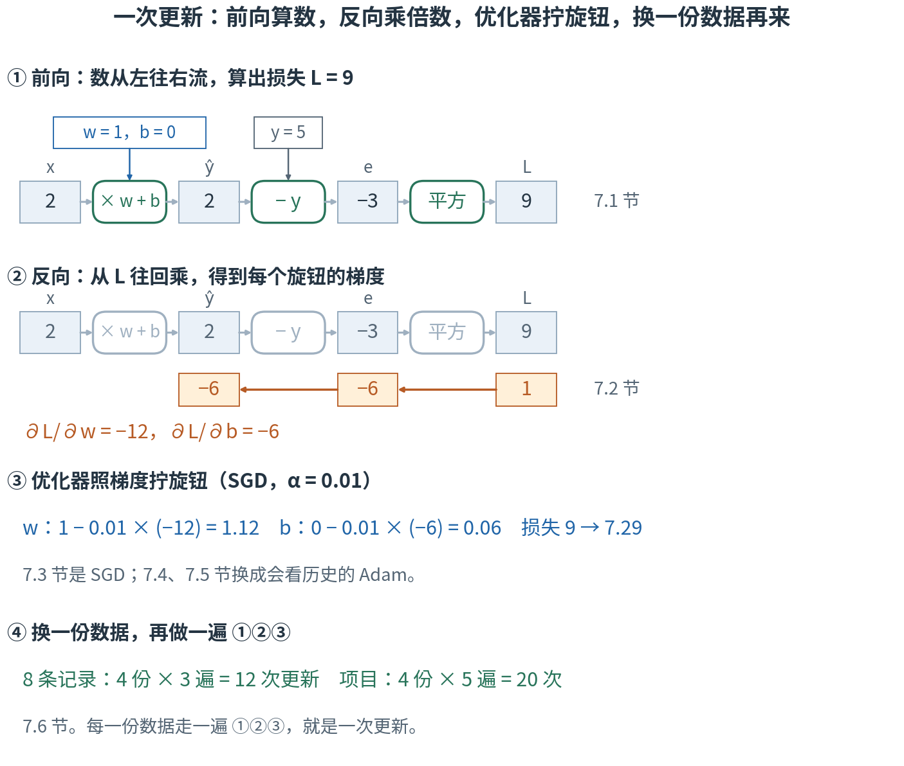
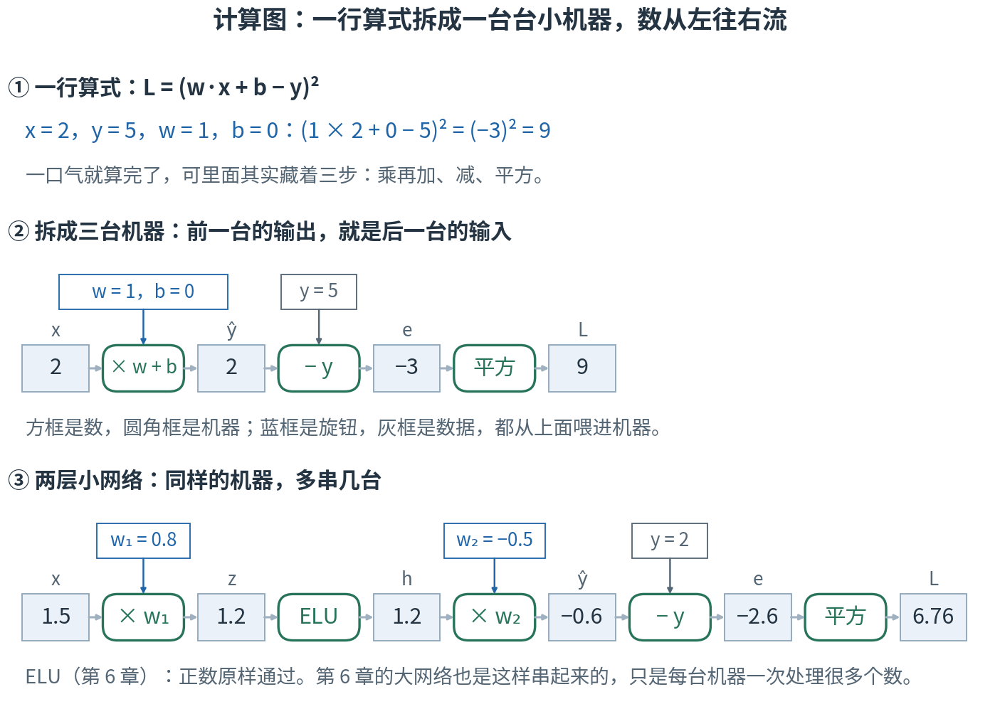
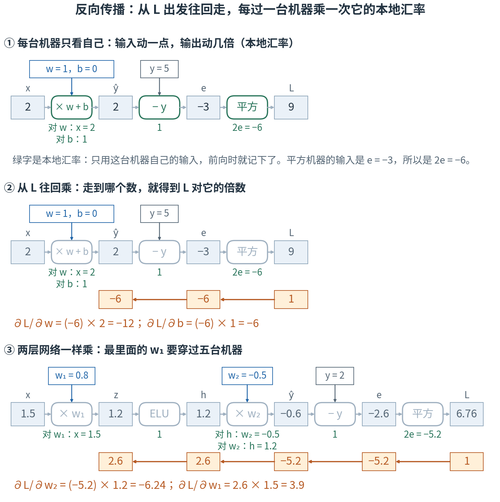
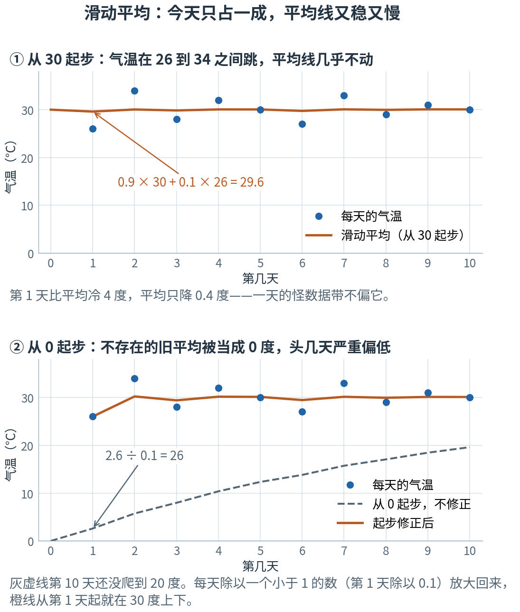
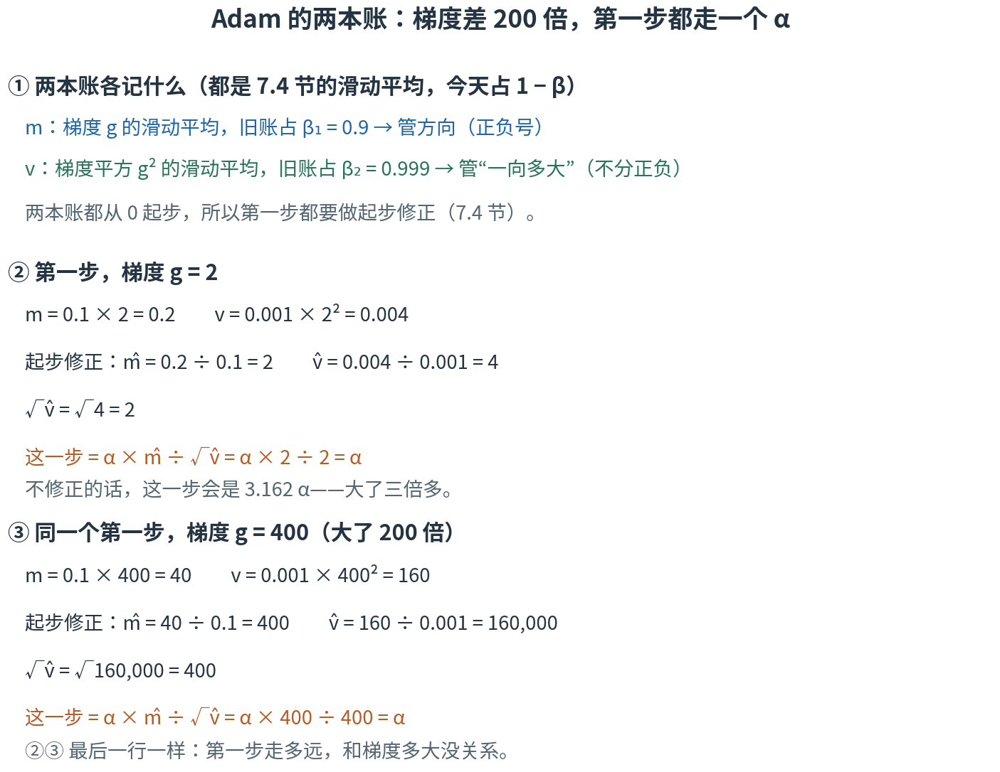
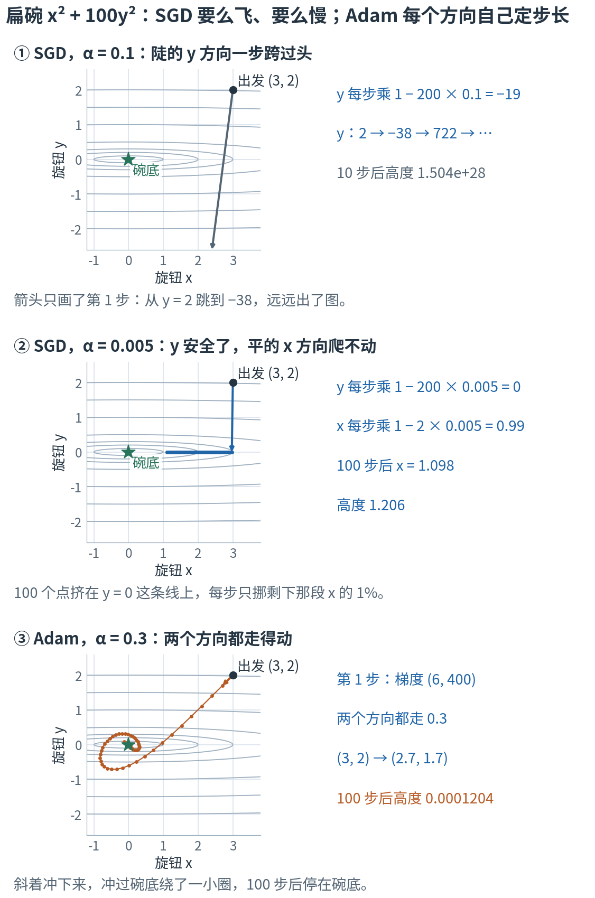
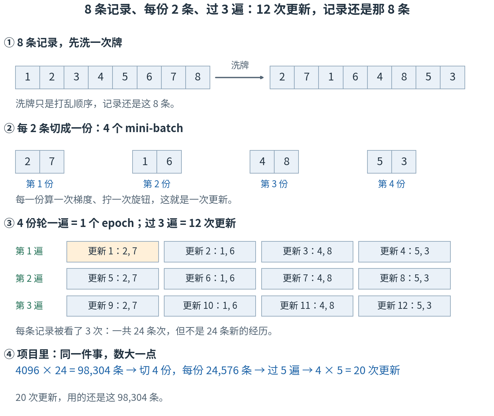
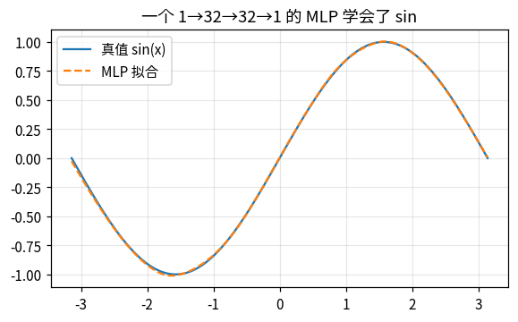

# 第 7 章 · 反向传播与优化器：梯度怎么算出来，旋钮怎么拧下去

> **上一章我们有了什么**：神经网络。它就是第 2 章的"价格表算总价"做 4 次，中间夹 3 次 ELU；项目的策略网络（actor）一共有 197,788 个可以训练的旋钮（第 6 章）。
>
> **这一章要补什么**：训练的每一步，都要知道损失对每一个旋钮的偏导数（只拧这一个旋钮、别的按住不动时，损失变多快，第 3 章 3.2 节），
> 所有旋钮的偏导数排成一张清单，就是梯度（3.3 节）。第 3 章手写了两个旋钮的梯度；第 5 章写一行 `loss.backward()` 就拿到了——这一行到底做了什么？
> 第 1 章 1.7 节已经给了答案的骨架：链式法则——两台机器串起来，总的倍数等于各自的倍数相乘（就像两段汇率相乘）。从最外层（离损失最近的那台机器）开始，一台一台把倍数往回乘。这一章把它从头到尾算给你看。
> 拿到梯度，还得真正去拧旋钮。第 3 章 3.6 节留下一个难题：陡的方向和缓的方向只能共用一个学习率 α（每一步 = α × 梯度，第 3 章 3.4 节）。这一章讲拧旋钮的那段程序，以及项目用的 Adam 怎样让每个旋钮有自己的步长。
> 最后讲"一次用多少数据"：项目每次攒下 98,304 条记录（4096 只机器人各走 24 步，4096 × 24 = 98,304），切成 4 份、过 5 遍，一共拧 4 × 5 = 20 次。
>
> **本章新词**：计算图、反向传播、优化器、SGD、滑动平均、Adam、mini-batch、epoch。
> **需要的前提**：第 1 章 1.7 节的链式法则（汇率相乘）；第 3 章的偏导数（3.2 节）、梯度下降（3.4 节）、误差与均方误差（3.5 节）、学习率的门槛（3.6 节）、梯度裁剪（3.7 节）；第 5 章（什么是学习）见过的 `loss.backward()`；第 6 章（神经网络）的 ELU。
> **不要求**会写 torch——代码只用来核对手算。标"进阶"和"第二遍读"的折叠块可以先跳过。

---

## 7.0 先看地图：数往前流，倍数往回传，再请一个会记账的人拧旋钮

**一行算式拆成一台台小机器，叫计算图；从损失出发、往回一台台乘倍数，叫反向传播，它把梯度一次算齐；拿着梯度真正去拧旋钮的程序，叫优化器。项目用的优化器 Adam 给每个旋钮记两本账，按各自的历史定步长；数据切成几小份，每份拧一次。**

想象一条做蛋糕的流水线：原料从左边进来，第一个工位按配方加料，第二个工位烤，第三个工位裱花，最后质检员打一个"有多差"的分。每个工位上都有旋钮（加多少糖、烤几分钟……）。分数不好，就要知道每个旋钮该往哪边拧、拧多少。

一个一个旋钮去试太慢了——项目里有 197,788 个。聪明的办法是**倒着传话**：质检员告诉裱花工位"你的成品每差一点，我的分就差这么多倍"；裱花工位乘上自己那一段的倍数，再告诉烤箱工位……一路传回第一个工位。每个工位只要知道自己那一段就够了。

话传完，还得有人真正去拧。莽撞的人照着传回来的数直接拧；有经验的老师傅会记住每个旋钮最近的反馈一向多大——一向很猛的，就轻点拧。另外，蛋糕不是全部做完才尝：每次抽几块尝一尝，就调一次旋钮；全部都尝过一遍算一轮，然后再从头尝。



**读图顺序：** 从 ① 到 ④ 竖着读，④ 做完再回到 ①。图里的数现在不用算，7.1–7.3 节和 7.6 节会一个一个手算出来；
现在只要看清次序：先往右算出损失，再往左传回倍数，然后拧旋钮，换一份数据再来。
图里的记号都是前面见过的：② 的 ∂L/∂w 读作"L 对 w 的偏导"（第 3 章 3.2 节），就是只拧 w 时 L 变多快；③ 的 α 是学习率；SGD 是 7.3 节要给的名字。

| 概念 | 它在回答什么问题 | 蛋糕流水线里对应什么 | 在哪一节 |
|---|---|---|---|
| 计算图 | 一个算式由哪些小步骤、按什么顺序连起来？ | 工位的排列 | 7.1 |
| 反向传播 | 损失对每个旋钮的偏导数，怎样一次算齐？ | 从质检员开始倒着传话 | 7.2 |
| 优化器 | 拿到梯度以后，谁去拧、按什么规则拧？ | 真正动手拧旋钮的人 | 7.3 |
| SGD | 最朴素的拧法是什么？ | 照着传回来的数直接拧 | 7.3、7.6 |
| 滑动平均 | 怎样记住"最近一向多大"，又不被一天的怪数据带偏？ | 老师傅的记性 | 7.4 |
| Adam | 怎样让每个旋钮有自己的步长？ | 老师傅：反馈一向猛的，轻点拧 | 7.5 |
| mini-batch | 一次用多少数据算梯度？ | 每次抽几块尝 | 7.6 |
| epoch | 全部数据都用过一遍，叫什么？ | 全部尝过一遍 | 7.6 |

表里的名字先不背，英文到了各节再给。本章最容易混的四处，先贴上标签：

- **反向传播（`backward()`）不是把前向（从输入一路算到损失的那一趟，7.1 节）倒着放一遍，也不拧旋钮**：它不从损失倒推出输入，也不求什么"反函数"，往回传的是倍数（7.2 节）；
  它只算出梯度、记在旋钮旁边，一个旋钮都不动，真正拧旋钮的是另一行 `step()`（7.3 节）。
- **x、y 中途换角色**：7.1、7.2 节和 7.6 节以后，x 是输入、y 是真值，都是数据；7.3–7.5 节的扁碗上，x、y 是两个旋钮（第 3 章 3.6 节的意思）。换的地方有 ⚠️ 提醒。
- **学习率 α 和 Adam 的 β₁、β₂**（读"贝塔一""贝塔二"，右下角的小数字只是编号）：α 仍是第 3 章那个乘在更新量前面的倍数，决定步子多大；β₁、β₂ 管的是两本账"记性多长"（7.4、7.5 节）。
- **一次更新、mini-batch、epoch、迭代**：从小到大。一次更新 = 用一个 mini-batch（一小份数据）拧一次旋钮；所有 mini-batch 轮一遍是一个 epoch；
  项目的一次迭代 = 采一批新记录 + 过 5 个 epoch，每个 epoch 切 4 个 mini-batch，一共 20 次更新（7.6 节）。第 3 章 3.5 节表头的"迭代"只是"第几轮"，一轮拧一次，比这里小得多。

现在觉得这些区别有点抽象很正常，读到对应小节就清楚了。

第一次读，只要按顺序看正文、图片和手算。标着"进阶"的折叠内容可以先跳过；代码是复核工具，不是阅读门槛。

## 7.1 计算图：把一行算式拆成一台台小机器

先拿第 3 章 3.5 节找直线的那一套，只留**一条**数据：输入 x = 2，真值 y = 5。直线 ŷ = w·x + b 的两个旋钮，此刻是 w = 1、b = 0。
先认两个记号。w·x 就是 w × x：中间那个小圆点 · 是乘号，和 JS 的 `*` 一样；数学里还常常连它也省掉，直接写成 wx。
ŷ 读作"y 帽"，是直线猜出来的预测值（第 3 章 3.5 节：戴帽子 = 猜的；不戴帽子的 y 是真值）。

损失用第 3 章 3.5 节的均方误差：每条数据的误差（预测 − 真值）先平方，再取平均。只有一条数据，平均就是它自己，所以损失就是误差的平方：

$$L = (w x + b - y)^2 = (1 × 2 + 0 - 5)^2 = (-3)^2 = 9$$

（w x 中间也省了乘号；$(-3)^2 = (-3) × (-3) = 9$，负负得正。）

一行就算完了。可计算机和你手算一样，是分三步走的，每一步的输出就是下一步的输入：

1. **乘再加**：ŷ = w·x + b = 1 × 2 + 0 = 2。这是预测值。
2. **减**：e = ŷ − y = 2 − 5 = −3。这是误差。
3. **平方**：L = e² = (−3)² = 9。

把每一步画成一台机器（第 1 章 1.1 节：函数就是一台机器），前一台的输出接到后一台的输入上：



**这样读图：** ① 是一口气算的写法。② 把它拆开：方框里是数，圆角框是机器，灰色小箭头是"数往哪流"。
蓝框里的 w、b 是旋钮，灰框里的 y 是数据，都从上面喂进机器。从左往右读：2 进去，出来 2，再出来 −3，最后是 9。③ 是一条更长的，下面马上算。

把一个算式拆成一台台小机器、再用箭头连起来，这样的图叫**计算图**（computational graph）。数从左往右流一遍、算出损失的这一趟，叫**前向**。
torch（项目训练网络用的 Python 库，第 5 章 5.4 节）在你每写一步运算时，都悄悄把这张图记下来：有哪几台机器，每台吃进了什么数、吐出了什么数。
第 5 章 5.4 节说的"torch 记的那本账"，记的就是这张图。下一节往回算的时候，要用的正是这些记下来的数。
这条三台机器的流水线，下面叫它"例一"。

再看一条长一点的，图 ③，下面叫它"例二"：一个迷你的两层网络。第一层把输入乘 w₁、再过一道 ELU 门；第二层再乘 w₂。
它就是第 6 章的网络缩到最小：每层只有一家店、一个旋钮，也不加运费。w₁、w₂ 右下角的小数字只是编号（第一层的、第二层的）。
输入 x = 1.5，真值 y = 2，两个旋钮 w₁ = 0.8、w₂ = −0.5：

1. z = w₁·x = 0.8 × 1.5 = 1.2
2. h = ELU(z) = 1.2（第 6 章 6.1 节的 ELU 门：正数原样通过；负数换成 $e^z - 1$，7.2 节会用到这一半）
3. ŷ = w₂·h = −0.5 × 1.2 = −0.6
4. e = ŷ − y = −0.6 − 2 = −2.6
5. L = e² = (−2.6)² = 6.76

第 6 章的网络就是这样串起来的，只是每台机器一次处理一整张清单（几十到几百个数），串得也更长。实验第 1 节把这两条流水线各算了一遍。

拆开有什么好处？下一节就用上了：每台机器只管自己那一小段"输入动一点、输出动几倍"，把这一串倍数乘起来，就是损失对某个旋钮的偏导数。

> **停一下，自测**：还是 x = 2、y = 5、w = 1，把 b 拧到 1。三台机器依次吐出什么？
> <details><summary>答案</summary>
>
> ŷ = 1 × 2 + 1 = 3，e = 3 − 5 = −2，L = (−2)² = 4。
>
> </details>

## 7.2 反向传播：从损失出发，往回乘本地汇率

现在问：**w 拧一点，L 动几倍？** 也就是 b 按住不动、只拧 w 时，"L 变了多少 ÷ w 变了多少"——这就是 L 对 w 的偏导数（第 3 章 3.2 节）。

第 1 章和第 3 章量它的办法是缩步：把 w 拧一点点，整条算式从头重算一遍，看 L 变了多少。一个旋钮这样量还行；
项目有 197,788 个旋钮，挨个量就要把整张网络从头算 197,788 遍——而且每拧一次旋钮之前都要这么来一轮，太慢了。
这一节换个办法：只沿着流水线往回走**一趟**，所有旋钮的偏导数一起出来。靠的是第 1 章 1.7 节的汇率法。

把那里的数原样摆一遍：1 元换 0.14 美元，1 美元换 0.9 欧元，那么 1 元换 0.14 × 0.9 = **0.126** 欧元。
为什么是相乘？拿 100 元走一遍：100 元换成 100 × 0.14 = 14 美元，14 美元再换成 14 × 0.9 = 12.6 欧元；12.6 ÷ 100 = 0.126，正好是两个汇率的乘积。
中间那道"美元"不用管，两段各自的倍数乘起来，就是全程的倍数。这里要串的是三段——w 变成 ŷ，ŷ 变成 e，e 变成 L。先问每台机器自己的那一段。

**每台机器只看自己**：它的输入动一点，它的输出动几倍？这个倍数叫这台机器的**本地汇率**——"本地"是说只看这一台，别的机器一概不管。
它其实就是这台机器自己的导数：第 1 章 1.4 节缩 h 量的正是"输出变了多少 ÷ 输入变了多少"，1.5 节还说过导数可以当汇率用——输出的变化 ≈ 导数 × 输入的变化（≈ 读"约等于"）。
和真钱的汇率有两处不一样，先说在前头：这里的倍数可以大于 1（输入动 1，输出动 2），也可以是负的（输入变大，输出反而变小）。负号照样跟着一路乘下去。

三台机器，每台都先拧 0.01 量一量，再看规则：

- **平方机器 L = e²**。e 从 −3 拧到 −2.99（多了 0.01），L 从 9 变成 $(-2.99)^2 = 8.9401$，少了 0.0599——差不多是 0.01 的 6 倍，而且是变小。
  精确值由第 1 章 1.6 节的规则给出：$x^2$ 的导数是 $2x$，换成这里的字母就是 2e。此刻 e = −3，本地汇率 2 × (−3) = **−6**。负号说的就是"e 变大，L 反而变小"。
- **减法机器 e = ŷ − y**。ŷ 从 2 拧到 2.01，e 从 −3 变成 −2.99，也多了 0.01：ŷ 动多少，e 就动多少，本地汇率 **1**（y 是数据，不动）。
- **乘加机器 ŷ = w·x + b**，它有两个旋钮，分开问。w 从 1 拧到 1.01：ŷ = 1.01 × 2 + 0 = 2.02，多了 0.02，是 0.01 的 2 倍。
  道理是 w 每多 1，w × 2 就多 2，所以对 w 的本地汇率就是 x = **2**。b 从 0 拧到 0.01：ŷ = 1 × 2 + 0.01 = 2.01，多了 0.01，对 b 的本地汇率是 **1**。

平方机器量出来是 0.0599，规则说 0.06，差的那 0.0001 从哪来？下面的折叠块用一个正方形说清楚。主线只要记住：拧得越少，量出来的越接近规则给的数。

<details>
<summary>补课：为什么平方的本地汇率是"2 × 自己"</summary>

第 5 章 5.1 节画过这张图（边长 3 的正方形多出两条长条和一个小角），这里用文字再走一遍。把 e² 想成边长为 e 的正方形的面积。先用正数 e = 3：边长加一点点 Δ = 0.01（Δ 读"德尔塔"，第 1 章 1.3 节的"变化量"），面积多出三块（示意图，长条画宽了）：

```text
          3        0.01
      +---------+------+
    3 |    9    | 0.03 |
      +---------+------+
 0.01 |  0.03   |0.0001|
      +---------+------+
```

右边、下边各一条长条，面积都是 3 × 0.01 = 0.03；右下角一个小方块 0.01 × 0.01 = 0.0001。所以 $3.01^2 = 9 + 0.03 + 0.03 + 0.0001 = 9.0601$。
写成字母：$(e + Δ)^2 = e^2 + 2eΔ + Δ^2$。这和第 4 章 4.4 节展开 $(x - 3.5)^2$ 的四格表是同一回事：正方形的四块就是 e × e、e × Δ、Δ × e、Δ × Δ 四个乘积，中间两块一样大，合成 2eΔ。
多出来的约等于 2eΔ，"约等于"扔掉的就是小角 Δ²：Δ 缩小 10 倍，小角缩小 100 倍。
e 是负数时式子照样成立：$(-3 + 0.01)^2 = 9 - 0.06 + 0.0001 = 8.9401$，中间那项 2eΔ = 2 × (−3) × 0.01 = −0.06 自动带着负号。
这就是第 1 章 1.6 节 $(x^2)' = 2x$ 的来历：误差变一点点，平方大约变 2e 倍。

</details>

每一个本地汇率都只用到这台机器自己的输入（e = −3、x = 2），前向时就记下了，不用把整条流水线重算一遍。

**为什么把它们乘起来就对了？** 拿数"传话"走一遍：w 多拧 0.01，乘加机器把它放大 2 倍，ŷ 多 0.02；减法机器原样往下传，e 也多 0.02；
平方机器再乘 −6，L 大约少 0.12。一路的倍数是 2 × 1 × (−6) = −12，所以 w 动 0.01，L 动 0.01 × (−12) = −0.12。
实际重算一遍：L = 8.8804，少了 0.1196，和 0.12 只差 0.0004——正是平方机器那个小角：e 这回变了 0.02，小角是 0.02 × 0.02 = 0.0004。
所以 L 对 w 的偏导数，就是一路上本地汇率的乘积。乘法不分先后，从 w 往前乘、从 L 往回乘，结果一样；
从 L 往回乘的好处是：走到 ŷ 时得到的那个数，w 和 b 两路都能接着用（两层网络里省得更多，见下文；第 5 章 5.4 节在两张收据上手算过一次同样的"倒着走"）。下面就**从 L 出发往回乘**：

- L 对自己：1。L 动多少，L 自己当然就动多少；就像汇率链从"1 元"起算，往回乘也从 1 起。
- 过平方机器：1 × (−6) = −6。这是 L 对 e 的倍数。
- 过减法机器：−6 × 1 = −6。这是 L 对 ŷ 的倍数。
- 过乘加机器，走到两个旋钮：对 w，−6 × 2 = **−12**；对 b，−6 × 1 = **−6**。



**这样读图：** ① 绿字是每台机器的本地汇率，写在机器正下方。② 橙色格子是往回乘的结果：从最右边的 1 起，每往左过一台机器，就乘上它的绿字，写到左边那个数的正下方；
走到第一台机器，分两路乘出两个旋钮的梯度 −12 和 −6。图里的 ∂L/∂w 就是第 3 章 3.2 节的偏导数，读作"L 对 w 的偏导"。③ 是两层网络，这一节后半段讲。

不信就缩步量一遍（第 1 章 1.4 节的老办法）：w 从 1 拧到 1.01，ŷ = 2.02，e = −2.98，L = 8.8804，变化率 (8.8804 − 9) ÷ 0.01 = −11.96；
只拧 0.001，变化率 −11.996，越来越靠近 −12 ✓。b 从 0 拧到 0.01，L = 8.9401，变化率 −5.99，靠近 −6 ✓。
差的那一点还是平方机器的小角：拧 0.01 时 e 变了 0.02，小角 0.0004，除以拧的 0.01 是 0.04，所以量到 −12 + 0.04 = −11.96；
拧 0.001 时 e 只变 0.002，小角 0.002 × 0.002 = 0.000004，除以 0.001 是 0.004，量到 −11.996。拧得越少，小角越不起眼。

这两个数你见过：第 3 章 3.5 节表里"2·e·x"和"2·e"那两列（· 是乘号，2·e·x 就是 2 × e × x），在这一条数据上正是 2 × (−3) × 2 = −12 和 2 × (−3) = −6。
当时那两列是直接写出来的公式，现在你看到了它们的来历：2·e·x 拆开是 (2e) × 1 × x——平方机器的 2e、减法机器的 1、乘加机器对 w 的 x，三个本地汇率连乘；
2·e 就是 (2e) × 1 × 1，最后那个 1 是乘加机器对 b 的本地汇率。

从损失出发、沿着计算图往回走、每过一台机器乘一次它的本地汇率——这个算法叫**反向传播**（backpropagation）。
写成式子，就是第 1 章 1.7 节的链式法则：那里是两段倍数相乘，这里有三段，就一段接一段乘下去：

$$\frac{\partial L}{\partial w} = \frac{\partial L}{\partial e}\cdot\frac{\partial e}{\partial \hat y}\cdot\frac{\partial \hat y}{\partial w} = (-6) × 1 × 2 = -12$$

| 符号 | 怎么读 | 就是 |
|---|---|---|
| $\dfrac{\partial L}{\partial e}$ | "L 对 e 的偏导" | 平方机器的本地汇率 2e，此刻 −6 |
| $\dfrac{\partial e}{\partial \hat y}$ | "e 对 y 帽的偏导" | 减法机器的本地汇率，1 |
| $\dfrac{\partial \hat y}{\partial w}$ | "y 帽对 w 的偏导" | 乘加机器对 w 的本地汇率，就是 x，此刻 2 |
| $\cdot$ | "乘" | 一路上的本地汇率连乘 |

右边这串像三个分数相乘：前一个的分母和后一个的分子是同一个东西（∂e 对 ∂e、∂ŷ 对 ∂ŷ），看上去可以上下约掉，只剩 ∂L/∂w。
第 1 章 1.7 节说过，这种写法可以照着"两个数相除"的直觉去记；它说的就是汇率一段接一段相乘。

torch 里负责这件事的部分叫 `autograd`——就是第 5 章 5.4 节说的自动求导。`loss.backward()` 做的全部事情就是：沿着前向时记下的计算图往回走一遍，
把每个旋钮的梯度写进它的 `.grad`（旋钮旁边专门存梯度的那个格子，grad 是 gradient 的缩写，第 5 章 5.4 节）。
实验第 2 节里 autograd 给出的也是 −12 和 −6。

### 两层网络：链长了，做法一样

回到例二，图 ③ 的两层网络（x = 1.5、y = 2、w₁ = 0.8、w₂ = −0.5，前向算得 e = −2.6）。每台机器的本地汇率：

- 平方：2e = 2 × (−2.6) = −5.2；减法：1。
- 乘 w₂（ŷ = w₂·h）：对 h 是 w₂ = −0.5；对旋钮 w₂ 是 h = 1.2。乘法机器有两个输入，问谁，本地汇率就是**另一个**：问 h 得 w₂，问 w₂ 得 h。
  拧一下看看：h 从 1.2 拧到 1.21，ŷ = −0.5 × 1.21 = −0.605，变了 −0.005，是 0.01 的 −0.5 倍；w₂ 从 −0.5 拧到 −0.49，ŷ = −0.49 × 1.2 = −0.588，变了 +0.012，是 0.01 的 1.2 倍。
  道理是：问 h 时 w₂ 按住不动，ŷ 就是"h 乘一个固定的数 −0.5"，第 1 章 1.6 节的"常数倍照搬"给出 −0.5；
  问 w₂ 时反过来，h 按住不动，ŷ 是"w₂ 乘一个固定的数 1.2"，给出 1.2。例一"对 w 的本地汇率是 x"是同一条规则。
- ELU：z = 1.2 是正数，原样通过，z 动多少 h 就动多少，本地汇率 1。
  z 是负数时，h 是 $e^z - 1$（这里的 e 是第 1 章 1.8 节那个约等于 2.718 的数，不是误差 e）。$e^z$ 的导数就是它自己（1.8 节），减 1 是减一个常数，导数是 0（1.6 节），
  所以负数处的本地汇率是 $e^z$，代码里写 exp(z)。它比 1 小：z = −1.2 时是 0.3012，浏览器控制台里敲 `Math.exp(-1.2)` 可以核对。
- 乘 w₁（z = w₁·x）：对旋钮 w₁ 是 x = 1.5。

从 L 往回乘：1 → −5.2（到 e）→ −5.2（到 ŷ）。在 ŷ 这里分岔：

- 往旋钮 w₂：−5.2 × 1.2 = **−6.24**。
- 往 h：−5.2 × (−0.5) = 2.6；过 ELU：2.6 × 1 = 2.6；到旋钮 w₁：2.6 × 1.5 = **3.9**。

实验第 2 节把手算和 autograd 并排打印：

```
        手算链式法则  autograd
------  ------------  --------
∂L/∂w2         -6.24     -6.24
∂L/∂w1           3.9       3.9
```

一模一样。最里面的 w₁ 离 L 最远，它的梯度是一路上**五个**本地汇率的连乘（其中两个是 1）：

$$\frac{\partial L}{\partial w_1} = \frac{\partial L}{\partial e}\cdot\frac{\partial e}{\partial \hat y}\cdot\frac{\partial \hat y}{\partial h}\cdot\frac{\partial h}{\partial z}\cdot\frac{\partial z}{\partial w_1} = (-5.2) × 1 × (-0.5) × 1 × 1.5 = 3.9$$

也可以缩步核对：w₁ 从 0.8 拧到 0.81，z = h = 1.215，ŷ = −0.6075，e = −2.6075，L = 6.79906，变化率 (6.79906 − 6.76) ÷ 0.01 = 3.906；只拧 0.001，变化率 3.9006，靠近 3.9 ✓。
3.9 是正的：w₁ 拧大，L 也跟着变大。想让 L 变小，w₁ 就该往小拧——第 1 章 1.5 节那张正负号的表。w₂ 的 −6.24 是负的，它该往大拧。

197,788 个旋钮也是这样算的：图大一点、岔路多一点，每个旋钮的梯度都是"从 L 走到它、一路上的本地汇率连乘"（遇到岔路怎么合，本节最后讲）。

还有一处省力的地方：往回乘到 ŷ 时已经得到 −5.2，w₂ 和 w₁ 两路都从这个数接着乘，不用各自从 L 重新走一遍。
要是各走各的，w₂ 要过 3 台机器，w₁ 要过 5 台，平方和减法这两台就被走了两遍；旋钮越多，重复走的路越长。
反向传播让共用的那一段只算一次，整张图往回走**一趟**，所有旋钮的梯度就都有了。这一趟的工作量和前向算一遍差不多大；
缩步却要为每个旋钮把整张网络重算一遍——这正是反向传播快的原因。

> ⚠️ **反向传播不是把前向倒着放一遍。** 它没有从 L = 9 倒推出 e、再倒推出 x，也没有求什么"反函数"。往回传的是**倍数**：L 对每一个中间数有多敏感。
> 它要用前向时记下的数（例一的 e = −3，例二的 h = 1.2、w₂ = −0.5），这正是 torch 要在前向时把图记下来的原因。
> 叫"反向"，只是因为方向相反：前向从输入算到损失，反向从损失算回每个旋钮。

### 同一个旋钮走两条路：两份相加

同一个 w 在图里出现两次会怎样？比如 ŷ = w·x₁ + w·x₂，x₁ = 2、x₂ = 3（两个输入用下标 1、2 编号），此刻 w = 1，ŷ = 2 + 3 = 5。
把 w 从 1 拧到 1.01，两条路各自带动一块：

- 第一块 w·x₁：从 1 × 2 = 2 变成 1.01 × 2 = 2.02，多了 0.02（这条路的倍数是 x₁ = 2）；
- 第二块 w·x₂：从 1 × 3 = 3 变成 1.01 × 3 = 3.03，多了 0.03（这条路的倍数是 x₂ = 3）；
- ŷ 是两块相加，从 5 变成 2.02 + 3.03 = 5.05，多了 0.02 + 0.03 = 0.05，变化率 0.05 ÷ 0.01 = 5 ✓。

所以 ∂ŷ/∂w = 2 + 3 = 5：两条路各算各的倍数，再**加**起来。这就是第 1 章 1.6 节的规则四"加法可以分开求导：两份变化各算各的，再加起来"。
记法是：**一台接一台串着走，倍数相乘；分成几条路、最后在加号处汇合，几份相加。** 一个旋钮的梯度 = 从 L 到它的每一条路各自连乘，再把各条路的结果加起来。

这种汇合在网络里到处都是。第 6 章的网络里，一个神经元报出的数 h 会送进下一层的每一家店；往回传时，h 从好几条路各收到一份倍数，加起来才是 L 对 h 的倍数。
一批数据也是这样：每一条都经过同一套旋钮，所以每一条都给同一个旋钮贡献一份梯度。损失是各条损失的平均（加起来再除以条数），
梯度也就是各条的梯度加起来、再除以条数（除以条数就是乘一个固定的数，第 1 章 1.6 节的"常数倍照搬"）。7.6 节会用到这一点。

> **停一下，自测**：还是例一（x = 2、y = 5、w = 1），但 b = 1，前向得 e = −2（7.1 节自测）。∂L/∂w 和 ∂L/∂b 各是多少？
> <details><summary>答案</summary>
>
> 平方机器的本地汇率 2e = −4；减法 1；乘加对 w 是 x = 2，对 b 是 1。∂L/∂w = (−4) × 1 × 2 = −8，∂L/∂b = (−4) × 1 × 1 = −4。
>
> </details>

## 7.3 优化器：`backward()` 只算梯度，`step()` 才拧旋钮

梯度有了：∂L/∂w = −12，∂L/∂b = −6。接下来就是第 3 章 3.4 节的那一步：每个旋钮减去"学习率 × 它的偏导数"。取 α = 0.01：

- w：1 − 0.01 × (−12) = 1.12。拆开看：先算要减掉的量 0.01 × (−12) = −0.12；减去 −0.12 就是加上 0.12，1 + 0.12 = 1.12。
- b：0 − 0.01 × (−6) = 0.06。同样：0.01 × (−6) = −0.06，0 + 0.06 = 0.06。

两个梯度都是负的，减去一个负数就是加，所以两个旋钮都往**大**里拧。这正是第 3 章 3.4 节"朝下坡方向走"的意思：L 对 w 的倍数是负的，说明 w 变大时 L 会下降，那就把 w 拧大。

拧完再前向一遍核对：ŷ = 1.12 × 2 + 0.06 = 2.30，e = 2.30 − 5 = −2.70，L = (−2.70)² = 7.29。从 9 降到了 7.29 ✓。

在 torch 里，这一步交给一段专门的程序：它拿到每个旋钮的梯度，按某种规则真正去改旋钮的值。这段程序叫**优化器**（optimizer）——第 3 章 3.7 节说的"拿到梯度后真正去拧旋钮的那段程序"，就是它。
为什么要单独做成一段程序？因为"拿到梯度以后怎么拧"不止一种规则：上面这种最朴素，7.5 节还有更聪明的。拧法单独放一处，换一种拧法只要换一个优化器，前向、反向那几行都不用动。
上面这种最朴素的规则——θ ← θ − α∇L 原样照做（第 3 章 3.4 节：θ 是全部旋钮排成的清单，∇L 是梯度，← 读"更新为"，就是 JS 里的赋值 `=`）——
在 torch 里叫 **SGD**（stochastic gradient descent，随机梯度下降），就是第 3 章的梯度下降；名字里"随机"两个字的来历，7.6 节讲。

写成代码，一次更新是这样：

```python
opt = torch.optim.SGD([w, b], lr=0.01)   # 造一个优化器：它管着 w、b 两个旋钮，学习率 0.01（代码里学习率叫 lr）
opt.zero_grad()                          # ① 清空旋钮旁边存着的旧梯度
loss = (w * x + b - y) ** 2              # 前向：沿计算图算出 L = 9（7.1 节）
loss.backward()                          # ② 反向传播：梯度写进 w.grad、b.grad（7.2 节）
opt.step()                               # ③ 读 .grad，真正改旋钮：w ← w − 0.01 × w.grad
```

三个动作各管一件事。实验第 3 节在 `backward()` 和 `step()` 之后各看了一眼：`backward()` 之后，w 还是 1，只是 w.grad 里多了 −12；`step()` 之后，w 才变成 1.12、b 变成 0.06。
反过来，只调 `step()` 不调 `backward()`，它读到的是旧的（或空的）梯度，不会凭空学到新东西。

> ⚠️ **`backward()` 会累加，不会覆盖。** 连着做两次"前向 + `backward()`"、中间不 `zero_grad()`，w.grad 会变成 −12 + (−12) = −24，b.grad 变成 −6 + (−6) = −12——同一份梯度被加了两遍（实验第 3 节核对过）。
> 所以每次更新前都要先清零。有人故意利用这一点：攒几份数据的梯度再拧一次，假装一次用了更多数据；那时要自己留意梯度被放大了几倍（要不要除以份数）。
> （每一次都要先前向：往回走完一趟，torch 就把前向记下的数扔了，对同一个 loss 再 `backward()` 一次会报错。）

> **停一下，自测**：同学说："我调了 `loss.backward()`，打印 w 发现一点没变，是不是求导失败了？"你怎么回答？再算一下：α 换成 0.05，SGD 一步后 w、b、L 各是多少？
> <details><summary>答案</summary>
>
> 不一定失败。先看 `w.grad`，这里应该是 −12。改 w 是 `step()` 的事，`backward()` 只算梯度。
> α = 0.05：w = 1 − 0.05 × (−12) = 1.6，b = 0 − 0.05 × (−6) = 0.3；ŷ = 1.6 × 2 + 0.3 = 3.5，e = −1.5，L = 2.25。
>
> </details>

### SGD 的老毛病：一个 α 顾不了陡缓两头

第 3 章 3.6 节已经见过这件事：碗 x² + 3y² 上，y 方向陡 3 倍，门槛（α 最大能取多少而不发散）就小 3 倍——x 方向每步乘 1 − 2α，y 方向每步乘 1 − 6α，
意思是每走一步，离碗底的距离都乘上这个数。可两个方向只能共用一个 α。这里把"陡几倍"加大到 100，看它有多麻烦；"每步乘几"也在新碗上从头推一遍。

> ⚠️ 从这里到 7.5 节，x、y 回到第 3 章 3.6 节的意思：**碗上的两个旋钮**，不是 7.1 节的输入 x 和真值 y。7.6 节起，x、y 又回到数据的意思。

碗 f = x² + 100y²，从 (3, 2) 出发，碗底在 (0, 0)。这种一个方向很陡、另一个方向很缓的碗，下面叫它**扁碗**。
"陡 100 倍"是这个意思：同样离碗底 1 格，往 x 方向高度是 1² = 1，往 y 方向是 100 × 1² = 100。
两个偏导数（第 3 章 3.2 节：按住一个、只拧另一个）是 ∂f/∂x = 2x 和 ∂f/∂y = 200y——100y² 是 100 × y²，y² 的导数 2y 再乘 100（第 1 章 1.6 节：幂规则加常数倍照搬）。
同样离碗底 1 格，坡度是 2 对 200，也差 100 倍。

### 每步乘几：拿 y = 2 走一遍

照 3.6 节的规则，x 方向每步乘 1 − 2α，y 方向每步乘 1 − 200α。这两个数怎么来的？先拿数字走一遍 y 方向，取 α = 0.1：

1. 此刻 y = 2，离碗底（y = 0）的距离就是 2。
2. y 方向的坡度：200y = 200 × 2 = 400。
3. 这一步 y 变多少：−α × 坡度 = −0.1 × 400 = −40。
4. 新的 y：2 − 40 = −38。一步就从碗底这边的 2，跳到了那边的 −38（距离带着正负号：负号表示在碗底的另一边）。

注意第 2 步：坡度 400 恰好是距离 2 的 200 倍——坡度 200y 本来就是"200 × 距离"。所以第 3 步可以写成：
变化 = −α × 200 × 距离 = −200α × 距离。α = 0.1 时 200α = 20，变化 = −20 × 2 = −40 ✓。

于是"新距离 = 旧距离 − 200α × 旧距离"（碗底在 y = 0，距离就是 y 自己）。右边两项都含"旧距离"，把它提到外面（第 6 章 6.5 节数旋钮时用过的提公因数：几项都乘着同一个数，就把它提出来只写一次），就像打折：
原价 100、打掉两成，就是 100 − 0.2 × 100 = 100 × (1 − 0.2) = 80。同样：

$$y_{\text{新}} = y - 200\alpha\,y = (1 - 200\alpha)\,y$$

（$y_{\text{新}}$ 右下角的"新"只是标签：走完这一步的 y。）α = 0.1 时 2 × (1 − 20) = 2 × (−19) = −38，和上面一步一步走出来的一样 ✓。
下一步还是乘 −19：−38 × (−19) = 722。每一步都乘同一个数，这就是"每步乘 1 − 200α"。

x 方向一模一样，只是坡度 2x 是距离的 2 倍，所以每步乘 1 − 2α。拿 α = 0.005 核对：x = 3，坡度 2 × 3 = 6，这一步变 −0.005 × 6 = −0.03，
新的 x = 3 − 0.03 = 2.97；而 3 × (1 − 2 × 0.005) = 3 × 0.99 = 2.97 ✓。

这个乘数决定一切：

| 每步乘的数 | 例子 | 会怎样 |
|---|---|---|
| 在 0 和 1 之间 | 0.99（x 方向，α = 0.005） | 一直在碗底同一边，每步近一点 |
| 正好是 0 | 0（y 方向，α = 0.005） | 一步到底 |
| 在 −1 和 0 之间 | −0.5（y 方向，α = 0.0075） | 每步跳到碗底另一边，但越跳越近 |
| 正好是 −1 | −1（y 方向，α = 0.01） | 两边原地对跳，不远也不近 |
| 比 −1 还小 | −19（y 方向，α = 0.1） | 每步跳到另一边，越跳越远：发散 |

正负号只说明在碗底哪一边；去掉正负号以后的大小，才决定靠近还是远离：小于 1，越乘越小；大于 1，越乘越大。
所以 y 不发散，要 1 − 200α 比 −1 大（"比 1 小"这一头不用操心：α 是正数，1 减去一个正数总比 1 小）：

$$1 - 200\alpha > -1$$

两边都加 1：2 − 200α > 0；两边再都加 200α：2 > 200α；两边都除以 200：α < 0.01。这就是 y 方向的门槛。
核对一下：α = 0.01 时乘数是 1 − 2 = −1，原地对跳；再大一点，α = 0.015 时乘数是 1 − 3 = −2，每步离碗底远一倍，发散。

### 两个 α 试一试：要么飞，要么慢

- α = 0.1：上面算过，y 每步乘 1 − 200 × 0.1 = −19。大小超过 1，发散：y 从 2 跳到 −38，再跳到 722……
- 要 y 不发散，α 得小于 0.01。取 α = 0.005：y 每步乘 1 − 200 × 0.005 = 0，一步就到底；
  可 x 每步乘 1 − 2 × 0.005 = 0.99，每步只挪剩下距离的 1%。100 步后 x = 3 × 0.99¹⁰⁰ = 3 × 0.366 = 1.098（0.99 连乘 100 次，第 1 章 1.8 节的"每走一步，乘同一个数"；控制台敲 `0.99**100` 得 0.366）。
  这时 y 已经是 0，100y² 也是 0，碗的高度只剩 x²：1.098² = 1.206，离碗底（高度 0）还远。

这就是 3.6 节那句"最陡的方向说了算"：α 只能迁就最陡的 y，缓的 x 就只能慢慢爬。真实的损失地形，不同旋钮的陡峭程度能差上千倍。
我们想要的是**每个旋钮有自己的步长**：陡的轻点拧，缓的放心拧。要做到这一点，先得记住"这个旋钮的梯度一向有多大"——下一节先学怎么记。

## 7.4 滑动平均：今天只占一成，旧的平均占九成

怎样记住"最近一向多大"？先离开旋钮，想一件生活里的事：**你想知道这几天大概多热。**

最笨的办法是把每天的气温都记下来，要用时再求平均。气温可以这样记，旋钮的梯度却不行，原因有两个。
一是太占地方：项目要给 197,788 个旋钮各记一份，训练又要拧上万次旋钮，每次的梯度都存下来，就是 197,788 × 上万个数。
二是旧账不作数：旋钮一直在挪，很久以前的梯度是在别的位置量的，早就不代表现在。我们要的是"最近"大概多大，不是"开训以来"的平均。

更省事的办法是只记**一个**数，就叫它"平均"，每天用今天的气温把它挪一点：

**新平均 = 0.9 × 旧平均 + 0.1 × 今天的气温**

旧的平均占九成，今天只占一成。九成加一成正好是十成（0.9 + 0.1 = 1），所以今天的气温要是正好等于旧平均，平均就不动：0.9 × 30 + 0.1 × 30 = 27 + 3 = 30。
今天比平均冷，平均就往下挪一点；比平均热，就往上挪一点。手算两天（这组气温是为了好算而构造的：10 天加起来 300 度，平均正好 30 度）：

- 原来的平均是 30 度，第 1 天 26 度：0.9 × 30 + 0.1 × 26 = 27 + 2.6 = **29.6**。今天比平均冷了 4 度，平均只降了 0.4 度。
- 第 2 天 34 度：0.9 × 29.6 + 0.1 × 34 = 26.64 + 3.4 = **30.04**。

同一个式子也能读成"每天只把差距补上一成"：29.6 + 0.1 × (34 − 29.6) = 29.6 + 0.44 = 30.04，结果一样。为什么一样？一步一步看：

1. 九成就是"全部减掉一成"：0.9 × 29.6 = 29.6 − 0.1 × 29.6 = 29.6 − 2.96 = 26.64。
2. 代回去：新平均 = 29.6 − 2.96 + 3.4。后两项是"减掉旧平均的一成、加上今天的一成"。
3. 这两项都乘着 0.1，把 0.1 提出来（7.3 节的提公因数）：0.1 × 34 − 0.1 × 29.6 = 0.1 × (34 − 29.6) = 0.1 × 4.4 = 0.44。
4. 所以新平均 = 旧平均 + 0.1 × (今天 − 旧平均)：今天比旧平均高 4.4 度，平均就往上补 4.4 度的一成。

这样记出来的数叫**滑动平均**（moving average）：它跟着新数据慢慢"滑"，又不会被一天的怪数据带偏。"旧的平均占几成"这个比例记作 β（读"贝塔"），这里 β = 0.9，今天占 1 − β = 0.1：

$$\text{新平均} = \beta × \text{旧平均} + (1 - \beta) × \text{今天} = \text{旧平均} + (1 - \beta) × (\text{今天} - \text{旧平均})$$

写成 JS，就是一个 `reduce`：

```js
const temps = [26, 34, 28, 32, 30, 27, 33, 29, 31, 30];          // 10 天的气温
const avg = temps.reduce((old, t) => 0.9 * old + 0.1 * t, 30);   // 从 30 起步：每天 0.9 × 旧平均 + 0.1 × 今天
// 在浏览器控制台里运行，avg 约为 30.06（第 10 天的滑动平均）
```



**这样读图：** 两张图的横轴是第几天，第 0 天画的是起步的那个数（① 是 30，② 是 0）；纵轴都是气温，刻度相同；蓝点是每天的气温，是同一组数。
① 从 30 度起步：蓝点在 26 到 34 度之间跳，橙色的滑动平均 10 天里只在 29.6 到 30.07 之间动——**又稳又慢**。箭头指的就是上面手算的第 1 天。② 先看灰虚线，下一段讲它。

"稳"的一面你已经算过：冷了 4 度，平均只降 0.4 度。"慢"的一面是：天真的变了，它也跟得慢。
假如平均是 30 度，之后天天都是 40 度：第一天 0.9 × 30 + 0.1 × 40 = 31，第二天 0.9 × 31 + 0.1 × 40 = 31.9……每天只补上剩下差距的一成，要到第 22 天才超过 39 度。
稳和慢是同一件事的两面：今天只占一成，所以一天的怪数据带不偏它，真变了也要好些天才跟上。

### 从 0 起步：头几天偏低，要修正

如果一开始根本没有"旧平均"呢？Adam 开训时就是这样（7.5 节）：账本上一个梯度都还没记过。最自然的做法是把旧平均记成 0。
第 1 天：0.9 × 0 + 0.1 × 26 = **2.6**——平均气温 2.6 度，离谱。
毛病出在那个不存在的"旧平均"被当成了 0 度，还占了九成。图 ② 的灰虚线就是这样一路记下去的：第 10 天才 19.60 度，还没爬到 20 度。

修正的办法：第 1 天记下的数里，真正来自数据的只有那一成，所以除以 1 − 0.9 = 0.1，放大回来：2.6 ÷ 0.1 = **26**，正好是第 1 天的气温 ✓。
之后每天也除一个数，这个数越来越接近 1（下面一步一步推）。图 ② 的橙线就是修正后的：从第 1 天起就在 30 度上下。
这一步本书叫**起步修正**：平均从 0 起步，头几天偏小，每天除以一个小于 1 的数放大回来。

> ⚠️ **资料上管它叫"偏差修正"，可这里的"偏差"和前几章的不是一回事。** 它的英文是 bias correction，常译作"偏差修正"。
> 本书前几章的"偏差"都是"差多少"：第 1 章 1.9 节的"指令 − 实际"（要 0.4 m/s、走了 0.3 m/s，偏差 0.1），第 4 章 4.4 节的"结果 − 平均"。
> 这里修的是另一种偏差：**估计出来的平均值，系统性地偏向一边**——从 0 起步的滑动平均，头几天一律偏小，不是这一天运气不好，换哪组气温都偏小。
> 为了不和前面两种混，本书把这一步叫起步修正。第 12 章（GAE）讲偏差–方差权衡时会正式讲这种统计意义上的偏差，那里还会再提醒一次。

### 第 t 天除以几：假的 0 每天再打九折

第 2 天，从 0 起步的平均记下：0.9 × 2.6 + 0.1 × 34 = 2.34 + 3.4 = 5.74。把这个数拆开，看里面每一样各占几份：

- 第 2 天的气温 34：占 0.1 份（今天占一成）。
- 第 1 天的气温 26：昨天它占 0.1 份。今天旧平均整体乘 0.9，它里面的每一份也跟着乘 0.9，所以 26 变成占 0.9 × 0.1 = 0.09 份。
- 假的 0：昨天占 0.9 份，今天也跟着乘 0.9，变成 0.9 × 0.9 = 0.81 份。

三份加起来 0.1 + 0.09 + 0.81 = 1。来自真数据的是 0.1 + 0.09 = 0.19，所以第 2 天除以 0.19：5.74 ÷ 0.19 = 30.21。

再往后也是这个规律：每过一天，所有旧的份额整体打九折（乘 0.9），新的一天占 0.1。九成加一成还是十成，所以**所有份额加起来永远是 1**。
假的 0 每天打一次九折：第 1 天 0.9，第 2 天 0.9 × 0.9 = 0.81，第 3 天 0.81 × 0.9 = 0.729……第 t 天是 0.9 连乘 t 次，写作 $0.9^t$（读"0.9 的 t 次方"，第 1 章 1.8 节）。
剩下来自真数据的份额，就是 $1 - 0.9^t$。这就是第 t 天要除的数（控制台敲 `1 - 0.9**10` 可以核对第 10 天）：

| 第 t 天 | 1 | 2 | 3 | 10 | 50 |
|---|---|---|---|---|---|
| 假的 0 占 $0.9^t$ | 0.9 | 0.81 | 0.729 | 0.349 | 0.005 |
| 要除的数 $1 - 0.9^t$ | 0.1 | 0.19 | 0.271 | 0.651 | 0.995 |

假的 0 越打折越小，要除的数就越来越接近 1；到第 50 天只差 0.005，除不除几乎一样——起步修正只在头几天起作用。把 0.9 换成一般的 β：

$$\text{修正后} = \frac{\text{记下的数}}{1 - \beta^t}$$

（$\beta^t$ 就是 β 连乘 t 次。）

为什么除以真数据的份额，得到的就是正经的平均？第 4 章 4.3 节的加权平均：每个数按自己的份额（权重）算，份额加起来要是 1。
第 2 天两份真数据只加到 0.19，除以 0.19 正好把它们放大到加起来是 1：0.09 ÷ 0.19 ≈ 0.474，0.1 ÷ 0.19 ≈ 0.526（保留三位小数），0.474 + 0.526 = 1。
所以修正后的 30.21，就是两天气温按这两个份额求的加权平均：(0.09 × 26 + 0.1 × 34) ÷ 0.19 = (2.34 + 3.4) ÷ 0.19 = 30.21。越近的一天份额越大。

**记性有多长？** 同一个"打九折"的道理还能回答：滑动平均到底记得多久以前的事？
今天占 0.1，昨天 0.09，前天 0.081……每往前一天，份额再乘一次 0.9。比 10 天更早的所有日子，份额合起来只剩 $0.9^{10} = 0.349$（和"假的 0"同一个算法：10 天前的那个平均，到今天被打了 10 次九折），
所以最近 10 天合起来占 $1 - 0.9^{10} = 0.651$，大约三分之二。粗略地说，β = 0.9 记得最近 1 ÷ (1 − 0.9) = 10 天。
β 越接近 1，记得越久：β = 0.999 时，最近 1 ÷ (1 − 0.999) = 1000 步占 $1 - 0.999^{1000} = 0.632$，也是大约三分之二。7.5 节的第二本账用的就是 0.999。

<details>
<summary>进阶：为什么叫"指数"滑动平均；1 ÷ (1 − β) 为什么总对应三分之二；为什么不从第 1 天的气温起步（现在可跳过）</summary>

**指数。** 每往前一天，份额乘一次 0.9——第 1 章 1.8 节的"每走一步，乘同一个数"，那就是指数函数。所以它也叫指数滑动平均。

**三分之二。** 看三个数：$0.9^{10} = 0.349$，$0.99^{100} = 0.366$（7.3 节刚算过），$0.999^{1000} = 0.368$。
β 越接近 1，"β 连乘 1 ÷ (1 − β) 次"就越靠近同一个数 0.368——它是 1 ÷ e，这个 e 是第 1 章 1.8 节那个约等于 2.718 的数（不是误差）。
所以最近 1 ÷ (1 − β) 步的份额总在 1 − 0.37 ≈ 0.63 上下：拿 1 ÷ (1 − β) 当"记性"的长度，对哪个 β 都差不多准。

**为什么不干脆从第 1 天的 26 起步？** 那样第 1 天倒是对了，可第 2 天是 0.9 × 26 + 0.1 × 34 = 26.8：第 1 天一个人占了九成，只因为它来得早。
从 0 起步再做起步修正，第 2 天两天的份额是 0.474 和 0.526，每一天都按"越近越大、每往前一天乘 0.9"的规矩分，更公平。

</details>

实验第 4 节把 10 天都算了一遍，并核对了一件事：修正后的数，恰好等于"越近的日子权重越大"的加权平均（第 4 章 4.3 节；上面手算了第 2 天）——不管气温是哪几个数都成立。

> **停一下，自测**：昨天的滑动平均是 20 度（β = 0.9），今天 10 度，新的平均是多少？如果是从 0 起步的第 1 天、今天 10 度，记下的是几？修正后是几？
> <details><summary>答案</summary>
>
> 0.9 × 20 + 0.1 × 10 = 18 + 1 = 19 度。从 0 起步：0.9 × 0 + 0.1 × 10 = 1；除以 0.1 得 10，正好是今天的气温。
>
> </details>

## 7.5 Adam：每个旋钮按自己的历史定步长

回到 7.3 节的扁碗。SGD 的一步 = α × 梯度，和梯度成正比：梯度大几倍，步子就大几倍。
在出发点 (3, 2)，两个偏导数是 2 × 3 = 6 和 200 × 2 = 400（7.3 节）；α = 0.005 时，SGD 这一步在 x 方向挪 0.005 × 6 = 0.03，在 y 方向挪 0.005 × 400 = 2——y 的步子是 x 的 67 倍左右。
y 方向的梯度大得多，步子就大得多，于是只能把 α 压得很小，x 方向跟着爬不动。

想法很直接：**把梯度除以"这个旋钮的梯度一向多大"**。一向很大的，除以一个大数，步子变小；一向很小的，除以一个小数，步子变大。
拿扁碗的数设想一下：y 方向的梯度一向是 400 左右，x 方向一向是 6 左右，那么 400 ÷ 400 = 1，6 ÷ 6 = 1——两边都变成 1 左右，再乘同一个 α，步子就一样大了。
"一向多大"就用上一节的滑动平均来记。

先手算一个旋钮的第一步。要记两本账（为什么是两本、各记什么，下面"三个为什么"细说），开训时一个梯度都还没见过，两本账都从 0 起步。设这一次它的梯度 g = 2：

1. **第一本账 m**：梯度的滑动平均，旧账占 0.9，今天占 1 − 0.9 = 0.1。m = 0.9 × 0 + 0.1 × 2 = **0.2**。
2. **第二本账 v**：梯度**平方**的滑动平均，旧账占 0.999，今天占 1 − 0.999 = 0.001。v = 0.999 × 0 + 0.001 × 2² = 0.001 × 4 = **0.004**。
3. **起步修正**（7.4 节，第 1 步除以 1 − β）：0.2 ÷ (1 − 0.9) = 0.2 ÷ 0.1 = **2**；0.004 ÷ (1 − 0.999) = 0.004 ÷ 0.001 = **4**。
4. **这一步** = α × 2 ÷ √4 = α × 2 ÷ 2 = **α**。√4 读"根号 4"，是开平方：哪个数自己乘自己等于 4？2 × 2 = 4，所以 √4 = 2（第 2 章 2.3 节；控制台 `Math.sqrt(4)`）。

和 SGD 一样，旋钮要**减去**这一步：θ ← θ − α。梯度是正的，旋钮往小拧；梯度是负的，"这一步"也是负的，减去它就往大拧（本节末的自测会算一次）。

第一步正好走一个 α。梯度换成 400 呢？m 记下 0.1 × 400 = 40，修正后 40 ÷ 0.1 = 400；v 记下 0.001 × 400² = 0.001 × 160,000 = 160，修正后 160 ÷ 0.001 = 160,000，开平方是 400（400 × 400 = 160,000）。
这一步 = α × 400 ÷ 400，还是 **α**。梯度大了 400 ÷ 2 = 200 倍，步子一点没变。



**这样读图：** ① 先记住两本账各管什么。②③ 是同一套四步手算，只换了梯度：② 是刚才的 g = 2，③ 换成 g = 400。
图里的 m̂、v̂（读"m 帽""v 帽"）就是起步修正之后的 m、v，名字本节后面正式给。
每一格竖着往下读：记账 → 起步修正 → v̂ 开平方 → 相除。②③ 的最后一行（橙色）都是 α——第一步走多远，和梯度多大没关系，这正是 Adam 和 SGD 最大的不同。

### 三个"为什么"：v 记平方、除以 √v、非修正不可

- **v 为什么记平方？** 梯度有正有负，直接平均会互相抵消。比如两步的梯度是 +4、−4：直接平均是 (4 − 4) ÷ 2 = 0，好像根本没有梯度；
  平方以后是 16 和 16，平均 16，开平方 4——这才是"一向多大"（不管正负）。所以 m 管方向（正负号），√v 管大小，相除以后剩下"方向 × 一个 1 左右的数"。
  v 也不是第 4 章 4.4 节的方差：方差要先减去平均值再平方，v 是直接平方再平均（两步都是 +4 时，方差是 0，v 却是 16）。
- **为什么要开平方再除？** v 记的是平方，和梯度不在一把尺子上：梯度 2 记成 4，梯度 400 记成 160,000——梯度差 200 倍，平方差 200 × 200 = 40,000 倍。
  如果不开平方、直接除以修正后的 v：2 ÷ 4 = 0.5，400 ÷ 160,000 = 0.0025。梯度大了 200 倍，步子反而小了 200 倍，又歪到另一头去了。
  开平方把平方变回梯度自己的大小（√4 = 2，√160,000 = 400），相除才正好是 1。
- **为什么非修正不可？** 不修正，第一步是 α × 0.2 ÷ √0.004 = α × 0.2 ÷ 0.06325 = 3.162α，比想要的大三倍多（控制台敲 `0.2 / Math.sqrt(0.004)` 可以核对）。
  两本账起步时偏小的程度不一样：m 小了 10 倍（0.2 比 2）；v 小了 1000 倍（0.004 比 4），开平方以后 √v 小了 √1000 ≈ 31.62 倍。
  分子小 10 倍、分母小 31.62 倍，相除的结果反而大了 31.62 ÷ 10 = 3.162 倍——相除不会自己抵消。

### 放到扁碗上：两个方向都走一个 α

回到 7.3 节那只扁碗，从 (3, 2) 出发。梯度是 (2 × 3, 200 × 2) = (6, 400)，y 方向约是 x 方向的 67 倍（400 ÷ 6 ≈ 66.7）。SGD 在 y 方向的步子也会大约 67 倍；Adam 的第一步呢？
两个方向都是一个 α（往哪边由梯度的正负号定）。取 α = 0.3：两个梯度都是正的，两个旋钮都往小拧，各减 0.3：3 − 0.3 = 2.7，2 − 0.3 = 1.7，到 (2.7, 1.7)。
下表第一行是两个方向的梯度，第二行是手算的落点，第三行是 torch 自带的 Adam 走出来的落点：

```
                   x    y
---------------  ---  ---
         梯度 g    6  400
 手算 Adam 一步  2.7  1.7
torch Adam 一步  2.7  1.7
```

手算和 torch 一模一样。y 方向的梯度是 x 方向的 67 倍，两边迈出的步子却一样，都是 0.3。
同一个 α = 0.3 交给 SGD：x 方向跨 0.3 × 6 = 1.8，y 方向跨 0.3 × 400 = 120——早飞出去了。

### 名字和公式：两本账写成三行

这种"给每个旋钮记两本账——梯度的滑动平均 m、梯度平方的滑动平均 v——再用 m 除以 √v 定步长"的优化器，叫 **Adam**（adaptive moment estimation 的缩写，意思是"自适应的矩估计"，名字不用记）。完整的一步是：

$$m \leftarrow \beta_1 m + (1-\beta_1)\,g, \qquad v \leftarrow \beta_2 v + (1-\beta_2)\,g^2$$

$$\hat m = \frac{m}{1-\beta_1^{\,t}}, \qquad \hat v = \frac{v}{1-\beta_2^{\,t}}$$

$$\theta \leftarrow \theta - \alpha\,\frac{\hat m}{\sqrt{\hat v} + \varepsilon}$$

第一行是记账，就是 7.4 节的滑动平均（$\beta_1 m$ 是 β₁ × m，乘号省掉了）；第二行是起步修正（7.4 节的"除以 $1 - \beta^t$"）；第三行是拧这一步。上面手算的四步，就是这三行。

| 符号 | 怎么读 | 就是 |
|---|---|---|
| $\theta$ | "西塔" | 旋钮。第 3 章 3.4 节的 θ 是全部旋钮排成的清单；Adam 对清单里的每一项各记各的账、各算各的 |
| $\leftarrow$ | "更新为" | 编程里的 `=`：右边算完，存回左边（第 3 章 3.4 节） |
| $g$ | | 这一次这个旋钮的梯度（上面的 2、400） |
| $m$ | | 第一本账：g 的滑动平均，管方向 |
| $v$ | | 第二本账：g² 的滑动平均，管"一向多大" |
| $\beta_1$、$\beta_2$ | "贝塔一""贝塔二" | 两本账里旧账占几成：0.9 和 0.999（torch 的默认值，可以改） |
| $t$ | | 这是第几次更新：第 1 次 t = 1，第 2 次 t = 2…… |
| $\hat m$、$\hat v$ | "m 帽""v 帽" | 起步修正后的 m、v：第 t 次分别除以 $1-\beta_1^{\,t}$、$1-\beta_2^{\,t}$。第 1 次就是上面的 2 和 4 |
| $\alpha$ | "阿尔法" | 学习率，还是乘在最后那一步前面的倍数（项目里从 0.001 起步） |
| $\varepsilon$ | "艾普西隆" | 一个极小的数 `1e-8`：第 3 章 3.6 节那种科学计数法（这个 e 和误差无关），e 后面是负号，表示小数点往左挪 8 位，也就是 0.00000001。它只为防止除以 0 |

ε 什么时候救命？某个旋钮的梯度一直是 0 时，m̂、v̂ 也一直是 0：没有 ε，这一步就是 0 ÷ 0，算不出数；加上 ε，0 ÷ 0.00000001 = 0，旋钮老老实实不动。
平常它小到可以不计：√v̂ = 2 时，分母是 2.00000001，和 2 几乎没差（实验第 5 节核对过，第一步和 α 只差一亿分之一的量级）。

帽子你在第 3 章 3.5 节见过："戴帽子 = 猜的"，ŷ 是猜出来的 y。这里也是这个意思：m̂、v̂ 是用两本账估计出来的"梯度平均多大、平方平均多大"，只是先做了起步修正（Adam 名字里的"估计"说的就是它们）。

**以后每一步也都正好走 α 吗？** 不是。看 m̂ ÷ √v̂ 这个比值：m̂ 是最近梯度的平均（带正负号，正负会抵消），√v̂ 是最近梯度一向的大小（不带正负号，不会抵消）。
第一步两本账里只有这一个梯度，平均和大小当然相等，比值正好是 1（梯度是负的就是 −1）。
往后，梯度一直朝同一边、大小也差不多时，平均和大小还是差不多，比值仍在 1 附近；
等它开始在碗底两侧来回跳，正负一抵消，平均变得很小，大小却还在，比值就掉到远小于 1（这一节后面走完 100 步，再用数算一遍）。
所以 α 定的是步子的量级，不是每一步都走满。

顺带回答一个容易冒出来的问题：**为什么不干脆除以这一次梯度的大小**？那样这个比值永远是 1（或 −1），每一步都不多不少走一个 α，到了碗底两侧来回跳时也照样大步跳，停不下来。
两本账记的是**历史**——m 用 β₁ = 0.9，记的是最近约 10 步；v 用 β₂ = 0.999，记的是最近约一千步的大小（7.4 节的"记性"）。
有了历史，才看得出"最近的梯度是不是一直朝一边、这一阵算大还是算小"，步子才有变化的余地。

### 走 100 步：三条路比一比

一步看不出全貌。实验第 5 节让三种走法在扁碗上各走 100 步，记下一路上的高度（碗底的高度是 0）：

```
     优化器  10 步后高度    30 步后     60 步后    100 步后
-----------  -----------  ---------  ----------  ----------
  SGD α=0.1    1.504e+28  2.125e+79  1.128e+156  2.253e+258
SGD α=0.005        7.361      4.924       2.694       1.206
 Adam α=0.3        24.24      10.14      0.3982   0.0001204
```

表里的"高度"就是碗在那一点的值 x² + 100y²，0 就是碗底。
第一行是科学计数法（第 3 章 3.6 节；这个 e 也和误差无关）：1.504e+28 就是 $1.504 × 10^{28}$，1 后面跟着 28 位数，越走越高，发散了。
第二行就是 7.3 节手算的那条慢路，100 步后停在 1.206。这一行整行都能自己算：第 1 步之后 y 就是 0，k 步后 x = 3 × 0.99ᵏ，高度就是 x²。
控制台敲 `(3 * 0.99**10)**2` 得 7.361；把 10 换成 30、60、100，依次得 4.924、2.694、1.206。
第三行，Adam 前 30 步反而比 α = 0.005 的 SGD 还高——它冲得猛，冲过了碗底；可到 100 步已经降到 0.0001204，几乎到底。



**这样读图：** 三张图都是从正上方看这只碗，灰线是等高线（第 3 章 3.1 节），高度从里往外依次是 1、4、9、25、100、225、400。
间隔不相等，所以这里不能拿线的疏密比坡的陡缓。这只碗 y 方向陡，最里面三圈被压成扁扁的椭圆；外面几条，y 只要离开 0 一点高度就涨得飞快（y = 1 时 100y² 就是 100），在图里几乎是横线。
横竖刻度相同，路径的长短可以直接比。
黑点是出发点 (3, 2)，绿星是碗底 (0, 0)。① SGD α = 0.1：第 1 步就从 y = 2 跳到 −38，箭头直接冲出了图。
② SGD α = 0.005：先一步竖直落到 y = 0，然后沿着 y = 0 一点点往左挪，100 步只挪到 x = 1.098。
③ Adam α = 0.3：第一步斜着走（两个方向各 0.3），一路冲下来，冲过碗底绕了一小圈，最后停在碗底。

Adam 为什么能停住，而不是在陡的方向上一直来回跳？来回跳的时候，梯度一会儿正一会儿负，m 这本账正负抵消、变得很小；v 记的是平方，不抵消，还是很大。m 除以 √v，步子自然就小了。
拿数说：一个旋钮前两步的梯度要是 +4、−4，第 2 步修正后的 m 只剩 −0.2105，√v̂ 还是 4，这一步只有 −0.0526α，α 的 5% 左右（下面折叠里一步一步算）。

<details>
<summary>进阶：来回跳的方向，步子会自己缩小；梯度没了，旋钮还会顺着惯性走（现在可跳过）</summary>

设一个旋钮前两步的梯度是 +4、−4（在碗底两侧来回跳）。第 1 步：m = 0.1 × 4 = 0.4，v = 0.001 × 16 = 0.016。
第 2 步：m = 0.9 × 0.4 + 0.1 × (−4) = −0.04，修正（除以 1 − 0.9² = 0.19）后是 −0.2105；v = 0.999 × 0.016 + 0.001 × 16 = 0.031984，修正（除以 1 − 0.999² = 0.001999）后是 16.0，开平方 4。
这一步 = α × (−0.2105) ÷ 4 = −0.0526α，只有 α 的 5% 左右。

对照：如果两步都是 +4，第 2 步修正后的 m 是 4，这一步还是 α。

**惯性。** 再看 +4 之后梯度变成 0（脚下已经平了）：第 2 步 m = 0.9 × 0.4 + 0.1 × 0 = 0.36，修正后 0.36 ÷ 0.19 = 1.895；
v = 0.999 × 0.016 + 0.001 × 0 = 0.015984，修正后 0.015984 ÷ 0.001999 = 7.996，开平方 2.828。这一步 = α × 1.895 ÷ 2.828 = 0.67α。
这一次的梯度明明是 0，旋钮还是顺着上一步的方向挪了三分之二个 α——m 里还记着前面的 +4。第 13 章（PPO）会碰到这件事。

</details>

> ⚠️ **学习率 α 和 β₁、β₂ 不是一类东西。** α 决定步子多大（在 Adam 下，第一步差不多就走 α 那么远）；β₁、β₂ 是两本账的记性（0.9 大约记得最近 10 步，0.999 大约 1000 步，见 7.4 节的"记性有多长"），不直接决定步子。嫌步子太大，要调的是 α。

Adam 也不是万能的：它不知道"这个方向在机器人身上安不安全"，也替代不了一个合适的 α 和实际的检验。
项目在它外面还套了一层"按 KL 自动调 α"的办法：KL 是量"策略这一次变了多少"的一把尺子（第 13 章讲），调法见第 3 章的 📍 映射块。

> **停一下，自测**：某个旋钮第一步的梯度 g = −3。两本账记下多少？修正后各是多少？这一步旋钮往大拧还是往小拧，拧多少？
> <details><summary>答案</summary>
>
> m = 0.1 × (−3) = −0.3，修正后 −3；v = 0.001 × 9 = 0.009，修正后 9，开平方 3。这一步 = α × (−3) ÷ 3 = −α，所以 θ ← θ − (−α) = θ + α：往大拧，拧 α。
>
> </details>

## 7.6 mini-batch 和 epoch：切成几份，每份拧一次

到现在为止，每拧一次旋钮，用的都是**全部**数据（第 3 章找直线，每一步都用全部 50 个点）。训练机器人时，4096 只机器人各走 24 步（这是机器人在仿真里走的步，不是 7.3–7.5 节优化器拧旋钮的"一步"），一次就攒下 4096 × 24 = 98,304 条记录。
每拧一次都把这 98,304 条全算一遍，太慢；只拧一次就把它们扔掉，又太浪费——这些记录是机器人辛辛苦苦跑出来的。

做法是：**洗一次牌，切成几份，每份算一次梯度、拧一次旋钮；所有份都轮过一遍，再从头轮，一共轮几遍。**

先看它的迷你版：8 条记录，编号 1 到 8。

1. 洗牌：顺序变成 2、7、1、6、4、8、5、3。为什么先洗？记录本来是按时间、按机器人挨着排的，挨着的往往很像；
   不洗就切，一份里可能全是同一段时间的记录，代表不了整批。洗过再切，每一份都是各种情形混在一起。
2. 每 2 条切成一份：{2, 7}、{1, 6}、{4, 8}、{5, 3}，一共 8 ÷ 2 = 4 份。
3. 每一份算一次梯度、拧一次旋钮，这是一次**更新**。4 份轮一遍，是 4 次更新。
4. 再轮两遍（和项目一样，沿用同一种切法），一共 4 × 3 = 12 次更新。



**这样读图：** ① 洗牌只是换顺序。② 每两格切成一份（图 ②③ 里的 mini-batch、epoch 是下面马上要给的名字：一份、一遍）。③ 每一行是一遍，每个格子是一次更新，格子里写着这次用的是哪两条记录；橙色的是第 1 次更新。
④ 是项目里的真实规模，这一节末尾会算。

切出来的每一小份叫一个 **mini-batch**（小批量）；所有 mini-batch 都用过一遍，叫一个 **epoch**（一遍）。于是：

**一共更新几次 = 切几份 × 过几遍** = 4 × 3 = 12。

> ⚠️ **epoch 不是新的经历。** 12 次更新一共看了 12 × 2 = 24 条次（条次 = 条数 × 次数，同一条看 3 遍算 3 条次），可不同的记录只有 8 条，每条被看了 3 遍。
> 多过几遍，只是把同一批记录多用几次，并没有变出新数据。

### 每份的梯度会"抖"：SGD 名字里的"随机"

一份只有几条记录，算出来的梯度和用全部数据算的不完全一样。看 4 条记录（为了好算构造的），旋钮都在 w = 1、b = 0；第一条就是 7.1 节的那条 (x = 2, y = 5)。
每一条自己的 ∂L/∂w，就是 7.2 节算过的 2·e·x（2 × e × x）。拿第二条 (1, 3) 算一列：预测 ŷ = 1 × 1 + 0 = 1，误差 e = 1 − 3 = −2，这一条的 ∂L/∂w = 2 × (−2) × 1 = −4。
表的每一列都是这样算的（表里的 1·x 就是 1 × x）：

| 记录 (x, y) | (2, 5) | (1, 3) | (2, 3) | (1, 1) |
|---|---|---|---|---|
| 预测 ŷ = 1·x + 0 | 2 | 1 | 2 | 1 |
| 误差 e = ŷ − y | −3 | −2 | −1 | 0 |
| 这一条的 ∂L/∂w = 2·e·x | −12 | −4 | −4 | 0 |

- 用全部 4 条（均方误差）：(−12 − 4 − 4 + 0) ÷ 4 = **−5**。每条贡献一份再取平均，就是 7.2 节末尾说的那回事。
- 只用前两条：(−12 − 4) ÷ 2 = **−8**；只用后两条：(−4 + 0) ÷ 2 = **−2**。

两份都说"w 该往大拧"（负号），方向一样；但一个说 −8、一个说 −2，大小在"抖"。两份再平均，(−8 − 2) ÷ 2 = −5，又回到了全体的梯度。
这不是巧合：两份一样大，"先各自平均、再平均"和"四条一起平均"是一回事。
−8 是前两条之和 −16 除以 2，−2 是后两条之和 −4 除以 2；两份再平均，又除一次 2，合起来就是四条之和除以 4：
(−8 − 2) ÷ 2 = (−16 ÷ 2 − 4 ÷ 2) ÷ 2 = (−16 − 4) ÷ 4 = −5。

为什么会抖？因为每一条记录的意见本来就不一样：第一条错得最多（e = −3），又在 x = 2 处，它说 −12；最后一条已经猜对了（e = 0），它说 0。
全体的梯度 −5 是这四种意见的平均；一份只抽其中几条，平均出来是多少，就看抽到了谁。把"每份几条"的所有抽法都列出来：

| 每份几条 | 所有可能的抽法，各自算出的梯度 | 最小到最大 | 所有抽法的平均 |
|---|---|---|---|
| 1 条 | −12、−4、−4、0 | −12 到 0 | −5 |
| 2 条 | −8、−8、−6、−4、−2、−2 | −8 到 −2 | −5 |
| 4 条（全部） | −5 | 只有 −5 | −5 |

2 条那一行是从 4 条里挑 2 条的全部 6 种挑法（按表里从左到右编号）：第 1、2 条得 (−12 − 4) ÷ 2 = −8，第 1、3 条得 −8，第 1、4 条得 −6，第 2、3 条得 −4，第 2、4 条和第 3、4 条都得 −2。
最后一列：(−8 − 8 − 6 − 4 − 2 − 2) ÷ 6 = −30 ÷ 6 = −5。

两件事一眼可见。一是不会系统地偏向一边：不管每份几条，所有抽法平均起来都是 −5。它和 7.4 节从 0 起步的平均不一样，没有那种"一律偏小"的毛病，只是每一次估得有准有不准。
二是份越大，抖得越小：每份 1 条，可能从 −12 跳到 0；2 条，在 −8 到 −2 之间；4 条（全部），只有 −5。
这就是第 4 章 4.5 节的大数定律：随机抽几个取平均，抽得越多，越靠近全体的平均。

每一份都相当于从全部数据里随机抽几条来估计梯度——这就是 SGD 名字里"随机"的来历。
这点抖动有时能帮着离开停滞不前的区域，但不是越抖越好；抖得太厉害，每一步都像听了一个说法不一的传话人。

### 项目里的真实规模

- 4096 只机器人各走 24 步：4096 × 24 = 98,304 条记录。
- 切 4 份：98,304 ÷ 4 = 24,576 条一份。
- 过 5 遍：4 × 5 = **20 次更新**。

每份有 24,576 条，抽得很多。按上面"份越大，抖得越小"，每次更新算出的梯度已经相当稳，不会像 4 条里抽 2 条那样从 −8 跳到 −2。

"采一批记录 + 用它们学 5 遍"合起来，项目里叫一次迭代（训练日志里写作 iteration）。所以：一次迭代 = 采 98,304 条记录 + 5 个 epoch；每个 epoch 4 个 mini-batch；每个 mini-batch 一次更新；一共 5 × 4 = 20 次更新。
它比第 3 章 3.5 节表头的"迭代"大得多：那里一轮只拧一次旋钮，这里一次迭代要拧 20 次。

> **停一下，自测**：① 8 条记录改成切 2 份、每份 4 条，过 3 个 epoch，一共更新几次？一共"看"了几条次？
> ② 项目如果**只切 1 份**（一次就把 98,304 条全用上），还是过 5 遍：一次迭代更新几次？每次更新用多少条？和现在的 20 次比，哪个数变了、哪个数没变？
> <details><summary>答案</summary>
>
> ① 2 × 3 = 6 次更新；看了 8 × 3 = 24 条次，不同的记录仍只有 8 条。
> ② 1 × 5 = 5 次更新，每次用全部 98,304 条（是 24,576 条的 4 倍）。**遍数没变**，还是 5 遍——同一批记录被用了几遍，由 epoch 数定；
> **更新次数变了**，20 次掉到 5 次——一遍里拧几次，由切几份定。切得越碎，同样一批记录能拧的次数越多，每次拧依据的记录也越少（梯度抖得更厉害）。
>
> </details>

<details>
<summary>第二遍读：同一批记录用 5 遍，PPO 怎样保证不出事</summary>

同一批记录反复用，有个隐患：记录是**旧的**网络跑出来的，可每拧一次，网络就变一点；到第 2 遍、第 3 遍，网络已经不是当初采记录的那个了。
PPO 的做法是：记录里存下当时的动作和它的 log 概率（第 4 章 4.8 节），每一遍都用**当前**的网络重新算一次，比一比变了多少，并且限制它别变得太离谱——第 13 章（PPO 的比率与裁剪）讲的就是这件事。

这里还会用到一个小工具 `detach()`：它把一个数从计算图上"摘"下来，数值留着，但反向传播不再从它往回走。
PPO 存下来的旧记录就是这样的数——它们是数据，不是要让梯度穿过去的路。"保存数据"和"让梯度穿过生成数据的全过程"是两回事。

</details>

## 7.7 一次完整的更新：五行代码，各管一件事

把本章和第 3 章串起来：每来一份数据，一次更新是五行。

```python
opt.zero_grad()                                        # ① 清掉上一次的梯度（7.3 节）
loss = torch.mean((net(X[idx]) - Y[idx]) ** 2)         # ② X[idx]、Y[idx]：按编号 idx 取出这一份；net(...) 前向（7.1 节）；mean 取平均：均方误差（第 3 章 3.5 节）
loss.backward()                                        # ③ 反向传播：梯度写进每个旋钮的 .grad（7.2 节）
torch.nn.utils.clip_grad_norm_(net.parameters(), 1.0)  # ④ 梯度裁剪：箭头太长就缩短（第 3 章 3.7 节）
opt.step()                                             # ⑤ 优化器拧旋钮（这里是 Adam，7.5 节）
```

外面再套两层循环：里层把一个 epoch 的每一份轮一遍，外层重复几个 epoch（7.6 节）。

实验第 7 节就用这五行训练一个小网络：1 个数 → 32 个数 → 32 个数 → 1 个数，三次"价格表算总价"、中间夹两道 ELU——和第 6 章的网络一个样子（那里是四次、夹三道），只是小得多。
小多少？按第 6 章 6.5 节的数法（每层的旋钮数 = 店数 × (输入个数 + 1)），一共 32 × 2 + 32 × 33 + 1 × 33 = 64 + 1,056 + 33 = 1,153 个旋钮，不到项目 197,788 个的百分之一。
目标是描出一条波浪线 sin(x)（[附录 D.4](../appendix/D-三角函数从0补课.md) 讲过这条曲线；这里只把它当成要描的形状）。
数据是从 −3.14 到 3.14 均匀取的 400 个点，每份 64 个：400 ÷ 64 = 6 份满的，剩下 16 个凑成第 7 份，所以每个 epoch 更新 7 次，60 个 epoch 共 7 × 60 = 420 次。
下表第二列"更新了几次"就是 epoch 数 × 7；第三列是用全部 400 个点算的均方误差：

```
过了几个 epoch  更新了几次  全部 400 个点的损失
--------------  ----------  -------------------
        训练前           0                0.300
             1           7                0.238
             5          35               0.0752
            10          70               0.0146
            20         140              0.00152
            40         280            0.0000551
            60         420            0.0000609
```

损失从 0.300 一路降到 0.0000609。这些损失只能跑实验得到，看趋势就行；想知道它们大概意味着什么，开个根号换回"差多少"：
损失是误差平方的平均，√0.300 ≈ 0.55，√0.0000609 ≈ 0.0078（控制台敲 `Math.sqrt(0.0000609)`）。粗略地说，训练前每个点差 0.5 多，训练后只差 0.008 左右——而波浪线的最高点才 1。
最后两行有个小细节：第 40 个 epoch 的 0.0000551 反而比第 60 个略低——每份数据的梯度在抖（7.6 节），到了碗底附近，旋钮就在底下轻轻晃。



**这样读图：** 三幅图的横轴都是输入 x（−3.14 到 3.14），纵轴是输出。灰色粗线是目标 sin(x)，橙线是网络此刻的输出，右下角是全部 400 个点的损失。① 训练前，旋钮还是随机的初始值，橙线只是一条微微弯曲的斜线。
② 只过了 1 个 epoch（7 次更新），橙线变陡了，中间一段贴近了波浪线，两头还差得远（损失 0.238 只比 0.300 小一点）。③ 60 个 epoch 后，橙线压在灰线上，几乎看不出差别。

项目的 PPO（项目训练机器人用的算法）更新也是这五行，只是第 ② 行的损失复杂得多（第 13 章），而且一个优化器同时管着两张网络（见 📍）。

## 📍 映射到项目

> 只需看一眼。语法看不懂没关系。

**这段配置做什么**：一次迭代的记录切几份、过几遍、学习率从多少起步，写在 `src/mjlab_microduck/tasks/microduck_velocity_env_cfg.py` 的 `MicroduckRlCfg` 里：

```python
num_learning_epochs=5,     # 每次迭代的记录过 5 遍：5 个 epoch（7.6 节）
num_mini_batches=4,        # 每遍切成 4 份：4 个 mini-batch（7.6 节）
learning_rate=1.0e-3,      # Adam 的 α 从 0.001 起步（7.5 节；训练中还会自动调，见第 3 章的 📍）
...                        # （中间省略几行别的设置）
max_grad_norm=1.0,         # 梯度裁剪的上限 1.0（第 3 章 3.7 节）
...
num_steps_per_env=24,      # 每只机器人每次迭代走 24 步
```

4096 只机器人来自训练命令里的 `--env.scene.num-envs 4096`（见仓库根目录的 `AGENTS.md`）。

**这段代码做什么**：rsl_rl 是项目用来训练的强化学习库。它的 `rsl_rl/algorithms/ppo.py` 里，先造出优化器，再在 `update()` 里按 4 份 × 5 遍取出 mini-batch，每一份做一次 7.7 节的那几步。
代码里的 critic 是第 6 章 6.7 节的第二张网络：不决定动作，只给处境打分，训练时才用。

```python
optimizer: str = "adam",                                                    # 优化器默认选 Adam（7.5 节）
...
self.optimizer = resolve_optimizer(optimizer)(                              # 按名字造出优化器：torch.optim.Adam
    chain(self.actor.parameters(), self.critic.parameters()), lr=learning_rate   # 它同时管着 actor、critic 两张网络的全部旋钮
...
generator = self.storage.mini_batch_generator(self.num_mini_batches, self.num_learning_epochs)   # 4 份 × 5 遍（7.6 节）
...
for batch in generator:                                                     # 每来一份 mini-batch……
    ...                                                                     # （先算 PPO 的损失，第 13 章）
    self.optimizer.zero_grad()                                              # 清掉旧梯度（7.3 节）
    loss.backward()                                                         # 反向传播，梯度写进 .grad（7.2 节）
    ...
    nn.utils.clip_grad_norm_(self.actor.parameters(), self.max_grad_norm)   # actor 的梯度裁剪（第 3 章 3.7 节）
    nn.utils.clip_grad_norm_(self.critic.parameters(), self.max_grad_norm)  # critic 单独再裁一次
    self.optimizer.step()                                                   # Adam 拧旋钮（7.5 节）
...
num_updates = self.num_learning_epochs * self.num_mini_batches              # 一次迭代的更新次数：5 × 4 = 20
```

**这段代码做什么**：`rsl_rl/storage/rollout_storage.py` 的 `mini_batch_generator` 负责洗牌和切分：

```python
batch_size = self.num_envs * self.num_transitions_per_env     # 4096 × 24 = 98,304 条
mini_batch_size = batch_size // num_mini_batches              # ÷ 4 = 24,576 条一份（// 是只取整数的除法）
indices = torch.randperm(num_mini_batches * mini_batch_size, requires_grad=False, device=self.device)   # 洗一次牌：把 0 到 98,303 这些编号打乱
...
for epoch in range(num_epochs):                               # 过 5 遍（epoch）
    for i in range(num_mini_batches):                         # 每遍 4 份（mini-batch）
        start = i * mini_batch_size                           # 这一份从洗好的第几个编号开始
        stop = (i + 1) * mini_batch_size                      # 到第几个为止
        batch_idx = indices[start:stop]                       # 取出这一份的编号
        yield RolloutStorage.Batch(                           # 交给上面的 for batch in generator，做一次更新
```

三个细节。第一，`randperm`（洗牌）在两层循环的**外面**：只洗一次，5 遍都用同一种切法——和 7.6 节的迷你版一样。（7.7 节描波浪线的例子是每遍重洗一次；两种做法都常见。）
`update()` 里取 mini-batch 其实有两支，另一支给另一类网络用；项目的 actor、critic 都是第 6 章那种一层接一层的网络，走的就是上面引的 `mini_batch_generator`。
第二，优化器只有一个，它同时管着 actor（决定动作的那张）和 critic（打分的那张）的旋钮，所以一次 `step()` 两张网络一起更新。
第三，Adam 的两本账也是训练的一部分：每个旋钮的 m、v 都会随检查点（训练中定期存下的 `model_N.pt` 文件）一起存下来（`ppo.py` 的 `save()` 里有 `optimizer_state_dict`），接着训练时账本才能接着记。
`resolve_optimizer` 在 `rsl_rl/utils/utils.py` 里，它把字符串 `"adam"` 换成 `torch.optim.Adam`。

实验第 8 节会核对：上面引用的常数和源码行，在你机器上的源码里还原样存在；洗牌确实只出现一次，而且在循环外面。

## 🧪 动手实验

```bash
uv run python docs/learn-zh/labs/ch07_backprop.py
```

1. 计算图：例一三台机器的前向（2、−3、9）和自测（3、−2、4），例二两层网络的前向（1.2、1.2、−0.6、−2.6、6.76）；画 `ch07_graph_forward.png`。
2. 反向传播：第 1 章那两道汇率相乘（0.14 × 0.9 = 0.126，100 元走一遍得 12.6 欧元）；三台机器各拧 0.01 的表（8.9401、−2.99、2.02、2.01）和正方形补课（9.0601、8.9401）；
   例一往回乘的表（−6、−6、−12、−6）、"传话"的 −0.12 和小角 0.0004、缩步核对（−11.96、−11.996、−5.99）、autograd 对照；例二的 −6.24、3.9 与 autograd 并排，乘法机器的 −0.605、−0.588，w₁ 的缩步 3.906；
   ELU 负半边的 0.3012；两条路相加的 2.02 + 3.03 = 5.05；自测 −8、−4；画 `ch07_graph_backward.png`。
3. 优化器：SGD 一步（1.12、0.06、7.29），`backward()` 和 `step()` 前后的 w，两次"前向 + `backward()`"累加成 −24、同一个 loss 不能 backward 两次，自测 α = 0.05；
   扁碗上拿 y = 2 走一遍（400、−40、−38、722）、x 方向的 2.97，五个 α 的乘数和 torch 走出的 y（0、−0.5、−1、−2、−19），门槛 0.01，SGD 两种 α 的乘数表（−19；0.99、1.098、1.206）。
4. 滑动平均：10 天气温的三种平均（从 30 起步、从 0 起步、起步修正后），29.6、30.04（和一步一步拆开的 26.64、0.44）、天天 40 度要追 22 天、2.6 → 26；
   第 2 天的份额 0.09、0.81、0.19 与 5.74 ÷ 0.19 = 30.21，0.9ᵗ 和 1 − 0.9ᵗ 的小表，份额加起来永远是 1，0.474 + 0.526 = 1，记性 0.651 与 0.632，自测 19 与 10；画 `ch07_moving_average.png`。
5. Adam：冻结手算 0.2、0.004、2、4，一步正好 α，g = 400 与 g = −3；三个为什么（+4、−4 的 0 与 16，直接除 v 的 0.5 与 0.0025，不修正时的 3.162 = 31.62 ÷ 10）；
   ε 让梯度一直为 0 的旋钮原地不动；扁碗第一步 (2.7, 1.7) 手算与 torch，三种走法 100 步的高度表（含 y 的 2 → −38 → 722，以及 SGD 慢路的手算 7.361），来回跳时的 −0.0526，惯性的 0.67；
   画两本账的第一步 `ch07_adam_two_books.png` 和扁碗上三种走法 `ch07_optimizers.png`。
6. mini-batch 与 epoch：8 条记录洗牌、切 4 份、过 3 遍的 12 次更新；4 条记录各自的梯度与两份的平均（−5、−8、−2），每份 1 条、2 条、4 条的所有抽法（都平均成 −5，份越大越不抖）；
   项目的 98,304、24,576、20，自测 6 与"切 1 份"的 5；画 `ch07_minibatch.png`。
7. 一次完整的更新：五行代码循环 420 次，训练小网络（1,153 个旋钮）描 sin(x)，打印损失表和开根号的换算（0.55、0.0078）；画 `ch07_sin_fit.png` 和 7.0 节的总览图 `ch07_overview.png`。
8. 映射到项目：核对 📍 里引用的配置常数和源码行还在不在；洗牌只有一次，项目走的是 `mini_batch_generator` 这一支。

**改一改**（每条都先写下你的预测，再运行。要改的三行在脚本里都标着 `# TWEAK-1` / `TWEAK-2` / `TWEAK-3`。
改动之后，锁正文数字的检查会从 ✓ 变成 ✗，脚本照常跑完，最后提示"N 项没对上"——这是预期的，它们锁的是正文里的数；有 ✗ 时新画的图不会覆盖教材里的图，会另存到临时目录，路径脚本会打印出来。
试完记得改回去再跑一遍）：

- 把第 3 节的 `ALPHA_SLOW` 从 0.005 改成 0.011。先用 7.3 节推出来的规则算：y 方向每步乘 1 − 200 × 0.011 等于几？它的大小超过 1 了吗？预测 SGD 还能不能走到碗底，再运行，看第 3 节的表和图 `ch07_optimizers.png` 的 ②。
- 把第 4 节的 `BETA` 从 0.9 改成 0.5（今天占一半）。先预测：从 30 起步的平均线会更稳还是更抖？从 0 起步时第 1 天要除以几？再运行，看表和图。
- 把第 7 节的 `BATCH_SIZE` 从 64 改成 400（一次用全部数据）。先预测：每个 epoch 更新几次？60 个 epoch 一共几次？最后的损失比 0.0000609 大还是小？再运行对照损失表。

本章 Adam 第一步的两个手算（0.2 ÷ (1 − 0.9) = 2、0.004 ÷ (1 − 0.999) = 4），也可用 `python3 docs/learn-zh/labs/worked_examples.py` 独立复核；它的输出用的是资料上的叫法"偏差修正"，就是本章的起步修正。

## 本章小结

- **计算图**：把一行算式拆成一台台小机器，前一台的输出是后一台的输入；数从左往右流一遍，就是前向。torch 边算边把图和每台机器吃进的数记下来。
- **反向传播**：从 L 出发往回走，每过一台机器乘一次它的本地汇率（只看这一台：输入动一点，输出动几倍），走到哪个旋钮，就得到 L 对它的偏导数。
  它就是第 1 章的链式法则，不是把前向倒着放——往回传的是倍数。串着走的倍数相乘，几条路在加号处汇合就相加。
  例一得 −12、−6；例二最里面的 w₁ 是五个本地汇率连乘，3.9。`loss.backward()` 做的就是这件事，结果写进 `.grad`，而且会累加。
- **优化器**：拿到梯度后真正去拧旋钮的程序。`backward()` 只算梯度，`step()` 才改旋钮，`zero_grad()` 清掉旧梯度。
  最朴素的是 **SGD**：θ ← θ − α∇L。它的毛病是一个 α 要迁就最陡的方向：扁碗 x² + 100y² 上，y 方向每步乘 1 − 200α，α 得小于 0.01；α = 0.1 发散，α = 0.005 在缓的方向走 100 步才到 x = 1.098。
- **滑动平均**：新平均 = β × 旧平均 + (1 − β) × 今天 = 旧平均 + (1 − β) × (今天 − 旧平均)；又稳又慢，一天的怪数据带不偏它，β = 0.9 大约记得最近 10 步。
  从 0 起步时头几步偏小：假的 0 第 t 步还占 βᵗ，所以除以真数据的份额 1 − βᵗ 放大回来（起步修正，资料里叫 bias correction）。
- **Adam**：给每个旋钮记两本滑动平均的账——梯度 m（β₁ = 0.9）和梯度的平方 v（β₂ = 0.999），修正后用 m̂ ÷ √v̂ 定步长：步子不再跟着梯度的大小涨落，陡的方向不会一步跨过头，缓的方向也不会爬不动。
  v 记平方，正负才不会抵消；开平方再除，才变回梯度自己的大小。第一步不管梯度是 2 还是 400，都正好走 α。α 仍决定步子多大，β 是账本的记性。
- **mini-batch / epoch**：记录洗牌后切成几份，每份一次更新；全部轮一遍是一个 epoch。更新次数 = 份数 × 遍数；项目一次迭代 98,304 条、4 份 × 5 遍 = 20 次更新。
  多过几遍不是新的经历；每份的梯度会抖（不偏向哪一边，但份越小抖得越厉害），这就是 SGD 的"随机"。
- **一次完整的更新**：`zero_grad → 前向算 loss → backward → clip → step`，五行，各管一件事。

**下一章**：第 3 章留了个伏笔——把数据的范围放大 10 倍，碗在一个方向上就陡了约 100 倍（w 乘的是数据 x：x 大 10 倍，w 一动误差就动 10 倍，平方以后差 100 倍），梯度下降就飞了。Adam 能缓解，但治本的办法在输入那头：
观测的 61 项里，关节速度的数值动不动就是好几，投影重力却只在 −1 到 1 之间，这就是一只扁碗。解法叫**归一化**，而且它必须"烘进"导出的模型里——[第 8 章 · 输入归一化](08-输入归一化.md)。
