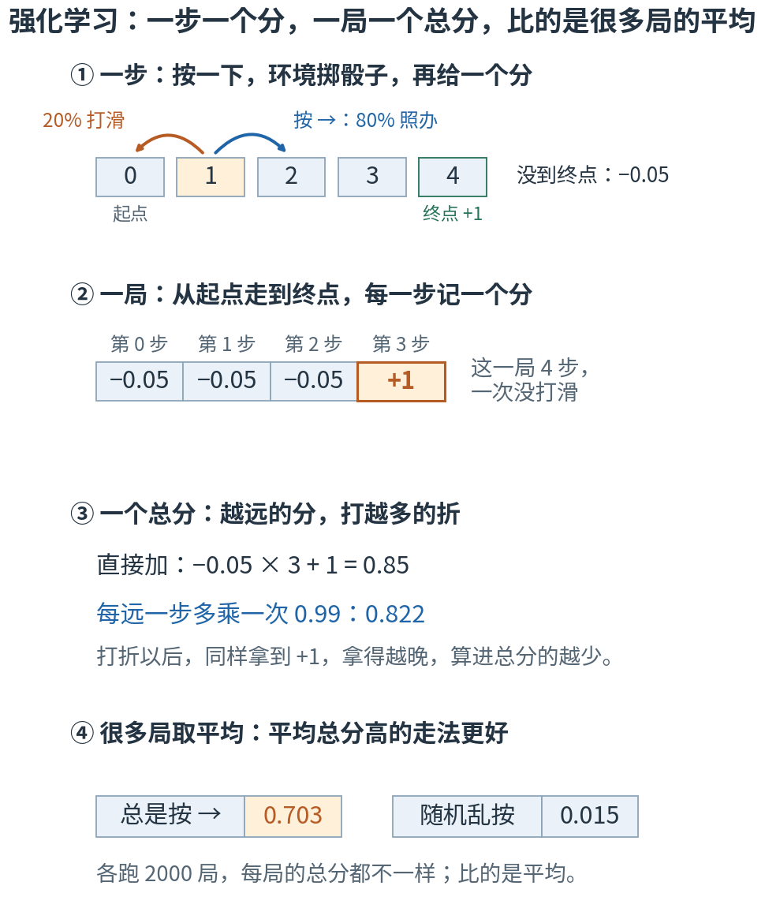
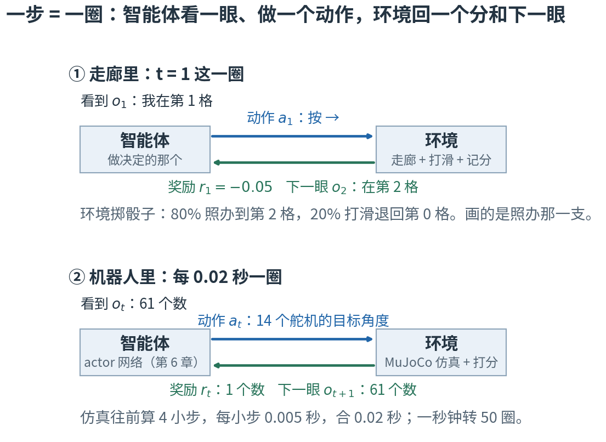
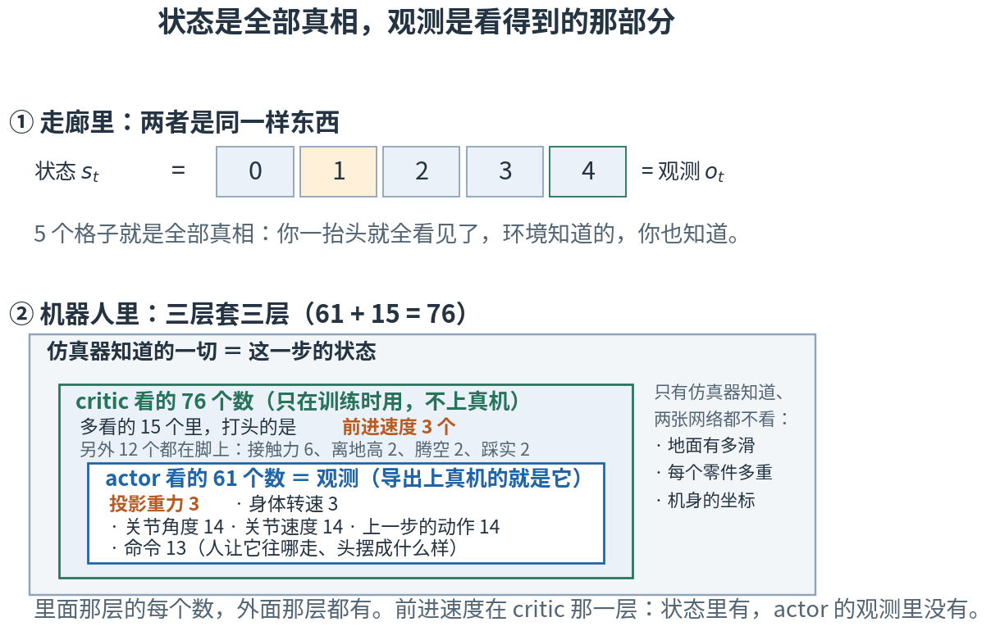
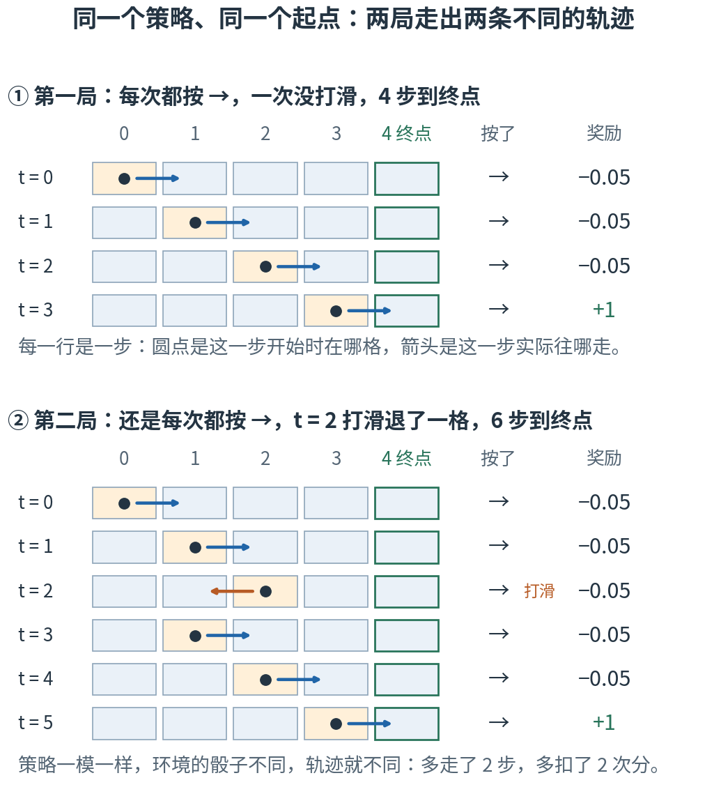
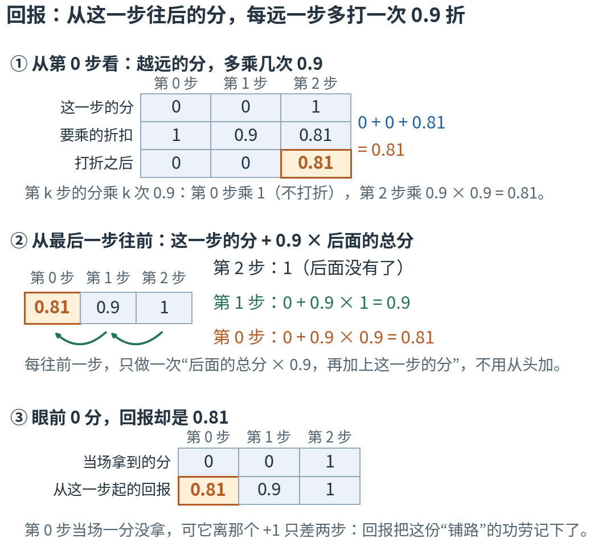
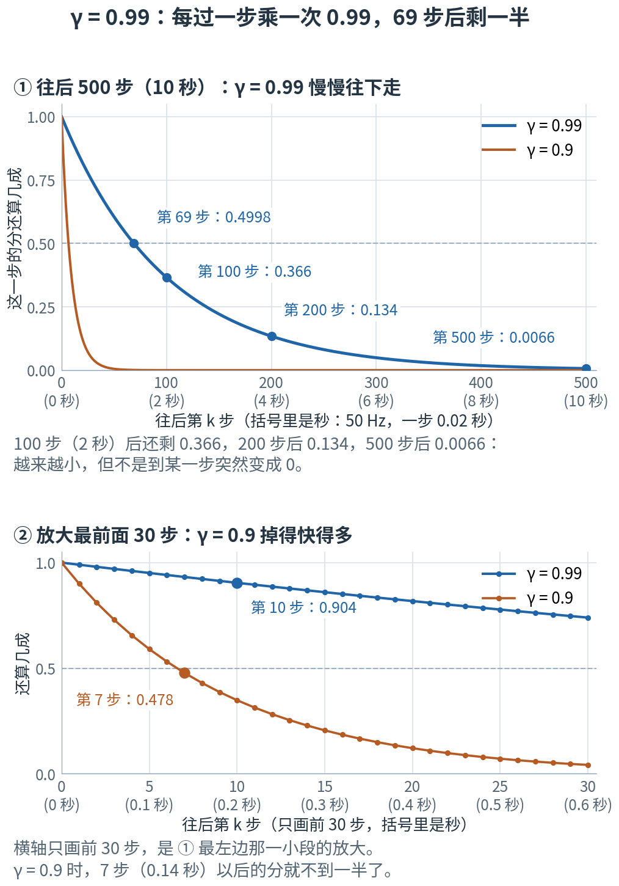
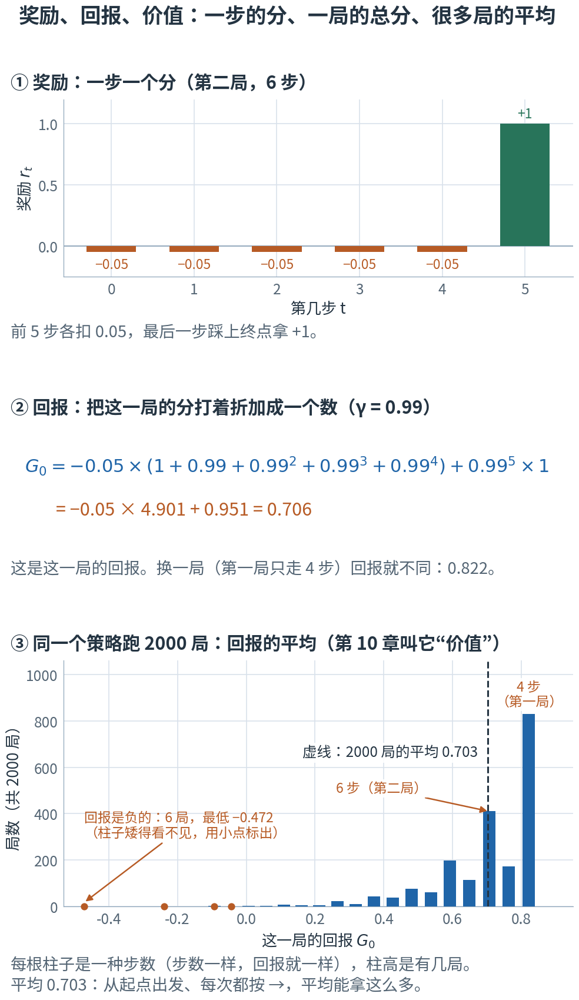

# 第 9 章 · 强化学习的世界观：没有标准答案，只有自己跑出来的分数

> **上一部我们有了什么**：一整套"学习"的零件（第 5 章）：数据、模型、损失、优化。模型是一张神经网络（第 6 章），梯度靠反向传播算、旋钮交给 Adam（按每个旋钮自己的历史定步长的那种拧法）去拧（第 7 章），输入先各自归一化（第 8 章）。
> 但到目前为止，数据都是现成的，损失都是"和标准答案差多少"。
>
> **这一章要补什么**：机器人没有标准答案——没人知道"这一刻 14 个关节该转到几度"。它只能自己试：摔了扣分，走稳了加分。
> 这一章把"边试边学"的整套说法建起来：谁在试，每一步看到什么、做什么，一局怎样算结束，总分怎么算，什么叫"学好了"。
> 全程用一个 5 格的走廊小游戏演示，每个词最后都对到机器人身上。
>
> **本章新词**：这一章的词分两拨，而且几乎都是成对的——记一对就等于记两个。
> 前一拨讲**一步**的事（9.1–9.4 节）：强化学习；智能体、环境；状态、观测；策略、探索。
> 后一拨讲**一局**的事（9.5–9.9 节）：回合、轨迹；终止、超时；回报、折扣因子。
> 一共 13 个，但其中 3 个你已经见过名字——强化学习（第 5 章 5.7 节）、策略和探索（第 4 章 4.7 节），这一章才正式讲它们。
> **需要的前提**：第 4 章的期望（4.3 节）、大数定律（4.5 节）和"策略吐出的是一口钟"（4.7 节）；第 5 章的四个零件（5.2 节）；第 1 章 1.8 节的"每走一步，乘同一个数"（次方）；第 2 章 2.2 节的 Σ；9.8 节还会用一次第 4 章 4.8 节的 ln。
> **不要求**新的数学：本章的计算大多是加法和乘法，外加在浏览器控制台里按几次乘方。要用到的几处代数（把共同的乘数提到括号外、两串数错开一格相减、等式两边同时取 ln）都会在用到的地方先用数字一步一步推出来。标"进阶"的折叠块可以第二遍再读。

---

## 9.0 先看地图：一条会打滑的走廊，一圈"看—做—得分"，一局一个总分

**强化学习里，一个做决定的"智能体"反复和"环境"打交道：看一眼，做一个动作，拿到一个分。一局从头到尾拿到的分，打着折加起来，是这一局的总分；学习的目标，是让很多局的平均总分尽量高。**

第 5 章 5.7 节说过学骑自行车：没人告诉你每一刻车把该转几度，你只知道摔了疼、骑稳了爽；摔过几十次，"什么感觉该往哪边扭"就练出来了。这一章把这种学法拆开来看。
骑车太复杂，先换一个小到能手算的游戏（教学构造的）：

- 走廊有 5 格，编号 0 到 4。你从第 0 格出发，第 4 格是终点。
- 每一步只能按一个键：→ 或 ←。
- 地面有点滑：80% 的时候照你按的走一格，20% 的时候反着走一格；撞到墙就原地不动（撞墙这一步照样算一步、照样扣分）。
- 没到终点的每一步扣 0.05 分；踩上终点的那一步得 +1 分（这一步不再扣），这一局结束。
- 一局最多走 50 步。走满 50 步还没到终点，也停下来重开一局——这种收场和"踩上终点"不一样，9.6 节专门讲。

你大概马上会想到"总是按 →"是好办法。可机器没有这种直觉，它得从一局局的分数里自己学出来。
这个游戏小到每个数都能手算，又有机器人身上的全部要素：看、做、打分、随机、一局结束、总分。它是机器人的迷你版。

**这五条设定，本章从头用到尾，一个都不改。** 还有一个数要到 9.7 节才登场：给"越晚拿到的分"打的折。
本章比较三种走法时（9.9 节）一律用项目的那个值 0.99；9.7 节为了好手算，会临时换几个别的值做对比，换的时候会当场说明。
（下一章还用这条走廊，但会换掉几个数——换了哪几个，那一章开头会讲。所以两章算出来的数对不上是正常的。）



**读图顺序：** 从 ① 到 ④ 竖着读。① 是一步：你按一下，环境掷骰子决定真走到哪，再给一个分。② 是一局：从起点走到终点，每一步记一个分。
③ 把一局的分合成一个总分——越晚拿到的分，算进去的越少。④ 同一种走法，每局的总分都不一样，所以比的是很多局的平均。
图里的数字现在不用算，后面各节会一个一个算出来。

| 概念 | 它在回答什么问题 | 走廊里 | 机器人里 | 在哪一节 |
|---|---|---|---|---|
| 强化学习 | 没有标准答案，怎么学？ | 只知道每一步得了几分 | 只知道摔没摔、走得好不好 | 9.1 |
| 智能体、环境 | 谁做决定？谁回应？ | 按键的你；走廊 + 地面 + 记分规则 | 策略网络；物理仿真 + 打分规则 | 9.2 |
| 奖励 | 这一步得了几分？ | −0.05，或者踩上终点的 +1 | 十几项打分规则加出来的一个数 | 9.2 |
| 状态、观测 | 真相是什么？看得到多少？ | 在第几格；全看得见 | 仿真器里的一切；只看到 61 个数 | 9.3 |
| 策略、探索 | 看到什么就怎么做？为什么故意带随机？ | "总是按 →"；"九成按 →" | 14 口钟（第 4 章 4.7 节） | 9.4 |
| 回合、轨迹 | 一局从哪到哪？怎么记下来？ | 从第 0 格走到第 4 格；每步一行 | 从站好到摔倒或 20 秒到 | 9.5 |
| 终止、超时 | 一局有几种收场？ | 踩上终点；走满 50 步 | 摔倒；20 秒到 | 9.6 |
| 回报、折扣因子 | 从某一步起，往后总共值多少分？ | 越远的分，打越多的折 | 每远一步乘 0.99 | 9.7–9.8 |
| 目标 | 什么叫"学好了"？ | 很多局的平均总分最高 | 同左 | 9.9 |

表里的名字先不背，英文和符号到了各节再给。本章最容易混的五处，先贴上标签：

- **奖励、回报、价值**：三个都是"分"。奖励是一步的分；回报是从某一步起、往后的分打着折加起来；价值是很多局回报的平均。价值本章只贴个标签，第 10 章（价值函数）专门讲；9.7、9.9 节会用同一局把三者分开。
- **状态 vs 观测**：走廊里一样，机器人里不一样——仿真器知道的，远比机器人自己感觉得到的多。第 4 章 4.7 节写策略的记号时说过其中的 s"本书里就是观测"，9.3 节把这两样正式分开。
- **终止 vs 超时**：都是"这一局结束了"，意思却相反：一个是真的完了，一个只是不再往下记。9.6 节有 ⚠️。
- **一步、一局、一轮**：机器人的一步是 0.02 秒；一局最长 20 秒，也就是 1000 步（20 ÷ 0.02 = 1000，9.6 节细算）；第 5 章 5.2 节说的"一轮"，是每只机器人攒够 24 步就训练一次。三种长度互不对齐，9.6 节的自测专门问这件事。
  还有两个"圈"也别混：9.2 节"看一眼、做动作、拿一个分"转一圈，是一步；第 5 章 5.0 节四个零件连成的圈转一轮，是训练一次。
- **三个 50**：走廊一局最多走 **50 步**（上面第五条规则）；机器人一秒走 **50 步**（每步 0.02 秒，9.2 节）；
  9.8 节的表里还会出现"往后第 **50** 步"。三个 50 互不相干，碰巧同一个数——读到时看清楚它在数什么。

现在觉得这些区别有点抽象很正常，读到对应小节就清楚了。

第一次读，按顺序看正文、图和手算就行。标着"进阶"的折叠块可以先跳过；代码是复核工具，不是阅读门槛。
这一章前后两半盯着两个不同的尺度：9.1–9.4 节讲清**一步**是怎么回事，9.5–9.9 节讲清**一局**怎么算分。
读完 9.4 节可以停一停喝口水——那时候"一步"那一拨词就齐了，后面几节都是在"一局"这个更大的尺度上搭出来的。

## 9.1 强化学习：没有标准答案，只有分数

先看走廊里缺了什么。第 3 章 3.5 节找直线时，每个 x 都配好了正确的 y，错了多少，一减就知道。
走廊里没有人告诉你"在第 2 格应该按 →"。你按了一下，只得到一个分：−0.05。这个 −0.05 并不是在说"你按错了"——按对了也是 −0.05，因为还没到终点。只有踩上终点的那一步给 +1。

所以你手里的信息是：每一步一个分，好坏要**攒起来看**。一局 4 步到终点，拿到 −0.05、−0.05、−0.05、+1；另一局乱走了 20 步，前 19 步各扣 0.05。
哪种走法好，得比整局下来的分；而且得比很多局——地面会打滑，同一种走法，这局快、那局慢。

没有正确答案、只有分数，靠自己一次次试着学——这叫**强化学习**（reinforcement learning, RL）。第 5 章 5.7 节已经见过这个名字，这一章正式讲。
名字里的"强化"，来自训练动物的老办法（第 5 章 5.7 节的小狗）：做对了就给零食，换来好处的动作以后出现得更多，也就是被"强化"了。强化学习做的是同一件事：哪种做法换来了更高的分，就让它以后更常出现。

第 5 章 5.7 节还讲过另一种学法：每个输入都配好标准答案，错了多少一减就知道——那叫监督学习，第 3 章 3.5 节找直线就是。拿第 5 章 5.2 节的四个零件把两种学法对照一下：

| 零件 | 监督学习（第 3 章 3.5 节找直线） | 强化学习（学走路） |
|---|---|---|
| 数据 | 现成的 (x, y) 对，从头到尾一个数都不改 | **自己跑出来的**："看到什么、做了什么、得了几分"。旋钮一变，下一轮跑出来的数据也跟着变 |
| 模型 | 一条直线 $wx + b$（w 乘 x 再加 b，乘号省掉了） | 一张网络：看到的 61 个数 → 14 口钟（每个关节一口钟，动作从钟里抽，第 4 章 4.7 节）。9.4 节给它正式的名字 |
| 损失 | 和标准答案差多少 | **没有标准答案**，要从"分数"倒推出一个能求梯度的东西（第 11–13 章） |
| 优化 | 梯度下降 | 一样：反向传播 + Adam |

数据和损失这两行的差别，就是后面五章的全部内容。优化这一行不变：第 7 章的 `backward()`（用反向传播算出每个旋钮的梯度）和 `step()`（照 Adam 的规矩把旋钮拧一步）原样照用（第 7 章 7.3 节）。

**为什么不能直接对分数求导？** 先回想求导在问什么（第 1 章 1.4 节）：把输入改一点点，输出跟着变多少——缩 h 量出来的那个比值。
第 1 章 1.14 节的折叠里提过一句：分数是采样得到的数据，训练不沿着"分数 → 物理仿真 → 动作"这条路往回求导。走廊里看得最清楚：

- 动作只有 → 和 ← 两种，没有"比 → 多按一点点"这种动作——"把输入改一点点"，无从改起。
- 分数也只有 −0.05 和 +1 两种。在第 3 格按 →，80% 拿 +1，20% 打滑拿 −0.05：同一个动作，这一次拿几分由骰子定；分数从 −0.05 一下跳到 +1，中间没有一条光滑的坡可以量斜率。

机器人更是这样：分数要经过接触、摩擦、摔倒这些物理过程才算出来。所以本项目用的算法（和大多数强化学习算法一样）不去问"分数对动作的导数是多少"，
而是问"很多局平均下来，怎样的做法分数更高"。怎样把这个问题变成一个能求梯度的东西，是第 11 章（策略梯度）的事。

## 9.2 智能体与环境：看一眼、做一个动作、拿一个分，一圈叫一步

走廊游戏里有两方。一方是按键的你：你只管一件事——看看自己在哪，决定按哪个键。
另一方是其余的一切：走廊有几格、地面滑不滑、走到哪给几分。这些你都左右不了，只能照它的规矩来。

手算一圈。你站在第 1 格：

1. **看一眼**：我在第 1 格。
2. **做一个动作**：按 →。
3. **对方回应**：掷一次骰子。80% 照办，你到了第 2 格；20% 打滑，你退回第 0 格。不管哪种都没到终点，给你 −0.05 分。
   （"掷骰子"在本章就是"随机决定"的意思：好比一颗 10 面的骰子，掷出 1 到 8 就照办，掷出 9 或 10 就打滑。）
4. 你再看一眼（现在在第 2 格，或者第 0 格），下一圈开始。

实验第 1 节把这些规矩列成了一张表。它只挑了三种情形当样本——终点以外的 4 格、每格 2 个键，一共 4 × 2 = 8 种，规矩都一样。
每种情形占两行，上一行是照办，下一行是打滑。前两列是"在哪、按了什么"；后四列是环境的回应：走到哪一格、这种结果的概率、这一步的奖励（表里的 1 就是 +1）、这一局是不是就此结束。
拿第一行手算：在第 1 格按 →，照办就往右一格，到第 2 格，概率 0.8；第 2 格不是终点，奖励 −0.05，这一局接着玩。
第二行是同一个按法打滑的那一支，概率 0.2。两行加起来 0.8 + 0.2 = 1：照办和打滑总有一个会发生，每种情形都是这样。

```
                 在哪  按了     结果  概率   奖励  这一局结束？
---------------------  ----  -------  ----  -----  ------------
      第 1 格（中间）     →  第 2 格   0.8  -0.05            否
      第 1 格（中间）     →  第 0 格   0.2  -0.05            否
第 3 格（终点前一格）     →  第 4 格   0.8      1            是
第 3 格（终点前一格）     →  第 2 格   0.2  -0.05            否
      第 0 格（墙边）     ←  第 0 格   0.8  -0.05            否
      第 0 格（墙边）     ←  第 1 格   0.2  -0.05            否
```

最后两行是墙边：在第 0 格按 ←，照办就是撞墙、原地不动；打滑反而往右挪了一格。

做决定的那一方叫**智能体**（agent）；除它以外的一切叫**环境**（environment）。环境不只是"场地"：打滑的骰子、记分的规矩都算环境——凡是智能体左右不了、只能去适应的，都归环境。
"看一眼、做一个动作、拿一个分"这一圈，叫**一步**（代码里做这件事的函数就叫 `step`）。步从 0 开始编号，记作 t。

### 一圈里来回传的三样东西，各给一个记号

每一步来回传三样东西，各给一个记号。记号右下角的小字是下标（第 2 章 2.1 节：$v_1$ 是清单的第 1 项）；这里的下标是"第几步"：$o_0$ 是第 0 步看到的东西，$o_1$ 是第 1 步看到的。

| 符号 | 怎么读 | 就是 |
|---|---|---|
| $t$ | "t" | 第几步，从 0 数起（取自 time） |
| $o_t$ | "o 下标 t" | 第 t 步智能体看到的东西。o 取自 observation；9.3 节给它正式起名，并和另一样东西分清 |
| $a_t$ | "a 下标 t" | 第 t 步做的动作（第 4 章 4.7 节：a 专指动作） |
| $r_t$ | "r 下标 t" | 第 t 步拿到的分，叫**奖励**。r 取自 reward；第 1 章 1.1 节那张表里的"打分规则"（也叫奖励函数），打出来的就是它 |

注意下标的节奏：做完动作 $a_t$，环境一起送回两样东西——这一步的奖励 $r_t$，和下一步要看的 $o_{t+1}$（下标里的 t + 1 就是"下一步的编号"：t = 1 时，$o_{t+1}$ 就是 $o_2$）。上面那一圈如果是这一局的第 1 步（t = 1，第 0 步刚从第 0 格走过来），写成记号：看到 $o_1$（在第 1 格），做 $a_1$（按 →），拿到 $r_1 = -0.05$，同时看到 $o_2$（在第 2 格，照办的那一支）。
下标是"第几步"，括号里的是"第几格"——这里碰巧都是 1；9.5 节的第二局里，两者就对不上了。



**这样读图：** 两张图是同一个圈，只是尺寸不同。蓝箭头从智能体指向环境：动作；绿箭头从环境指回智能体：这一步的奖励，加上下一步要看的东西。
① 走廊里，看到的是"在第几格"，动作是 → 或 ←，奖励是 −0.05 或 +1。
② 机器人里，看到的是 61 个数（第 8 章 8.2 节），动作是 14 个舵机的目标角度，奖励是一个数——十几项打分规则的加权和（每一项先乘一个权重、再加起来，和第 2 章 2.2 节的点积一个算法），第 16 章（奖励逐项拆解）逐项讲。
环境框里的 MuJoCo，是项目用的物理仿真引擎：专门算重力、碰撞、摩擦的程序。图下的灰字说，它每一小步只往前算 0.005 秒，4 小步合成一圈：4 × 0.005 = 0.02 秒。所以一秒钟转 1 ÷ 0.02 = 50 圈。

### 写成代码，就是一个主循环

这一圈就是游戏开发里的"主循环"。写成 JS：

```js
let obs = env.reset();                                // 一局开始：先看一眼（在第 0 格）
for (let t = 0; ; t++) {
  const action = agent.act(obs);                      // 智能体：看到什么 → 做什么
  const { nextObs, reward, done } = env.step(action); // 环境：执行、掷骰子、打分、给下一眼
  obs = nextObs;                                      // 下一圈从新的一眼开始
  if (done) break;                                    // 这一局结束了（怎么算结束，9.6 节）
}
```

智能体只有 `act` 这一个口子，环境只有 `reset` 和 `step` 两个。整个强化学习，就在这几个口子之间转。

> **停一下，自测**：下面几样，各属于智能体还是环境？① 走廊地面 20% 会打滑；② "踩上终点给 +1"这条规矩；③ 机器人的舵机收到指令后，要过一小会儿才转到位；④ 机器人策略网络里那 197,788 个可训练的旋钮。
> <details><summary>答案</summary>
>
> ①②③ 都是环境：智能体左右不了，只能适应。③ 最容易想错——舵机长在机器人身上，可"指令发出去以后怎样执行"智能体管不着，所以归环境。这类延迟，第 17 章（动作执行器）专门讲。
> ④ 是智能体：它就是做决定的那部分（第 6 章 6.5 节数过这个数）。
>
> </details>

## 9.3 状态与观测：环境知道的全部，和智能体看得到的那部分

走廊里，"我在第几格"就是全部真相：知道了它，再知道按哪个键，下一步有哪几种可能、各占几成（80% 这样、20% 那样）就完全定了，用不着知道更早走过哪些格。而且这个真相你看得见。

机器人不一样。仿真器知道一切：每个零件的位置和速度，每个关节的角度和转速，脚底受了多大的力，地面有多滑……
机器人自己只"看"得到 61 个数（第 8 章 8.2 节）：关节的角度和速度、上一步的动作、身体转得多快、投影重力（重力在机身自己的三根轴上各分到多少，第 2 章 2.4 节）、命令（人让它往哪走、头摆成什么样）。
仿真器知道、机器人看不到的东西很多，最典型的是**前进速度**：机器人相对地面走得多快。仿真器算得出来，真机上却没有任何传感器能直接测它——没有 GPS，也没有里程计（汽车上记走了多少公里的那种表）。

环境在第 t 步的全部真相，叫**状态**（state），记作 $s_t$；智能体在第 t 步实际拿到手的那部分，叫**观测**（observation），就是 9.2 节的 $o_t$。

| 符号 | 怎么读 | 就是 |
|---|---|---|
| $s_t$ | "s 下标 t" | 第 t 步环境的全部真相（s 取自 state）。走廊里是"在第几格"；机器人里是仿真器里的全部物理量 |
| $o_t$ | "o 下标 t" | 第 t 步智能体看到的那部分。走廊里 $o_t = s_t$；机器人里是 61 个数 |

### 机器人里，"看得到多少"分三层

前进速度就是"状态里有、观测里没有"的例子。先提醒一下项目里的两张网络（第 6 章 6.7 节）：actor 就是策略网络，看了观测决定动作，训练完要上真机；critic 只在训练时用，给"现在这个处境"打分。
项目里有一个现成的对照：critic 的输入比 actor 多 15 项"只有仿真器才知道的信息"，前进速度就是其中之一。
配置里写得明明白白：从 actor 的观测里删掉它，只加给 critic（📍 映射到项目）。critic 不上真机，所以可以"偷看"；actor 要上真机，只能用真机上测得到的东西。

多的这 15 项是哪些（实验第 2 节打印的原样输出，每一项第 15 章（61 维观测）逐块讲）：

```
critic 比 actor 多看的块  几个数
------------------------  ------
                前进速度       3
            脚底的接触力       6
              脚离地多高       2
              脚腾空多久       2
            脚踩实了没有       2
                    合计      15
```

每一块为什么是这几个数：打头的"前进速度"这一块，其实是机身的速度，按前后、左右、上下分成 3 个数（本章说"前进速度"，就指这一块）；
后四块都在脚上，两只脚各一份——接触力每只脚分 3 个方向，2 × 3 = 6 个数；离地多高、腾空多久、踩实了没有，每只脚各 1 个数，所以各是 2 个。

先把两个数加一下：actor 的 61 项加上这 15 项，**61 + 15 = 76**——正是第 6 章 6.7 节说的"critic 看 76 个数"。
所以同一个时刻，"看得到多少"有三层，一层套一层：



**这样读图：** 先看 ①：走廊里只有一层，状态和观测是同一样东西，所以两边都指着同一排格子。
再看 ②，从外往里读三层框：最外层是仿真器知道的一切（也就是状态）；往里一层是 critic 看的 76 个数；最里层是 actor 看的 61 个数，也就是这一章说的观测。
橙色的两项正好对上下面那道自测：**投影重力**在最里层（actor 看得到，当然也在状态里）；**前进速度**只在中间那一层（状态里有，actor 的观测里没有）。
最右边那一列是外面两层之外的东西——地面有多滑、每个零件多重——两张网络谁也不看。
（图里画的是"哪些量在不在清单上"。actor 那 61 个数还带着噪声和延迟，和仿真器算出的真值并不完全相等，那是第 15 章（61 维观测）的事，这一章先不管。）

### 本书的口径：公式里的 s，就是网络的输入

> ⚠️ **第 4 章 4.7 节的 s，严格说是这里的 o。** 那一节写策略的记号 $\pi(a \mid s)$ 时说过，其中的 s"本书里就是观测"——策略只能根据看得到的东西做决定，这句话没错。
> 可上面的表刚把 s 定成"全部真相"，两边怎么对上？靠一个习惯：强化学习的书和论文，把"网络拿到手的那些数"也写成 s（走廊里两者本来就一样）。本书后面沿用这个习惯，一共两条：
>
> 1. **公式里的 s = 网络的输入。** 落到机器人身上：策略（actor）的 s 是那 61 个数；critic 的 s 是那 76 个数。同一个字母，看是哪张网络在用。
> 2. **真要指"仿真器里的全部真相"时，不写 s，改用文字明说"状态"。**
>
> 这条口径从这里开始，第 10 到 14 章一直沿用——后面见到 $V(s)$、$\pi(a \mid s)$ 里的 s，都按第 1 条读。

**61 个数够不够？** 不一定。两只机器人此刻的 61 个数几乎一样，真相却可能不同：电池电压不同，通信延迟不同，一只脚刚好踩实了、另一只还悬着。
观测里放上"上一步的动作"（我刚才让舵机去哪）和关节速度，就是为了让"只看这一眼"也能推断出趋势，减少这种歧义——但减少不等于消除。
本项目是用有限的观测，训练一个扛得住这些不确定的策略；看不到的东西，并没有因此变成看得到。

<details>
<summary>进阶：马尔可夫性质与 MDP（现在可跳过）</summary>

走廊里"知道现在在第几格，就足以预测下一步"这件事有个名字，叫**马尔可夫性质**（英文名 Markov property，论文里常见）：下一步会发生什么，只取决于**现在**的状态和动作，不取决于更早的历史。

物理世界里，只要状态包含了全部必要的量（位置和速度都在），就满足它；只给一部分传感器读数就不一定。举个反例：只告诉你一个球现在在哪、不告诉你它的速度，你没法预测它下一刻往哪滚。
这时就得把"上一刻在哪"也塞进观测，用两帧的差推断速度。机器人的观测里放上一步的动作，是同一个道理（第 15 章（61 维观测）逐项讲）。

把"所有可能的状态、所有可能的动作、转移概率 $P(s' \mid s, a)$、奖励规则"打包在一起，叫**马尔可夫决策过程**（英文缩写 MDP）；论文里常再加上 9.7 节的折扣因子，把这五样写成一组（叫五元组）。
$P(s' \mid s, a)$ 读作"在 s 做了 a 之后，下一个状态是 s′ 的概率"（s′ 读"s 撇"，惯用来记"下一个状态"；竖线读"给定"，第 4 章 4.7 节）。它只是本章这些词的正式打包：走廊里的 $P(s' \mid s, a)$，就是 9.2 节那张规矩表——"在第 1 格按 →：0.8 到第 2 格，0.2 到第 0 格"。

</details>

> **停一下，自测**：① 机器人观测里的"投影重力"（第 2 章 2.4 节）属于状态还是观测？"机器人相对地面的前进速度"呢？
> ② critic 看的那 76 个数，能不能就叫"状态"？③ 有人想给 actor 也加上前进速度，说"多看点总没坏处"。会出什么问题？
> <details><summary>答案</summary>
>
> ① 投影重力两者都是：它是状态的一部分（机器人此刻的朝向），机身上的传感器也测得到（和第 2 章 2.4 节手机的重力感应是一回事），所以被放进了观测。
> 前进速度只属于状态：仿真器知道，真机上没有传感器能直接测，所以不在观测里——策略只能从关节速度、陀螺仪（量身体转得多快的传感器）这些看得到的数里去推断它。
> ② 不能。76 个数只是状态里被挑出来的一部分——地面有多滑、每个零件多重，这些 critic 也看不到（图 ② 最右边那一列）。
> 它只是"比 actor 多看的一份观测"，不是全部真相。
> ③ 训练时看上去更好学，可这个策略上不了真机：真机上根本没有这一项读数，那一格填什么都是假的，网络就会照着一个假数做决定。
> 这正是"actor 只能用真机上测得到的东西"的理由。critic 不上真机，所以它多看无妨。
>
> </details>

## 9.4 策略与探索：看到什么就怎么做，带一点随机才试得到新东西

智能体凭什么决定按哪个键？它得有一条"看到什么 → 做什么"的规则。走廊里随手就能想出几条（后面几节一直用这三条，都是教学构造的）：

- **总是按 →**：不管在哪，都按 →。
- **九成按 →**：每一步掷一次骰子，90% 按 →，10% 按 ←。
- **随机乱按**：每一步抛一次硬币，→ 和 ← 各一半。

第一条每次都做同一件事；后两条带着随机——看到同样的东西，这次按 →，下次可能按 ←。能把三条统一起来的说法是：**看到什么之后，每个动作各有多大可能**。
"总是按 →"就是"→ 的可能是 1，← 是 0"的特例。

这条规则叫**策略**（policy），记作 π。第 4 章 4.7 节先认得的那个记号，就是它：

| 符号 | 怎么读 | 就是 |
|---|---|---|
| $\pi$ | "派" | 策略：看到什么就怎么做的规则。这个 π 不是圆周率 |
| $\pi(a \mid s)$ | "派 a 给定 s" | 看到 s 之后，做动作 a 的概率。竖线读"给定"（第 4 章 4.7 节）：右边是已经知道的（看到了什么），左边是要问可能性的（做哪个动作）。"九成按 →"在第 2 格：π(→ ∣ 第 2 格) = 0.9，π(← ∣ 第 2 格) = 0.1 |
| $\pi_\theta$ | "派 西塔" | 由网络的旋钮 θ 决定的策略（θ 是第 3 章 3.4 节说的"全部旋钮"）。右下角的 θ 只是写明"这个策略由 θ 决定"：旋钮一拧，策略就跟着变 |

它是一台第 1 章 1.1 节那样的机器：喂进去"看到的东西"，吐出来"每个动作的可能"。上面三条碰巧都不看自己在哪一格，每一格吐出的都一样；一般的策略会因地而异。
机器人的策略就是第 4 章 4.7 节那 14 口钟：网络看了 61 个数，给出 14 口钟的中心；每一步从每口钟里抽一个数当动作（动作 = 均值 + 标准差 × 噪声：均值就是钟的中心，由网络算出；标准差管钟有多宽；噪声是每一步从"中心 0、宽 1"的标准钟里新抽的一个数）。61 个数一变，14 个中心就跟着变。

**为什么要故意带随机？** 设想一个"总是按 ←"的策略：它每一局都只按 ←，于是永远只知道"按了 ← 之后会怎样"，永远不知道按 → 会不会更好。要学到"→ 更好"，它必须至少**试过** →。
"九成按 →"每一步都给 ← 留了一成机会。实验第 3 节让三个策略在第 0 格各按 100 次。
表的第二列是按 → 的概率，按 ← 的概率就是 1 减它；第三列是 100 次里"平均该有"几次 ←，等于 100 × 按 ← 的概率；第四列是这一次真抽出来的次数：

```
    策略  按 → 的概率  100 次里按 ← 的期望次数  这次实际按 ← 的次数
--------  -----------  -----------------------  -------------------
总是按 →            1                        0                    0
九成按 →          0.9                       10                    7
随机乱按          0.5                       50                   49
```

"总是按 →"一次 ← 也没试过。"九成按 →"按 ← 的概率是 1 − 0.9 = 0.1：每按一次，按到 ← 的机会是一成，平均算下来每次贡献 0.1 次 ←；100 次加起来，期望就是 100 × 0.1 = 10 次（第 4 章 4.3 节：期望是按概率加权的平均）。
这一次实际抽到 7 次——期望是很多次的平均，单独一次不一定正好是它。
故意带一点随机、去试"眼下不认为最好"的动作，叫**探索**（exploration）。第 4 章 4.7 节说"加了噪声，它才会偶然试到新动作"，说的就是它。
试到了好的，训练就把钟的中心往那边挪——具体怎么挪，是第 11 章（策略梯度）的事。训练好以后部署到真机，就不再加噪声，直接执行钟的中心（第 19 章（导出与部署））。

> ⚠️ **走廊里有两层随机，不要混。** 地面 80% 照办、20% 打滑，是环境的随机：智能体管不着，它按的明明是 →，打滑也不是它"想试试 ←"。
> "九成按 →"里的那一成 ←，是策略的随机：这是智能体自己选的，只有这一层才叫探索。（也正因为如此，这里故意用"九成"而不用"八成"，免得和地面的 80% 搅在一起。）
> 两层随机会叠起来。用"九成按 →"站在第 1 格走 100 步，数一数真往右挪了几步：约 90 步按 →，其中八成照办，90 × 0.8 = 72 步往右；
> 约 10 步按 ←，其中两成打滑、反倒往右，10 × 0.2 = 2 步。一共 72 + 2 = 74 步，占 100 步的 0.74。
> 换成概率写：按 → 且照办是"九成里的八成"，0.9 × 0.8 = 0.72——几成里的几成，就是两个数相乘（第 4 章 4.8 节：两颗骰子各掷各的，1/6 × 1/6）；按 ← 却打滑是 0.1 × 0.2 = 0.02。
> 一步要么按了 →、要么按了 ←，这两条路不会同时发生，所以往右的机会是两条路相加：0.72 + 0.02 = **0.74**。实验第 3 节让它站在第 1 格试 10,000 次，真往右挪的比例是 0.7398。

> **停一下，自测**：① "九成按 →"在第 0 格按 1000 次，期望试几次 ←？② 用"总是按 →"，真往右挪一格的概率是多少？用"随机乱按"呢？
> <details><summary>答案</summary>
>
> ① 1000 × 0.1 = 100 次。② 总是按 →：只有"按 → 且照办"一条路，1 × 0.8 = 0.8。
> 随机乱按：0.5 × 0.8 + 0.5 × 0.2 = 0.4 + 0.1 = 0.5——硬币把地面的八成两成抵消了，往右往左一样多。
>
> </details>

**歇一口气。** "一步"那一拨词到这里齐了：强化学习（9.1 节）、智能体与环境（9.2 节）、状态与观测（9.3 节）、策略与探索（9.4 节）。
把它们串起来就是一句话："智能体看到观测，按策略（带一点随机）挑一个动作，环境回一个奖励和下一眼。"
后面五节换一个尺度——把这样的一步接一步连成一整局，再给这一局算一个总分。

## 9.5 回合与轨迹：一局从头到尾，每一步都记下来

让"总是按 →"真的玩一局：从第 0 格出发，一步一步走，直到踩上终点。实验第 4 节玩了两局，第二局是这样的：

```
t  s_t  a_t    r_t  s_{t+1}
-  ---  ---  -----  -------
0    0    →  -0.05        1
1    1    →  -0.05        2
2    2    →  -0.05        1
3    1    →  -0.05        2
4    2    →  -0.05        3
5    3    →      1        4
```

每一行是一步：这一步开始时在哪（$s_t$）、按了什么（$a_t$）、拿到几分（$r_t$）、走到了哪（$s_{t+1}$）。
表头的 s_{t+1} 就是 $s_{t+1}$，花括号只是把 t+1 括在一起当一个下标。走廊里状态和观测是同一样东西（9.3 节），所以这里统一写 s。
t = 2 那一步按的是 →，却从第 2 格退回了第 1 格——打滑了。多绕了这一下，一共走了 6 步。第一局运气好，一次没打滑，4 步就到了。



**这样读图：** 每张图从上往下是时间，一行是一步。圆点是这一步开始时所在的格子，箭头是这一步实际往哪走：蓝的是照办，橙的是打滑。最右两列是按了什么、拿了几分。
两局用的是同一个策略（每次都按 →）、同一个起点，只是环境的骰子掷得不同——② 的第 3 行（t = 2）箭头是橙色的，"按了"那一列标着"打滑"：按的明明是 →，却退了一格。整条路线因此长了两步，多扣了两次 0.05。

从开始到结束的这一整局，叫一个**回合**（episode）。一回合里按顺序记下的整串东西——每一步的状态、动作、奖励，直到最后停在哪——叫一条**轨迹**（trajectory），记作 τ（希腊字母，读"陶"）：

$$\tau = (s_0, a_0, r_0,\ s_1, a_1, r_1,\ \ldots,\ s_T)$$

中间的三个点"…"是说：照"状态、动作、奖励"的顺序一步一步排下去，一直排到最后停下的那个状态 $s_T$。

| 符号 | 怎么读 | 就是 |
|---|---|---|
| $\tau$ | "陶" | 一条轨迹：一回合的完整记录 |
| $T$ | "大 T" | 这一回合一共走了几步（第二局 T = 6） |
| $s_T$ | "s 下标大 T" | 最后停在的状态（第二局停在第 4 格）。停下了，就不再做动作、不再拿分 |

所以一条 T 步的轨迹里有 T 个动作、T 个奖励，状态多一个：状态的下标从 0 数到 T，一共 T + 1 个。
第二局 T = 6：状态是 $s_0$ 到 $s_6$，下标 0、1、2、3、4、5、6，一共 7 个；动作和奖励的下标从 0 到 5，各 6 个。
就像一排 6 段栏杆要立 7 根柱子：每一步是一段栏杆，状态是两头的柱子。
第 2 章 2.8 节说过，时间这条轴有先后因果——轨迹就是沿着这条轴一步一步排出来的。

为什么非要按顺序记下这一整串？9.7 节要给每一步算"从这里往后一共拿了多少分"，得知道每一步拿了几分、谁先谁后；
训练用的数据（9.1 节那张表里"自己跑出来的数据"）也正是这样一串串的记录。

机器人的一个回合：从站好开始，到摔倒或者 20 秒时间到为止。它的轨迹最长 1000 步（20 秒 ÷ 每步 0.02 秒，9.6 节细算），每一步记下"看到的 61 个数、一个动作（14 个舵机各一个目标角度，共 14 个数）、1 个奖励"。

> **停一下，自测**：第一局（4 步到终点）的轨迹里，有几个状态、几个动作、几个奖励？最后一个状态是什么？
> <details><summary>答案</summary>
>
> 5 个状态（$s_0$ 到 $s_4$，依次是第 0、1、2、3、4 格），4 个动作（都是 →），4 个奖励（−0.05、−0.05、−0.05、+1）。最后一个状态是第 4 格——终点，这一局就停在这里。
>
> </details>

## 9.6 终止与超时：摔倒是真的完了，时间到只是不再往下记

一局怎样算结束？走廊里有两种收场。

第一种：踩上终点。游戏规则就是这样定的——踩上终点，这一局**真的完了**，之后再也没有分可拿。

第二种：走满 50 步还没到终点。这就是 9.0 节那五条规则里的最后一条——"随机乱按"常常在走廊里来回晃，要是不设上限，一局可能走个没完。
到了上限，这一局就停下、从头再来——可游戏本身并没有完，只是**不再往下记**了。

环境自己宣布"这一局完了"——踩上终点、机器人摔倒——叫**终止**（termination）：之后没分了。
只是记录到了定好的时长上限、被截断——走满 50 步、机器人走满 20 秒——叫**超时**（time-out，也叫 truncation，意思是截断）：游戏本来还能接着玩，之后本来还有分，只是没记下来。

实验第 5 节让"随机乱按"跑了 2000 局，数一数两种收场各有多少：

```
“随机乱按”跑 2000 局：踩上终点而终止 1878 局，走满 50 步被超时截断 122 局
超时那几局，截断时站在哪一格： 第 0 格 48 局  第 1 格 34 局  第 2 格 26 局  第 3 格 14 局
```

两行数自己加一下就对得上：1878 + 122 = 2000 局；48 + 34 + 26 + 14 = 122 局。
第二行里没有"第 4 格"这一项——因为一站上终点，这一局当场就终止了，轮不到超时。

看最后那 14 局：50 步用完的时候，它正站在第 3 格，离终点只差一步——下一步按 →，就有 80% 拿到 +1。游戏本来没完，是我们不再往下记了。这和"踩上终点"完全是两回事。

| 收场 | 意思 | 走廊里 | 机器人里 | 之后还有分吗 |
|---|---|---|---|---|
| 终止 | 真的完了 | 踩上终点 | 摔倒：倾斜超过 70° | 没有了 |
| 超时 | 时间到，不再往下记 | 走满 50 步 | 走满 20 秒 | 本来还有，只是没记 |

机器人的"摔倒"就是第 2 章 2.4 节的判据：投影重力的第 3 项 $g_z$ 从站直时的 −1 升到约 −0.34（那一节算过：前倾 70° 时 $g_z = -0.342$），也就是倾斜超过 70°。
"20 秒"合多少步：每步 0.02 秒，1 秒就是 1 ÷ 0.02 = 50 步（9.2 节），20 秒就是 20 × 50 = 1000 步。

> ⚠️ **超时不是终止，也不是失败。** 两种收场在代码里都会让这一局停下、重新开始，看上去一样，意思却相反。终止之后"没分了"，之后的分一律按 0 算（9.7 节算总分时就是这么做的），这是对的。
> 超时之后"本来还有分"：机器人在第 20 秒时也许正稳稳地走着，只要还站着，后面每一步都还有分可拿。要是把超时也当成"之后没分了"，算法就会以为"走到第 20 秒会突然没分"，
> 把最后这段好好走路也算成了走向失败。所以项目的配置给每一种收场都标明了它是哪一种（📍 映射到项目）。
> 超时之后那段没记下的分怎么补？得先有"从这里往后平均能拿多少"的估计（第 10 章（价值函数）），再由第 12 章（优势估计 GAE）用它补上。

> **停一下，自测**：训练时，每只机器人攒够 24 步的数据就训练一次（第 5 章 5.2 节）。这是不是说，机器人每走 24 步就被重新摆回起点？
> <details><summary>答案</summary>
>
> 不是。"攒 24 步"是收数据的节奏，"一局结束"是游戏本身的事，两者互不相干：一局最长 1000 步，1000 ÷ 24 = 41.67，本来就对不齐。
> 攒够 24 步时，没摔倒、没超时的机器人接着往下走，下一批数据从它当时的样子接着记。这 24 步以后的分，这一批里也还没记下——和超时一样，要靠第 12 章（优势估计 GAE）用估计补上。
>
> </details>

## 9.7 回报与折扣因子：从这一步起的总分，越远的分打越多的折

一步的分只说明这一步。9.1 节说过，好坏要"攒起来看"；这一节把"攒起来"说准确。智能体真正关心的是：**从现在起往后，一共能拿多少分？**

先看一段只有三步的小经历（教学构造的，不是 Microduck 的真实评分）：三步拿到的分依次是 0、0、1。从第 0 步看，往后一共多少分？直接加是 0 + 0 + 1 = 1。

可"现在的 1 分"和"很久以后的 1 分"，值得一样多吗？通常不：我们更想早一点拿到——就像今天到手的 100 块，比一年后才给的 100 块更实在。办法是**每远一步，就多打一次折**。
折扣取 0.9。"打九折"就是乘 0.9，和商店里一样：当场的分算足，下一步的分打一次九折（乘 0.9），再下一步打两次（乘 0.9 × 0.9 = 0.81）——正是第 1 章 1.8 节"每走一步，乘同一个数"的那种函数。
两个 0.9 连乘写作 $0.9^2$，读"0.9 的平方"（第 1 章 1.8 节的次方：右上角的小数字说连乘了几次）。（这个 0.9 是折扣，和 9.4 节"九成按 →"里的 0.9 不相干，只是碰巧同一个数。）从第 0 步看：

$$0 + 0.9 × 0 + 0.9^2 × 1 = 0.81$$

从第 1 步看，往后只剩两步：$0 + 0.9 × 1 = 0.9$。从第 2 步看，只剩它自己：1。
同一个 +1，从第 0 步看值 0.81，从第 1 步看值 0.9，从第 2 步看值 1：折扣数的是"离现在还有几步"——还差两步打两次折，还差一步打一次，就在眼前不打折。

### 倒着算更省事：从最后一步往前

同样这三个数，还有一种更省事的算法：**从最后一步往前**。

- 第 2 步：1（后面没有了）。
- 第 1 步：这一步的 0，加上 0.9 × 后面的总分 1：$0 + 0.9 × 1 = 0.9$。
- 第 0 步：这一步的 0，加上 0.9 × 后面的总分 0.9：$0 + 0.9 × 0.9 = 0.81$。

两种算法得到同一个 0.81。这不是碰巧，一步一步拆开看：

1. 从前往后的那个式子里，$0.9^2$ 就是 0.9 × 0.9。写开：$0 + 0.9 × 0 + 0.9 × (0.9 × 1)$（三个数连乘，先乘哪两个都一样，这里先把后两个括起来）。
2. 后两项 $0.9 × 0$ 和 $0.9 × (0.9 × 1)$ 都乘着一个 0.9。把这个共同的 0.9 提到括号外面：$0.9 × 0 + 0.9 × (0.9 × 1) = 0.9 × (0 + 0.9 × 1)$。
   这是第 4 章 4.3 节的分配律倒过来用：$2 × 4 + 3 × 4 = (2 + 3) × 4 = 20$。换成买东西：两件都打九折，先各自打折再相加，和先相加再一起打折，付的钱一样。
3. 于是"从第 0 步看的总分" $= 0 + 0.9 × (0 + 0.9 × 1)$。括号里的 $0 + 0.9 × 1 = 0.9$，正是"从第 1 步看"的总分。

所以：**从第 0 步看的总分 = 第 0 步的分 + 0.9 × 从第 1 步看的总分**，$0 + 0.9 × 0.9 = 0.81$。
同样的拆法再用一次：从第 1 步看的总分 = 第 1 步的分 + 0.9 × 从第 2 步看的总分，$0 + 0.9 × 1 = 0.9$。
倒着算，就是把这条关系从最后一步开始，一步一步往前用：先有第 2 步的 1，才算得出第 1 步的 0.9，再算得出第 0 步的 0.81。

倒着算的好处是：每往前挪一步，只做一次"乘 0.9、再加上这一步的分"，不必从头加起。步数一多，差别很大。一局 1000 步，要是把每一步起的总分都从前往后各加一遍：
第 0 步起要加 1000 项，第 1 步起 999 项……最后一步起 1 项，一共 1000 + 999 + … + 1 = 500,500 项
（首尾配对：1000 + 1、999 + 2……每对都是 1001，一共 500 对，500 × 1001 = 500,500）；倒着算，一步一次，只要 1000 次。

这个"从这一步往后、打着折加起来的总分"叫**回报**（return），记作 $G_t$；那个每远一步就乘一次的数叫**折扣因子**（discount factor），记作 γ。
上面三个数写成记号：$G_2 = 1$，$G_1 = 0.9$，$G_0 = 0.81$——G 的下标就是"从第几步起算"。刚才那条关系，写成记号就是 $G_0 = 0 + 0.9 × G_1$。



**这样读图：** ① 是从前往后：第 k 步的分乘 k 次 0.9（k 就是"往后第几步"），再全部加起来。
② 是从后往前。这一段要注意**算的顺序和读的方向相反**：右边那三行手算从上往下读，就是计算的先后——先算第 2 步，再算第 1 步，最后才算第 0 步；
左边那排格子里的 1、0.9、0.81，是按绿色弧线的方向、从右往左一个一个填出来的。每往前传一步，乘一次 0.9，再加上这一步的分。
③ 把"当场拿到的分"和"回报"并排：第 0 步当场一分没拿，回报却是 0.81。

③ 是这一节最要紧的一点。第 0 步的动作当场没得分，可正是它把你往那个 +1 推近了一步——回报把这份"铺路"的功劳记下了。
如果只看每一步当场的分，像监督学习那样"学当场得分高的动作"，这类准备动作就永远得不到认可。机器人走路满是这种动作：抬起一条腿的那一刻并不加分，可不抬腿就迈不出下一步。

### 一般的公式：0.9 换成 γ，第 0 步换成第 t 步

把上面的手算换成字母，只换两处：0.9 换成 γ（随便哪个折扣因子），"从第 0 步看"换成"从第 t 步看"（t 可以是任何一步）。
从第 t 步往后数 k 步，那一步的奖励记作 $r_{t+k}$（下标 t + k，就是"第 t 步再往后 k 步"）；它要打 k 次折，也就是乘 k 个 γ，写作 $\gamma^k$。逐项对照：

| 往后第 k 步 | 那一步的奖励 | 要乘的折扣 | 三步例子（t = 0，γ = 0.9） |
|---|---|---|---|
| 0（就是现在） | $r_t$ | $\gamma^0 = 1$ | $r_0 × 1 = 0 × 1$ |
| 1 | $r_{t+1}$ | $\gamma^1 = \gamma$ | $r_1 × 0.9 = 0 × 0.9$ |
| 2 | $r_{t+2}$ | $\gamma^2 = \gamma × \gamma$ | $r_2 × 0.81 = 1 × 0.81$ |
| 3 | $r_{t+3}$ | $\gamma^3 = \gamma × \gamma × \gamma$ | 例子里没有第 3 步，这一项算 0 |

第一行的 $\gamma^0 = 1$：一次折也没打，当场的分算足（第 1 章 1.8 节：任何数的 0 次方都是 1，$2^0 = 1$）。
最后一列加起来，$0 + 0 + 0.81 = 0.81$，正是上面的 $G_0$。把每一行的"奖励 × 折扣"加起来，就是一般的公式：

$$G_t = r_t + \gamma\, r_{t+1} + \gamma^2 r_{t+2} + \gamma^3 r_{t+3} + \cdots = \sum_{k=0}^{\infty} \gamma^k\, r_{t+k}$$

两个等号中间那一长串，末尾的 $\cdots$ 是"照这个规律一直加下去"；最右边的 Σ 是同一件事的缩写。逐个符号看：

| 符号 | 怎么读 | 就是 |
|---|---|---|
| $G_t$ | "G 下标 t" | 回报：从第 t 步起往后的折扣总分。下标换成 0、1、2，就是上面的 $G_0$、$G_1$、$G_2$。一局**终止**了（踩上终点、摔倒），后面的项就没有了，当 0 算；要是只是**超时**，后面本来还有分，那就不能当 0——9.6 节的 ⚠️ 说的就是这条 |
| $\gamma$ | "伽马" | 折扣因子，0 到 1 之间的一个数。上面用 0.9，项目用 0.99 |
| $r_{t+k}$ | "r 下标 t 加 k" | 从第 t 步往后数 k 步，那一步的奖励。t = 0、k = 2 时就是 $r_2$ |
| $\gamma^k$ | "伽马的 k 次方" | k 个 γ 连乘：往后第 k 步的分要乘的折扣，打 k 次折。k = 0 时是 1 |
| $\sum_{k=0}^{\infty}$ | "对 k 从 0 到无穷求和" | 第 2 章 2.2 节的 Σ，就是一个 for 循环：k = 0、1、2……一项一项加，每一项是 $\gamma^k\, r_{t+k}$。∞ 读"无穷" |

Σ 上面写的是 ∞，不是这一局的步数：公式本身不写死加到哪儿停。对一局会结束的游戏，这不碍事——终止以后再也没有分，后面的项都是 0，加了等于没加；走廊里加到最后一步就停。
照定义从前往后加，写成 JS 是：

```js
const rewards = [0, 0, 1], gamma = 0.9, t = 0;
let G = 0;
for (let k = 0; t + k < rewards.length; k++) G += gamma ** k * rewards[t + k];   // 第 k 项：γ 的 k 次方 × r_{t+k}；G = 0.81
```

"从后往前"那条关系，换成字母照样成立，推法和上面的三步一样。除了第一项 $r_t$，后面每一项都至少乘着一个 γ（$\gamma^2 = \gamma × \gamma$，$\gamma^3 = \gamma × \gamma^2$……）。
把共同的一个 γ 提到括号外，括号里每一项都少乘一次 γ：

$$G_t = r_t + \gamma\,\big(r_{t+1} + \gamma\, r_{t+2} + \gamma^2 r_{t+3} + \cdots\big) = r_t + \gamma\, G_{t+1}$$

括号里是什么？$r_{t+1}$ 不打折，$r_{t+2}$ 打一次，$r_{t+3}$ 打两次……正是"从第 t + 1 步起算"的回报 $G_{t+1}$。
所以 $G_t = r_t + \gamma\, G_{t+1}$：这一步的分，加上 γ 乘以下一步起的回报。它就是 JS 数组的 `reduceRight`——从最后一个元素往前累积：

```js
const rewards = [0, 0, 1], gamma = 0.9;
const G0 = rewards.reduceRight((later, r) => r + gamma * later, 0);   // 从最后一个往前：0.81
```

`later` 是从右边累积过来的"后面的总分"，`r` 是这一步的分，最后那个 0 是初值：最后一步之后没有分。依次算出 1、0.9、0.81，和上面倒着手算的三行一模一样。

这条"从后往前"的规则，第 10 章（价值函数）还会反复用到；第 12 章（优势估计 GAE）的代码也正是这样倒着循环的。

### 回到走廊：同一局，换几个 γ

第一局的四个分是 −0.05、−0.05、−0.05、+1。实验第 6 节用几个不同的 γ 算它的 $G_0$。第一列是取的 γ，第二列是这一局从第 0 步算起的回报：

```
   γ  第一局的 G_0
----  ------------
   1          0.85
0.99      0.821794
 0.9        0.5935
 0.5        0.0375
```

每一行都是"三个扣分各自打折后相加，再加上打了三次折的 +1"，四行都能手算：

- γ = 1 就是不打折，直接加：−0.05 × 3 + 1 = 0.85。
- γ = 0.99：三个扣分分别乘 1、0.99、0.9801（= 0.99 × 0.99），+1 乘 $0.99^3 = 0.970299$。三个扣分都是 −0.05，照上面的分配律提到括号外：
  $-0.05 × (1 + 0.99 + 0.9801) + 0.970299 = -0.05 × 2.9701 + 0.970299 = 0.821794$。
- γ = 0.9：四个分分别乘 1、0.9、0.81、0.729，$-0.05 - 0.045 - 0.0405 + 0.729 = 0.5935$。
- γ = 0.5：$-0.05 × (1 + 0.5 + 0.25) + 0.125 = -0.05 × 1.75 + 0.125 = 0.0375$。

γ 越小，第 3 步那个 +1 被打的折越狠（它要乘 $\gamma^3$，四行依次是 1、0.970299、0.729、0.125），开头看到的回报就越小。
不管 γ 取多少，最后一步的回报都是 $G_3 = 1$：终点之后没有别的分了。

### 为什么要打折

两个理由。① 它定下一种偏好：同样拿到 +1，早拿比晚拿好。② 它让总分不会无限大：机器人要是一直走、一直有分，不打折的总分会越加越大，没法比较；打了折，总和就有上限（9.8 节算给你看）。

走廊里的表是第 ① 条的写照（走廊的一局总会结束，第 ② 条要到 9.8 节才看得见）：γ 从 1 降到 0.5，"早拿"的偏好一路变强（+1 被打的折越来越狠），前三步那点扣分相对就越来越显眼——
γ = 1 时，三个扣分加起来 −0.15，对面是整整一个 +1；γ = 0.5 时，扣分还有 −0.0875，可 +1 打完折只剩 0.125，扣分快赶上奖励了。

还有一条容易想歪：打折**不是**用来表示"环境可能出事"的。地面打滑、机器人可能摔倒，这些随机已经体现在"每一局的轨迹不一样"里，要靠 9.9 节的"很多局取平均"来处理；γ 是我们选定的"对远处的分看得多重"，不是环境的属性；也别把它当成"每一步活下来的概率"（除非你专门把它设计成这个意思）。

> **停一下，自测**：三步的分是 0、1、0，γ = 0.9。$G_0$、$G_1$、$G_2$ 各是多少？
> <details><summary>答案</summary>
>
> 从后往前：$G_2 = 0$；$G_1 = 1 + 0.9 × 0 = 1$；$G_0 = 0 + 0.9 × 1 = 0.9$。中间那一步当场拿的 1 分，传到第 0 步打了一次折，剩 0.9。
>
> </details>

## 9.8 γ = 0.99 看多远：每过一步乘 0.99，69 步后剩一半

9.7 节为了好手算，用的折扣是 0.9；项目用的是 γ = 0.99。它打折打得有多慢？换句话说，智能体往前能"看"多远？
往后第 k 步的分，要乘 $0.99^k$（k 个 0.99 连乘）。这种数不用手算，打开浏览器控制台（按 F12）按几下——JS 的 `**` 就是乘方（注释里的"…"表示后面还有更多位小数）：

```js
0.99 ** 10    // 0.904…：10 步以后的分，还算 90%
0.99 ** 69    // 0.4998…：69 步以后，只算一半
0.99 ** 100   // 0.366…：100 步以后，剩 37%
```

每一步 0.02 秒，一秒 50 步（写作 50 Hz，Hz 读"赫兹"，就是"每秒几次"），所以步数 × 0.02 就是秒数：69 步是 69 × 0.02 = 1.38 秒，100 步是 100 × 0.02 = 2 秒。
实验第 7 节把更多的点列成表，并和 γ = 0.9 对比。第一列是往后第几步，第二列换算成秒，后两列是那一步的分还算几成：

```
往后第 k 步  = 几秒   0.99^k     0.9^k
-----------  ------  -------  --------
          1    0.02     0.99       0.9
         10     0.2   0.9044     0.349
         50       1    0.605   0.00515
         69    1.38   0.4998  0.000696
        100       2    0.366  2.66e-05
        200       4    0.134  7.06e-10
        500      10  0.00657  1.32e-23
```

拿 k = 50 那一行核对：50 × 0.02 = 1 秒；控制台里 `0.99 ** 50` 得 0.605，`0.9 ** 50` 得 0.00515。
最后一列的 `2.66e-05` 是第 3 章 3.6 节的科学计数法，只是指数是负的：$2.66 × 10^{-5}$，小数点往左挪 5 位，就是 0.0000266。



**这样读图：** 纵轴是"往后第 k 步的分还算几成"，也就是 $\gamma^k$；灰色虚线是一半。
① 蓝线（γ = 0.99）慢慢往下走：第 69 步穿过一半，100 步（2 秒）剩 0.366，500 步（10 秒）剩 0.0066——越来越小，但没有哪一步突然变成 0。橙线（γ = 0.9）一出发就几乎贴到了底。
② 是 ① 最左边前 30 步的放大（横轴只到 30 步）：γ = 0.9 到第 7 步（0.14 秒）就掉到 0.478，γ = 0.99 到第 10 步还有 0.904。

对走路来说，这个差别很实在。一个动作的后果常常要过一阵才显出来：9.7 节里第 0 步的功劳，要到两步以后才兑现；机器人一脚踩歪，身子也是慢慢歪下去的，要过一会儿才摔倒。γ = 0.9 时，1 秒（50 步）以后的分只算 0.00515，几乎看不见；γ = 0.99 时还算 0.605。

### 一半落在第几步：69 是怎么找出来的

标题里的 69，是"0.99 连乘多少次，第一次跌破一半"。有两种找法。

**试出来。** 在控制台里先粗后细地夹：`0.99 ** 60` 得 0.547，还比一半多；`0.99 ** 70` 得 0.495，已经不到一半——答案在 60 和 70 之间。
再往中间试：`0.99 ** 68` 得 0.5049，`0.99 ** 69` 得 0.4998。第 69 步第一次跌破一半。

**用 ln 一步算出来。** 想找的是 k，让 $0.99^k = 0.5$。k 坐在右上角，没法像解"2 × k = 6"那样两边一除就完事；第 4 章 4.8 节的 ln 正好能把它请下来：

1. 两边同时取 ln。等号两边本来就是同一个数，喂给同一台机器，吐出来的也相等（第 1 章 1.1 节：同样的输入，永远得到同样的输出）：$\ln(0.99^k) = \ln 0.5$。
2. 左边用第 4 章 4.8 节规则表里的一条——k 次方取 ln，变成乘 k：$\ln(0.99^k) = k × \ln 0.99$。于是 $k × \ln 0.99 = \ln 0.5$。
3. 两边同时除以 $\ln 0.99$（两边除以同一个不是 0 的数，等式照样成立）：$k = \ln 0.5 ÷ \ln 0.99$。控制台里 `Math.log(0.5)` 得 −0.6931，`Math.log(0.99)` 得 −0.01005，
   所以 $k = (-0.6931) ÷ (-0.01005) = 68.97$（负数除以负数，得正数）。

68.97 不是整数：0.99 连乘 68 次还差一点没到一半（0.5049），连乘 69 次刚好跌破（0.4998）——和试出来的一样。
换成 γ = 0.9：$\ln 0.9 = -0.1054$，$(-0.6931) ÷ (-0.1054) = 6.58$，所以第 7 步第一次跌破一半——图 ② 里那个 0.478 就是它（第 6 步还有 0.531）。
γ 越接近 1，$\ln \gamma$ 越接近 0（$\ln 1 = 0$），除出来的步数就越大：0.99 比 0.9 "看得远"，原因就在这里。

### 每步拿 1 分，加到无穷也只有 100

9.7 节说过，打了折，总分就有上限。现在算给你看。假设每一步都拿 1 分、一直拿下去（机器人一直稳稳地走），打折后的总分是

$$1 + 0.99 + 0.99^2 + 0.99^3 + \cdots$$

实验第 7 节把它一项一项加：前 2 项是 1.99，前 100 项是 63.40，前 500 项是 99.34，越加越靠近 **100**，但永远不超过。在控制台里也能自己加：

```js
let sum = 0;
for (let k = 0; k < 500; k++) sum += 0.99 ** k;   // 前 500 项
sum                                              // 99.34…
```

无穷多个正数加起来，怎么会停在 100？下面一步一步推，先用好算的数，再换成 0.99，最后换成字母。

**第一步：先拿 0.5、只加四项。** 记 $S_4 = 1 + 0.5 + 0.25 + 0.125$（S 只是个代号，和状态 s 无关；下标 4 表示加了 4 项）。直接加是 1.875。
现在把它整个乘 0.5。一个和乘一个数，等于每一项各乘这个数（第 4 章 4.3 节的分配律），而每一项乘 0.5，正好变成它右边那一项：

```text
          S₄ =  1 + 0.5 + 0.25 + 0.125
    0.5 × S₄ =      0.5 + 0.25 + 0.125 + 0.0625
```

两行错开一格对齐以后，中间的 0.5、0.25、0.125 上下都有。拿上一行减下一行，它们两两抵掉，只剩上一行开头的 1 和下一行末尾的 0.0625：

$$S_4 - 0.5 × S_4 = 1 - 0.0625 = 0.9375$$

左边是"一个 $S_4$ 减去半个 $S_4$"，剩半个：$0.5 × S_4 = 0.9375$。两边同时除以 0.5（除以一半就是乘 2）：$S_4 = 0.9375 × 2 = 1.875$，和直接加的一样。

**第二步：换成 0.99、加 n 项。** 记 $S_n = 1 + 0.99 + 0.99^2 + \cdots + 0.99^{n-1}$（n 项，指数从 0 数到 n − 1）。
照样整个乘 0.99、错开一格相减：中间全部抵掉，只剩开头的 1 和末尾多出来的 $0.99^n$：

$$S_n - 0.99 × S_n = 1 - 0.99^n$$

左边是一个 $S_n$ 减去 0.99 个 $S_n$，剩 0.01 个：$0.01 × S_n = 1 - 0.99^n$。两边同时除以 0.01（除以百分之一就是乘 100）：

$$S_n = 100 × (1 - 0.99^n)$$

拿实验的数核对：前 2 项，$100 × (1 - 0.9801) = 1.99$；前 100 项，$100 × (1 - 0.366) = 63.4$；前 500 项，$100 × (1 - 0.00657) = 99.343$。和一项一项加出来的 1.99、63.40、99.34 都对上了。

**第三步：为什么停在 100。** 式子里只有 $0.99^n$ 跟着 n 变。n 越大它越小（上面那张表：0.366、0.134、0.00657……），但永远是正数，不会变成 0 或负数。所以：

- $1 - 0.99^n$ 永远比 1 小一点，$S_n$ 永远比 100 小一点——"永远不超过"；
- 差的那一点正好是 $100 × 0.99^n$，n 越大越小：前 500 项还差 0.657，前 2000 项差得不到 0.000001——"越来越靠近"。

"无穷多项加起来是 100"，说的就是这件事：项数越多，总和离 100 越近，要多近有多近，却永远越不过它。

**第四步：换成字母。** 把 0.99 换成 γ，推法一字不改：$S_n - \gamma × S_n = 1 - \gamma^n$；左边是一个 $S_n$ 减去 γ 个 $S_n$，剩 $(1 - \gamma)$ 个，所以

$$S_n = \frac{1 - \gamma^n}{1 - \gamma}$$

γ 在 0 和 1 之间时，n 越大，$\gamma^n$ 越接近 0，$S_n$ 就越接近 $\dfrac{1}{1 - \gamma}$。这就是"每步拿 1 分、打折后的总和"的上限：
γ = 0.9 时是 $1 ÷ 0.1 = 10$，γ = 0.99 时是 $1 ÷ 0.01 = 100$。γ 越接近 1，上限越大，远处的分也就越算数。
要是 γ = 1（不打折），每一项都是 1，n 项加起来就是 n，越加越大、没有上限——这就是 9.7 节说的"不打折的总分会越加越大"。

### 为什么折扣不是"机器人最多只看两秒"

常听到一个说法："γ = 0.99 的视界是 $1/(1-\gamma) = 100$ 步，也就是 2 秒。"（视界：能往前看多远。）
这个 100 就是上面那个上限：$1 - 0.99 = 0.01$，$1 ÷ 0.01 = 100$。说它是"视界"，是因为每步 1 分时，打着折拿无穷多步，总共也只值 100 分——和不打折地拿满 100 步一样多。

<details>
<summary>进阶：另一种推法；0.99¹⁰⁰ 为什么和 e⁻¹ 差不多（现在可跳过）</summary>

**另一种推法。** 正文已经推出总和是个有限的数，把它记作 S：$S = 1 + \gamma + \gamma^2 + \gamma^3 + \cdots$。
开头那个 1 后面的一串 $\gamma + \gamma^2 + \gamma^3 + \cdots$，每一项都是 S 里对应那一项再乘一个 γ，所以这一串就是 γ × S。于是 $S = 1 + \gamma S$。
这和 9.7 节的 $G_t = r_t + \gamma\, G_{t+1}$ 是同一个样子：每步都拿 1 分、永不结束时，从哪一步往后看，前面都是一模一样的无尽的路，所以 $G_t$ 和 $G_{t+1}$ 一样大，都是 S。
两边减去 γS：$S - \gamma S = 1$，也就是 $S(1-\gamma) = 1$，$S = 1/(1-\gamma)$。γ = 0.99 时代回去核对：$1 + 0.99 × 100 = 1 + 99 = 100$ ✓。

用一个小的 γ 核对：γ = 0.5 时，$1 + 0.5 + 0.25 + 0.125 = 1.875$，再加 0.0625、0.03125……越来越靠近 $1/(1-0.5) = 2$。
这种"每一项都是前一项乘同一个数"的无穷相加，叫几何级数；只要那个数在 0 到 1 之间，总和就是有限的。

**一个巧合**：$0.99^{100} = 0.366$，和第 1 章 1.8 节那张表里的 $e^{-1} ≈ 0.3679$ 很接近。这不全是碰巧：γ 越接近 1，往后第 $1/(1-\gamma)$ 步的折扣就越接近 $e^{-1}$——控制台里依次按 `0.9 ** 10`、`0.99 ** 100`、`0.999 ** 1000`，得 0.349、0.366、0.3677。所以人们爱拿 $1/(1-\gamma)$ 当"看多远"的尺度：走到那一步，分只剩三成多。

</details>

但 100 步只是一个**尺度**，不是一刀切的截止线。回头看表：第 100 步的分还算 0.366，第 200 步还算 0.134，都不是 0。"第 101 步以后一律不管"是错的读法。

### γ 管的是步，不是秒

> ⚠️ **γ 数的是"步"，不是"秒"。** 同样的 γ = 0.99，控制频率（一秒做几次决定）一换，对应的秒数就跟着换：
> 50 Hz 下往后 100 步是 2 秒；换成 100 Hz（一秒做 100 次决定），同样往后 100 步只有 1 秒——"看多远"少了一半，γ 这个数却一个字没改。
> 本章所有"多少步 = 多少秒"的换算，都是按项目的 50 Hz 算的（9.2 节：一步 0.02 秒）。

<details>
<summary>进阶：换控制频率时，γ 怎么换才能让"每秒打的折"不变（现在可跳过）</summary>

记 50 Hz 下每一步的折扣为 $\gamma_{50}$，100 Hz 下为 $\gamma_{100}$（下标只是标签：50 Hz 用的那个 γ、100 Hz 用的那个 γ）。100 Hz 走两步，才是 50 Hz 的一步（都是 0.02 秒）。要让同样的 0.02 秒打的折一样多，$\gamma_{100}$ 乘两次得等于 $\gamma_{50}$：
$\gamma_{100} × \gamma_{100} = \gamma_{50}$，也就是 $\gamma_{100} = \sqrt{\gamma_{50}}$（√ 是开平方，第 2 章 2.3 节量长度时用过）。

代进去：γ = 0.99 → $\sqrt{0.99} = 0.99499$（$0.99499 × 0.99499 ≈ 0.99$）。核对：2 秒在 100 Hz 下是 200 步，$0.99499^{200} = 0.366$，和 50 Hz 下的 $0.99^{100}$ 一样（控制台里按 `Math.sqrt(0.99)` 和 `0.99499 ** 200` 各试一下）。
为什么一样：200 个 $\sqrt{0.99}$ 连乘，两两配成一对，每对乘出 0.99，一共 100 对，就是 $0.99^{100}$。

这只是单位换算的练习；项目的控制频率一直是 50 Hz，不需要改。

</details>

> **停一下，自测**：如果 γ = 0.95，往后大约多少步，一个分就只算一半了？合多少秒？每步都拿 1 分时，打折后的总分上限是多少？（提示：在控制台里试 `0.95 ** 13` 和 `0.95 ** 14`。）
> <details><summary>答案</summary>
>
> $0.95^{13} = 0.513$，$0.95^{14} = 0.488$，所以在第 13 到 14 步之间剩一半，约 13.5 × 0.02 = 0.27 秒。
> 用 ln 算也一样：`Math.log(0.95)` 得 −0.0513，$(-0.6931) ÷ (-0.0513) = 13.51$。总分上限是 $1/(1-0.95) = 1 ÷ 0.05 = 20$。
>
> </details>

## 9.9 目标：让平均回报最大

现在可以回答"什么叫学好了"。

同一个策略，每一局的回报都不一样。取 γ = 0.99：第一局 4 步到终点，$G_0$ 是 0.822（9.7 节那张表里的 0.821794）；第二局多绕了两步：

$$G_0 = -0.05 × (1 + 0.99 + 0.99^2 + 0.99^3 + 0.99^4) + 0.99^5 × 1 = -0.05 × 4.901 + 0.951 = 0.706$$

式子是这样来的：第二局走了 6 步，前 5 步（t = 0 到 4）各扣 0.05，第 6 步（t = 5）踩上终点拿 +1。从第 0 步算起，第 t 步的分乘 $0.99^t$（9.7 节：往后第几步，就打几次折），
所以五个扣分是 $-0.05 × 1$、$-0.05 × 0.99$、……、$-0.05 × 0.99^4$，共同的 −0.05 提到括号外（9.7 节的分配律）；+1 在第 5 步，乘 $0.99^5$。
括号里五项加起来，$1 + 0.99 + 0.9801 + 0.970299 + 0.960596 = 4.900995$，取三位是 4.901——也可以直接套 9.8 节刚推出的前 n 项公式，$100 × (1 - 0.99^5) = 100 × (1 - 0.95099) = 4.901$。
$0.99^5 = 0.95099$，取三位是 0.951。最后，$-0.05 × 4.901 = -0.24505$，取三位是 −0.245；$-0.245 + 0.951 = 0.706$。

骰子一变，回报就变。同一个策略，一局 0.822，另一局 0.706——单看哪一局都不算数。

那就先把这两局平均一下，这是"取平均"的迷你版：$(0.822 + 0.706) ÷ 2 = 0.764$。
两局当然不够：再跑一局，这个平均又会动；而且这两局都走得挺顺，0.764 多半偏高了。
所以比较两个策略，不能各跑一局就下结论，要比**很多局的平均**——也就是第 4 章 4.3 节的期望：每种可能的结果 × 它的概率，再全部加起来（那一节的转盘：$0 × 0.5 + 5 × 0.3 + 20 × 0.2 = 5.5$ 元）。这里的"结果"，就是一局的回报。
可一局有哪些可能、各占几成，不好一一列出来（下一小节会看到为什么）。不要紧：像第 4 章 4.5 节那样，多跑很多局取平均就行。
实验第 8 节让三个策略各跑 2000 局。第二列是 2000 局各自的回报加起来再 ÷ 2000，第三列是 2000 局的步数加起来再 ÷ 2000：

```
    策略  2000 局的平均回报  平均每局几步
--------  -----------------  ------------
总是按 →              0.703          6.09
九成按 →              0.639          7.25
随机乱按              0.015         18.99
```

"总是按 →"平均 6 步多就到终点，平均回报 0.703——刚才拿两局算出的 0.764 果然偏高了。
"随机乱按"平均要晃 19 步，一路扣的分几乎把终点那个 +1 抵光了（粗算：19 步里前 18 步各扣 0.05，就是 18 × 0.05 = 0.9，还没算打折）。
"九成按 →"夹在中间：那一成探索，让它平均多走了 7.25 − 6.09 = 1.16 步。
实验还用另一种不抽样的办法算出了"总是按 →"的精确值 0.7015，和 2000 局的平均相差不到 0.002。这种不抽样的算法，第 10 章（价值函数）讲；这一章用抽样平均就够了。

### 期望到底在加什么：每种局的回报 × 它的概率

那个精确值 0.7015，是哪些数加权平均出来的？还看"总是按 →"。先注意一件事：这条走廊里，一局的回报只看走了几步——前面每一步扣 0.05，最后一步拿 +1，步数一样，回报就一样。
所以把局按步数分组，一组一组算：

- **4 步就到**：四步都照办。每一步的骰子各掷各的，"四步都照办"就是四个八成连乘（第 4 章 4.8 节：两颗骰子各掷各的，可能性相乘）：0.8 × 0.8 × 0.8 × 0.8 = 0.4096。回报就是第一局的 0.8218。
- **5 步**：只多一步，只能是开头在第 0 格打滑——撞墙、原地不动（0.2），后面四步全照办（0.4096）：0.2 × 0.4096 = 0.08192。
  打滑要是发生在别处，会退回一格、还得再走回来，一下就多出两步。回报：前 4 步各扣 0.05、第 5 步拿 +1，$-0.05 × (1 + 0.99 + 0.9801 + 0.970299) + 0.99^4 = -0.05 × 3.940399 + 0.960596 = 0.763576$，约 0.7636。
- **6 步**：多出两步，有两种来历。一是中途在第 1、2、3 格的某一格打滑、退了一格（3 个位置，每种都是 5 步照办加 1 步打滑：$0.8^5 × 0.2 = 0.065536$）；
  二是开头在墙边连滑两次（$0.2 × 0.2 × 0.8^4 = 0.016384$）。合计 3 × 0.065536 + 0.016384 = 0.212992，约 0.2130。回报就是第二局的 0.7059。

期望就是把"概率 × 回报"全部加起来。前三组列成表（概率、回报都取四位小数）：

| 这一局走了几步 | 这种局的概率 | 这种局的回报 | 概率 × 回报 |
|---|---|---|---|
| 4 | 0.4096 | 0.8218 | 0.3366 |
| 5 | 0.0819 | 0.7636 | 0.0625 |
| 6 | 0.2130 | 0.7059 | 0.1504 |
| 前三组合计 | 0.7045 | | 0.5495 |

前三组已经占了七成的局（0.4096 + 0.0819 + 0.2130 = 0.7045），贡献了 0.3366 + 0.0625 + 0.1504 = 0.5495。
剩下三成的局分散在 7 步、8 步……一直到 50 步，还有走满 50 步被超时截断的；步数越多，走法的花样越多（4 步只有 1 种走法，6 步已经有 4 种），一组比一组难数——这就是"不好一一列出来"。
实验第 8 节用的那种不抽样的算法（第 10 章讲）换了一条路算，效果等于把所有组都算了进去，结果是 0.7015；实验还真的一组一组加到了第 50 步（连同超时的局），得到的也是 0.7015。
抽 2000 局取平均，是同一件事的另一条路：不去算每种局的概率，让它们按各自的概率自然出现，直接数。每一组出现的比例都会靠近自己的概率（第 4 章 4.5 节），平均回报也就靠近 0.7015——下面图 ③ 会看到这一点。

写成记号，策略 π 的好坏用一个数衡量：

$$J(\pi) = \mathbb{E}\big[\,G_0\,\big]$$

| 符号 | 怎么读 | 就是 |
|---|---|---|
| $J(\pi)$ | "J 派" | 策略 π 的目标值：一个数，越大越好。J 像第 1 章 1.1 节的机器：喂进去一个策略，吐出一个数 |
| $\mathbb{E}[\cdot]$ | "期望" | 第 4 章 4.3 节：按概率加权的平均，也就是上一小节那张表的做法——每种结果 × 它的概率，全部加起来。方括号里的点是"放东西的位置"，这里放的是 $G_0$。这里的随机来自两处——环境的骰子和策略的骰子（9.4 节的两层随机） |
| $G_0$ | "G 下标 0" | 从一局开头算起的回报（9.7 节） |

读作"策略 π 的目标值，等于一局从头算起的回报的期望"。走廊里，"总是按 →"的 J 约是 0.70，"随机乱按"的 J 差不多是 0。
**强化学习的全部目标就是一句话：找到让 J 最大的策略。** 第 3 章是"让损失最小"，朝下坡走（沿梯度的反方向拧旋钮）；这里是"让 J 最大"，朝上坡走（沿梯度的方向拧）——方向反了，道理一样。怎么用梯度去找，第 11 章（策略梯度）开始讲。



**这样读图：** 三段是三种"分"，从小往大读。① 奖励：一步一个分，第二局一共 6 个。② 回报：把一局的奖励打着折加成一个数，第二局是 0.706。
③ 同一个策略跑 2000 局，每局一个回报，按大小堆成柱子。步数一样的局，回报也一样，所以每根柱子对应一种步数（图上标出了 4 步和 6 步那两根），柱高是有几局。
最右、最高的那根在 0.822——4 步就到、一次没打滑的局，第一局就是其中之一。上一小节算过，这种局的概率是 0.8 × 0.8 × 0.8 × 0.8 = 0.4096，约四成。
照这个比例，2000 局里"该"有 0.4096 × 2000 = 819.2，也就是大约 819 局；实际数出来是 829 局，多了 10 局——抽样的正常起伏（第 4 章 4.5 节）。图上那根最高的柱子，高度就是这 829。
5 步、6 步那两根也一样：柱高 173 和 410，除以 2000 是 0.0865 和 0.2050，都靠近上一小节表里的 0.0819 和 0.2130。③ 就是那张"按步数分组"的表，用抽样数出来的样子。
6 步那根在 0.706，第二局就在里面。越往左，走的步数越多；最左边还有 6 局绕了很久，回报是负的，柱子矮得看不见，图上用小点标出。虚线是 2000 局的平均 0.703，碰巧和 6 步那根几乎重合。

### 奖励、回报、价值：一句话分开

这三样最容易混，再用一句话分开：

- 奖励：某一步拿到的分。
- 回报：某一局从某一步起、打着折加起来的总分——一条轨迹一个数。
- 价值：从某个处境出发、按某个策略走，回报的平均——③ 里那条虚线，就是用 2000 局估出来的"起点的价值"。它有专门的名字和算法，先不背，第 10 章（价值函数）讲。

> **停一下，自测**：策略甲只跑了一局，回报 0.822；策略乙跑了 2000 局，平均回报 0.703。能说甲比乙好吗？
> <details><summary>答案</summary>
>
> 不能。一局只是一个样本：③ 里"总是按 →"自己的 2000 局，回报从 −0.472 到 0.822 都有——同一个策略，单独一局可以很高，也可以很低。要比，就让甲也跑很多局，比平均（第 4 章 4.5 节）。
>
> </details>

## 📍 映射到项目

> 只需看一眼。语法看不懂没关系。

**这段配置做什么**：定下机器人这个环境的"时间"和"收场"——一步多长、一局最长多久、哪几种情况算结束，以及每一种是终止还是超时（9.2、9.6 节）。
它在 mjlab（项目在 MuJoCo 之上用的机器人训练框架，一个 Python 包）的 `mjlab/tasks/velocity/velocity_env_cfg.py` 的 `make_velocity_env_cfg()` 里，项目的走路任务就是在这个模板上改出来的：

```python
terminations = {
  "time_out": TerminationTermCfg(func=mdp.time_out, time_out=True),  # 时间到：time_out=True 标明“这是超时”（9.6 节）
  "fell_over": TerminationTermCfg(                                    # 摔倒：没写 time_out，默认就是终止
    func=mdp.bad_orientation,                                         # 判据：身子歪得太厉害
    params={"limit_angle": math.radians(70.0)},                       # 倾斜超过 70° 算摔倒（第 2 章 2.4 节）
  ),
  "out_of_terrain_bounds": TerminationTermCfg(                        # 走出了地形的边界
    func=mdp.out_of_terrain_bounds,                                   # （判断有没有走出去）
    time_out=True,                                                    # 也标成超时：不是它做错了什么，只是场地到头了
  ),
}
...
    timestep=0.005,                                                   # 物理仿真的一小步：0.005 秒
...
    decimation=4,                                                     # 4 小步合成一个环境步：0.02 秒，50 Hz（9.2 节）
    episode_length_s=20.0,                                            # 一局最长 20 秒，也就是 1000 步（9.5、9.6 节）
```

`bad_orientation` 在 `mjlab/envs/mdp/terminations.py` 里只有一行判断：倾角 = arccos(−$g_z$)，和 70° 比——就是第 2 章 2.4 节的算法（arccos 是"已知 cos 值反查角度"，没学过就看[附录 D.6](../appendix/D-三角函数从0补课.md)）。
`time_out` 也只是比一比"这一局走过的步数，到没到上限"；上限 1000 是 `mjlab/envs/manager_based_rl_env.py` 里用 20 秒除以每步 0.02 秒、向上取整（有小数就进一位，比如 999.2 记成 1000）算出来的——20 ÷ 0.02 正好是 1000，进位用不上；时长除不尽时才起作用。

**这段配置做什么**：项目在模板上又加了一种收场，把前进速度从 actor 的观测里拿掉、只给 critic（9.3、9.6 节），并在训练的超参数（人事先定好、训练过程不去改的设置，第 5 章 5.3 节）里定下 γ（9.7、9.8 节）。都在 `src/mjlab_microduck/tasks/microduck_velocity_env_cfg.py`：

```python
cfg.terminations["nan_state"] = TerminationTermCfg(                  # 仿真算出了 NaN（坏掉的数，not a number）
    func=microduck_mdp.robot_state_is_nan,                            # （检查机器人的状态里有没有 NaN）
    time_out=False,                                                   # 按终止处理：之后不再算分，立刻重来
...
del cfg.observations["actor"].terms["base_lin_vel"]                  # actor 看不到前进速度：状态里有、观测里没有（9.3 节）
...
cfg.observations["critic"].terms["base_lin_vel"] = ObservationTermCfg(  # 只有训练时用的 critic 看得到（第 6 章 6.7 节）
...
MicroduckRlCfg = RslRlOnPolicyRunnerCfg(                             # 训练用的一组超参数
...
        gamma=0.99,                                                   # 折扣因子 γ = 0.99（9.7、9.8 节）
...
    num_steps_per_env=24,                                             # 每只机器人攒 24 步就训练一次（9.6 节的自测）
```

合起来，机器人一共有 4 种收场：摔倒（`fell_over`）和数值出错（`nan_state`）是终止；20 秒到（`time_out`）和走出地形边界（`out_of_terrain_bounds`）标成超时。

最后一件事：`time_out=True` 这个标记会一路传到训练算法。rsl_rl 是项目用的强化学习训练库，PPO 是它实现的训练算法（第 13 章讲）。
它的 `rsl_rl/algorithms/ppo.py` 里，碰上超时的那一步，算法会用 critic 的估计补上"后面本来还有的分"——
9.6 节 ⚠️ 说的"超时之后本来还有分"，代码里就是这样处理的。那几行，第 12 章（优势估计 GAE）逐行读。

实验第 9 节会核对：上面引用的这些常数和代码行，在你机器上的源码里还原样存在。

## 🧪 动手实验

```bash
uv run python docs/learn-zh/labs/ch09_gridworld.py
```

1. 走廊的规则：把"在哪、按什么"的每种结果列成表（0.8 + 0.2 = 1，4 × 2 = 8 种情形），再在第 1 格按 10,000 次，看照办的比例是不是约 0.8；4 × 0.005 = 0.02 秒、1 ÷ 0.02 = 50 圈；画 `ch09_loop.png`（走廊里和机器人里的一圈）。
2. 状态与观测：actor 的 6 块加成 61、critic 多看的 5 块加成 15（两只脚：2 × 3 = 6）、61 + 15 = 76；画 `ch09_state_obs.png`（走廊里一层，机器人里三层）。
3. 策略与探索：三个策略在第 0 格各按 100 次，数试了几次 ←（期望 100 × 0.1 = 10）；两层随机叠起来的 0.74（数 100 步：72 + 2 = 74），手算和 10,000 步抽样对照，外加自测的 0.8 和 0.5。
4. 回合与轨迹："总是按 →"跑两局，打印两张轨迹表，数状态、动作、奖励各几个；画 `ch09_trajectory.png`。
5. 终止与超时："随机乱按"跑 2000 局，数终止和超时各几局、超时时站在哪一格；机器人一局最长 20 × 50 = 1000 步，和 24 步的节奏对不齐。
6. 回报：三步经历 [0, 0, 1] 用两种算法都得 0.81，为什么一样（把共同的 0.9 提到括号外），从前往后的 for 循环，1000 步时 500,500 项对 1000 次；自测 [0, 1, 0]；第一局在四个 γ 下的 $G_0$ 和每一行的手算；画 `ch09_return_by_hand.png`。
7. 折扣看多远：$0.99^k$ 和 $0.9^k$ 的表，一半落在第几步（试出来，和 ln 0.5 ÷ ln 0.99 = 68.97、γ = 0.9 的 6.58），每步 1 分的总和靠近 100（错开一格相减：四项的 1.875、前 n 项 = 100 × (1 − 0.99ⁿ)），γ = 0.5 的迷你版，换频率时的 √0.99，自测 γ = 0.95；画 `ch09_discount.png`。
8. 目标：三个策略各跑 2000 局比平均回报，并和不抽样的精确值核对；两局的迷你平均 0.764；第二局的 0.706 怎么算；按步数分组的期望表（4、5、6 步的概率和回报，合计 0.5495，全部算进去是 0.7015）；4 步就到的局实得 829 局（该有 819 局）；画 `ch09_reward_return_value.png` 和 9.0 节的总览图 `ch09_overview.png`。
9. 映射到项目：核对 📍 里引用的配置常数和源码行还在不在，外加 9.3 节"脚上四块、接触力按脚数 × 3 摊平"在 mjlab 源码里的出处。

**改一改**（每条都先写下你的预测，再运行。要改的三行在脚本里都标着 `# TWEAK-1` / `TWEAK-2` / `TWEAK-3`。
改动之后，锁正文数字的检查会从 ✓ 变成 ✗，脚本照常跑完，最后提示"N 项没对上"——这是预期的，它们锁的是正文里的数；有 ✗ 时新画的图不会覆盖教材里的图。试完记得改回去再跑一遍）：

- 把第 1 节的 `STEP_REWARD` 从 −0.05 改成 0（每一步不再扣分）。先预测：第 8 节"随机乱按"的平均回报会变大还是变小？它和"总是按 →"的差距会怎样？再想一想：为什么强化学习的任务常常给"每一步"一点小惩罚？
- 把第 7 节的 `GAMMA` 从 0.99 改成 0.9。先预测："一半"的位置从第 69 步挪到第几步？第 8 节"随机乱按"的平均回报还会是正的吗？为什么？
- 把第 1 节的 `P_SLIP` 从 0.2 改成 0.5（地面有一半的时候走反）。先用 9.4 节的办法算一算："总是按 →"和"随机乱按"真往右挪一格的概率各是多少？再预测两者的平均回报谁高，然后运行（除了 2000 局的平均，也看看表下面"不抽样的精确值"那几行）。

本章的 0.81 这个手算，也可用 `python3 docs/learn-zh/labs/worked_examples.py` 独立复核。

## 本章小结

- **强化学习**：没有标准答案，只有分数；数据是智能体自己跑出来的。分数是环境采样出来的数，训练不沿着仿真往回求导——所以后面几章要另找办法得到梯度。
- **智能体**看一眼、做一个动作，**环境**回一个奖励和下一眼；这一圈叫一步。凡是智能体左右不了的（打滑、舵机的延迟、记分的规矩），都归环境。
- **状态**是环境的全部真相，**观测**是智能体看得到的那部分。走廊里两者一样；机器人里套着三层：仿真器知道的一切，套着 critic 的 76 个数，又套着 actor 的 61 个数（61 + 15 = 76）。
  前进速度是"状态里有、观测里没有"的典型，只给训练时的 critic 看。从 9.3 节起本书定下一条口径：**公式里的 s 就是网络的输入**——actor 61 个数、critic 76 个数；要指全部真相时用文字写"状态"。
- **策略** π(a ∣ s)：看到什么之后，每个动作各有多大可能。故意带一点随机、去试眼下不认为最好的动作，叫**探索**——那是策略的随机，不是地面打滑那种环境的随机。
- 一局叫一个**回合**，一局的完整记录叫一条**轨迹** τ。一局有两种收场：**终止**（踩上终点、摔倒）之后没分了；**超时**（走满 50 步、走满 20 秒）只是不再往下记，后面本来还有分——两者不能混。
- **回报** $G_t = r_t + \gamma r_{t+1} + \gamma^2 r_{t+2} + \cdots$：从这一步起、越远打越多折的总分，往后第 k 步的分乘 $\gamma^k$。
  从后往前算最省事，$G_t = r_t + \gamma G_{t+1}$——它和定义是同一个数：除第一项外每项都乘着 γ，把这个共同的 γ 提到括号外，括号里正好是 $G_{t+1}$。三步 [0, 0, 1]、γ = 0.9 时 $G_0 = 0.81$：眼前 0 分的铺路动作，也能记上功劳。
- **折扣因子** γ = 0.99：69 步（1.38 秒）后剩一半（$\ln 0.5 ÷ \ln 0.99 = 68.97$），100 步（2 秒）后剩 0.366。
  每步拿 1 分时，前 n 项是 $100 × (1 - 0.99^n)$，永远差一点到 100，所以无穷多项的总和是 $1/(1-\gamma) = 100$；它是尺度，不是截止线。γ 管的是步，不是秒。
- 目标：让平均回报 $J(\pi) = \mathbb{E}[G_0]$ 最大。期望 = 每种局的回报 × 这种局的概率，全部加起来；种类太多列不完，就多跑很多局取平均。同一个策略每局的回报都不同，比的是很多局的平均；很多局回报的平均，第 10 章叫它价值。

**下一章**：走廊里只有踩上终点那一步给 +1，前面每一步都是 −0.05。可你会觉得"离终点近的格子"比"离得远的"更好——怎样给每一格打一个"从这里出发，平均能拿多少"的分？
这个分叫价值，估它的网络就是 critic——[第 10 章 · 价值函数与贝尔曼方程](10-价值函数与贝尔曼方程.md)。那一章还用这条 5 格走廊，但为了好手算换掉了几个数（折扣、策略、有没有 50 步上限），它开头会逐条说明；本章这个 0.703，不要拿去和那边的数比。
