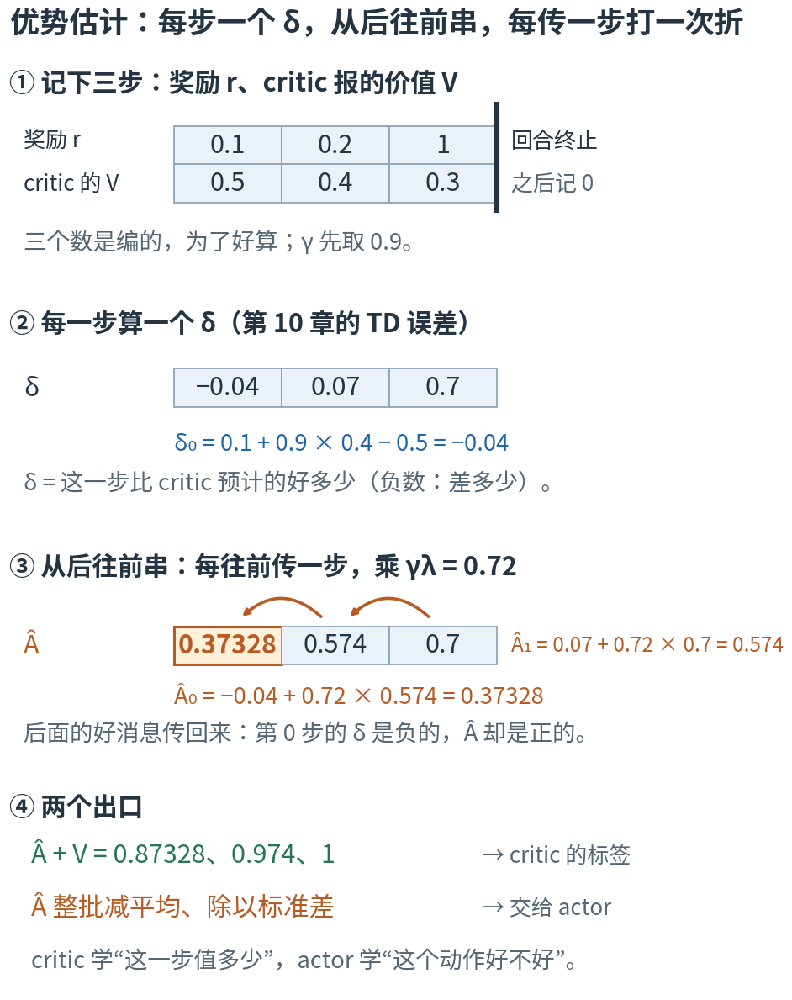
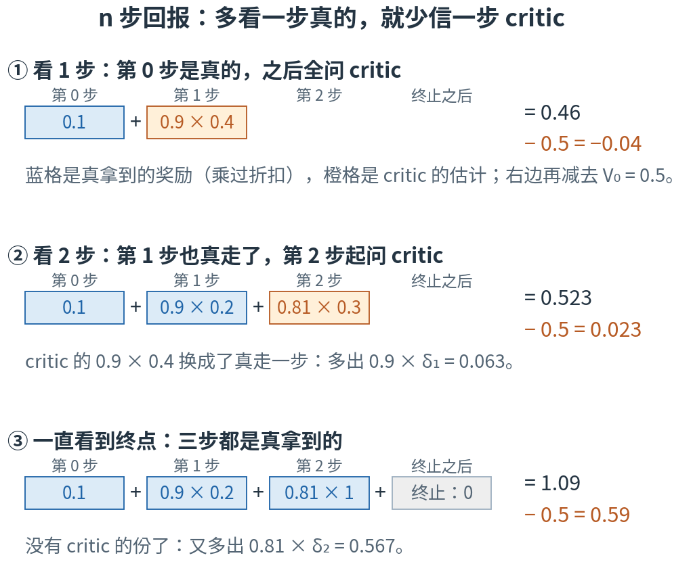
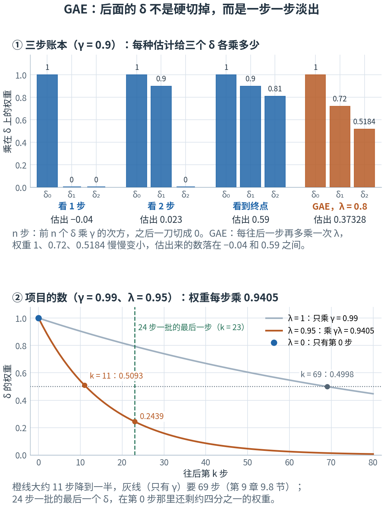
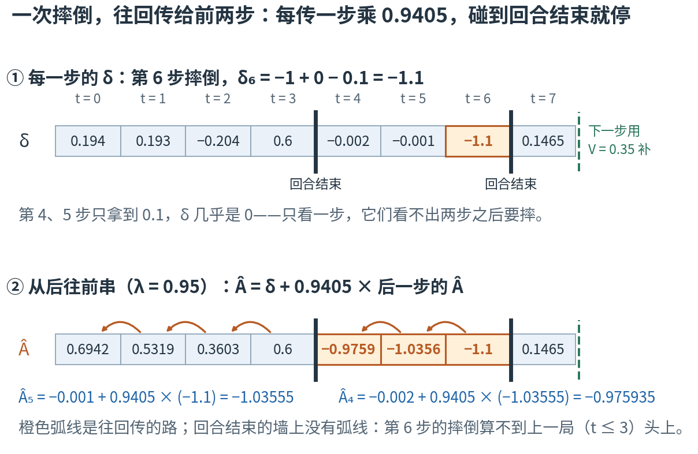
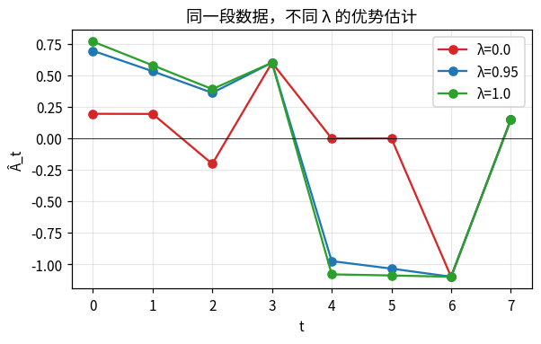
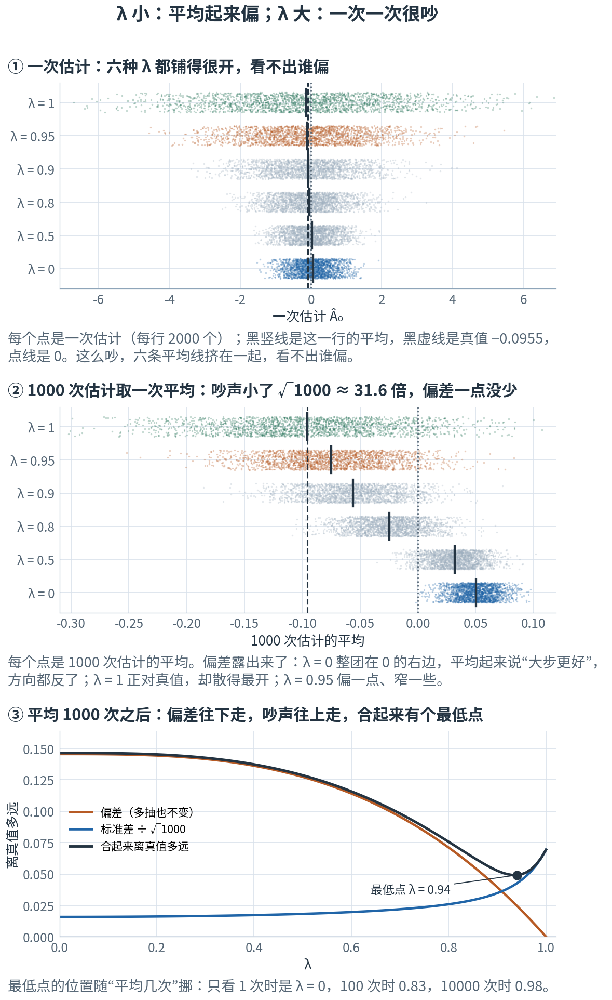
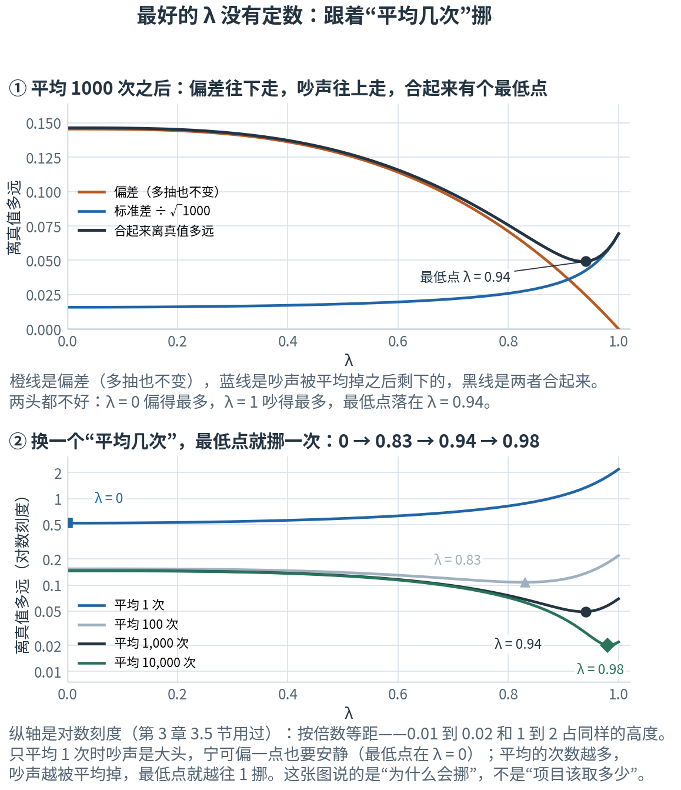
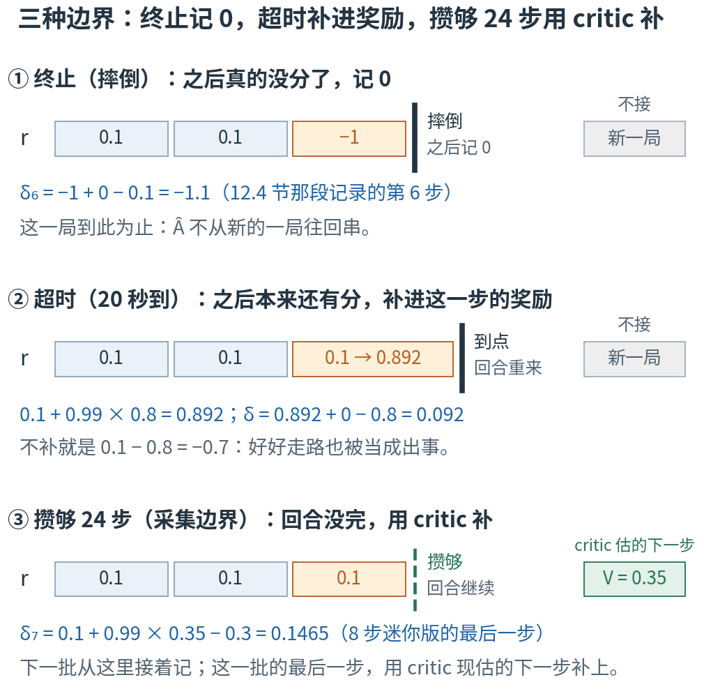

# 第 12 章 · 优势估计 GAE：一串"意外"从后往前传，每传一步打一次折

> **上一章我们有了什么**：第 11 章（策略梯度）的做法——抽到哪个动作，就把它的概率往上推一把，推多少看它**比平均好多少**；很多条记录平均起来，就是 actor（出动作的那张策略网络）的旋钮该往哪边拧。这个"比平均好多少"就是第 10 章 10.4 节的优势，第 11 章的公式里乘的是它的估计，写成 $\hat A$（读"A 帽"）。
>
> **这一章要补什么**：第 11 章留下的问题是：$\hat A$ 用什么算？第 10 章 10.4 节说过，一个 δ（10.3 节的 TD 误差：这一步比 critic 预计的好多少）就是优势的一次抽样；可它只看了一步，后面的事全凭 critic（估价值 V 的那张网络，10.5 节）的估计，critic 估错了，它就跟着错。
> 另一个极端是一直等到回合结束，拿真拿到的回报减去 V：不靠 critic，可一路上每一步的运气都加了进来，很吵；何况项目里每只机器人只走 24 步就要更新一次，常常等不到回合结束。
> 这一章在两个极端之间装一个旋钮 λ（读"拉姆达"）：把后面每一步的 δ 都加回来，越远的打越多的折。这就是 GAE（全名 12.3 节给），项目里 λ = 0.95。
> 本章最后，你会逐行读懂 rsl_rl（项目用的强化学习训练库）里干这件事的 `compute_returns()`——去掉注释和说明文字只有 12 行。
>
> **本章新词**：n 步回报、广义优势估计（GAE）、偏差、偏差-方差权衡、超时自举、优势归一化。
> **需要的前提**：第 9 章的终止与超时（9.6 节）、回报与折扣（9.7 节）；第 10 章的 TD 误差与自举（10.3 节）、优势（10.4 节）、critic（10.5 节）；
> 第 4 章的期望的线性（4.3 节）、方差与标准差和"平移、拉伸"两条规则（4.4 节）、"多抽几次取平均"（4.5 节）、"减平均、再除以标准差"（4.7 节）；第 8 章的归一化（8.3 节）。
> **不要求**会推导求和公式——本章用到的代数（分配律、提公因数、"一正一负抵消"）都拿三步的小账本一项一项摆开；只有字母版的一般写法放在"进阶"折叠里。

---

## 12.0 先看地图：一串"意外"，从后往前传，每传一步打一次折

**一个动作好不好，要看它之后发生了什么。每一步都有一个"意外"：比 critic 预计的好了多少、差了多少，就是第 10 章的 δ。
把后面每一步的意外都算回到这个动作头上，越远的算得越少（每远一步多打一次折），就是本章的优势估计 GAE；折打得多狠，由旋钮 λ 决定。**

还是第 10 章那个导航。你在一个路口选了上高速，事后想知道：这个选择到底好不好？有三种算法。

- **急性子**：开过第一段就下结论。这一段实际开了多久，加上导航新报的"剩下还要多久"，比出发时导航报的总时间少了 2 分钟——结论是"上高速好"。
  快，可后面的路全凭导航的预计：导航要是还不知道前面 30 公里在修路，结论就错了，而且每次都错在同一边。
- **慢性子**：一直开到上海，拿实际总用时和出发时的预计比。不再靠导航的预计，可总用时里掺着一路上的运气——后面的红灯、别人的剐蹭，
  和那个路口的选择毫无关系，也全算了进来。同样的选择，今天和明天的结论可能一正一负。
- **折中**：把后面每一段"比预计快了多少、慢了多少"都记到这个选择头上，但越往后的段记得越少。

第三种就是 GAE。这一章先用三步的小账本把它手算一遍，再看它在训练代码里是哪几行。



**读图顺序：** 从 ① 到 ④ 竖着读。① 是一段只有三步的记录：每一步拿到的奖励，critic 当时报的价值；走完这三步，回合终止。② 每一步算一个 δ。
③ 从最后一步往前，把后一步的 Â 乘 0.72，加到这一步的 δ 上（0.72 就是图上写的 γλ = 0.9 × 0.8。γλ 就是 γ × λ：字母挨着写，中间省掉了乘号；γ 是第 9 章 9.7 节的折扣，λ 是开篇说的那个旋钮，12.3 节细讲）。④ 算出来的 Â 有两个去处。
图里的数现在不用算，12.1–12.3 节会一个一个手算出来；④ 的第二行到 12.7 节再讲。

| 概念 | 它在回答什么问题 | 导航里对应什么 | 在哪一节 |
|---|---|---|---|
| 两个极端：一步估计、整局估计 | 这个动作比预计好多少：只看一步，还是一直看到回合结束？ | 急性子开过第一段就下结论；慢性子开到上海再比总用时 | 12.1 |
| n 步回报 | 先看 n 步真拿到的分，剩下的交给 critic？ | 开过 n 段再下结论 | 12.2 |
| GAE 和它的旋钮 λ | 后面每一步的意外，各记多少到这个动作头上？ | 折中：后面每段都记，越远记得越少 | 12.3 |
| 回合边界 | 往回记，记到哪里为止？ | 这一趟到站了，下一趟的堵车不算在这一趟头上 | 12.4、12.6 |
| 偏差、方差 | 很多次估计平均起来，偏了多少？一次和一次差多少？ | 导航不知道修路；一路上的运气 | 12.5 |
| 超时自举 | 时间到了停下，本来还有的分怎么补？ | 导航到点关机，剩下的路按它最后的预计算 | 12.6 |
| 优势归一化 | 交给 actor 之前，怎么统一尺度？ | 把"快了几分钟"换成"比这一批平均快了多少" | 12.7 |

表里的名字先不背，英文和符号到了各节再给。本章最容易混的四处，先贴上标签：

- **三个"偏差"**：第 1 章 1.9 节的偏差是"指令 − 实际"（要 0.4 m/s，走了 0.3 m/s，差 0.1）；第 4 章 4.4 节算方差时，偏差是"这一次的结果 − 平均"。
  12.5 节的偏差是第三种：**很多次估计的平均，离真值还差多少**（第 7 章 7.4 节讲起步修正时预告过这一种，本章正式讲）。那里有 ⚠️。
- **γ 和 λ**：都是"往后每多一步，多乘一次"的数，管的事却不同。γ 定"远处的分算多少"，是题目本身的一部分（第 9 章 9.7 节）；λ 定"后面的 δ 信多少"，是估计的办法。12.3 节把它们乘在一起，写成 γλ。
- **奖励 r、回报 G、代码里的 `returns`**：`returns` 是 critic 的标签 Â + V。只有 λ = 1、而且这一局在这批数据里走到了终止，它才等于第 9 章的回报 G（12.3 节）。
- **done 和终止**：done 是代码给每一步记的一个 0 或 1：0 是"接着走"，1 只说"这一局在这一步停了"。超时也会让 done = 1，可超时之后本来还有分（12.6 节）。

现在觉得这些区别有点抽象很正常，读到对应小节就清楚了。
还有一处数要留心：12.1–12.3 节为了好算，γ 取 0.9、λ 取 0.8；从 12.4 节起换成项目的 γ = 0.99、λ = 0.95。

第一次读，只要按顺序看正文、图和手算。标着"进阶"的折叠内容可以先跳过；代码是复核工具，不是阅读门槛。

## 12.1 两个极端：只看一步，还是一直看到终点

先造一段最短的记录（数是编的，为了好算）。一只机器人走了三步，每一步拿到的奖励，和 critic 在那一步报的价值：

| 第几步 t | 0 | 1 | 2 |
|---|---|---|---|
| 奖励 r | 0.1 | 0.2 | 1 |
| critic 报的 V | 0.5 | 0.4 | 0.3 |

"奖励 r"那一行是这一步当场拿到的分；"critic 报的 V"那一行是 critic 在这一步报的价值，意思是"从这一步起往后，平均还能拿多少"（第 10 章 10.1 节的价值，10.5 节由 critic 这张网络来估）。
第 2 步之后回合终止：之后没有分，"下一步的价值"记 0（第 10 章 10.1 节"终点记 0"）。γ 取 0.9：往后每多一步，分数多乘一次 0.9（第 9 章 9.7 节的折扣）。

要回答的问题是：**第 0 步做的那个动作，比平均好多少？**——第 10 章 10.4 节的优势：

优势 = "先做这个动作、之后照策略走，平均能拿多少" − "这一处境平均能拿多少（价值 V）"

后一半，critic 已经报了：$V_0 = 0.5$。难的是前一半：我们手里只有这一次的记录。下面两种最直接的算法，差别只在**怎么估"做了这个动作之后能拿多少"**。

**只看一步。** 第 0 步拿到 0.1；到了第 1 步，critic 说"从这里往后还值 0.4"，打一次折是 0.9 × 0.4 = 0.36。合起来 0.1 + 0.36 = 0.46——这就是"做了这个动作之后能拿多少"的一个估计：这一步真拿到的，加上 critic 对后面的估计。
它比 critic 在第 0 步的预计 0.5 少了 0.04：

$$\delta_0 = 0.1 + 0.9 × 0.4 - 0.5 = -0.04$$

这正是第 10 章 10.3 节的 TD 误差；10.4 节说过，一次 δ 就是优势的一次抽样（平均起来正好是优势）。结论：这个动作比平均差一点点。这种算法下面叫**一步估计**：只用了一步真拿到的奖励，其余全凭 critic。

**一直看到终点。** 三步真拿到的奖励打着折加起来，就是第 9 章 9.7 节的回报：$G_0 = 0.1 + 0.9 × 0.2 + 0.81 × 1 = 0.1 + 0.18 + 0.81 = 1.09$（0.81 = 0.9 × 0.9，打两次折）。
这回"做了这个动作之后能拿多少"不用估了，用的是真拿到的 1.09。再减去 critic 在第 0 步的预计：1.09 − 0.5 = 0.59。结论：这个动作比平均好得多。这种算法下面叫**整局估计**：除了最后减去的起点那个 V，一个 critic 的数都不用。

这两种算法第 10 章都见过：一步估计是 10.3 节 TD 的做法，整局估计是 10.1 节蒙特卡洛的做法（拿真拿到的回报，只是这里只跑了一次）。

同一个动作，一个说 −0.04，一个说 0.59，连正负号都不一样。差在哪？看第 1 步：critic 说"从第 1 步往后还值 0.4"，可实际从第 1 步起拿到的是 $G_1 = 0.2 + 0.9 × 1 = 1.1$。
critic 估低了一大截，一步估计照单全收；整局估计根本没用这个数。

那是不是整局估计就对了？也不是。这三个奖励只是**一次**的结果。真训练时，奖励每次都带着运气（第 10 章 10.1 节：同一格出发，两个回合的回报一个 1、一个 0.715），
一局越长，加进来的运气越多。一步估计只沾一步的运气，整局估计沾一整局的。两种算法各有各的毛病：一个怕 critic 不准，一个怕运气太吵。12.5 节会把这两种毛病量出来。

估出来的优势，第 11 章 11.4 节的公式里已经写成 $\hat A$（读"A 帽"）：帽子提醒你它是**估计**，不是第 10 章 10.4 节那个"平均起来才是"的真值 A。这一章讲的就是 $\hat A$ 怎么算。

| 符号 | 怎么读 | 就是 |
|---|---|---|
| $\hat A_t$ | "A 帽 t" | 第 t 步那个动作的优势的估计 |
| $s_t$、$s_{t+1}$ | "s t"、"s t 加 1" | 第 t 步的处境、下一步的处境（第 9 章 9.3 节：就是网络的输入）。右下角的小字是第几步，t + 1 就是 t 的下一步 |
| $\delta_t = r_t + \gamma V(s_{t+1}) - V(s_t)$ | "德尔塔 t" | 第 10 章 10.3 节的 TD 误差。一步估计：$\hat A_t = \delta_t$ |
| $G_t - V(s_t)$ | | 从第 t 步起真拿到的回报，减去 critic 在第 t 步的预计。整局估计：$\hat A_t = G_t - V(s_t)$ |

下面常把 $V(s_t)$ 简写成 $V_t$：$V_0 = 0.5$，$V_1 = 0.4$，$V_2 = 0.3$。

> **停一下，自测**：换成第 1 步的动作。一步估计和整局估计各是多少？
> <details><summary>答案</summary>
>
> 一步估计：$\delta_1 = 0.2 + 0.9 × 0.3 - 0.4 = 0.07$。整局估计：$G_1 - V_1 = 1.1 - 0.4 = 0.7$，差了 10 倍——还是因为 critic 在第 2 步报的 0.3，比实际的 1 低得多。
>
> </details>

后面几节要反复用到这三步各自的 δ，先列成一张账本。每一行都照 δ 的式子算：这一步拿到的奖励，加上打过一次折的"下一步的 V"，再减去这一步的 V（t = 1 那一行就是上面自测的答案）：

| 第几步 t | 这一步的奖励 $r_t$ | + γ × 下一步的 V | − 这一步的 V | = $\delta_t$ |
|---|---|---|---|---|
| 0 | 0.1 | + 0.9 × 0.4 = 0.36 | − 0.5 | −0.04 |
| 1 | 0.2 | + 0.9 × 0.3 = 0.27 | − 0.4 | 0.07 |
| 2 | 1 | + 0（终止了，下一步记 0） | − 0.3 | 0.7 |

实验第 1 节把这几个数都算了一遍：三个 δ 是 −0.04、0.07、0.7，$G_0 = 1.09$，$G_1 = 1.1$。

## 12.2 n 步回报：先看 n 步真拿到的分，剩下的问 critic

两个极端之间，有一串中间的算法：先看两步真拿到的分，再问 critic；或者先看三步……还是第 0 步，手算三种：

- **看 1 步**：$0.1 + 0.9 × 0.4 = 0.1 + 0.36 = 0.46$，减去 0.5 得 −0.04。就是 12.1 节的一步估计。
- **看 2 步**：第 0、1 步真拿到的 0.1 和 0.2，第 2 步起问 critic（它报 0.3，打两次折）：$0.1 + 0.9 × 0.2 + 0.81 × 0.3 = 0.1 + 0.18 + 0.243 = 0.523$，减去 0.5 得 0.023。
- **看 3 步**：三步都是真的，走完这三步回合已经终止，没有 critic 的份：$0.1 + 0.18 + 0.81 × 1 = 1.09$，减去 0.5 得 0.59。就是 12.1 节的整局估计。



**这样读图：** 每一行从左往右，是"从第 0 步起，每一步贡献多少"。蓝格是真拿到的奖励（已经乘过折扣），橙格是 critic 的估计（也乘过折扣）。
从 ① 到 ③，蓝格一格一格往右长，橙格一格一格往右退，最后退没了。每一行右边先加起来，再减去 critic 在第 0 步的预计 0.5。

这样"前 n 步用真拿到的奖励、第 n 步之后请 critic 补上"算出来的数，叫 **n 步回报**（n-step return）。第 10 章 10.3 节的 TD 目标 $r_t + \gamma V(s_{t+1})$——前 1 步是真的、之后问 critic——就是 1 步回报。写成式子：

$$G_t^{(n)} = r_t + \gamma r_{t+1} + \cdots + \gamma^{n-1} r_{t+n-1} + \gamma^n V(s_{t+n})$$

式子中间的 ⋯ 表示"中间照这个规律的几项，省略不写"。代 t = 0、n = 2 进去，省略的那段一项也不剩：$G_0^{(2)} = r_0 + \gamma r_1 + \gamma^2 V(s_2) = 0.1 + 0.9 × 0.2 + 0.81 × 0.3$，正是上面"看 2 步"那一行。

| 符号 | 怎么读 | 就是 |
|---|---|---|
| $G_t^{(n)}$ | "G t 的 n 步" | 从第 t 步起的 n 步回报。上标的括号只是"看几步"的标记，不是 n 次方 |
| $r_t + \cdots + \gamma^{n-1} r_{t+n-1}$ | | 前 n 步真拿到的奖励，打着折加起来（图里的蓝格）。下标从 t 数到 t + n − 1，正好 n 项；离第 t 步远几步，就打几次折，最远的那一项远 n − 1 步，所以乘 $\gamma^{n-1}$ |
| $\gamma^n V(s_{t+n})$ | | 第 n 步之后请 critic 补的那一块，打 n 次折（图里的橙格）。中途终止了，就没有这一项 |

n 步回报不是第 9 章的回报 G：它只有前 n 步是真拿到的，最后一项是 critic 的估计。只有回合在这 n 步里终止了（图里的 ③），它才等于 G。

再看减去 0.5 之后的三个数：−0.04 → 0.023 → 0.59。每多看一步，多出来多少？

- 1 步 → 2 步：多出 0.023 − (−0.04) = 0.023 + 0.04 = 0.063（减去一个负数，就是加上它的大小），而 0.063 = 0.9 × 0.07，正好是**打过一次折的 δ₁**（δ₁ = 0.07，12.1 节账本里 t = 1 那一行）。
- 2 步 → 3 步：多出 0.59 − 0.023 = 0.567 = 0.81 × 0.7，正好是**打过两次折的 δ₂**（δ₂ = 0.7，账本里 t = 2 那一行）。

### 为什么正好多出一个 δ：一步一步看

不是巧合。先看从"看 1 步"到"看 2 步"，算式里变了哪一块（两行最后都要减 0.5，那一块没变）：

- 看 1 步：0.1 + **0.9 × 0.4**
- 看 2 步：0.1 + **0.9 × 0.2 + 0.81 × 0.3**

只有加粗的部分变了：critic 对第 1 步的估计，打过折是 0.9 × 0.4 = 0.36；换成了"真走一步"，0.9 × 0.2 + 0.81 × 0.3 = 0.18 + 0.243 = 0.423。差额 0.423 − 0.36 = 0.063。
这个 0.063 为什么正好是 0.9 × δ₁？分三步看。

1. **提公因数。** 0.81 就是 0.9 × 0.9，所以新换上的那块是 0.9 × 0.2 + 0.9 × (0.9 × 0.3)：两项都乘着 0.9。两件东西各打九折再相加，等于先相加、再打九折——把每一项都乘着的那个数提到括号外面，这叫**提公因数**。
   核对：0.9 × 0.2 + 0.9 × 0.27 = 0.18 + 0.243 = 0.423；先加再乘，0.9 × (0.2 + 0.27) = 0.9 × 0.47 = 0.423，一样。
2. **再提一次。** 差额是 0.9 × 0.47 − 0.9 × 0.4，两项又都乘着 0.9，提出来：0.9 × (0.47 − 0.4) = 0.9 × 0.07 = 0.063。
3. **认出括号里是谁。** 0.47 − 0.4 = 0.2 + 0.27 − 0.4 = 0.2 + 0.9 × 0.3 − 0.4：第 1 步的奖励，加 γ × 下一步的 V，减第 1 步的 V——正是账本里 t = 1 那一行，δ₁ 的定义。

大白话：多看一步，就是把"critic 报的 $V_1$"，换成"真走一步看到的 $r_1 + \gamma V_2$"。两者之差 $r_1 + \gamma V_2 - V_1$ 就是 δ₁；这件事发生在一步之后，所以整个再打一次折。

### 把一整串摆开：中间的 V 一正一负，全抵消

再多看一步，还是同一件事。下面把"看到终点"那一行的三个打过折的 δ，各拆成三块，一项一项摆开。
拆的时候，乘在 δ 前面的 0.9、0.81 要分给括号里的每一项——这是分配律：一个和乘一个数，等于每一项各乘这个数再相加（第 4 章 4.3 节，$(2 + 3) × 4 = 2 × 4 + 3 × 4$）。
表中间的三列就是账本的三块：真拿到的奖励、加上的"下一步的 V"、减去的"这一步的 V"，都乘过了各自的折扣；最后一列是这一行加起来。

| 这一行 | 真拿到的奖励 | + 下一步的 V | − 这一步的 V | 这一行合计 |
|---|---|---|---|---|
| $\delta_0$ | 0.1 | + 0.9 × 0.4 = 0.36 | −0.5 | −0.04 |
| $0.9 × \delta_1$ | 0.9 × 0.2 = 0.18 | + 0.81 × 0.3 = 0.243 | −0.9 × 0.4 = −0.36 | 0.063 |
| $0.81 × \delta_2$ | 0.81 × 1 = 0.81 | + 0（终止了） | −0.81 × 0.3 = −0.243 | 0.567 |
| 竖着加 | 1.09 | 0.603 | −1.103 | 0.59 |

在表里找两个 0.36：δ₀ 那一行"+ 下一步的 V"那一格是 +0.36，0.9 × δ₁ 那一行"− 这一步的 V"那一格是 −0.36。它们是同一个数——critic 对第 1 步报的 $V_1 = 0.4$，打一次折——在第 0 步的 δ 里当"下一步"加进来，在第 1 步的 δ 里当"这一步"减出去。
两个 0.243 也一样（$V_2 = 0.3$ 打两次折），错开一行、一正一负。加起来，这几对全抵消："+ 下一步的 V"那一列加"− 这一步的 V"那一列，0.603 + (−1.103) = −0.5，只剩没人来抵的 $-V_0$。
所以整张表加起来，就是"真拿到的奖励"那一列的 1.09（回报 $G_0$）减 0.5：0.59。这种错开一行、一正一负的抵消，像一节一节收起来的望远镜，每一节的头都被下一节的尾盖住，只剩最外面的两端——叫**望远镜消去**。

只取前两行，就是"看 2 步"：$(0.1 + 0.36 - 0.5) + (0.18 + 0.243 - 0.36)$ 里两个 0.36 抵消，剩 $0.1 + 0.18 + 0.243 - 0.5 = 0.023$，正是看 2 步的估计；
0.9 × δ₁ 那一行的 +0.243 这回没有下一行来抵它，它就是 2 步回报里"请 critic 补"的那一块 0.81 × $V_2$。看几步都是这样：前 n 个打过折的 δ 加起来，中间的 V 两两抵消，剩下的正好是 n 步回报减去起点的 V：

$$\text{看 n 步的优势估计} = G_t^{(n)} - V(s_t) = \delta_t + \gamma\,\delta_{t+1} + \cdots + \gamma^{n-1}\,\delta_{t+n-1}$$

右边每一项比前一项多乘一个 γ：离第 t 步远几步，就打几次折。看到终点的那一行：$-0.04 + 0.9 × 0.07 + 0.81 × 0.7 = -0.04 + 0.063 + 0.567 = 0.59$，正是 $G_0 - V_0$。

<details>
<summary>进阶：字母版，任何 γ、任何 n 都这样抵消（现在可跳过）</summary>

把往后第 k 个 δ 乘上 $\gamma^k$，按分配律写开（k = 0、1、……、n − 1）：

$$\gamma^k\,\delta_{t+k} = \gamma^k r_{t+k} + \gamma^{k+1} V(s_{t+k+1}) - \gamma^{k} V(s_{t+k})$$

中间那项是 $\gamma^k × \gamma = \gamma^{k+1}$：多乘一个 γ，次数加 1。把 k = 0 到 n − 1 这 n 行竖着摆，和上面的表一样分成"真拿到的奖励""+ 下一步的 V""− 这一步的 V"三列：

- "真拿到的奖励"那一列加起来是 $r_t + \gamma r_{t+1} + \cdots + \gamma^{n-1} r_{t+n-1}$：n 步回报里真拿到的那部分。
- 第 k 行"+ 下一步的 V"那一格的 $+\gamma^{k+1} V(s_{t+k+1})$，和第 k + 1 行"− 这一步的 V"那一格的 $-\gamma^{k+1} V(s_{t+k+1})$ 是同一个数，一正一负抵消。
- 没被抵消的只剩两个：k = 0 那一行"− 这一步的 V"的 $-V(s_t)$（上面没有行来抵它），和最后一行"+ 下一步的 V"的 $+\gamma^n V(s_{t+n})$（下面没有行来抵它）。

三列合起来就是 $G_t^{(n)} - V(s_t)$。要是这 n 步里回合终止了，终止那一步的"下一步的 V"记 0，最后剩下的就是 $G_t - V(s_t)$——上面"看到终点"那一行就是这种情形。

</details>

实验第 2 节把这三行分成"真拿到的""critic 补的"两块印了出来，也把上面这张摆开的表竖着加了一遍，数和上面一样。

看几步，就是在"信 critic"和"信真实奖励"之间选一个位置：n 越小，越依赖 critic 报得准；n 越大，加进来的真实奖励（连同它们的运气）越多。

> **停一下，自测**：假如 critic 在第 2 步报准了，报的是 1（从第 2 步起实际就拿到 1），而不是 0.3。看 2 步的估计变成多少？和看到终点的比呢？看 1 步的呢？
> <details><summary>答案</summary>
>
> $0.1 + 0.18 + 0.81 × 1 - 0.5 = 0.59$，和看到终点的一模一样：第 2 步报准了，"第 2 步之后请 critic 补"的那一块，就和真拿到的一样多。
> 看 1 步却还是 $0.1 + 0.9 × 0.4 - 0.5 = -0.04$：它靠的是 $V_1 = 0.4$，而从第 1 步起实际拿到的是 1.1（12.1 节），$V_1$ 还是错的。
> 要 critic 每一步都报准，看几步结论才都一样（在不算运气的这个账本里）；n 越小，越依赖这份"准"。
>
> </details>

## 12.3 GAE：后面的 δ 全都加进来，越远打越多的折

12.2 节的 n 步估计有一个生硬的地方：前 n 个 δ 照单全收，第 n 个之后**一刀切成 0**。n = 1 时只信第 0 步的 δ；n = 3 时三个都信。
挑哪个 n 都别扭：比如看 2 步，第 1 步的 δ 算足十成，第 2 步的一成也不算——可这两个 δ 离得只差一步。
能不能不切，让后面的 δ 一个一个**淡出**，离得越远信得越少？办法是：往后第 k 个 δ（k = 0 是这一步自己的 δ，k = 1 是下一步的，依此类推），除了照常乘 γ 的 k 次方，再多乘一个 λ 的 k 次方，λ 是 0 到 1 之间的一个数。
为什么偏偏是"每远一步，多乘一次同一个数"？因为这样它就和回报的折扣长成一个样子，可以像回报那样从后往前一步算完（本节后面的 reduceRight）。

取 λ = 0.8。往后第 1 个 δ 乘 γ × λ = 0.9 × 0.8 = 0.72。往后第 2 个 δ 本来乘 γ² = 0.81，再乘 λ² = 0.64：0.81 × 0.64 = 0.5184，正好等于 0.72 × 0.72。
这不是巧合：0.9 × 0.9 × 0.8 × 0.8 是四个数相乘，可以随便换顺序、重新分组，排成 (0.9 × 0.8) × (0.9 × 0.8)，就是 0.72 × 0.72。所以"乘 k 次 γ、再乘 k 次 λ"，就是"乘 k 次 γλ"，写作 $(\gamma\lambda)^k$。三步账本上：

$$\hat A_0 = -0.04 + 0.72 × 0.07 + 0.5184 × 0.7 = -0.04 + 0.0504 + 0.36288 = 0.37328$$

它落在一步估计 −0.04 和整局估计 0.59 之间。这种算法叫**广义优势估计**（generalized advantage estimation，GAE）："广义"是说，一步估计和整局估计都是它的特例——λ 取 0 或 1 就是（下面马上看到）。写成一般的式子：

$$\hat A_t = \delta_t + (\gamma\lambda)\,\delta_{t+1} + (\gamma\lambda)^2\,\delta_{t+2} + \cdots = \sum_{k=0}^{\infty} (\gamma\lambda)^k\,\delta_{t+k}$$

| 符号 | 怎么读 | 就是 |
|---|---|---|
| $\lambda$ | "拉姆达" | 新旋钮，0 到 1 之间。越大，后面的 δ 淡出得越慢。项目里 0.95 |
| $\gamma\lambda$ | "伽马拉姆达" | 每往后一步多乘的数：本节 0.72，项目里 0.99 × 0.95 = 0.9405 |
| $(\gamma\lambda)^k$ | | 往后第 k 个 δ 的权重：打 k 次折 |
| $\sum_{k=0}^{\infty}$ | "对 k 从 0 到无穷求和" | 第 2 章 2.2 节的 for 循环。碰到回合结束就停，一局有限长 |

两头正好是 12.1 节的两个极端。λ = 0：第一项 $\delta_t$ 前面没乘任何 γλ（权重是 1），后面每一项都至少乘了一个 λ = 0，全成了 0，只剩 $\hat A_t = \delta_t$，一步估计。
λ = 1：$(\gamma × 1)^k = \gamma^k$，权重变回 γ 的次方，就是 12.2 节"看到终点"那一行——中间的 V 望远镜消去，剩 $G_t - V(s_t)$。
λ 从 0 拧到 1，GAE 就从"只信 critic"滑到"只信真实奖励"。γ 和 λ 虽然都是每步乘一次，γ 定的是"远处的分算多少"（题目本身），λ 定的是"后面的 δ 信多少"（估计的办法）。

### λ 是一个"软的 n"：权重一步一步淡出

先把权重列出来。每往后一步，权重乘一次 0.72：1、0.72、0.5184、0.3732、0.2687……一步一步变小，却不会在哪一步突然变成 0——正是第 1 章 1.8 节"每走一步，乘同一个数"的衰减。

下图上半把 12.2 节的三种 n 步估计和 GAE 并排放，看它们各给三个 δ 乘多少；下半换成项目的数。



**这样读图：** ① 每组三根柱子是乘在 δ₀、δ₁、δ₂ 上的权重。蓝色的 n 步估计：前几根是 1、0.9、0.81，后面一刀切成 0；橙色的 GAE：1、0.72、0.5184，一根比一根矮，但没有哪一根是 0。
② 横轴是往后第几步（k 从 0 数起），纵轴是那一步的 δ 的权重，灰色点线是一半。灰线只乘 γ = 0.99（λ = 1），第 69 步才降到一半——就是第 9 章 9.8 节那条线；左上角的蓝点是 λ = 0：只有第 0 步的权重是 1，往后全是 0。
橙线乘 0.9405（λ = 0.95），第 11 步就只剩 0.5093。绿色虚线是 24 步一批的最后一步：从 0 数起，第 24 步的编号是 23，那里的 δ 对第 0 步还有 0.2439 的权重。这两个数在浏览器控制台里按一下就有：`0.9405 ** 11`、`0.9405 ** 23`。

所以项目里的 GAE，往后第 11 步的 δ，权重就只剩一半左右（0.9405 连乘 11 次是 0.5093，连乘 12 次是 0.4790）。

为什么说 λ 是一个"软的 n"？把 γ 本来就要打的那份折先放一边（那是题目定的，12.0 节说过），只看 λ 管的那一份——"后面这个 δ 信几成"：

| 往后第 k 个 δ | 0 | 1 | 2 | 3 | 4 | …… |
|---|---|---|---|---|---|---|
| 看 2 步：信几成 | 1 | 1 | 0 | 0 | 0 | 一直是 0 |
| GAE（λ = 0.8）：信几成 = $\lambda^k$ | 1 | 0.8 | 0.64 | 0.512 | 0.4096 | 越来越小 |

n 步估计是"前 n 个全信，之后全不信"，信的成数加起来正好是 n。GAE 越往后信得越少，成数加起来是 1 + 0.8 + 0.64 + 0.512 + ⋯：前 10 项是 4.46，前 20 项是 4.94，越加越接近 5，却永远超不过 5。
这和第 9 章 9.8 节的进阶折叠是同一种加法：那里 1 + 0.99 + 0.99² + ⋯ 越来越接近 1 ÷ (1 − 0.99) = 100，这里是 1 ÷ (1 − 0.8) = 5。
所以 λ = 0.8 的 GAE，大致相当于"看 5 步"，只是不在第 5 步一刀切，而是慢慢淡出；项目的 λ = 0.95，大致相当于看 1 ÷ (1 − 0.95) = 20 步。这就是"软的 n"。
（这个 20 和上面的"第 11 步权重剩一半"量的不是一回事：20 只算 λ 管的"信几成"、而且是全部加起来；11 是连 γ 的折一起算、权重降到一半的那个位置。）

<details>
<summary>进阶：GAE 也是 1 步、2 步、3 步估计的加权平均（现在可跳过）</summary>

12.2 节算过：看 1 步、2 步、3 步的优势估计是 −0.04、0.023、0.59。给它们三个权重 $1-\lambda$、$(1-\lambda)\lambda$、$\lambda^2$，λ = 0.8 时是 0.2、0.16、0.64：

$$0.2 × (-0.04) + 0.16 × 0.023 + 0.64 × 0.59 = -0.008 + 0.00368 + 0.3776 = 0.37328$$

又是 GAE。

**三个权重怎么来的。** 像分一块蛋糕：先切下 1 − λ = 0.2 给 1 步估计，剩 0.8；再从剩下的里切两成，0.8 × 0.2 = 0.16，给 2 步估计，剩 0.8 − 0.16 = 0.64；第 3 步之后回合已经终止，没有更长的估计可分，剩下的 0.64 全给 3 步估计。
分的是同一块蛋糕，所以三份加起来正好是 1：0.2 + 0.16 + 0.64 = 1——和第 4 章 4.3 节按概率加权一样，权重加起来是 1，才是正经的加权平均。
字母版也是一正一负抵消：$(1-\lambda) + (1-\lambda)\lambda + \lambda^2 = 1 - \lambda + \lambda - \lambda^2 + \lambda^2 = 1$。
一局更长时照样往下分：第 n 份是 $(1-\lambda)\lambda^{n-1}$（剩下的蛋糕里切 1 − λ 那么一份），一局结束时，最后一份接住剩下的全部。
合起来写（把每份都有的 1 − λ 提到外面）：GAE = $(1-\lambda)$ × [1 步估计 + λ × 2 步估计 + λ² × 3 步估计 + ⋯]，一局结束时，最后一项接住剩下的所有权重。

**为什么正好等于 GAE。** 把 12.2 节的"n 步估计 = 前 n 个 δ 打折相加"代进去，数一数每个 δ 一共分到多少。表里每一格是"这种估计给这个 δ 乘多少"，最后一行按权重加起来：

| 估计 | 权重 | δ₀ 的系数 | δ₁ 的系数 | δ₂ 的系数 |
|---|---|---|---|---|
| 1 步估计 | 0.2 | 1 | 0 | 0 |
| 2 步估计 | 0.16 | 1 | 0.9 | 0 |
| 3 步估计 | 0.64 | 1 | 0.9 | 0.81 |
| 按权重加起来 | | 0.2 + 0.16 + 0.64 = 1 | (0.16 + 0.64) × 0.9 = 0.72 | 0.64 × 0.81 = 0.5184 |

最后一行是 1、0.72、0.5184——正好是 GAE 给三个 δ 的权重 1、γλ、(γλ)²。

</details>

### 从后往前算：和回报一样的 reduceRight

照定义算，每一步都要把后面所有的 δ 重新加一遍。项目里一批 24 步：第 0 步要加 24 项，第 1 步 23 项……最后一步 1 项，一共 24 + 23 + ⋯ + 1 = 300 项（首尾配对，24 + 1、23 + 2……每对都是 25，一共 12 对，12 × 25 = 300）。
第 9 章 9.7 节的回报有一个省事的算法：从最后一步往前，这一步的分，加上 γ 乘"后一步起的回报"。GAE 照搬，只是"这一步的分"换成 δ，γ 换成 γλ——24 步只要往前走 24 次。从最后一步往前手算：

1. $\hat A_2 = \delta_2 = 0.7$：第 2 步之后回合终止，后面没有了。
2. $\hat A_1 = 0.07 + 0.72 × 0.7 = 0.07 + 0.504 = 0.574$。
3. $\hat A_0 = -0.04 + 0.72 × 0.574 = -0.04 + 0.41328 = 0.37328$。

和上面按定义算的 0.37328 一样。写成式子，和第 9 章 9.7 节的 $G_t = r_t + \gamma G_{t+1}$ 是同一个样子：

$$\hat A_t = \delta_t + \gamma\lambda\,\hat A_{t+1}\qquad\text{（回合在第 t 步之后结束，就不加后面那一项）}$$

写成 JS 就是 `reduceRight`：

```js
const deltas = [-0.04, 0.07, 0.7], gl = 0.9 * 0.8;               // 三个 δ；每往前传一步乘 γλ = 0.72
const A0 = deltas.reduceRight((later, d) => d + gl * later, 0);   // 从最后一个往前：0.7 → 0.574 → 0.37328
```

`reduceRight` 从数组的最后一个往前走：`d` 是这一步的 δ，`later` 是后面已经算好的那个 Â；末尾那个 0 是起点——最后一步之后，没有 Â 可接。
控制台会印出 0.3732800000000001：小数在计算机里存得不精确，末尾那个 1 不用管。

### 递推为什么和定义算出同一个数：代进去，一层一层展开

递推算出的 0.37328 和按定义算的一样，不是凑巧。把三步账本的递推一层一层代进去：

1. 递推的 t = 0 那一行：$\hat A_0 = -0.04 + 0.72 × \hat A_1$。
2. 把 t = 1 那一行 $\hat A_1 = 0.07 + 0.72 × \hat A_2$ 整个代进来：$\hat A_0 = -0.04 + 0.72 × (0.07 + 0.72 × \hat A_2)$。
3. 分配律，括号里每一项各乘 0.72：$\hat A_0 = -0.04 + 0.72 × 0.07 + 0.72 × 0.72 × \hat A_2$。
4. $\hat A_2 = \delta_2 = 0.7$，$0.72 × 0.72 = 0.5184$：$\hat A_0 = -0.04 + 0.72 × 0.07 + 0.5184 × 0.7$——一字不差，就是本节开头按定义写的那一行。

用数核对第 3 步：先算括号，$0.72 × 0.574 = 0.41328$；拆开算，$0.72 × 0.07 + 0.72 × 0.504 = 0.0504 + 0.36288 = 0.41328$，一样（0.504 就是 $\hat A_1$ 里的 0.72 × 0.7）。

换成哪一步、一局多长都一样。按定义，$\hat A_{t+1} = \delta_{t+1} + \gamma\lambda\,\delta_{t+2} + (\gamma\lambda)^2\delta_{t+3} + \cdots$。整串乘上 γλ，每一项都多乘一个 γλ：$\gamma\lambda\,\delta_{t+1} + (\gamma\lambda)^2\delta_{t+2} + (\gamma\lambda)^3\delta_{t+3} + \cdots$；
前面再添上 $\delta_t$，正好就是 $\hat A_t$ 的定义。所以 $\hat A_t = \delta_t + \gamma\lambda\,\hat A_{t+1}$ 对每一步都成立——递推只是把定义式从后往前、一层一层地算，每个 δ 只碰一次。

第 0 步的 δ 是负的（−0.04），它的 Â 却是正的（0.37328）：后面两步的好消息传了回来，改变了对这一步的评价。
但别把它读成"证明了第 0 步的动作单独造成了后面的好结果"——这只是一次估计，要很多条记录平均起来才作数（第 10 章 10.4 节的那条自测）。

实验第 3 节把展开和递推都算了一遍，每一步都相同。

> **停一下，自测**：把 λ 换成 0.5（γλ = 0.45），用从后往前的办法算 $\hat A_1$ 和 $\hat A_0$；再用展开式核对 $\hat A_0$。
> <details><summary>答案</summary>
>
> $\hat A_2 = 0.7$；$\hat A_1 = 0.07 + 0.45 × 0.7 = 0.385$；$\hat A_0 = -0.04 + 0.45 × 0.385 = 0.13325$。
> 展开：$-0.04 + 0.45 × 0.07 + 0.2025 × 0.7 = -0.04 + 0.0315 + 0.14175 = 0.13325$。λ 变小，后面的好消息传回来的更少，Â₀ 从 0.37328 降到 0.13325。
>
> </details>

### critic 的标签：returns = Â + V

第 10 章 10.5 节说，critic 的标签（训练 critic 时当标准答案用的那个数）是"TD 目标的升级版"。升级版就是它：把 Â 加回 critic 当时报的 V——

$$\text{returns}_t = \hat A_t + V(s_t)$$

三步账本：0.37328 + 0.5 = 0.87328，0.574 + 0.4 = 0.974，0.7 + 0.3 = 1。

为什么加回 V 就是标签？回到 12.1 节那句话：优势的估计 = "做了这个动作之后，估计能拿多少" − $V(s_t)$。把减掉的 V 加回去，剩下的就是"从这一步起，估计能拿多少"本身——critic 该学着报的，正是这个数。
看 n 步时，"估计能拿多少"就是 n 步回报（12.2 节：看 n 步的 Â = $G_t^{(n)} - V(s_t)$），加回 V，标签就是 n 步回报。GAE 把几种 n 步估计按 λ 掺在一起，标签也就是几种 n 步回报按同样的比例掺在一起（下面的折叠拆开核对了 0.87328）。

λ 一变，这个标签也跟着变，而且两头正好落在两个老朋友身上。λ = 0 时 Â = δ，returns = δ + V = r + γV(s')，正是第 10 章 10.3 节的 TD 目标（1 步回报）：第 0 步是 −0.04 + 0.5 = 0.46，就是 0.1 + 0.9 × 0.4。
λ = 1 时 Â = G − V，加回 V 就是真拿到的回报 G：第 0 步 0.59 + 0.5 = 1.09，三步依次是 1.09、1.1、1。项目的 λ = 0.95，标签落在两者之间，更靠近真实的回报。

<details>
<summary>进阶：λ = 0、0.8、1 三种 returns 并排核对（现在可跳过）</summary>

```
t  λ = 0：TD 目标  λ = 0.8：returns  λ = 1：回报 G
-  --------------  ----------------  -------------
0            0.46           0.87328           1.09
1            0.47             0.974            1.1
2               1                 1              1
```

横着读一行，就是同一步的标签随 λ 从"只信 critic 一步"滑到"真拿到的回报"。第 2 步三列都是 1：它后面紧挨着终止，没有可滑的余地。

中间那一列为什么落在两头之间？因为它就是三种 n 步回报的加权平均。"GAE 也是 1 步、2 步、3 步估计的加权平均"那个折叠里的权重 0.2、0.16、0.64，原样用在 12.2 节的 1 步、2 步、3 步回报 0.46、0.523、1.09 上：

$$0.2 × 0.46 + 0.16 × 0.523 + 0.64 × 1.09 = 0.092 + 0.08368 + 0.6976 = 0.87328$$

能这样换，靠的是三个权重加起来是 1：每种 n 步估计都是"n 步回报 − 0.5"，按权重平均以后，三个 −0.5 合起来还是一个 −0.5（0.2 × 0.5 + 0.16 × 0.5 + 0.64 × 0.5 = 0.5），加回 $V_0 = 0.5$ 正好抵掉。

从后往前还有一种看法，λ 管什么看得更清楚。把 t = 1 的标签写开：$0.2 + 0.9 × (0.2 × 0.3 + 0.8 × 1) = 0.2 + 0.9 × 0.86 = 0.974$——这一步真拿到的 0.2，加上 γ 乘"下一步 critic 报的 V（0.3）信两成，下一步的标签（1）信八成"。
第 0 步同样：$0.1 + 0.9 × (0.2 × 0.4 + 0.8 × 0.974) = 0.1 + 0.9 × 0.8592 = 0.87328$。两成、八成就是 1 − λ 和 λ：λ = 0 全信下一步的 V，就是 TD 目标；λ = 1 全信下一步的标签，一路接到终点，就是回报 G。
这个写法是怎么来的，用字母走三步：

1. 递推：$\text{returns}_t = \hat A_t + V_t = \delta_t + \gamma\lambda\,\hat A_{t+1} + V_t$。
2. 把 $\delta_t = r_t + \gamma V_{t+1} - V_t$ 代进去，$-V_t$ 和 $+V_t$ 抵掉，剩 $r_t + \gamma V_{t+1} + \gamma\lambda\,\hat A_{t+1}$。
3. 下一步也有 $\hat A_{t+1} = \text{returns}_{t+1} - V_{t+1}$，代进去，再把 γ 提到括号外：$r_t + \gamma\big(V_{t+1} - \lambda V_{t+1} + \lambda\,\text{returns}_{t+1}\big) = r_t + \gamma\big((1-\lambda)V_{t+1} + \lambda\,\text{returns}_{t+1}\big)$。

</details>

> ⚠️ **`returns` 不是第 9 章的回报 G。** 代码里把 critic 的标签叫 `returns`，可它是 Â + V：用了 critic 自己的估计，也被 λ 打过折。
> 只有 λ = 1、而且这一局在这批数据里走到了终止，它才等于 G。三个"分"别混：奖励 r 是一步的分，回报 G 是真拿到的折扣总和，`returns` 是给 critic 的标签。

**为什么重要**：第 11 章（策略梯度）乘在"推一把"后面的，就是这里的 Â；第 10 章 10.5 节 critic 要追的标签，就是这里的 returns。一次倒着的循环，同时喂饱了 actor 和 critic 两张网络（📍 映射到项目）。

## 12.4 往回传：一次摔倒，提前算到前两步头上

从这一节起换成项目的数：γ = 0.99，λ = 0.95，每往前传一步乘 γλ = 0.9405。记录也长一点：一只机器人连续 8 步（项目里是 24 步，这是它的迷你版），中间有两次回合结束。
数还是编的，但各种情况都有：第 3 步拿到 +1 后这一局终止；第 4 步起是新的一局，第 6 步摔倒（奖励 −1，终止）；第 7 步又是新的一局，记到这里正好攒够 8 步——
这时 critic 对"下一步"估的价值是 0.35（下面记作 $V_{\text{last}}$）。先照 12.1 节的办法，每一步算一个 δ：

```
t    r    V  这一步之后       δ
-  ---  ---  ----------  ------
0  0.1  0.5               0.194
1  0.1  0.6               0.193
2  0.1  0.7              -0.204
3    1  0.4        终止     0.6
4  0.1  0.3              -0.002
5  0.1  0.2              -0.001
6   -1  0.1        终止    -1.1
7  0.1  0.3   攒够 8 步  0.1465
```

**这张表要看的是最后一列。** 前四列只是记录本身（这一步拿到多少、critic 当时报多少、这一步之后有没有停），δ 是从它们算出来的，一步一个。
抽几个核对：$\delta_0 = 0.1 + 0.99 × 0.6 - 0.5 = 0.1 + 0.594 - 0.5 = 0.194$；第 3 步之后终止，下一步的价值记 0，$\delta_3 = 1 + 0 - 0.4 = 0.6$；同理 $\delta_6 = -1 + 0 - 0.1 = -1.1$；
第 7 步是这一批的最后一步，下一步的价值用 $V_{\text{last}}$：$\delta_7 = 0.1 + 0.99 × 0.35 - 0.3 = 0.1 + 0.3465 - 0.3 = 0.1465$。

再从后往前串。多了一条规矩：**碰到回合结束就断开**——第 t 步之后回合结束了，第 t + 1 步属于新的一局，它的 Â 不能加到第 t 步上。
道理很直接：新的一局是重新摆好的机器人，那里发生的好事坏事，和这一步做的动作毫无关系，不该记到它头上。

1. $\hat A_7 = \delta_7 = 0.1465$：这一批里它后面没有记录了（它之后的未来，已经由 $V_{\text{last}}$ 算进 δ₇）。
2. $\hat A_6 = \delta_6 = -1.1$：第 6 步之后回合结束，第 7 步是新的一局，不接。
3. $\hat A_5 = -0.001 + 0.9405 × (-1.1) = -0.001 - 1.03455 = -1.03555$。
4. $\hat A_4 = -0.002 + 0.9405 × (-1.03555) = -0.002 - 0.973935 = -0.975935$（0.9405 × 1.03555 = 0.973934775，留六位小数）。
5. $\hat A_3 = \delta_3 = 0.6$：第 3 步之后回合结束，第 4 步起是新的一局，不接。
6. 再往前照常：$\hat A_2 = -0.204 + 0.9405 × 0.6 = -0.204 + 0.5643 = 0.3603$，$\hat A_1$、$\hat A_0$ 留给自测。

看第 4、5 步：它们各只拿到 0.1，δ 几乎是 0（−0.002、−0.001）——只看一步，看不出任何问题。可它们的 Â 是 −0.98、−1.04：第 6 步的摔倒传了回来。
**GAE 把"两步之后要摔"的消息，提前算到了第 4 步头上。** 传到第 4 步时乘了两次 0.9405：0.9405 × 0.9405 × (−1.1) ≈ −0.973（≈ 读"约等于"：精确值是 −0.972994…，这里只留三位小数），Â₄ 的大头就是它。



**这样读图：** ① 上排是每一步的 δ。第 6 步的 −1.1 最显眼；第 4、5 步的 δ 几乎是 0。两道粗竖线是回合结束；最右边的绿色虚线是这一批的末尾，那里用 $V_{\text{last}} = 0.35$ 补。
② 下排是 Â。橙色弧线是往回传的路：每条弧把后一格的 Â 乘 0.9405，加到前一格上。粗竖线上没有弧线——第 6 步的摔倒算不到上一局（第 0–3 步）头上；第 7 步那一局里的事，也算不到第 6 步头上。

同一段记录，λ 取别的值呢？实验第 4 节把 λ = 0、0.95、1 并排算了：

```
t  Â（λ = 0，就是 δ）  Â（λ = 0.95）  Â（λ = 1）
-  ------------------  -------------  ----------
0               0.194       0.694216    0.767309
1               0.193       0.531862      0.5791
2              -0.204         0.3603        0.39
3                 0.6            0.6         0.6
4              -0.002      -0.975935     -1.0811
5              -0.001       -1.03555       -1.09
6                -1.1           -1.1        -1.1
7              0.1465         0.1465      0.1465
```

三列的算法一样，只是每往前传一步乘的数不同：λ = 0 乘 0.99 × 0 = 0（一步也不传，Â 就是 δ）；λ = 0.95 乘 0.9405（就是上面那六步）；λ = 1 乘 0.99 × 1 = 0.99。
拿最后一列手算两格：$\hat A_5 = -0.001 + 0.99 × (-1.1) = -0.001 - 1.089 = -1.09$，$\hat A_4 = -0.002 + 0.99 × (-1.09) = -0.002 - 1.0791 = -1.0811$。

**这张表要看的是第 4、5 两行。** 别的行里，三个 λ 的差别只是"后面的消息多传回来一点、少传回来一点"；只有这两行的差别是**看不看得见两步之后的摔倒**——
λ = 0 那一列说"没事"（−0.002、−0.001），另外两列说"要出事"（−0.98 上下）。第 3、6、7 行三列完全一样，图后面会说为什么。



**这样读图：** 横轴是第几步，纵轴是 Â。先看第 4、5 步：蓝线（λ = 0）贴着 0，橙线（0.95）和绿线（1）都掉到 −1 附近。
λ 越大，摔倒的消息往回传得越远、剩得越多；λ = 0 时消息一步也传不回去。再看两道灰色竖条：线在这里断开——隔着回合结束，互不相干。第 3、6、7 步三种 λ 完全一样：它们后面紧挨着回合结束或这一批的末尾，没有后面的 Â 可接，Â 就是 δ 自己。

"碰到回合结束就断开"，在代码里是乘一个 (1 − done)。done 是每一步记的那个 0 或 1（12.0 节）；1 − done 正好反过来：接着走时 1 − 0 = 1，这一步之后停了时 1 − 1 = 0。
任何数乘 1 不变、乘 0 就没了，所以 (1 − done) 像一个开关：乘在"下一步的价值"和"后一步的 Â"前面，没停就放行，停了就关掉（写成 JS 就是 `done ? 0 : 1`）：

$$\delta_t = r_t + \gamma\,(1 - \text{done}_t)\,V(s_{t+1}) - V(s_t), \qquad \hat A_t = \delta_t + \gamma\lambda\,(1 - \text{done}_t)\,\hat A_{t+1}$$

为什么非要这个开关？因为代码里的"下一步"永远是数组的下一行，不管下一行是不是新的一局。拿上面的记录看第 2、3 两步：

- **第 2 步**：done = 0，1 − done = 1，开关开着。$\delta_2 = 0.1 + 0.99 × 1 × 0.4 - 0.7 = 0.1 + 0.396 - 0.7 = -0.204$；$\hat A_2 = -0.204 + 0.9405 × 1 × 0.6 = 0.3603$——和没有开关时一样。
- **第 3 步**：done = 1，1 − done = 0，开关关上。代码里第 3 步的"下一步"是 t = 4 那一行，那是新一局的第一步：V = 0.3，Â = −0.975935。乘了 0：$\delta_3 = 1 + 0.99 × 0 × 0.3 - 0.4 = 0.6$；$\hat A_3 = 0.6 + 0.9405 × 0 × (-0.975935) = 0.6$。新一局的两个数，一点也没混进来。

没结束时 1 − done = 1，式子和 12.3 节的一样。📍 映射到项目里，这个 (1 − done) 叫 `next_is_not_terminal`（"下一步不是终点"）。

> **停一下，自测**：接着上面第 6 条，算 $\hat A_1$ 和 $\hat A_0$（提示：$\hat A_2 = 0.3603$），再和表里 λ = 0.95 那一列对一对。
> <details><summary>答案</summary>
>
> $\hat A_1 = 0.193 + 0.9405 × 0.3603 = 0.193 + 0.33886 = 0.53186$，和表里的 0.531862 对上（多保留几位：0.9405 × 0.3603 = 0.33886215）。
> $\hat A_0 = 0.194 + 0.9405 × 0.531862 = 0.194 + 0.500216 = 0.694216$，也和表里一样。
>
> </details>

### 4096 只机器人一起算：沿时间轴走，各算各的

项目里一批数据不是一条记录，是 4096 只机器人各 24 步，排成 `[24, 4096]` 的样子：第 0 轴是时间，第 1 轴是机器人（第 2 章 2.8 节）。
第 2 章 2.8 节说过：同一回合里，时间有先后因果；机器人编号没有——B 不是 A 的下一时刻。所以倒着循环时，**沿时间轴走**：每一步取出这一时刻的一整排（4096 只一起算），"下一步"永远是同一只机器人的下一行。

实验第 4 节做了一个迷你版 `[8, 2]`：A 是上面那段 8 步的记录，B 是一只一直稳稳走的机器人（每步奖励 0.1，critic 每步都报 0.3）。两只一起算，A 那一列和单独算 A 完全一样。
要是图省事，把 `[8, 2]` 按行展开成一条 16 步的长记录（一行一行地读：先读第 0 行的 A、B，再读第 1 行的 A、B……排成一长串 A₀、B₀、A₁、B₁……）再倒着算，A 第 0 步的"下一步"就成了 B 的第 0 步：
$\delta = 0.1 + 0.99 × 0.3 - 0.5 = -0.103$，而正确的是 0.194。B 的 0.3 被当成了 A 下一步的价值，后面的 Â 全错。

## 12.5 偏差与方差：λ 小了偏，λ 大了吵

λ 到底取多少？12.1 节说过两种毛病：一步估计怕 critic 不准，整局估计怕运气太吵。这一节分四步把它们量出来——
先说清这是**两种**不同的错，再在一个玩具上各量出一个数，然后看"多抽几次"对哪一种管用，最后才谈 λ 该怎么挑。

### 两种错：准星歪了，和手抖

第 4 章 4.5 节讲大数定律时，留下过一句话：**多抽只能消掉"运气"，消不掉"规则写错"。** 打靶是个好例子：
手抖，弹孔围着靶心散开，一枪高一枪低——多打几枪、取弹孔的平均位置，就回到了靶心；准星歪了，弹孔整团偏向一边——打多少枪，平均位置都在那一边。
估计优势也有这两种错，而且 λ 正好在两者之间拉扯。

下面这个例子是为了看清两种错专门编的，数不来自项目：

1. 机器人在某个处境里，第 0 步有两种走法，策略各选一半：**大步**当场得 0.2，**小步**当场得 0.1。
2. 大步会让身子晃，可要到第 3 步才显出来：那一步少得 0.3。
3. 除此之外，两种走法以后都一样：每步平均得 0.1。但每一步的奖励都带随机的起伏，标准差 0.5（第 4 章 4.4 节：一次一次一般离平均差 0.5 左右）——比平均值还大，这个例子故意让奖励很吵。
4. critic 在第 1、2、3 步看不出走的是哪条路（身子还没晃起来，两种处境看上去一模一样），只能报两条路的平均；其余时刻它都报得准。
5. 每段记录 24 步，和项目一样，末尾用 critic 的估计补上（那时两条路早就没区别了，补得准）。γ = 0.99。

问题：**大步这个动作，优势是多少？GAE 平均起来又估成多少？**

### 把两种错量出来：偏差 0.1455，吵声 0.5 到 2.19

先看大步这条路上，δ 平均是多少（不算随机起伏）。δ 还是那三块："这一步拿到的 + γ × 下一步的 V − 这一步的 V"。一步一步看：

- **第 0 步**：当场拿的，大步是 0.2。下一步的 V：到了第 1 步，critic 看不出走的是哪条路，对两条路报同一个数，打过折记作 γ × V₁（它具体是多少不要紧，马上就会抵消）。
  起点的 V：critic 在起点报得准，就是两种走法的平均——当场平均拿 (0.2 + 0.1) ÷ 2 = 0.15，再加上同一个 γ × V₁（第 10 章 10.2 节的贝尔曼方程：这一格的价值 = 这一步平均拿的 + 打过折的下一格的价值）。三块合起来：
  δ₀ = 0.2 + γV₁ − (0.15 + γV₁) = 0.2 − 0.15 = **+0.05**：γV₁ 一加一减，抵消了。
- **第 1、2 步**：critic 在这两步其实都报错了（它分不清两条路），但错得前后一致：两步都只按"第 3 步平均少拿 0.15"来预计，这一步实际拿到的 0.1 也和它预计的一样。前后一减，δ 平均是 0——错还没露出来。
- **第 3 步**：大步这条路实际少拿 0.3；critic 看不出走的是哪条路，只按两条路的平均来预计：一半的时候少 0.3、一半的时候少 0，平均少 0.5 × 0.3 + 0.5 × 0 = 0.15。
  所以大步这条路上，δ₃ 平均是 −0.3 − (−0.15) = −0.3 + 0.15 = **−0.15**——错在这一步露了出来。
- **第 4 步以后**：两条路没区别了，critic 报得准，δ 平均是 0。

真正的优势是多少？大步和"两条路的平均"相比，只在两处不同：第 0 步当场多拿 0.2 − 0.15 = 0.05；第 3 步少拿 0.3，而平均只少 0.15，所以又少了 0.15。
第 3 步离第 0 步三步远，打三次折（第 9 章 9.7 节）：

$$A = 0.05 - 0.15 × 0.99^3 = 0.05 - 0.15 × 0.9703 = -0.0955$$

大步其实比平均**差**。再看 GAE。GAE 是一串 δ 各乘一个固定的权重、再相加；第 4 章 4.3 节的线性说，"先加起来再平均"和"先各自平均再加起来"是一回事，乘在前面的固定数也可以照搬。
所以 GAE 的平均 = 每个 δ 的平均乘同样的权重再相加：第 0 步的 +0.05 乘 1，第 3 步的 −0.15 乘 $(\gamma\lambda)^3$（往后第 3 个 δ 的权重，12.3 节），其余都是 0。GAE 平均估成 $0.05 - 0.15 × (\gamma\lambda)^3$：

- λ = 0：只剩当场的 +0.05。它说"大步比平均好"——**连正负号都错了**。
- λ = 0.95：γλ = 0.9405，$0.9405^3 = 0.8319$（控制台 `0.9405 ** 3`），$0.05 - 0.15 × 0.8319 = 0.05 - 0.124785 ≈ -0.0748$。方向对了，还差一点。
- λ = 1：$0.05 - 0.15 × 0.9703 = -0.0955$，正好是真值。

λ = 0 的错，不是运气造成的：它压根没看第 3 步，全信了 critic 那个"两条路一样"的估计。重复一万次再平均，它还是 +0.05。
这种"很多次估计的平均，离真值还差多少"，叫**偏差**（bias）：λ = 0 的偏差是 0.05 − (−0.0955) = 0.05 + 0.0955 = 0.1455，λ = 1 的是 0。

> ⚠️ **这是本书第三种"偏差"，第 7 章 7.4 节先提过一次。** 第 1 章 1.9 节的偏差是"指令 − 实际"；第 4 章 4.4 节算方差时，偏差是"这一次的结果 − 平均"，它的平方再平均就是方差。
> 本节的偏差说的是**估计的平均 − 真值**：一次一次的估计有高有低，那是方差管的；平均起来还差多少，才是偏差。
> 第 7 章 7.4 节讲滑动平均时，那条 ⚠️ 说过"第 12 章讲偏差–方差权衡时会正式讲这种统计意义上的偏差"——就是这里。那里修的正是它（从 0 起步的平均，头几步一律偏小，换哪组数据都偏小），
> 本书把那一步叫**起步修正**，为的就是不跟前两种混。第 10 章 10.3 节的进阶折叠里量过的两份"偏差"（α 固定时，TD 估计的后一半平均会系统性地偏：走廊第 3 格偏高、第 0 格偏低）也是本节这一种。
> 还有一个长得像的词：网络里的 b 叫偏置（第 2 章 2.6 节），是一个旋钮，不是哪一种偏差。本章里再说"偏差"，都是本节这一种。

再看随机起伏。这种一次一次的忽高忽低，第 11 章 11.4 节（基线）叫"抖"，本章叫"吵"，大小都用标准差来量；标准差的平方就是方差（第 4 章 4.4 节），所以"偏差-方差"里的方差，说的就是吵声。
λ = 0 的 Â₀ 就是 $\delta_0 = r_0 + \gamma V_1 - V_0$：两个 V 都是 critic 报的固定的数，随机的只有第 0 步的奖励，所以它的标准差就是那一步奖励的 0.5。
λ = 1 把 24 步带起伏的奖励全加了进来，起伏也跟着叠起来。叠成多少？不是 24 × 0.5 = 12：各步的起伏互相独立，有的往上、有的往下，会互相抵掉一部分——第 4 章 4.5 节说过，独立的随机数相加，方差相加，标准差只涨到 √ 倍。
24 个起伏要是原样相加，标准差是 0.5 × √24 ≈ 2.45（控制台 `0.5 * Math.sqrt(24)`）；λ = 1 时越往后的起伏乘的权重越小（0.99 的次方），所以还要再小一点，是 2.19（下面的折叠一步一步算）。
实验第 5 节把六个 λ 的数都算了出来（表里是精确值；实验另外抽了 200 万段记录核对，只差一点运气）：

```
   λ  平均估成    偏差  一次估计的标准差  1000 次平均后离真值
----  --------  ------  ----------------  -------------------
   0    0.0500  0.1455            0.5000               0.1464
 0.5    0.0318  0.1274            0.5754               0.1286
 0.8   -0.0245  0.0710            0.8190               0.0756
 0.9   -0.0561  0.0394            1.0991               0.0526
0.95   -0.0748  0.0208            1.4322               0.0498
   1   -0.0955  0.0000            2.1927               0.0693
```

表里五列：λ；"平均估成"就是上面的 $0.05 - 0.15 × (\gamma\lambda)^3$；"偏差"是平均估成 − 真值（−0.0955）；"一次估计的标准差"是吵声；最后一列"平均 1000 次以后离真值多远"，下一小节讲。
（偏差那一列是拿没舍入的数相减的：λ = 0.95 时 −0.074787 − (−0.095545) = 0.020758，印成 0.0208；拿表里印的四位小数算，−0.0748 + 0.0955 = 0.0207，差的那一点来自舍入。）

先看"偏差"和"一次估计的标准差"两列：λ 越大，偏差越小，标准差越大。一次估计的标准差（λ = 1 时 2.19）比要估的那个数（0.0955）大二十多倍（2.19 ÷ 0.0955 ≈ 23）——只看一次，几乎全是噪声。

<details>
<summary>进阶：一次估计的标准差 0.5、2.19 是怎么来的（现在可跳过）</summary>

第 k 步奖励的起伏，只出现在 δ_k 里（δ_k 里的两个 V 都是固定的数），而 δ_k 在 Â₀ 里的权重是 $(\gamma\lambda)^k$（12.3 节）。所以 Â₀ = 固定的一部分 + $\sum_k (\gamma\lambda)^k$ × 第 k 步的起伏。
用第 4 章的两条规矩：4.4 节的拉伸——一个随机数乘 w，标准差乘 w，方差乘 w²；4.5 节的折叠——互相独立的随机数相加，**方差相加**（那里用两枚硬币核对过：各自等可能地出 +1 或 −1，方差都是 1；相加得 −2、0、0、+2 四种等可能的结果，平均 0，方差 (4 + 0 + 0 + 4) ÷ 4 = 2 = 1 + 1）。

于是 Â₀ 的方差 = 0.5² × [1 + (γλ)² + (γλ)⁴ + ⋯]（24 项），标准差 = 0.5 × √[⋯]。方括号里第 k 项是权重 $(\gamma\lambda)^k$ 的平方：k 个 γλ 再乘 k 个 γλ，就是 2k 个，写作 $(\gamma\lambda)^{2k}$。
λ = 0 时方括号里只剩 1，标准差 0.5。权重都是 1 的话，方括号是 24 个 1，标准差 0.5 × √24 ≈ 2.45——正文那个数就是这么来的。
λ = 1 时是 1 + 0.9801 + 0.9801² + ⋯（0.99² = 0.9801），24 项加起来是 19.23（实验里一项一项加的；浏览器控制台里一行也能核对：`[...Array(24).keys()].reduce((s, k) => s + 0.9801 ** k, 0)`），标准差 0.5 × √19.23 ≈ 2.19。

</details>

### 多抽管不管用：吵声被平均掉，偏差留下来

两种错的区别，就在于多抽管不管用。第 4 章 4.5 节：把很多次估计取平均，标准差缩成原来的 1 ÷ √次数；可偏差一点不少——平均 n 次估计，它们的平均还是原来那个平均（第 4 章 4.3 节的线性），离真值差多少，一分不变。
第 11 章（策略梯度）最后也是把很多条记录的"推一把"平均起来用，所以要紧的是**很多次估计的平均**离真值多远。先随手取 1000 次（这个次数是挑的，下面会换），√1000 ≈ 31.6（控制台 `Math.sqrt(1000)` 得 31.62）：
λ = 1 的吵声缩到 2.1927 ÷ 31.6 ≈ 0.069；λ = 0 的吵声缩到 0.5 ÷ 31.6 ≈ 0.016，可那 0.1455 的偏差原封不动。
上面那张表的最后一列，就是"平均 1000 次之后，一般离真值多远"——和第 4 章 4.4 节算标准差是同一个配方（离多远 → 平方 → 平均 → 开根号），只是参照物从"自己的平均"换成了"真值"，所以偏差也算在里面。
偏差和吵声怎么合成这一个数，看完下面这张图，用打靶说清。



**这样读图：** ① 每一行是一种 λ，每个点是一次估计，黑竖线是这一行的平均，黑虚线是真值 −0.0955，点线是 0。点铺满了 −6 到 6，六条平均线挤在一起，谁偏谁不偏根本看不出来。
② 换成"每个点是 1000 次估计的平均"，横轴的范围跟着缩小了很多（注意两幅的横轴刻度不一样：①是 −6 到 6，②只有 −0.30 到 0.10）。
点团收窄了 31.6 倍，偏差这才露出来——蓝色（λ = 0）整团在 0 的右边，平均起来说"大步更好"，方向都反了；绿色（λ = 1）正对真值，却散得最开；橙色（0.95）偏一点，窄一些；灰色的三行是 λ = 0.5、0.8、0.9，夹在中间。

### 偏差和吵声怎么合：像直角三角形的两条边

还是打靶，只打两枪（数是编的）：一枪打在靶心右边 7 厘米，一枪打在靶心左边 1 厘米（记作 −1）。

- **偏差**：两枪的平均位置是 (7 + (−1)) ÷ 2 = 3，整团偏右 3 厘米。
- **吵声**：每一枪离这个平均位置多远：7 − 3 = 4，−1 − 3 = −4。平方都是 16，平均 16，开根号 4：标准差是 4。
- **离靶心多远**：照"离多远 → 平方 → 平均 → 开根号"：7² = 49，(−1)² = 1，平均 (49 + 1) ÷ 2 = 25，开根号得 5 厘米。

偏差 3、吵声 4，合起来离靶心 5：正好是 $\sqrt{3^2 + 4^2} = \sqrt{25} = 5$，像直角三角形的两条直角边和斜边（勾股定理：两条直角边的平方加起来，等于斜边的平方，$3^2 + 4^2 = 5^2$）。
这不是巧合。第 4 章 4.4 节有一条"方差 = 平方的平均 − 平均的平方"，倒过来写就是"平方的平均 = 平均的平方 + 方差"；把它套在"弹孔 − 靶心"这个数上："弹孔 − 靶心"的平均就是偏差 3；
它的方差就是弹孔自己的方差 4² = 16——每一枪都减同一个靶心位置，平移不改变方差（4.4 节）。所以平方的平均 = 3² + 16 = 25，开根号是 5。

再把很多次估计平均起来：偏差一点不变，吵声缩成"标准差 ÷ √次数"（第 4 章 4.5 节）。把吵声那条直角边换成"标准差 ÷ √n"（n 是平均的次数），斜边就是：

$$\text{平均 n 次以后，离真值多远} = \sqrt{\text{偏差}^2 + \left(\text{标准差} \div \sqrt{n}\right)^2}$$

核对表里两行：λ = 0，$\sqrt{0.1455^2 + (0.5 ÷ \sqrt{1000})^2} = \sqrt{0.02117 + 0.00025} ≈ 0.1464$；λ = 0.95，$\sqrt{0.0208^2 + (1.4322 ÷ \sqrt{1000})^2} ≈ 0.0498$。和表里一样。

<details>
<summary>进阶：平方展开以后，交叉的那一块为什么平均成 0（现在可跳过）</summary>

把"弹孔 − 靶心"拆成两段：（弹孔 − 平均位置）+（平均位置 − 靶心）。第一段是这一枪的运气，时正时负（两枪是 +4、−4）；第二段就是偏差，每一枪都一样（3）。
平方时用第 4 章 4.5 节折叠里展开 $(a + b)^2$ 的办法：（运气 + 偏差）² = 运气² + 2 × 运气 × 偏差 + 偏差²。两枪各算一遍：

| 这一枪 | 运气 | 运气² | 2 × 运气 × 偏差 | 偏差² | 合计 |
|---|---|---|---|---|---|
| 7 | +4 | 16 | 2 × 4 × 3 = 24 | 9 | 49 = 7² |
| −1 | −4 | 16 | 2 × (−4) × 3 = −24 | 9 | 1 = (−1)² |
| 两枪平均 | 0 | 16 | 0 | 9 | 25 |

中间"交叉"的那一列一正一负，平均成 0：运气的平均是 0，乘上一个固定的偏差，平均还是 0。剩下的就是"运气² 的平均（方差 16）+ 偏差²（9）"。
平均 n 次估计时，"运气"换成平均值自己的运气，它的方差是 (标准差 ÷ √n)²，其余一步不变。

</details>

回到那张六行的表：最后一列里 λ = 0.95 那一行最小，0.0498。先别急着说"所以项目取 0.95"——这个"最小"跟着"平均几次"走。

### λ 怎么挑：最好的 λ 跟着"平均几次"挪

把刚才的三样东西画成三条线——偏差、被平均掉之后剩下的吵声、两者合起来——最低点就看得见了。



**这样读图：** ① 横轴是 λ，纵轴是"平均 1000 次之后离真值多远"。橙线是偏差：λ 越大越小，到 λ = 1 归零。蓝线是吵声被平均掉之后剩下的那点（标准差 ÷ √1000）：λ 越大越大。
黑线是两者合起来，合起来的办法就是上一小节的直角三角形：各自平方、相加、再开根号。所以黑线总比两条里高的那条还高一点，又比两条直接相加要低；
左边 λ 小的地方，吵声只剩 0.5 ÷ √1000 ≈ 0.016，平方后是 0.25 ÷ 1000 = 0.00025，比偏差的平方 0.1455² ≈ 0.02117 小得多，黑线几乎贴着橙线。两头都不好：左边偏得最多，右边吵得最多，中间有个最低点，落在 λ = 0.94。
② 换一个"平均几次"，就换一条黑线那样的曲线，最低点跟着挪：平均 1 次时在 λ = 0，100 次时 0.83，1000 次时 0.94，10000 次时 0.98。
纵轴是对数刻度（第 3 章 3.5 节用过）：按倍数等距——0.01 到 0.02 和 1 到 2 在图上占同样的高度，这样 0.02 和 2.19 才画得进同一张图。

λ 小，偏差大、方差小；λ 大，偏差小、方差大。两头不能同时占，只能挑一个折中——这叫**偏差-方差权衡**（bias-variance tradeoff）。

最低点具体落在哪，要看平均几次。实验第 5 节把平均 1 次、100 次、1000 次、10000 次时最好的 λ 都找了出来（办法很直接：λ 从 0 到 1 每隔 0.01 试一遍，101 个里挑离真值最近的那个）：

```
平均几次  最好的 λ  那时离真值  λ = 0.95 时离真值
--------  --------  ----------  -----------------
       1         0      0.5208             1.4324
     100      0.83      0.1076             0.1447
   1,000      0.94      0.0491             0.0498
  10,000      0.98      0.0200             0.0252
```

**这张表要看的是"最好的 λ"那一列。** 只平均一次时，吵声是大头，宁可偏一点也要安静，最好的是 λ = 0；样本越多，吵声越能被平均掉，最好的 λ 就越往 1 挪，最后剩下偏差说了算。
最后一列是个对照：只平均 1 次时，λ = 0.95 离真值 $\sqrt{0.0208^2 + 1.4322^2} = 1.4324$（式子就是上一小节那一条，平均 1 次，√1 = 1，就不用除了），而最好的 λ = 0 只有 0.5208，差得很远；
平均到 1000 次，λ = 0.95 的 0.0498 和最好的 0.0491 已经几乎一样了。

> ⚠️ **别把"最低点 0.94"读成"玩具证明了项目的 0.95"。** 两个数挨得近纯属巧合——同一张表里，平均 100 次时最低点是 0.83，平均 10000 次时是 0.98。
> 而"平均几次"这个数，在真实训练里根本没有对应物：一批 98,304 条记录（4096 只机器人 × 24 步）平均的是很多不同处境、不同动作的估计，不是同一个 Â 重抽 98,304 次，没有一个现成的次数可以代进这张表。
> 玩具的数也全是编的（critic 错多少、奖励多吵、看几步，都是挑出来好算的），换一组，最低点还会挪（"改一改"第 3 条就是让你看这个）。
> **这个玩具能说明的只有一件事：为什么必须折中。折中该落在哪，它说不了。**

项目的 0.95 是 rsl_rl 和 mjlab（项目所依托的机器人仿真与训练框架）配置里的默认值，项目照用（📍 映射到项目）；它是大家试出来的经验值，不是推出来的。
直觉上，训练中的 critic 一直在追着变化的策略跑（第 10 章 10.5 节：它的标签会跟着变），总有估不准的地方；λ 取得接近 1，少受它的连累，同时比 λ = 1 安静不少（六行那张表的标准差：1.4322 对 2.1927）。

还有一件事：例子里假定起点的 V 报得准。其实起点报偏了不要紧：同一个处境里的每个动作，Â 都减去同一个数——第 11 章 11.4 节（基线）说过，给每个分数减同一个数，平均起来的推动方向不变。
要紧的是**后面几步**的 V：它们对不同的动作会给出不同的错，λ 越小，越依赖它们。

> **停一下，自测**：训练刚开始，critic 还一塌糊涂。λ = 0 和 λ = 1，哪个估出来的优势更靠谱？代价是什么？
> <details><summary>答案</summary>
>
> λ = 1 更靠谱：它不用中间任何一步的 V（望远镜把它们消掉了），只剩起点那个（相当于基线）和 24 步末尾补的那一个，偏差小。λ = 0 的 Â = δ 里有一项 γV(s')，critic 一塌糊涂，它就系统性地偏，抽多少样本都救不回来。
> 代价是吵：λ = 1 的标准差大得多，得靠更多样本平均掉。这也是 λ 取得接近 1、又不取到 1 的一个原因。
>
> </details>

## 12.6 三种边界：终止记 0，超时补进奖励，攒够 24 步用 critic 补

12.4 节碰到了两种边界：回合终止（记 0、断开），和一批数据的末尾（用 $V_{\text{last}}$ 补）。还有第三种，第 9 章 9.6 节留下的那个问题：**超时**。

第 9 章 9.6 节分过两种收场：摔倒是终止，之后真的没分了；20 秒（每步 0.02 秒，就是 1000 步）到了是超时，游戏本来还能接着玩，之后本来还有分，只是不再往下记。
可到了代码里，两种收场都让 done = 1（第 10 章的映射块说过：mjlab 把摔倒和到点都算作回合结束）。照 12.4 节的规矩，done = 1 就把下一步的价值记 0——超时也被当成了"之后没分了"。

手算一次。一只机器人稳稳地走着，走到第 20 秒那一步：拿到奖励 0.1，critic 对这一步处境的估计是 V = 0.8，γ = 0.99。

1. **当成终止**（下一步记 0）：δ = 0.1 + 0 − 0.8 = −0.7。看上去这一步出了大事——其实它什么也没做错。
2. **本来该是**：回合没有真的完，下一步的处境照样值 0.8 左右，δ = 0.1 + 0.99 × 0.8 − 0.8 = 0.1 + 0.792 − 0.8 = 0.092。
3. **rsl_rl 的补法**：在超时的那一步，把 γ × V 加进这一步的奖励：0.1 + 0.99 × 0.8 = 0.1 + 0.792 = **0.892**；然后照旧把下一步记 0：δ = 0.892 + 0 − 0.8 = 0.092。和第 2 条一样。

为什么不干脆在超时那一步不记 done，照第 2 条那样算？因为超时之后，机器人真的被摆回了起点，数组的下一行已经是新一局的第一步——它的 V 和 Â 照样不能接过来（12.4 节的开关），done 还得记 1。
于是 rsl_rl 照样断开，再把"本来还有的那段分"折成一个数 γ × V，直接塞进这一步的奖励里。

超时那一步，拿 critic 的估计补上"没记下来的未来"——又是第 10 章 10.3 节的自举，这叫**超时自举**（time-out bootstrapping）。摔倒（代码里叫 `fell_over`）没有这一步：后面真的没分了。

不补的话，冤枉的还不止这一步：GAE 会把 −0.7 往回传给前面几步。实验第 6 节算了超时前的最后 3 步（每步都是 0.1，critic 每步都报 0.8）：

```
超时前的最后 3 步  Â（不补，当成终止）  Â（补上 γV）
-----------------  -------------------  ------------
      倒数第 3 步              -0.4407        0.2599
      倒数第 2 步              -0.5664        0.1785
      倒数第 1 步                 -0.7         0.092
```

两列都照 12.4 节从后往前串（每往前一步乘 0.9405），手算两格就对得上。除了最后一步，每一步的 δ 都是 0.1 + 0.99 × 0.8 − 0.8 = 0.092，两列一样；最后一步，"补上"是 0.092，"不补"是 −0.7。
"补上"那一列，倒数第 2 步是 0.092 + 0.9405 × 0.092 = 0.092 + 0.086526 = 0.178526，印成 0.1785；"不补"那一列，倒数第 2 步是 0.092 + 0.9405 × (−0.7) = 0.092 − 0.65835 = −0.56635，印成 −0.5664。

不补，快到 20 秒的那几步个个都像是"走向失败"，策略会学着讨厌"走到第 20 秒"——这正是第 9 章 9.6 节 ⚠️ 说的冤枉。补上以后，超时那一步的 δ 和前面每一步一样是 0.092，三步的 Â 都是正的：到点不再被当成出事。
（补上之后越靠近末尾 Â 越小，只是因为后面能接上来的 δ 越来越少；12.4 节那批数据的最后一步也是这样。）

三种边界放在一起。第三种叫采集边界：这一批数据攒到这里为止（12.4 节"一批数据的末尾"）：

| 边界 | 例子 | 之后的分 | 代码里怎么做 | Â 往回串，过不过这道边界 |
|---|---|---|---|---|
| 终止 | 摔倒、数值出错 | 真的没有了 | done = 1，下一步的价值记 0 | 不过：下一步是新的一局 |
| 超时 | 20 秒到、走出地形边界 | 本来还有，没记下 | done = 1；另外把 γ × V(s_t) 加进这一步的奖励 | 不过：下一步也是新的一局 |
| 采集边界 | 攒够 24 步 | 本来还有，在下一批里 | 最后一步的"下一步价值"用 critic 现估的 $V_{\text{last}}$ | 这一批算到这里；下一批从这里接着记 |

> ⚠️ **done = 1 不等于"之后没分了"。** done 只说"这一局在这一步停了、要重新开始"：终止和超时都是 1。
> 超时之后本来还有分，所以超时要另外补；采集边界更不是 done——回合根本没停，只是这一批记满了。三种边界，三种处理，混了任何一种，Â 就会系统性地偏（12.5 节意义上的偏）。



**这样读图：** 三排从上往下读，每排最后一格（橙色）是边界前的最后一步。粗黑竖线是回合停了：右边的"新一局"灰格和这一局不接，Â 不从那里往回传。
① 摔倒：之后记 0，δ 实打实地是 −1.1（12.4 节那段记录的第 6 步）。② 到点：奖励先补上 0.99 × 0.8，再照终止处理，δ 是 0.092 而不是 −0.7。
③ 绿色虚线不是回合结束，只是这一批记满了：右边的绿格是 critic 现估的下一步，δ₇ 就用它算（12.4 节的 0.1465）；要是错当成终止，δ₇ 就成了 0.1 − 0.3 = −0.2。

第 9 章 9.6 节的两处伏笔，到这里都兑现了：超时之后没记下的分，用超时自举补；24 步切片之后的分，用 $V_{\text{last}}$ 补。都是自举，都靠 critic。

<details>
<summary>进阶：rsl_rl 补的是 γV(s_t)，不是理论上的 γV(s_{t+1})（现在可跳过）</summary>

按道理，超时那一步该补的是**下一步**处境的价值 $V(s_{t+1})$：上面第 2 条就是这么算的。可超时的那一刻，环境会立刻把机器人摆回起点，交给算法的已经是新一局的观测，"下一步"那个处境没有传过来。
rsl_rl 5.0.1 的做法是拿动作之前存下的 $V(s_t)$ 顶替（📍 里 `process_env_step()` 那几行）。稳稳走路时，相邻两步的价值差得很少，顶替得几乎没有误差，上面第 2、3 条就一样。

要是下一步其实只值 0.7：理想的 δ = 0.1 + 0.99 × 0.7 − 0.8 = −0.007，rsl_rl 给的是 0.092，差 0.099 = 0.99 × (0.8 − 0.7)。
所以讲道理时用 $V(s_{t+1})$，读代码时要知道它用的是 $V(s_t)$——一个是算法，一个是这个库的具体近似，别当成同一个量。

</details>

> **停一下，自测**：λ = 1，一批只采了 24 步，这一局在这 24 步里没有终止。这时 critic 的标签 returns 完全不依赖 critic 了吗？
> <details><summary>答案</summary>
>
> 不是。λ = 1 时中间的 V 都消掉了（12.2 节的望远镜），可末尾还要用 critic 现估的 $V_{\text{last}}$ 补上 24 步以后的分。
> 只有这一局在这批数据里真的走到终止，λ = 1 的 returns 才是纯粹的真实折扣回报 G。
>
> </details>

## 12.7 优势归一化：整批减平均、除以标准差

最后一步，发生在 Â 交给 actor 之前。

 的大小跟着奖励的单位走：同样的走法，奖励的每一项都乘 100，价值 V（奖励打折加起来的平均）也跟着乘 100；δ = r + γV' − V 的三块都乘了 100，δ 也就乘 100（分配律倒过来用；拿账本第 0 步试：100 × 0.1 + 0.9 × 100 × 0.4 − 100 × 0.5 = 10 + 36 − 50 = −4，正是 100 × (−0.04)）； 是一串 δ 乘固定权重相加，也整体乘 100，"推一把"的力度跟着乘 100。
第 7 章 7.5 节的 Adam 会把梯度"一向多大"除掉，单看这一项，步子不会跟着大 100 倍；麻烦在于 actor 的损失里不只这一项：除了乘着 Â 的"推一把"，还有第 11 章 11.6 节的熵奖励 c × H（项目里 c = 0.01），它不跟着奖励变。
 放大 100 倍，熵那一项相对就小了 100 倍，等于没加；奖励单位缩小 100 倍，它又反过来压过了正事。何况训练中奖励会越拿越多， 的大小一直在变。
办法和第 8 章 8.3 节一样：换一把尺子。

为了好算，编三个优势：0.3、0.5、0.7。

1. **平均**：(0.3 + 0.5 + 0.7) ÷ 3 = 0.5。
2. **标准差**：离平均 −0.2、0、+0.2，平方 0.04、0、0.04，加起来 0.08；除以 3 − 1 = 2，得 0.04；开根号 0.2。（torch 的 `.std()` 默认除以 n − 1，不是 n；这里的 n 是数的个数 3，和 12.2 节"看 n 步"的 n 无关。见第 4 章 4.4 节的进阶折叠。）
3. **换算**：每个数减平均、除以标准差：(0.3 − 0.5) ÷ 0.2 = −1，0，+1。

奖励单位放大 100 倍，优势变成 30、50、70：平均 50，标准差 20，换算后还是 −1、0、+1。
为什么一点不变？第 4 章 4.4 节的拉伸：每个数乘 100，平均也乘 100，离平均的差也乘 100；标准差也乘 100。分子分母都大了 100 倍，约掉了：(30 − 50) ÷ 20 = (100 × (−0.2)) ÷ (100 × 0.2) = −0.2 ÷ 0.2 = −1。
尺度没了，只剩"比这一批的平均好几个标准差"。
这就是第 8 章 8.3 节的归一化，用在优势上，叫**优势归一化**（advantage normalization）。和第 8 章有三处不同：它不分列，整批一起算（项目里 4096 × 24 = 98,304 个 Â 共用一个平均、一个标准差）；只用这一批自己的平均和标准差，每批重算，不像第 8 章 8.4 节那样一点一点挪；分母上加的小数也不一样：

$$\hat A \leftarrow \frac{\hat A - \operatorname{mean}(\hat A)}{\operatorname{std}(\hat A) + 10^{-8}}$$

| 符号 | 怎么读 | 就是 |
|---|---|---|
| $\leftarrow$ | "更新为" | 右边算完，存回左边（第 3 章 3.4 节）：每个 Â 都换成它归一化以后的样子 |
| $\operatorname{mean}(\hat A)$ | "Â 的平均" | 这一批全部 Â 的平均（上面的 0.5） |
| $\operatorname{std}(\hat A)$ | "Â 的标准差" | 这一批全部 Â 的标准差，除以 n − 1（上面的 0.2） |
| $10^{-8}$ | "10 的负 8 次方" | 0.00000001，代码里写成 `1e-8`（科学计数法，第 3 章 3.6 节）。只防一种情况：一批 Â 全一样、标准差是 0。不是第 8 章的 ε = 0.01 |

三个一样的优势 0.5、0.5、0.5：标准差 0，分子也是 0，没有 $10^{-8}$ 就是 0 ÷ 0，算出 nan（坏掉的数）；加上它，结果是 0、0、0。

归一化之后，Â 的平均正好是 0、标准差正好是 1。这是第 4 章 4.7 节说过的：减平均是平移，平均变成 0、标准差不变；再除以标准差是拉伸，标准差变成 1、平均还是 0。
拿上面的 −1、0、+1 核对：平均 0；离平均 −1、0、+1，平方加起来 2，除以 3 − 1 = 2 得 1，开根号还是 1。

所以归一化后的 Â 有正有负：比这一批平均好的动作，概率往上推；比平均差的，往下推。注意 0.3 这个动作，原本 Â 是正的，归一化后成了 −1——它比这一批的平均差。
整批减去同一个数，就是第 11 章 11.4 节（基线）说的"给每个分数减同一个数"，不改变平均的推动方向（这个数是这一批自己算出来的，严格说沾了每个 Â 自己一点；98,304 个一起平均，小到可以不管）；
整批除以同一个正数，每一条记录的"推一把"都缩放同样的倍数，合起来的方向不变，只变长短——尺度统一了。

> ⚠️ **critic 的标签用的是没归一化的 Â。** 12.3 节的 returns = Â + V，是在归一化**之前**算好存下的：三步账本的标签是 0.87328、0.974、1。
> 这三个 Â（0.37328、0.574、0.7）的平均是 (0.37328 + 0.574 + 0.7) ÷ 3 = 1.64728 ÷ 3 ≈ 0.54909、标准差 0.16478，第 0 个归一化后是 (0.37328 − 0.54909) ÷ 0.16478 ≈ −1.067。
> 要是把它加回 V 当标签，第 0 步的标签会从 0.87328 变成 0.5 + (−1.067) = −0.567——单位和意思全变了。📍 里的代码也是这个顺序：先存 returns，再归一化 Â。

实验第 7 节把这几种情况都算了一遍，也用 torch 核对了 `.std()` 除以 n − 1。

> **停一下，自测**：一批优势是 1、2、3。归一化之后是多少？奖励单位放大 10 倍（10、20、30）呢？
> <details><summary>答案</summary>
>
> 平均 2；离平均 −1、0、+1，平方加起来 2，除以 3 − 1 = 2 得 1，标准差 1。归一化后是 −1、0、+1。放大 10 倍：平均 20、标准差 10，还是 −1、0、+1。
>
> </details>

## 📍 映射到项目

> 现在可以逐行读了。本章手算过的 δ、Â、回合边界、超时补分、returns 和归一化，都能在下面找到对应的一行；语法看不懂没关系，看右边的中文注释。

**这段配置做什么**：定下 γ、λ，和"每只机器人攒几步就算一次"。它在 `src/mjlab_microduck/tasks/microduck_velocity_env_cfg.py` 的 `MicroduckRlCfg` 里：

```python
gamma=0.99,                 # 折扣 γ（第 9 章 9.7 节）；本章 12.4 节起用它
lam=0.95,                   # GAE 的 λ（12.3、12.5 节）；γλ = 0.9405，大约 11 步打对折
...                         # （中间省略几行别的设置）
num_steps_per_env=24,       # 每只机器人攒 24 步，就倒着算一遍 Â（12.4、12.6 节）
```

**这段代码做什么**：下面是 `rsl_rl/algorithms/ppo.py` 里的三段，按执行的先后排。`act()`：每走一步，做动作之前先存下 critic 对眼下处境的估计。
`process_env_step()`：记下这一步的奖励和 done；这一步有机器人超时，就把 γ × V 补进它的奖励（12.6 节）。
`compute_returns()`：攒够 24 步后，沿时间轴从后往前，算 δ、串 Â、存 returns，最后把 Â 整批归一化。

```python
self.transition.values = self.critic(obs).detach()      # act()：做动作之前，存下 critic 对眼下处境的估计 V(s_t)（12.1 节的 V_t）
...
self.transition.rewards = rewards.clone()               # process_env_step()：记下这一步的奖励 r_t（12.1 节）
self.transition.dones = dones                           # 和 done：摔倒或超时都是 1（12.6 节的 ⚠️）
...
if "time_outs" in extras:                               # extras 里有没有"超时"这一项：mjlab 每一步都给，是一排 0 和 1（12.6 节）
    self.transition.rewards += self.gamma * torch.squeeze(   # 奖励加上 γ × ……（12.6 节的 0.1 + 0.99 × 0.8 = 0.892）
        self.transition.values * extras["time_outs"].unsqueeze(1).to(self.device),   # …… V(s_t) × time_outs：超时的那只乘 1，其余乘 0、等于没加（12.6 节）
        1,                                              # 去掉多出来的第 1 条轴：[4096, 1] 变回 [4096]，和奖励对齐（12.4 节的形状）
    )                                                   # 超时补分到此为止（12.6 节）
...
st = self.storage                                       # compute_returns()：st 是存着这 24 步的那块存储（下面"第一"讲它的形状，12.4 节）
last_values = self.critic(obs).detach()                 # 攒够 24 步：critic 现估“下一步”的价值 V_last（12.4、12.6 节的采集边界）
advantage = 0                                           # 这一批的最后一步之后，没有 Â 可接：从 0 开始（12.4 节）
for step in reversed(range(st.num_transitions_per_env)):    # step = 23, 22, …, 0：沿时间轴从后往前（12.3 节的 reduceRight）
    next_values = last_values if step == st.num_transitions_per_env - 1 else st.values[step + 1]   # 下一步的 V；最后一步用 V_last（12.4 节）
    next_is_not_terminal = 1.0 - st.dones[step].float()     # 1 − done：这一步之后回合停了就是 0（12.4 节"碰到回合结束就断开"）
    delta = st.rewards[step] + next_is_not_terminal * self.gamma * next_values - st.values[step]   # δ = r + γV(s') − V(s)（12.1 节）
    advantage = delta + next_is_not_terminal * self.gamma * self.lam * advantage                   # Â = δ + γλ × 后一步的 Â，碰到回合结束就断（12.3、12.4 节）
    st.returns[step] = advantage + st.values[step]      # returns = Â + V：critic 的标签，用没归一化的 Â（12.3 节）
st.advantages = st.returns - st.values                  # 再减回去，得到这一批全部的 Â（12.3 节）
if not self.normalize_advantage_per_mini_batch:         # 项目用默认值 False，走这一支（12.7 节）；设成 True 就改成每个 mini-batch（第 7 章 7.6 节切出的一份）各自归一化
    st.advantages = (st.advantages - st.advantages.mean()) / (st.advantages.std() + 1e-8)   # 整批一起归一化（12.7 节）
```

四个细节。

第一，**哪条轴**。`rsl_rl/storage/rollout_storage.py` 把奖励、done、价值、returns、优势都存成 `[24, 4096, 1]`：第 0 轴 24 个时刻，第 1 轴 4096 只机器人，最后一条轴只有 1 项（每只每步一个数）。
`for step in reversed(...)` 沿第 0 轴走 24 圈；`st.rewards[step]` 取出这一时刻的一整排 `[4096, 1]`，4096 只一起算；`st.values[step + 1]` 是下一时刻的**同一行**，也就是同一只机器人的下一步。
`advantage` 从 0 开始，第一圈之后也变成 `[4096, 1]`，每只机器人一格，各传各的。第 2 章 2.8 节"不能把 A、B 两只机器人的经历误接成一条"，靠的就是这个形状——实验第 4 节的 `[8, 2]` 是它的迷你版。

第二，**顺序**。`rsl_rl/runners/on_policy_runner.py` 里，每走一步调一次 `process_env_step()`，攒够 24 步才调一次 `compute_returns()`。超时补分发生在前者，所以 `compute_returns()` 里看到的奖励已经补好了。
补分用的是 `self.transition.values`，也就是动作之前存下的 $V(s_t)$——12.6 节进阶折叠说的那个近似。`time_outs` 由 mjlab 的 `mjlab/rl/vecenv_wrapper.py` 给出：只有标了 `time_out=True` 的那几种收场才是 1。
项目里标了的是**到点**（`time_out`）和**走出地形边界**（`out_of_terrain_bounds`），没标的是**摔倒**（`fell_over`，倾斜超过 70°）和**数值出错**（`nan_state`）——这正是 12.6 节那张表的前两行，实验第 8 节读 cfg 核对过。

第三，**一个函数喂两张网络**。循环里存下的 `st.returns` 是 critic 的标签（第 10 章 10.5 节）；归一化后的 `st.advantages` 交给 actor，乘在第 11 章（策略梯度）的"推一把"后面，第 13 章（PPO）接着用。
项目还在 `src/mjlab_microduck/tasks/mdp.py` 开头给这个函数包了一层保险：原样算完之后，把 `st.advantages`、`st.returns` 里的 NaN（坏掉的数）、无穷大换成 0。它护的是网络的旋钮：归一化时只要混进一个 NaN，平均和标准差就都成了 NaN、整批 Â 跟着坏；换成 0，这一批就不推 actor 了，但坏数进不了损失，旋钮不会跟着坏。

第四，**它和本章的手算是同一个东西**。实验第 8 节把 `[8, 2]` 的迷你记录直接交给这个 `compute_returns()`，算出的 Â 和手写的 gae() 相同（只差计算机存小数时末几位的舍入，不到百万分之一）；
它还核对了上面引用的常数和代码行在你机器上的源码里原样存在，装的是 rsl_rl 5.0.1，rsl_rl 和 mjlab 的默认 λ 都是 0.95，以及 `compute_returns()` 去掉注释和说明文字正好 12 行（上面一行不落地引全了）。

## 🧪 动手实验

```bash
uv run python docs/learn-zh/labs/ch12_gae.py
```

1. 两个极端：三步账本的 δ（−0.04、0.07、0.7，账本表里的 0.36、0.27），回报 1.09、1.1，一步估计 −0.04 和整局估计 0.59，外加自测的 0.07 和 0.7。
2. n 步回报：1、2、3 步回报 0.46、0.523、1.09，"每多看一步，多一个打过折的 δ"（0.063、0.567）和提公因数的三步（0.423、0.47），摆开的那张表竖着加（1.09、0.603、−1.103），
   自测里 critic 报准时的 0.59（看 1 步还是 −0.04）；画 `ch12_nstep_ladder.png`。
3. GAE：0.81 × 0.64 = 0.72²，权重 1、0.72、0.5184、0.3732、0.2687，展开和递推（0.37328、0.574、0.7）、递推一层层代进去（0.41328），"信几成"加起来趋近 5 和 20，
   按 0.2、0.16、0.64 加权的 n 步平均（分蛋糕、系数表），300 项对 24 次，λ = 0 和 λ = 1 两头，returns 的三列表和 0.87328 的两种拆法，项目的 0.9405、11 步和 69 步，自测的 λ = 0.5；
   画 `ch12_gae_weights.png` 和 12.0 节的总览图 `ch12_overview.png`。
4. 往回传：8 步记录的 δ 和 Â（−1.03555、−0.975935），回合边界挡住往回传，三个 λ 的对照（λ = 1 那列的 −1.09、−1.0811），(1 − done) 开关在第 2、3 步的手算，
   `[8, 2]` 两只一起算和"展开成一条"的错误做法；画 `ch12_news_backward.png` 和 `ch12_gae_lambda.png`。
5. 偏差与方差：大步、小步的例子（δ 的平均 +0.05、0、0、−0.15），六个 λ 的偏差和标准差（精确值，外加 200 万段记录的抽样核对，偏差列的舍入），0.5 × √24 = 2.45，
   打靶的 3、4、5 和交叉项，平均 1000 次后离真值多远，最好的 λ 随平均次数怎么挪；画 `ch12_bias_variance.png` 和 `ch12_best_lambda.png`。
6. 三种边界：超时补分 0.892、δ 从 −0.7 变成 0.092，超时前 3 步补与不补的 Â（0.1785、−0.5664 两格手算），$V(s_t)$ 顶替 $V(s_{t+1})$ 差多少，采集边界的 0.1465；画 `ch12_boundaries.png`。
7. 优势归一化：0.3、0.5、0.7 变成 −1、0、1，放大 100 倍不变（分子分母一起约掉），归一化后平均 0、标准差 1，$10^{-8}$ 防 0 ÷ 0，torch 的 `.std()` 除以 n − 1，错把归一化后的 Â 加回 V 会怎样，外加自测。
8. 映射到项目：核对 📍 里引用的常数和源码行，并把 `[8, 2]` 的迷你记录直接交给 rsl_rl 的 `compute_returns()`，和手写的对照。

**改一改**（每条都先写下你的预测，再运行。要改的三行在脚本里都标着 `# TWEAK-1` / `TWEAK-2` / `TWEAK-3`。
改动之后，锁正文数字的检查会从 ✓ 变成 ✗，脚本照常跑完，最后提示"N 项没对上"——这是预期的；有 ✗ 时新画的图不会覆盖教材里的图，而是存到脚本提示的临时目录。
试完记得改回去再跑一遍）：

- 把第 3 节的 `LAM_T` 从 0.8 改成 1.0。先预测：三步账本的 $\hat A_0$ 会变成多少？returns 那张表中间一列，会和哪一列一模一样？再运行对照。
- 把第 4 节的 `FALL`（第 6 步的奖励）从 −1.0 改成 0.0：回合照样在第 6 步结束，只是不再扣那 1 分。先预测：第 4、5 步的 Â 大约变成多少（提示：δ₆ 变成 0 − 0.1）？第 0–3 步的 Â 会不会变？再运行，看第 4 节的两张表和新画的图。
- 把第 5 节的 `NOISE`（每步奖励起伏的标准差）从 0.5 改成 0.1。先预测：表里哪几列会变、哪几列一点不变？平均 1000 次时最好的 λ 会往 0 挪还是往 1 挪？再运行。

本章的 0.37328、0.574 和 0.892 这几个手算，也可用 `python3 docs/learn-zh/labs/worked_examples.py` 独立复核。

## 本章小结

- **两个极端**：一步估计 $\hat A_t = \delta_t$ 只用一步真拿到的奖励，其余全信 critic；整局估计 $\hat A_t = G_t - V(s_t)$ 除了起点的 V，一个 critic 的数都不用，却把一整局的运气都加了进来。三步账本上一个是 −0.04，一个是 0.59。
- **n 步回报**：前 n 步用真拿到的奖励，第 n 步之后请 critic 补。每多看一步，就是把 critic 报的一个 V 换成"真走一步"，差额正是一个打过折的 δ；
  把前 n 个 δ 一项一项摆开，相邻两个 δ 里同一个 V 一正一负、错开一行抵消（望远镜消去），只剩 n 步回报 − 起点的 V；看到终点，就是 $G_t - V(s_t)$。
- **GAE**：不硬切，让后面的 δ 一步一步淡出：$\hat A_t = \sum_k (\gamma\lambda)^k \delta_{t+k}$，从后往前就是 $\hat A_t = \delta_t + \gamma\lambda\hat A_{t+1}$（reduceRight）；把递推一层层代进去、用分配律乘开，就回到定义式。
  三步账本、λ = 0.8：0.7 → 0.574 → 0.37328。λ = 0 是一步估计，λ = 1 是整局估计；λ 是"软的 n"，信的成数加起来 1 ÷ (1 − λ)：0.8 像看 5 步，0.95 像看 20 步。
  项目的 γλ = 0.9405，往后第 11 步的 δ 权重剩一半左右。像导航的"折中"算法：后面每段的快慢都记上，越远记得越少。
- **critic 的标签** returns = Â + V：Â 是"估计能拿多少 − V"，加回 V 就是"估计能拿多少"本身——λ = 0 是 TD 目标，λ = 1 是回报 G，中间是几种 n 步回报的加权平均（0.87328）。
- **往回传与边界**：第 6 步的摔倒（δ = −1.1）传回第 5、4 步，成了 −1.03555 和 −0.975935，只看一步时它们几乎是 0。碰到回合结束就断开：代码里乘 1 − done，它像一个开关，接着走是 1、停了是 0，把新一局那一行的 V 和 Â 关掉；4096 只机器人沿时间轴各算各的。
- **偏差-方差权衡**：**偏差**是很多次估计的平均离真值差多少，多抽也消不掉；方差是一次和一次差多少，能被平均掉。λ 小偏、λ 大吵。
  两样合成"离真值多远"，像直角三角形：$\sqrt{\text{偏差}^2 + (\text{标准差} ÷ \sqrt n)^2}$（打靶：偏差 3、吵声 4，离靶心 5）。
  大步、小步的例子里，λ = 0 连方向都估反了（+0.05 对 −0.0955），λ = 1 一次估计的标准差是 2.19；最好的 λ 随平均的次数从 0 挪到 0.98。玩具只说明为什么要折中；项目的 0.95 是经验值，不是它算出来的。
- **超时自举**：超时那一步把 γ × V 补进奖励（0.1 + 0.99 × 0.8 = 0.892），δ 从冤枉的 −0.7 变回 0.092；摔倒不补；攒够 24 步用 $V_{\text{last}}$ 补。done = 1 不等于"之后没分了"。
- **优势归一化**：交给 actor 前，整批 Â 减平均、除以标准差（加 $10^{-8}$ 防 0 ÷ 0），之后平均正好 0、标准差正好 1（第 4 章的平移和拉伸）。奖励用什么单位，分子分母都跟着放大、约掉，Â 都成了"比这一批平均好几个标准差"，和熵奖励那一项的轻重也就固定了。critic 的标签 returns = Â + V 用的是归一化**之前**的 Â。

**下一章**：有了 Â，第 11 章（策略梯度）的那个平均就能算了。可项目里同一批数据要用 5 遍（第 7 章 7.6 节：4 份 × 5 遍），第二遍时策略已经被改过，数据却还是改之前的策略采的——
改得太猛，这批数据就不再说真话。PPO 给每一步更新加了一道"别改太多"的保险——[第 13 章 · PPO](13-PPO.md)。
