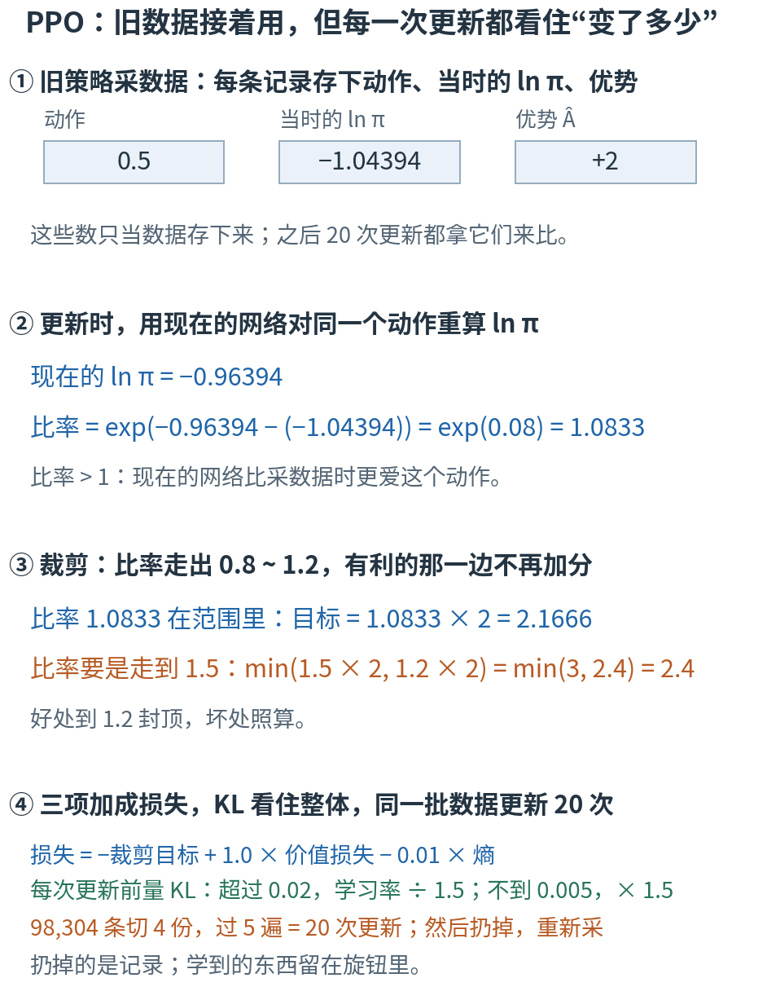
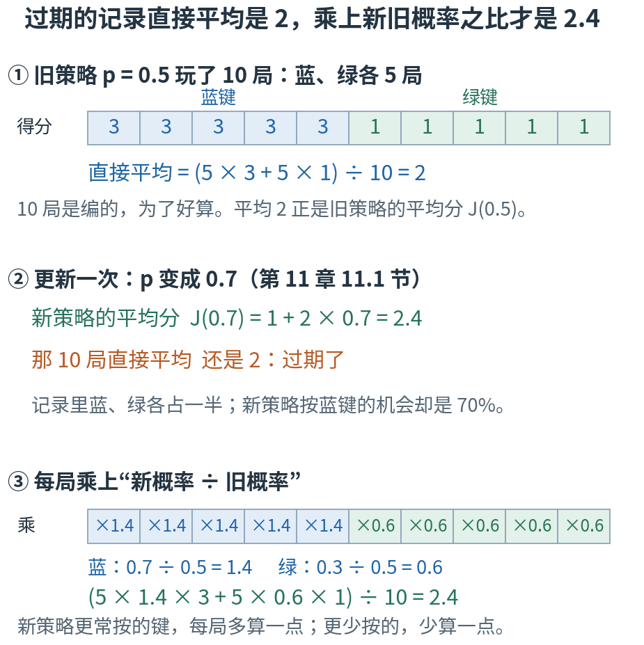
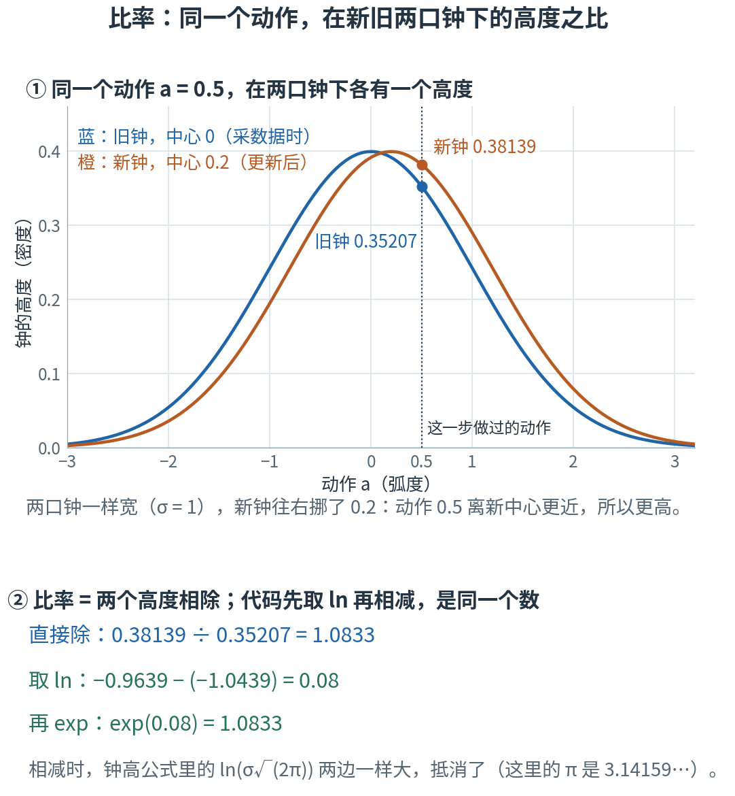
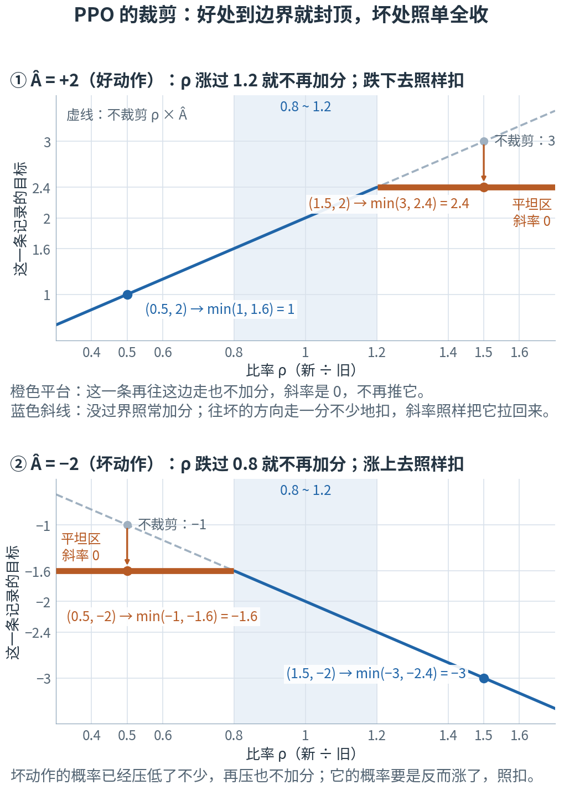
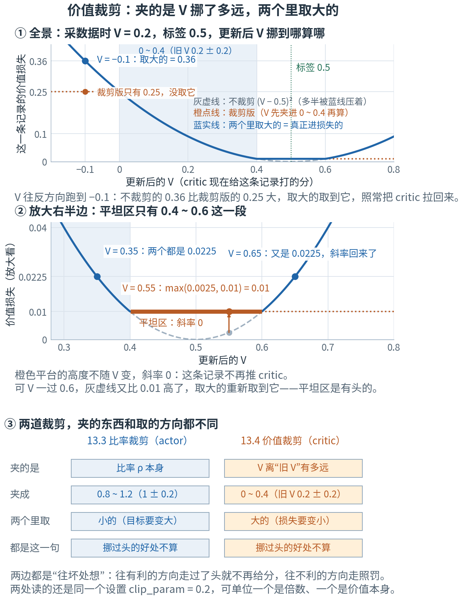
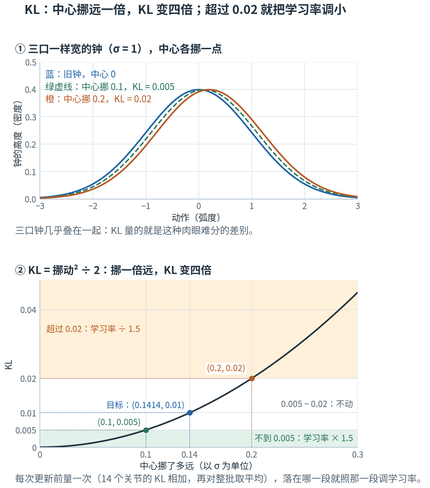

# 第 13 章 · PPO：旧数据接着用，但每一次更新都别改太多

> **上一章我们有了什么**：优势 Â（读"A 帽"：这一步做的动作，比平均好多少，第 10 章 10.4 节）。第 12 章用 GAE 把一串 δ（每一步的"意外"，第 10 章 10.3 节的 TD 误差）从后往前串起来，整批归一化之后交给 actor（策略网络：看观测、出动作的那一张）；第 11 章的策略梯度拿它当"推一把"的力度：比平均好的动作，概率往上推；比平均差的，往下推。
>
> **这一章要补什么**：第 11 章 11.5 节的 REINFORCE 每批数据只用一次：抽一批、拧一次旋钮、扔掉。项目却把一次采来的 98,304 条记录（4096 只机器人各走 24 步，4096 × 24 = 98,304）切 4 份、用 5 遍，一共更新 4 × 5 = 20 次（第 7 章 7.6 节；13.6 节再细数一遍）。
> 从第二次更新起，策略已经被改过了，记录却还是改之前的策略采的——数据"过期"了。硬拿来用，一次更新可能改得太猛，策略直接学坏；学坏了，下一批数据也是学坏的策略采的，很难救回来。
> PPO 给每一次更新加了一道保险：可以变，别变太多。这一章把它拆成四样东西——比率、裁剪、三项损失、KL，每样先用小数字手算一遍。读完，你能逐行读懂 rsl_rl（项目用的强化学习训练库）里 PPO 的 `update()`——每次迭代拧旋钮的那个函数。
>
> **本章新词**：同策略、重要性采样、比率、裁剪、PPO、代理目标、价值裁剪、KL 散度、自适应学习率。
> **需要的前提**：第 4 章的期望（4.3 节：按概率加权的平均）、钟形高度和 ln 概率（4.6、4.8 节，尤其是 4.8 节那张 ln 规则表）；第 1 章的 exp（1.8 节）；第 11 章的游戏机（11.1 节）、策略梯度和熵奖励；第 12 章的 returns 和优势归一化（12.3、12.7 节）；第 7 章 7.6 节的 mini-batch 和 epoch。
> **不要求**会推导 KL 的一般公式——正文用到的 KL 都能手算，一般公式的来历放在折叠块里。本章要用到的代数（乘一个数再除回去、乘 −1 让大小翻个面、展开括号）都会在用到的地方一步一步写出来。标"进阶"的折叠块可以第二遍再读。

---

## 13.0 先看地图：比一比变了多少，变多了就不再给分

**PPO 一句话：同一批旧记录可以接着用；每用一次，先算一算现在的策略比采数据时变了多少。某一条记录上变得太多，就不再为它加分；整体变得太多，下一次更新就改得轻一点。**

先想象一个厨师。上周他收回一叠顾客的评价卡：每张卡写着点了哪道菜、比平时满意还是失望。这周他照着卡片改菜单——常被夸的菜多上，常被骂的菜少上。
问题来了：改过一次之后，这叠卡还能接着用吗？卡是在上周那份菜单下填的；这周多上的菜，卡里并没有那么多。
厨师的办法有三条：这周出得更多的菜，它的卡多算一点分量；某道菜已经改得够多了，就不再因为一张卡接着猛改；整份菜单要是和上周差得太远，下回就改得轻一点。
改几轮之后，把旧卡扔掉，按新菜单再收一叠。

这一章就是把这三条写成数学，好让 4096 只机器人攒下的 98,304 条记录，安全地用上 20 次。



**读图顺序：** 从 ① 到 ④ 竖着读。图里的数现在不用算，13.2–13.6 节会逐个手算出来；"比率"是 13.2 节才给的名字，先把它读成"现在的网络比采数据时更爱这个动作几倍"。
图里的记号先认个脸：ln π 是第 4 章 4.8 节的 log 概率（这个动作在钟下的 ln 密度）；Â 是上一章的优势；exp 是"e 的几次方"（第 1 章 1.8 节）；min 是"两个里取小的"（13.3 节）；KL 是 13.5 节的一把尺子；"0.8 ~ 1.2"里的 ~ 读"到"。
现在只要看清次序：采数据时存下 ln π；更新时对**同一个动作**重算；两个一比，得到比率；比率走得太远，就不再加分；最后加上另外两项，再用 KL 看住整体。

| 概念 | 它在回答什么问题 | 厨师那里对应什么 | 在哪一节 |
|---|---|---|---|
| 同策略 | 数据必须来自哪个策略？ | 评价卡只说得出上周那份菜单 | 13.1 |
| 重要性采样、比率 | 旧记录怎样折算成现在的策略的？ | 这周多上的菜，它的卡多算一点 | 13.2 |
| 裁剪、PPO | 一条记录最多能让策略变多少？ | 一道菜改够了，就不再因一张卡猛改 | 13.3 |
| 代理目标 | 用旧记录算出来的"分"，和真正想要的是什么关系？ | 卡片上的分，只是真实口碑的替身 | 13.4 |
| 价值裁剪 | critic 的打分，一次最多挪多少？ | 对一道菜的口碑预判，一次也别改太多 | 13.4 |
| KL 散度 | 整个策略变了多少？ | 整份菜单和上周差多远 | 13.5 |
| 自适应学习率 | 变多了、变少了，下一次更新怎么调？ | 改多了下回轻点，改少了下回重点 | 13.5 |
| 一次迭代 | 同一批数据用几次，然后怎样？ | 同一叠卡翻几遍，再换新卡 | 13.6 |

表里的名字先不背，到了各节再给。本章最容易混的四处，先贴上标签：

- **三种"裁剪"**：第 3 章 3.7 节的梯度裁剪，剪的是梯度箭头的长度；13.3 节 PPO 的裁剪，剪的是比率——一条记录最多还能为它的动作加多少分；
  13.4 节 critic（第 10 章 10.5 节那张给每个处境估价值的网络）那边还有一道价值裁剪，夹的是"这一次迭代里，价值估计挪了多远"，而且两个里取的是**大**的、不是小的。
  名字都叫裁剪，剪的东西和取的方向都不一样——13.4 节有一张对照表专门管这件事。
- **ρ 和 r**：本章把比率写成 ρ（希腊字母，读"柔"），r 仍然只指奖励。PPO 论文和很多资料把比率写成 $r_t(\theta)$，读别的材料时要自己换过来。
- **π_θ 和 π_old**：π_θ 是"现在的"策略（θ 读"西塔"，是网络的全部旋钮，第 9 章 9.4 节），每更新一次就变一次；π_old 是"采这批数据时"的策略，这批数据用完之前一直不变——不是"上一次更新之前"的那个。
- **损失的正负号**：论文里的裁剪目标要越大越好；代码里的 `surrogate_loss` 是它的相反数，要越小越好。训练日志里它常常是个小负数，这很正常（13.4 节）。

现在觉得这些区别有点抽象很正常，读到对应小节就清楚了。

第一次读，按顺序看正文、图和手算就够了；标"进阶"的折叠块可以先跳过；代码是复核工具，不是阅读门槛。

## 13.1 数据过期：旧策略采的记录，只说得出旧策略的平均分

回到第 11 章 11.1 节的游戏机：按蓝键得 3 分，按绿键得 1 分；策略只有一个旋钮 p，以概率 p 按蓝键、以概率 1 − p 按绿键。
平均分按概率加权（第 4 章 4.3 节）：J(p) = 3 × p + 1 × (1 − p)。数字和字母相乘时，乘号常省掉不写：3 × p 写成 3p。
展开再合并：3p + 1 − p = 1 + 2p——3 个 p 减去 1 个 p，剩 2 个 p（合并同类项，第 6 章 6.4 节）。代 p = 0.5 核对：3 × 0.5 + 1 × 0.5 = 2，1 + 2 × 0.5 也是 2。

p = 0.5 时玩了 10 局（数是教学构造的）：蓝 5 局、绿 5 局。直接平均：

$$\frac{5 × 3 + 5 × 1}{10} = 2$$

正好是 J(0.5) = 2。这 10 局是好记录：它们就是按 p = 0.5 玩出来的。

第 11 章 11.1 节顺着斜率更新了一次：J = 1 + 2p 是一条直线，斜率处处是 2（p 每加 0.01，J 加 0.02），学习率取 0.1，p ← 0.5 + 0.1 × 2 = 0.7（← 读"换成"，就是 JS 的赋值）。新策略的平均分 J(0.7) = 1 + 2 × 0.7 = 2.4。
现在想接着用这 10 局，看看新策略怎么样、下一次该往哪拧。直接平均——还是 2。
记录没有变：里面仍是蓝、绿各半；可新策略按蓝键的机会已经是 70%。**这 10 局只说得出旧策略的平均分。**

这不是运气问题。实验第 1 节让 p = 0.5 的旧策略再玩 10 万局，直接平均是 2.0020，仍在 2 附近，离 2.4 差得远：多抽也没用。记录是哪个策略玩出来的，平均出来的就是哪个策略。

梯度也一样。第 11 章 11.2 节的策略梯度，就是"对记录取平均"；那里的 $\mathbb{E}_{a\sim\pi_\theta}[\cdots]$ 是第 4 章 4.3 节的期望（按概率加权的平均），右下角的 $a\sim\pi_\theta$ 读"a 按 π_θ 抽"——下标写着动作要按**现在的** π_θ 抽（第 11 章 11.2 节的符号表）。
旧策略抽的记录不满足这一条，平均出来的就是旧策略的梯度，不是现在的。

<details>
<summary>进阶：梯度会估错多少（现在可跳过）</summary>

按第 11 章 11.2 节，p = 0.7 时每局记"ln 概率对 p 的导数 × 分数"（ln p 对 p 的导数是 1/p，ln(1 − p) 的是 −1/(1 − p)）：按蓝键记 (1/0.7) × 3 = 3 ÷ 0.7 = 4.2857，按绿键记 (−1/0.3) × 1 = −1 ÷ 0.3 = −3.3333。
新策略自己玩，70% 是蓝：0.7 × 4.2857 + 0.3 × (−3.3333) = 3 − 1 = 2，正是 J(p) = 1 + 2p 的斜率。
拿旧的 10 局（蓝、绿各半）直接平均：(4.2857 − 3.3333) ÷ 2 = 0.4762——方向没错，大小却只有 2 的四分之一不到。13.2 节的折叠块会把它修回 2。

</details>

像 REINFORCE 这样，要求数据必须由**现在的**策略采出来的算法，叫**同策略**（on-policy）算法。
第 11 章 11.5 节的 REINFORCE 严格做到了：抽一批、拧一次旋钮、扔掉，下一批用新策略重抽。代价是浪费：项目的一批，是 4096 只机器人各走 24 步攒下的 98,304 条记录，只拧一次就扔，第 7 章 7.6 节已经说过"太浪费"。

> ⚠️ **同策略不等于"每条记录只能用一次"。** 它要的是：数据要来自**和现在一样的**策略。PPO 仍然只用这一次迭代刚采的数据，只是要用 20 次；
> 它的办法是一边用、一边把策略拉住，别让它离采数据时的那个太远，数据就一直"差不多新鲜"。下面三节讲怎么拉。

> **停一下，自测**：如果更新一次后 p 变成了 0.9，那 10 局直接平均是多少？新策略的平均分是多少？差了多少？和 p = 0.7 时比，差得更多还是更少？
> <details><summary>答案</summary>
>
> 直接平均还是 2（记录没变）；J(0.9) = 1 + 2 × 0.9 = 2.8，差 0.8。p = 0.7 时只差 2.4 − 2 = 0.4。策略离采数据时越远，旧记录差得越多。
>
> </details>

## 13.2 比率：每条记录乘上"新概率 ÷ 旧概率"

### 问卷的分量：占少了的多算，占多了的少算

先看一个生活里的做法。报社想知道全市居民平均每天通勤多久，可问卷只在地铁站门口发了：路过的人不全坐地铁，收回的答卷里坐地铁的占一半，而全市人口里坐地铁的只占四分之一。
不用重发问卷。给每份答卷一个"分量"：地铁族在全市占 1/4、在答卷里占 1/2，每份算 (1/4) ÷ (1/2) = 0.5 份（除以 1/2 就是乘 2：0.25 × 2 = 0.5）；其余的人在全市占 3/4、在答卷里占 1/2，每份算 (3/4) ÷ (1/2) = 1.5 份。
**分量 = 在想要的人群里占多少 ÷ 在手上的答卷里占多少。** 占少了的多算，占多了的少算，答卷的比例就被扳回全市的比例。
数一数份数，就看得见"扳回"：比如收回 100 份，地铁族、其余的人各 50 份。地铁族 50 × 0.5 = 25 份，其余 50 × 1.5 = 75 份，加起来还是 100 份；地铁族占 25 ÷ 100 = 1/4，正是全市的比例。

游戏机照做。想要的是新策略（p = 0.7）的平均，手上是旧策略（p = 0.5）的记录：

- 蓝局：新策略按蓝的概率 0.7，旧策略 0.5，分量 0.7 ÷ 0.5 = **1.4**。
- 绿局：0.3 ÷ 0.5 = **0.6**。

每局的分数乘上自己的分量，再平均：

$$\frac{5 × 1.4 × 3 + 5 × 0.6 × 1}{10} = \frac{21 + 3}{10} = 2.4$$

分子里的两块：5 × 1.4 × 3 = 7 × 3 = 21，5 × 0.6 × 1 = 3 × 1 = 3。结果正好是新策略的平均分 J(0.7) = 2.4，一局也没重玩。



**这样读图：** ① 旧策略的 10 局，蓝格 3 分、绿格 1 分，直接平均 2。② 策略更新以后，新策略的平均分是 2.4，那 10 局直接平均却还是 2——这就是 13.1 节的"过期"。
③ 每格乘上自己的分量：蓝格 ×1.4、绿格 ×0.6；乘完再平均，得 2.4。

### 为什么乘上分量就对：一步一步看

这个 2.4 不是凑巧。分三步看它是怎么来的。

**第一步：数一数份数。** 和问卷一样：5 局蓝，每局算 1.4 份，一共 5 × 1.4 = 7 份；5 局绿，每局算 0.6 份，一共 5 × 0.6 = 3 份。
加起来 7 + 3 = 10 份，和原来的 10 局一样多；变的只是比例——蓝局从占 5 成变成占 7 成，绿局从 5 成变成 3 成。
所以上面那个加权平均，也可以按份数算：(7 × 3 + 3 × 1) ÷ 10 = 0.7 × 3 + 0.3 × 1 = 2.1 + 0.3 = 2.4。
后一种写法你见过：它就是 13.1 节开头那条 J(p) = 3 × p + 1 × (1 − p) 在 p = 0.7 时的样子——蓝键有 0.7 的机会得 3 分，绿键有 0.3 的机会得 1 分。

**第二步：为什么蓝局恰好占 7 成。** 蓝局在记录里占 0.5，这正是旧策略按蓝键的概率；每局乘的分量是 0.7 ÷ 0.5。两个一乘：

$$0.5 × (0.7 ÷ 0.5) = 0.7$$

先除以 0.5、再乘 0.5，等于没动（10 ÷ 0.5 × 0.5 还是 10）：旧概率被约掉了，剩下的正是新概率。绿局同理，0.5 × (0.3 ÷ 0.5) = 0.3。排成一张表：

| 键 | 在旧记录里占多少（= 旧概率） | 每局的分量（新 ÷ 旧） | 占多少 × 分量 | 新概率 |
|---|---|---|---|---|
| 蓝 | 0.5 | 0.7 ÷ 0.5 = 1.4 | 0.5 × 1.4 = 0.7 | 0.7 |
| 绿 | 0.5 | 0.3 ÷ 0.5 = 0.6 | 0.5 × 0.6 = 0.3 | 0.3 |

第二列是这个键在旧记录里的比例，第三列是上面算的分量，第四列是这两列相乘，最后一列是新策略按这个键的概率。第四列和最后一列一模一样。
一句话：**旧记录里占的比例 × 分量 = 新策略里占的比例。** 乘过分量，旧记录看起来就像新策略玩出来的，平均出来自然是新策略的平均分。

**第三步：记录是随机的时候。** 这 10 局是编的，蓝、绿恰好各 5 局，和旧概率分毫不差，所以加权平均恰好是 2.4。
真实的记录是旧策略随机玩出来的，蓝局不一定正好占一半，加权平均就只"约等于"新策略的平均分。差的那一点是抽样的运气：记录越多，运气抵掉得越多（第 4 章 4.5 节的大数定律）。
实验第 2 节拿 10 万局旧记录加权平均，得 2.4035，离 2.4 只差 0.0035。

**只有一个要求**：新策略可能按的键，旧策略也得有机会按（旧概率大于 0）。旧概率是 0 的键，记录里一局也没有，乘多大的分量都是 0 份；分量本身也成了"除以 0"，算不出来。

### 给它名字：比率 ρ

用"另一个策略抽出来的样本，每个乘上分量，来估这个策略的平均"，这种做法叫**重要性采样**（importance sampling）——名字里的"重要性"指的就是分量：一条记录对想要的那个策略有多重要。那个分量叫**比率**（ratio），本书写作 ρ：

$$\rho = \frac{\pi_\theta(a\mid s)}{\pi_{\text{old}}(a\mid s)}$$

| 符号 | 怎么读 | 就是 |
|---|---|---|
| $\rho$ | "柔" | 比率：现在的策略给这个动作的概率，是采数据时的几倍。代码里叫 `ratio` |
| $\pi_\theta(a\mid s)$ | "派西塔，a 给定 s" | 现在的策略（旋钮是 θ）在观测 s 下做动作 a 的概率（第 9 章 9.4 节的 π_θ）。竖线读"给定"：先看到观测 s，再问动作 a 有多大可能（第 4 章 4.7 节的条件概率） |
| $\pi_{\text{old}}(a\mid s)$ | "派 old" | 采这批数据时的策略，给同一个动作的概率。这批数据用完之前，它一直不变 |

ρ > 1：现在的策略比采数据时更爱这个动作；ρ < 1：更不爱；ρ = 1：没变。游戏机里蓝局的 ρ = 1.4，绿局的 ρ = 0.6。

> ⚠️ **ρ 不是奖励。** PPO 论文把比率写成 $r_t(\theta)$，和第 9–12 章的奖励 r 撞了字母。本书用 ρ，r 只留给奖励。

### 写成式子：塞进一个"旧 ÷ 旧"，再重新分组

有了比率，前面那三步可以写成一行式子——PPO 论文和各种资料里都是从这一行出发的。先约定两件事：f(a) 代表"每条记录要平均的那个数"（游戏机里是分数：f(蓝) = 3，f(绿) = 1）；这里只看一个处境，把"∣ s"省掉不写。
下面四步，每一步的游戏机代入都是同一个 2.4。

**① 定义。** 新策略的平均 = 每种动作的新概率 × f，全部加起来（第 4 章 4.3 节；Σ 就是 for 循环累加，第 2 章 2.2 节，下面的 a 是说"每一种动作都过一遍"）：

$$\mathbb{E}_{a\sim\pi_\theta}[f(a)] = \sum_a \pi_\theta(a)\,f(a)$$

游戏机：0.7 × 3 + 0.3 × 1 = 2.1 + 0.3 = 2.4。

**② 塞进一个"旧 ÷ 旧"。** 每个新概率都写成"旧概率 × (新 ÷ 旧)"——先除以旧、再乘旧，等于没动，就是上面第二步的 0.5 × (0.7 ÷ 0.5) = 0.7：

$$= \sum_a \pi_{\text{old}}(a) × \frac{\pi_\theta(a)}{\pi_{\text{old}}(a)} × f(a)$$

游戏机：0.5 × 1.4 × 3 + 0.5 × 0.6 × 1 = 2.1 + 0.3 = 2.4。

**③ 重新分组。** 中间那个分数就是 ρ。三个数相乘，先乘哪两个都一样（2 × 3 × 4：先算 2 × 3 = 6 再乘 4，或者先算 3 × 4 = 12 再乘 2，都是 24），所以把后两个括成一块：

$$= \sum_a \pi_{\text{old}}(a) × \big[\rho\,f(a)\big]$$

游戏机：0.5 × (1.4 × 3) + 0.5 × (0.6 × 1) = 0.5 × 4.2 + 0.5 × 0.6 = 2.1 + 0.3 = 2.4。

**④ 读回成期望。** 上一行是"旧概率 × 某个数，全部加起来"——把第 ① 步的定义倒过来读，它就是"按旧策略抽，ρ × f 的平均"：

$$= \mathbb{E}_{a\sim\pi_{\text{old}}}\big[\rho\,f(a)\big]$$

游戏机：旧记录里蓝局每局记 1.4 × 3 = 4.2，绿局每局记 0.6 × 1 = 0.6，各占一半，平均 (4.2 + 0.6) ÷ 2 = 2.4——正是前面"每局乘分量、再平均"的那一行。

最左边要的是新策略的平均；最右边只用得着旧策略抽出来的记录，每条乘上自己的 ρ。这就是"旧记录接着用"的全部道理。（第 ② 步要除以 π_old(a)，所以才有上面那个要求：π_old(a) 不能是 0。）
把 f 换成优势 Â，就是 13.3 节的起点：用旧记录估"现在的策略比平均好多少"，就是把每条记录的 ρ × Â 平均起来。

<details>
<summary>进阶：13.1 节估错的梯度，也能这样修回来（现在可跳过）</summary>

把 f 换成 13.1 节折叠块里"每局记的那个数"（蓝局 4.2857、绿局 −3.3333），照第 ④ 步每局乘上比率：蓝局的 4.2857 乘分量 1.4，得 6.0000；绿局的 −3.3333 乘 0.6，得 −2.0000；平均 (6 − 2) ÷ 2 = 2，回到真值。
6 和 −2 眼熟吗？正是第 11 章 11.2 节 p = 0.5 时每局记的数。

</details>

### 连续动作：两口钟的高度之比

机器人的动作是连续的数，没有"按蓝键的概率"这种东西，只有钟的高度（第 4 章 4.2 节：高度是密度，不是概率）。
比率就换成：**同一个动作，在现在的钟下有多高、在采数据时的钟下有多高，两个高度相除。**
第 4 章 4.8 节说过，拿同一个动作附近一样宽的一小段来比，宽度在相除时约掉了，所以高度之比就是概率之比。

手算一个。一个关节，钟的宽度 σ = 1；采数据时钟的中心在 0，更新后挪到了 0.2；这一步当时做过的动作是 a = 0.5。钟的高度用第 4 章 4.6 节那条公式：

$$\text{高度} = \frac{1}{\sigma\sqrt{2\pi}}\,\exp\!\left(-\frac{(a-\mu)^2}{2\sigma^2}\right)$$

提醒一下它是 4.6 节那两步：① 形状——离中心多远（a − μ），平方，除以 2σ²，取负号送进 exp（e 的几次方）；② 再除以 σ × √(2π) = σ × 2.5066，把整口钟的面积调成 1。μ 是钟的中心，σ 管钟有多宽。

- 旧钟（μ = 0）：离中心 0.5 − 0 = 0.5，平方 0.25，除以 2σ² = 2 得 0.125；exp(−0.125) = 0.8825；再除以 2.5066：0.8825 ÷ 2.5066 = **0.35207**。
- 新钟（μ = 0.2）：离中心 0.5 − 0.2 = 0.3，平方 0.09，除以 2 得 0.045；exp(−0.045) = 0.9560；0.9560 ÷ 2.5066 = **0.38139**。
- 比率 ρ = 0.38139 ÷ 0.35207 = **1.0833**。

浏览器控制台里敲 `Math.exp(-0.125) / Math.sqrt(2 * Math.PI)`，就能核对第一个高度。

回头核对一下"宽度约掉"：在动作 0.5 附近取宽 0.01 的一小段，落进去的概率 ≈ 高度 × 宽度（第 4 章 4.2 节：面积才是概率；≈ 是因为这一小段里钟的高度还略有起伏）。
新钟 0.38139 × 0.01 = 0.0038139，旧钟 0.35207 × 0.01 = 0.0035207；两个概率相除，0.0038139 ÷ 0.0035207 = 1.0833——和高度直接相除一样。分子、分母都乘了同一个 0.01，约掉了。
这一节里有两个 π：高度公式 √(2π) 里的是圆周率 3.14159…，ρ 的式子里的 π_θ(a∣s) 是策略——第 4 章 4.6 节提醒过，它们会在这一章同页出现。



**这样读图：** ① 横轴是动作——这个关节的目标角度，单位是弧度（rad，角度的另一种单位，1 rad ≈ 57.3°，见[附录 D.2](../appendix/D-三角函数从0补课.md)）；纵轴是钟的高度（密度）。
蓝钟是采数据时的，橙钟是更新后的，一样宽，橙钟往右挪了 0.2。沿虚线看动作 0.5：橙点比蓝点高，所以 ρ > 1——现在的策略更爱这个动作。
② 同一个数有两条路：直接相除；或者先取 ln、相减、再过 exp。

### 代码走的是第二条路：ln 相减再 exp

采数据时，rsl_rl 把每个动作的 ln π 存了下来（第 11 章的映射块）；更新时，用现在的网络对同一个动作重算 ln π，两个相减，再过 exp。
为什么相减再 exp 就是相除？两条第 4 章 4.8 节的老规矩：ln 那张规则表的第一行，除法变减法，ln(新 ÷ 旧) = ln 新 − ln 旧；而 exp 把 ln 原路退回，exp(ln x) = x。连起来：

$$\rho = \frac{\text{新高度}}{\text{旧高度}} = \exp\!\Big(\ln\frac{\text{新高度}}{\text{旧高度}}\Big) = \exp(\ln \text{新高度} - \ln \text{旧高度})$$

为什么要绕这一下，4.8 节也说过：14 个关节的密度相乘，会小到下溢；取了 ln，乘法变加法，除法变减法。手算：

- ln 0.35207 = −1.0439，ln 0.38139 = −0.9639（浏览器里敲 `Math.log(0.35207)` 就能核对）；
- 相减：−0.9639 − (−1.0439) = −0.9639 + 1.0439 = 0.08（减去一个负数，就是加上它）；
- exp(0.08) = 1.0833（`Math.exp(0.08)`），和直接相除一样。

0.08 还有更快的算法，而且能看清它是哪来的。上面两个高度都是"exp(某个数) ÷ 2.5066"：新钟 exp(−0.045) ÷ 2.5066，旧钟 exp(−0.125) ÷ 2.5066。两个相除：

1. 分母是同一个 2.5066（两口钟一样宽，σ × √(2π) 一样），约掉，剩 exp(−0.045) ÷ exp(−0.125)；
2. 数相除、指数相减（4.8 节规则表第一行的来历：$e^5 ÷ e^2 = e^3$）：exp(−0.045 − (−0.125)) = exp(0.08)。

所以 ln 之差就是两个指数相减：−0.045 + 0.125 = 0.08，也就是 (0.25 − 0.09) ÷ 2——前面那个调面积的常数，在相除时整个抵消了。换成任意的动作 a、两个中心，只要两口钟一样宽（宽 σ），每一步都一样：

$$\ln \rho = \frac{(a - \text{旧中心})^2 - (a - \text{新中心})^2}{2\sigma^2}$$

代回去核对：[(0.5 − 0)² − (0.5 − 0.2)²] ÷ 2 = (0.25 − 0.09) ÷ 2 = 0.08。13.3 节的折叠块和 13.5 节都要用这条"快算法"。

项目的动作有 14 个关节，ln π 是 14 个关节的 ln 密度相加（第 4 章 4.8 节）。新旧两个 ln π 相减时，可以一个关节一个关节地配对相减——加减法可以换顺序重新配对，比如 (5 + 7) − (2 + 3) = (5 − 2) + (7 − 3) = 7。
所以 ln 比率 = 14 个关节各自的 ln 之差相加。再过 exp：数相乘、指数相加（4.8 节），exp(甲 + 乙) = exp(甲) × exp(乙)，于是比率 = 14 个关节各自比率的**乘积**。

先用 2 个关节的迷你版看一眼"加 ln 就是乘比率"：关节甲的比率 1.1，关节乙的 0.9。它们的 ln 之差是 ln 1.1 = 0.0953 和 ln 0.9 = −0.1054；
加起来 0.0953 + (−0.1054) = −0.0101，再过 exp：exp(−0.0101) = 0.99——正是 1.1 × 0.9 = 0.99。14 个关节也一样，只是加了 14 项。

每个关节只变一点点，乘起来就不小：14 个关节的比率都是 1.02，合起来是 1.02¹⁴（14 个 1.02 连乘）= 1.3195（`Math.pow(1.02, 14)`）。第 4 章 4.8 节那个"14 个中心各朝动作挪 10%"的例子，比率到了 3.24。

第一次更新之前，旋钮还没动过，新旧 ln π 相等，比率是 exp(0) = 1。第 11 章的映射块核对过：这一刻"−Â × 比率"的梯度，和第 11 章的 −Â × ln π 一模一样，就是 REINFORCE。
原因在 exp 的斜率：exp 的导数就是它自己（第 1 章 1.8 节），在 0 处是 e⁰ = 1。用数看：exp(0.001) = 1.0010005，ln π 多了 0.001，比率也几乎正好多 0.001。所以在这一点上，推比率和推 ln π 是一回事。
从第二次更新起，比率才偏离 1，开始干活。（项目里严格说还差一点点：输入归一化器——第 8 章那一步，把每项观测减去平均、除以标准差，而平均和标准差在采数据时还在跟着新数据挪——会让比率在第一次更新时也不恰好是 1，13.5 节的最后一个折叠块会讲。）

> **停一下，自测**：① 游戏机更新到了 p = 0.9。蓝局、绿局的比率各是多少？用那 10 局加权平均，得多少？和 J(0.9) 对得上吗？
> ② 一条记录存下的 ln π 是 −1，现在的网络重算得 −0.8，比率是多少？如果重算得 −1.4 呢？哪一个是"更爱"？
> <details><summary>答案</summary>
>
> ① 蓝 0.9 ÷ 0.5 = 1.8，绿 0.1 ÷ 0.5 = 0.2；(5 × 1.8 × 3 + 5 × 0.2 × 1) ÷ 10 = (27 + 1) ÷ 10 = 2.8，正是 J(0.9) = 2.8。
> ② exp(−0.8 − (−1)) = exp(0.2) = 1.2214，更爱；exp(−1.4 − (−1)) = exp(−0.4) = 0.6703，更不爱。浏览器里 `Math.exp(0.2)`、`Math.exp(-0.4)` 可以核对。
>
> </details>

## 13.3 裁剪：好处到 1.2 封顶，坏处照单全收

### 为什么非要装个限位

有了比率，旧记录就能替现在的策略打分。每条记录的分是 ρ × Â（13.2 节最后一段：把 f 换成 Â）。Â 是第 12 章 12.7 节归一化之后的优势（Â = 2 就是"比这一批的平均好 2 个标准差"）。
把所有记录的 ρ × Â 平均起来，就是用旧记录估的"现在的策略比平均好多少"。第 11 章的做法，是顺着梯度让它变大。

**问题是它没有刹车。** 拿 13.2 节那条记录（动作 0.5，旧钟在这里高 0.35207），设它的 Â = +2（好动作）。要让 ρ × Â 变大，就要让 ρ = 新高度 ÷ 0.35207 变大，也就是让新钟在 0.5 处尽量高。分两步：

1. **把钟的中心挪到 0.5。** 钟在中心最高：σ = 1 时中心高 1 ÷ 2.5066 = 0.3989，ρ = 0.3989 ÷ 0.35207 = 1.133。
2. **再把钟收窄到 σ = 0.1。** 面积还得是 1，挤进十分之一的宽度，只能长到十倍高：1 ÷ (0.1 × 2.5066) = 3.989（第 4 章 4.6 节"密度又超过 1 了"、4.8 节的 ⚠️ 都算过）。于是

$$\rho = 3.989 \div 0.35207 = 11.33, \qquad \rho × \hat A = 11.33 × 2 = 22.66$$

没更新时 ρ = 1，这条记录的分是 1 × 2 = 2；现在是 22.66，涨了十倍多（22.66 ÷ 2 = 11.33）。可这只是把全部赌注押在一条旧记录上：σ = 0.1 的钟，95% 的动作都落在 0.3 到 0.7 之间（第 4 章 4.6 节：±2σ 以内占 95%），新策略几乎只会做 0.5 这一个动作，别的都不试了；而"它好"这个判断，只来自一条记录——13.1 节说过，策略离采数据时越远，旧记录越说不准。
98,304 条记录里，这样的"捷径"数不过来，优化器会一条条找出来，一次迭代就把策略推得面目全非。

PPO 的办法，是给每条记录装一个限位：**比率只在 0.8 到 1.2 之间算数；往有利的方向走过了界，就不再加分。**（改的只是这条记录在损失里的分，环境给的奖励一分没动。）
0.8 = 1 − 0.2，1.2 = 1 + 0.2：现在的策略比采数据时多爱、少爱这个动作，都只算到两成为止。这个 0.2 是项目配置里的 `clip_param`，📍 里能看到。

### 四格逐格手算

四种情况逐格手算。每一格做两件事：先把 ρ 夹进 [0.8, 1.2]（方括号读"0.8 到 1.2，两头都算"）——小于 0.8 算 0.8，大于 1.2 算 1.2，中间的原样，这就叫**裁剪**（clipping）；再把裁剪过的和没裁剪的两个结果比一比，取小的。（下面四格里的 0.5、1.5 都是比率 ρ，别和上面那个动作 0.5 搞混。）
"取小的"写作 min：min(3, 2.4) 读"3 和 2.4 里小的那个"，就是 JS 的 `Math.min(3, 2.4)`，得 2.4。为什么偏偏取小的，四格算完再说。

**好动作（Â = +2）：**

1. ρ = 1.5：现在的策略更爱它了，而且爱过了头。不裁剪 1.5 × 2 = 3；裁剪：1.5 夹成 1.2，1.2 × 2 = 2.4。取小的：min(3, 2.4) = **2.4**。ρ 再涨到 1.6，还是 2.4（1.6 × 2 = 3.2，比 2.4 大，取不到它）——**这条记录不再奖励继续变**。
2. ρ = 0.5：好动作反而更少做了。不裁剪 0.5 × 2 = 1；裁剪：0.5 夹成 0.8，0.8 × 2 = 1.6。取小的：min(1, 1.6) = **1**——取到的是不裁剪的那个：分数跟着 ρ 一起掉，梯度照样把它拉回来。

**坏动作（Â = −2）：**

3. ρ = 0.5：坏动作已经大幅减少了。不裁剪 0.5 × (−2) = −1；裁剪 0.8 × (−2) = −1.6。取小的：min(−1, −1.6) = **−1.6**——封顶：再减少也不加分。
4. ρ = 1.5：坏动作反而更多了。不裁剪 1.5 × (−2) = −3；裁剪 1.2 × (−2) = −2.4。取小的：min(−3, −2.4) = **−3**——照扣，梯度照样把它压回去。

四格的规律：两个里取小的，**好处打折封顶，坏处一分不少**。封顶只发生在"往有利方向走过了界"时；往不利方向走，永远按原价算，好让策略纠正回来。

> ⚠️ **−3 比 −2.4 小。** 负数比大小看数轴：−3 在 −2.4 的左边。第 4 格要是当成"−2.4 更小"取了它，坏动作多做了也只罚到 −2.4 封顶——想保护的方向就全反了。



**这样读图：** 横轴是比率 ρ，纵轴是这一条记录的分；浅蓝竖条是 0.8 到 1.2；灰虚线是不裁剪的 ρ × Â，蓝线是两者取小之后的结果。
① Â = +2：ρ 过了 1.2，蓝线变成水平的橙色平台——ρ 从 1.5 往上怎么涨都是 2.4；灰点 3 被箭头压到 2.4，就是第 1 格。ρ 往左走，蓝线跟着斜线一起下降，第 2 格的 1 就在这条线上。
② Â = −2 左右镜像：平台在 0.8 的左边（第 3 格 −1.6），右边的斜线一直往下（第 4 格 −3）。

图里橙色的水平段叫**平坦区**：在那里，这条记录的分不随 ρ 变，斜率是 0。
斜率就是"ρ 挪一点，这条记录的分变多少"；按链式法则（第 1 章 1.7 节：两台机器串起来，总倍数是各自倍数相乘）再乘上"旋钮动一点，ρ 变多少"，就是这条记录对旋钮的推力。斜率是 0，这条记录就不再推。
拿数看两格（ρ 都挪 0.01）：第 1 格 ρ 从 1.5 到 1.51，不裁剪 3.02、裁剪 2.4，取小的还是 2.4——分没变，斜率 0。第 2 格 ρ 从 0.5 到 0.51，不裁剪 1.02、裁剪 1.6，取小的 1.02——分多了 0.02，斜率 0.02 ÷ 0.01 = 2。
所以斜线上斜率等于 Â：Â = 2 时，ρ 挪 0.01，分变 0.02。实验第 3 节把四格的斜率用"缩 h"和 torch 各量了一遍：平坦区是 0，其余是 ±2。

### 为什么要两个里取小的：只用裁剪版，纠正的力也没了

既然要刹车，为什么不干脆只用裁剪版 clip(ρ) × Â，非要再和不裁剪的比一比？把三种做法在四格上并排算一遍。每格写"分（斜率）"，斜率就是上面那个"ρ 挪一点，分变多少"：

| 格 | 情况 | 不裁剪：ρ × Â | 只用裁剪版 | 两个里取小的（PPO） |
|---|---|---|---|---|
| 1 | 好动作，ρ = 1.5（往有利方向走过了界） | 3（斜率 2） | 2.4（斜率 0） | 2.4（斜率 0） |
| 2 | 好动作，ρ = 0.5（往不利方向走了） | 1（斜率 2） | 1.6（斜率 0） | 1（斜率 2） |
| 3 | 坏动作，ρ = 0.5（往有利方向走过了界） | −1（斜率 −2） | −1.6（斜率 0） | −1.6（斜率 0） |
| 4 | 坏动作，ρ = 1.5（往不利方向走了） | −3（斜率 −2） | −2.4（斜率 0） | −3（斜率 −2） |

"不裁剪"一列，四格斜率都不是 0：第 1、3 格走过了界还在推，这就是本节开头说的"没有刹车"（ρ 一路涨到 11.33）。
"只用裁剪版"一列，四格斜率全是 0：刹车是有了，可第 2、4 格——好动作反而少做了、坏动作反而多做了——也不推了，没有任何力把策略纠正回来。
"取小的"一列，正好在第 1、3 格停、在第 2、4 格推。

它是怎么做到的？看每一格里两个候选谁小：往有利方向走过了界时，裁剪版更小（2.4 < 3，−1.6 < −1），取到平的那个；往不利方向走时，不裁剪的更小（1 < 1.6，−3 < −2.4），取到斜的那个。
大白话：两个打分员，一个照原价、一个按封顶价，**每次都听更悲观的那个**。这是在"往坏处想"：旧记录离采数据时的策略一远就说不准（13.1 节），好处不敢全信，坏处一分不少地记着。

### 写成一条式子：裁剪目标 L^CLIP

这套"夹住、再和不裁剪的取小"写成一条式子，一小批记录每条算一个，再平均：

$$L^{\text{CLIP}} = \operatorname{mean}\Big[\min\big(\rho\,\hat A,\ \operatorname{clip}(\rho,\ 0.8,\ 1.2)\,\hat A\big)\Big]$$

| 符号 | 怎么读 | 就是 |
|---|---|---|
| $\rho\,\hat A$ | "柔乘 A 帽" | 不裁剪：比率 × 优势。字母挨着写，中间的乘号省掉了 |
| $\operatorname{clip}(\rho, 0.8, 1.2)\,\hat A$ | "把柔夹在 0.8 到 1.2，再乘 A 帽" | 先夹：小于 0.8 取 0.8，大于 1.2 取 1.2，中间原样；再乘 Â（乘号同样省掉）。1.2 − 1 = 0.2，代码里叫 `clip_param` |
| $\min(\cdot,\cdot)$ | "取较小的" | 逗号隔开两个候选，取小的那个（JS 的 `Math.min`）。这里的两个 · 是空位，表示"往这里填一个数"，不是乘号 |
| $\operatorname{mean}[\cdots]$ | "取平均" | 一小批里的每条记录各算一个，再平均；方括号只是把里面括成一块 |
| $L^{\text{CLIP}}$ | "L clip" | 裁剪目标：要让它**变大**。右上角的 CLIP 不是次方，只是名字的标签（"带裁剪的那个 L"）。字母 L 借的是"损失"的写法，可它要变大——13.4 节给它翻个号，才成了真正要变小的损失 |

这一行由里往外读。代入第 1 格（ρ = 1.5，Â = 2）：

1. 不裁剪：ρ × Â = 1.5 × 2 = 3；
2. 裁剪：clip(1.5, 0.8, 1.2) = 1.2，再乘 Â，1.2 × 2 = 2.4；
3. 两个取小：min(3, 2.4) = 2.4——这一条记录的分；
4. 一小批里每条记录都这样算出一个分，mean 把它们平均。四格当成一小批，13.4 节马上算。

夹的是比率本身，不是 ln π 之差：13.2 节自测里 ln π 差 0.2 的那条记录，ρ = exp(0.2) = 1.2214，已经出了 1.2。
PPO 论文里写作 $\min\big(r_t\hat A_t,\ \text{clip}(r_t, 1-\epsilon, 1+\epsilon)\,\hat A_t\big)$：$r_t$ 就是本书的 ρ，右下角的 t 是第几步（第 t 步那条记录的比率和优势）；ε 就是 0.2（和第 4 章 4.7 节那个噪声 ε 只是撞了字母，本书不用它）。

写成 JS，夹住就是 `Math.min(Math.max(…))`：

```js
const clip = (x, lo, hi) => Math.min(Math.max(x, lo), hi);                  // 先抬到 lo 以上，再压到 hi 以下
const objective = (rho, adv) => Math.min(rho * adv, clip(rho, 0.8, 1.2) * adv);   // 两个里取小的
objective(1.5, 2);    // 2.4   好处封顶
objective(0.5, -2);   // -1.6  封顶
objective(1.5, -2);   // -3    坏处照算
```

`clip(1.5, 0.8, 1.2)` 这样走：先 `Math.max(1.5, 0.8)` 得 1.5（抬到 0.8 以上——它本来就在上面），再 `Math.min(1.5, 1.2)` 得 1.2（压到 1.2 以下）。`clip(0.5, 0.8, 1.2)`：`Math.max(0.5, 0.8)` 得 0.8，`Math.min(0.8, 1.2)` 还是 0.8。

这一套"比率 + 裁剪"，就是 **PPO**（Proximal Policy Optimization，近端策略优化）的核心。"近端"说的正是：只在采数据时那个策略的附近优化，走远了的部分不算数。

> ⚠️ **PPO 的裁剪不是梯度裁剪。** 第 3 章 3.7 节的梯度裁剪，剪的是交给优化器的整根梯度箭头的长度（项目里上限 1.0）；这里剪的是每条记录的比率，也就是某些记录对损失的贡献。
> 项目两样都用：先按本节的式子算损失、求梯度，再把梯度箭头按第 3 章 3.7 节剪短（📍 里能看到这两处）。

### 一大批记录里，有多少被封了顶

真训练时，一份 24,576 条记录里会有多少条被封顶？实验第 3 节造了 10,000 条假记录来数一数：新旧 ln π 之差的标准差取 0.15（这个 0.15 是为了演示挑的，不是项目里的实测值）、Â 正负各半，结果 9.0% 落在平坦区。

这个 9.0% 可以拆开看，拆开就知道"进平坦区"要两个条件同时成立：比率出了界，**而且**是往有利的方向出的。

- 比率超过 1.2，也就是 ln 之差超过 ln 1.2 = 0.182：这样的记录约占 11.2%。其中只有 Â 为正的一半（5.6%）是"好动作被多做过了头"，进平坦区；Â 为负的那一半是"坏动作反而多做了"，在斜线上照扣。
- 比率低于 0.8，也就是 ln 之差低于 ln 0.8 = −0.223：约占 6.8%。同样只有 Â 为负的一半（3.4%）进平坦区。
- 合起来 5.6% + 3.4% = 9.0%。

（11.2% 和 6.8% 是 ln 之差那口钟在 0.182 以右、−0.223 以左的面积，实验第 3 节用钟的面积算的。上边出界的多，是因为 0.182 离 0 比 −0.223 近。）
平坦区比例要是高，说明策略这一次迭代变得比较多，该去看看 13.5 节的 KL 和学习率；低也未必是好事，可能只是更新得很保守。rsl_rl 的训练日志不记这个数。

<details>
<summary>进阶：这一条不推了，不等于它的比率不再变（现在可跳过）</summary>

平坦区只说明"**这一条记录**不再推"。旋钮是所有记录共用的，别的记录照样可以推着它走。

最小的例子：两条记录共用一个旋钮——钟的中心 μ（σ = 1 不动，采数据时 μ = 0）。记录 1 的动作是 2.0，记录 2 的动作是 0.3，优势都是 +1。
照 13.2 节的快算法（旧中心 0、新中心 μ、σ = 1），中心挪到 μ 时，动作 a 的 ln 比率是 [a² − (a − μ)²] ÷ 2。

- μ 从 0 往右挪。挪到 0.093 左右（实验解出来的：让 [2² − (2 − μ)²] ÷ 2 等于 ln 1.2 = 0.182 的那个 μ），记录 1 的比率就到了 1.2，进了平坦区，不再推。
- 记录 2 的比率最大也只有 exp(0.3² ÷ 2) = exp(0.045) = 1.046（中心正好挪到 0.3 时），永远到不了 1.2；它一直想把中心拉向 0.3。于是 μ 继续往右，停在 0.3。
- 这时记录 1 的真实比率：[2² − (2 − 0.3)²] ÷ 2 = (4 − 2.89) ÷ 2 = 0.555，exp(0.555) = **1.742**（`Math.exp(0.555)`），远远超过 1.2。

实验第 3 节用 torch 真的更新了 400 次：μ 停在 0.300，记录 1 的比率 1.742。
项目里还有两个来源：熵那一项（13.4 节）也在改钟的宽度；Adam 带着以前梯度的滑动平均（第 7 章 7.5 节），这一次的梯度即使是 0，旋钮也还会顺着惯性走（7.5 节末尾的折叠算过：梯度从 +4 变成 0，下一步仍走 0.67α，α 是学习率）。
所以裁剪去掉的是"继续推它"的**动机**，不是给真实的比率加了一道**硬边界**。OpenAI 的 [Spinning Up 对 PPO 的说明](https://spinningup.openai.com/en/latest/algorithms/ppo.html) 也特别强调了这一点。

</details>

> **停一下，自测**：Â = −1，ρ = 1.4。这条记录的分是多少？在不在平坦区？
> <details><summary>答案</summary>
>
> 不裁剪 1.4 × (−1) = −1.4；裁剪 1.2 × (−1) = −1.2；取小的 min(−1.4, −1.2) = −1.4。不在平坦区，斜率是 −1：坏动作反而更多了，照扣，梯度会把它压回去。
>
> </details>

## 13.4 完整的损失：−裁剪目标 + 价值损失 − 熵

13.3 节有了 actor 要变大的那个数。可一次更新里要拧的不止 actor：critic（第 10 章 10.5 节那张给处境估价值的网络）也要跟着这批记录学，熵那一项也要算进去。
一次 `backward()`（反向传播：从一个数出发，往回算出每个旋钮的梯度，第 7 章 7.2 节）要同时管两张网络：actor（13.3 节的裁剪目标、熵）和 critic（价值估计）。
办法是把三样东西加成**一个**数，叫损失，然后一起往小里拧。加起来不会互相干扰：一个和的梯度，就是各项梯度之和（第 1 章 1.6 节的规则四：加法可以分开求导），每个旋钮只从"含有它的那几项"拿到梯度。这一节一项一项地装，每项都用小数字算一遍。

### 第一项：把裁剪目标翻个号，min 就变成了 max

torch 的优化器只会让损失变小（第 3 章 3.4 节的梯度下降）。$L^{\text{CLIP}}$ 要变大，就取个负号当损失——第 11 章 11.5 节 ⚠️ 里的那个负号。
为什么让 −L 变小，就是让 L 变大？拿数看：两种拧法，一种让 $L^{\text{CLIP}}$ 得 2.4，另一种得 1。取负号后是 −2.4 和 −1。优化器挑损失小的那个，−2.4 比 −1 小，挑中的正是 $L^{\text{CLIP}}$ 大的那种拧法。

把 13.3 节的四格当成一小批，手算一次：

- 裁剪目标的平均：(2.4 + 1 − 1.6 − 3) ÷ 4。从左往右加：2.4 + 1 = 3.4，3.4 − 1.6 = 1.8，1.8 − 3 = −1.2；再 −1.2 ÷ 4 = −0.3；
- 进损失的这一项：取负号，0.3。

代码是先取负号、再比大小。取了负号，"取小的"就变成"取大的"——max 是 min 的反面：max(u, v) 取 u、v 里大的那个，就是 JS 的 `Math.max`。对任意两个数 u、v：

$$-\min(u, v) = \max(-u, -v)$$

为什么？乘 −1 等于把数轴左右翻个面：3 在 2.4 的右边，翻过来 −3 就在 −2.4 的左边。原来小的那个，翻过来就成了大的。核对两格：

- 第 1 格：min(3, 2.4) = 2.4，取负号 −2.4；先取负号再取大：max(−3, −2.4) = −2.4。一样。
- 第 4 格：min(−3, −2.4) = −3，取负号 3；先取负号再取大：max(3, 2.4) = 3。一样。

所以 rsl_rl 里写的是 `torch.max`，和论文里的 min 并不矛盾。实验第 4 节把两种写法并排算了一遍：一个是 −0.3，一个是 0.3。

### 代理目标：旧记录算出来的替身，只在附近靠得住

这一项在 rsl_rl 里叫 `surrogate_loss`。$L^{\text{CLIP}}$ 在论文里叫**代理目标**（surrogate objective）："代理"是替身的意思。
真正想让它变大的，是第 9 章 9.9 节的平均回报 J（同一个策略跑很多局，回报的平均）；$L^{\text{CLIP}}$ 只是用旧记录算出来的替身，只在现在的策略离采数据时不远的地方才靠得住。
为什么只在附近靠得住？13.2 节的比率修的是"在记录下来的那些处境里，动作怎么选"。可策略一变，机器人会走到别的处境里去：换了步态，身体的姿态、速度都不一样了。那些处境旧记录里根本没有，比率修不到。
所以它要靠 13.3 节的裁剪和下一节的 KL 看着；它也不保证训练一定稳，只是让改得太猛不再划算。

### 第二项：critic 的损失，外加一道语义不同的裁剪

第 10 章 10.5 节：critic 的损失是（估计 − 标签）²。估计就是 V——critic 给这个处境打的分，意思是"从这里往后，平均还能拿多少分"（第 10 章 10.1 节）；标签是第 12 章 12.3 节的 returns = Â + V（优势加上采数据时的那个 V）。
这里的 Â **不是** 13.3 节那个：returns 是采数据时就算好存下的，用的是**没归一化**的 Â（第 12 章 12.7 节的 ⚠️ 专门说过这件事）；归一化后的 Â 只给 actor 用。
critic 也有同一个毛病：这批记录只够它把自己往标签的方向挪一点点，一次迭代更新 20 次，它同样可能被同一批旧记录推得太远。
PPO 给它也装了一个限位，叫**价值裁剪**（value clipping）。

它是 13.3 节那一招搬到 critic 上，但**夹的东西和取的方向都换了**，得当一个新机制重新读一遍：

- **夹的东西换了**：13.3 节夹的是**比率**本身（0.8 到 1.2）；这里夹的是"现在的 V 离**采数据时那个 V** 挪了多远"（最多算挪 0.2）。
- **取的方向换了**：两边都是"往坏处想"（两个数里挑对自己不利的那个），可这里的"坏"反了个个儿——13.3 节的目标要**变大**，往坏处想就是取**小**的；这里是损失、要**变小**，往坏处想就是取**大**的。

手算一条记录：采数据时 critic 估 V = 0.2，标签是 0.5，所以"最多算挪 0.2"就是把 V 先夹进 0 到 0.4。更新几次之后，V 可能在三个位置：

- **V = 0.55**：不裁剪 (0.55 − 0.5)² = 0.0025。裁剪：它挪了 0.35，只算 0.2，当成 0.4，(0.4 − 0.5)² = 0.01。两个取**大**的：**0.01**。用的是裁剪版，而裁剪版里的 0.4 不随 V 变——这条记录不再推 critic。
- **V = 0.35**：只挪了 0.15，没过界，两个都是 (0.35 − 0.5)² = **0.0225**，照常推。
- **V = −0.1**：往反方向跑了。不裁剪 (−0.1 − 0.5)² = 0.36；裁剪：挪了 −0.3，只算 −0.2，当成 0，(0 − 0.5)² = 0.25。取大的：**0.36**，用的是不裁剪版，照常拉回来。

一句话：挪过头的好处不算，往坏处跑照罚。

写成式子（V 是 critic 现在给这条记录打的分，$V_{\text{旧}}$ 是采数据时存下的那个）：

$$V_{\text{夹}} = V_{\text{旧}} + \operatorname{clip}(V - V_{\text{旧}},\ -0.2,\ 0.2), \qquad L^{V} = \max\big((V - \text{标签})^2,\ (V_{\text{夹}} - \text{标签})^2\big)$$

| 符号 | 怎么读 | 就是 |
|---|---|---|
| $V - V_{\text{旧}}$ | "V 减 V 旧" | 这一次迭代里，V 挪了多远：往大挪是正，往小挪是负 |
| $\operatorname{clip}(\cdots,\ -0.2,\ 0.2)$ | "夹在 −0.2 到 0.2" | 挪动最多只算 0.2，往哪边都一样 |
| $V_{\text{夹}}$ | "V 夹" | 旧 V 加上封了顶的挪动。挪过了头，V 就被当成停在 0 或 0.4 |
| $\max(\cdot,\cdot)$ | "取较大的" | 两个损失里取大的（· 还是空位，不是乘号） |
| $L^{V}$ | "L V" | 这一条记录的价值损失。右上角的 V 是名字的标签，不是次方；一小批里再取平均，就是下面总账里的那一项 |

代入 V = 0.55：挪动 0.55 − 0.2 = 0.35，夹成 0.2，$V_{\text{夹}}$ = 0.2 + 0.2 = 0.4；max((0.55 − 0.5)², (0.4 − 0.5)²) = max(0.0025, 0.01) = 0.01，和上面一样。

斜率也能手算。不裁剪的 (V − 0.5)² 对 V 的斜率是 2 × (V − 0.5)——第 10 章 10.5 节算过同样的导数（平方求导多出一个 2）：
V = 0.35 时是 2 × (0.35 − 0.5) = −0.3，V = −0.1 时是 2 × (−0.1 − 0.5) = −1.2；V = 0.55 用的是裁剪版，里面的 0.4 不随 V 变，斜率 0。
斜率是负的，意思是 V 往大挪、损失变小，于是梯度下降把 V 往大推——推向标签 0.5。实验第 4 节量出来的三种斜率，正是 0、−0.3、−1.2。



**这样读图：** ① 先看三条线：灰虚线是不裁剪的 (V − 0.5)²，橙点线是"先把 V 夹进 0 ~ 0.4 再算"，蓝实线是两个里取大的——蓝线才是真正进损失的那个。
浅蓝竖条是 V 允许算进去的范围 0 ~ 0.4（旧 V 0.2 ± 0.2）。V 跑到 −0.1 时，灰的 0.36 比橙的 0.25 大，蓝线取的是灰的，照常把 critic 拉回来。
② 把右半边放大。0.4 到 0.6 之间蓝线是一段水平的橙色平台，高度恒是 0.01，斜率 0——V = 0.55 就落在上面，这条记录不再推 critic。
**可平台是有头的**：V 一过 0.6，(V − 0.5)² 又比 0.01 大了，取大的重新取到灰线，斜率回来（V = 0.65 时损失又是 0.0225，斜率 +0.3），critic 被拉回来。
这和 13.3 节的平坦区不一样：那里的平台一路向右不封口。③ 是两道裁剪的对照表，回头混的时候看这一张。

> ⚠️ **本章有三个 0.2，别串了。** ① 13.3 节的 0.2 是**比率**的倍数（夹进 0.8 ~ 1.2）；② 这里的 0.2 是**价值本身**的单位（V 最多算挪 0.2 分）——①② 读的是同一个设置 `clip_param=0.2`，意思却不同；
> ③ 13.5 节还会出现一个 0.2，那是**钟的中心挪了多远**（以 σ 为单位），和这个设置一点关系都没有，只是例子挑的数恰好也是 0.2。

> **停一下，自测**：同一条记录（旧 V = 0.2，标签 0.5），更新后 V 跑到了 0.7。不裁剪和裁剪版各是多少？取大的是哪个？这条记录还推不推 critic？
> <details><summary>答案</summary>
>
> 不裁剪 (0.7 − 0.5)² = 0.04；裁剪版还是把 V 当成 0.4，(0.4 − 0.5)² = 0.01。取大的是 **0.04**，用的是不裁剪版——所以它照常推，把 V 往 0.5 拉。
> 0.7 已经出了平坦区（0.4 ~ 0.6）：价值裁剪封的只是 0.4 到 0.6 这一段。
>
> </details>

### 第三项：熵，给"还愿意试"留一点分

熵 H 量的是一口钟有多"随机"、多难猜（第 4 章 4.9 节），σ = 1 的一口钟，熵是 1.41894。第 11 章 11.6 节给它记了一点奖励：要变大的是 c × H，好让钟别过早缩窄、策略还愿意试新动作；c 是这份奖励的分量，项目的 c = 0.01。进损失时同样取负号。
14 口钟互相独立，总的熵就是 14 口相加（第 4 章 4.9 节）：一开始 σ 都是 1，熵是 14 × 1.41894 = 19.865，这一项就是 0.01 × 19.865 = 0.19865。

### 三项合起来：一条记录的总账

$$\text{loss} = -L^{\text{CLIP}} + 1.0 × L^{V} - 0.01 × H$$

| 符号 | 怎么读 | 就是 |
|---|---|---|
| $-L^{\text{CLIP}}$ | "负 L clip" | 13.3 节的裁剪目标取负号。代码里叫 `surrogate_loss` |
| $L^{V}$ | "L V" | 价值损失，带价值裁剪，一小批取平均。代码里叫 `value_loss`，系数 `value_loss_coef=1.0` |
| $H$ | "熵" | 每条记录那 14 口钟的熵（第 4 章 4.9 节），一小批取平均。系数 `entropy_coef=0.01`，就是第 11 章 11.6 节的 c |

三项的正负号是这样配的。损失要往小里拧，所以：想让它变大的项，前面放减号；想让它变小的项，前面放加号。

| 项 | 我们想让它 | 进损失时 | 为什么 |
|---|---|---|---|
| $L^{\text{CLIP}}$ | 变大（策略变好） | 减号 | 取了负号，它越大，这一项越小（上面 −2.4 和 −1 的例子） |
| $L^{V}$ | 变小（critic 估得准） | 加号 | 本来就要变小，原样加进来 |
| $H$ | 变大（还愿意试） | 减号 | 和第一项同一个道理 |

前面的 1.0 和 0.01 是轻重：价值损失照原样算，熵只给百分之一的分量。

就拿第 1 格那条记录：ρ = 1.5、Â = 2；它的价值是上面 V = 0.55 那种情况；14 个 σ 都是 1：

$$-2.4 + 1.0 × 0.01 - 0.01 × 19.865 = -2.4 + 0.01 - 0.19865 = -2.58865$$

从左往右算：−2.4 + 0.01 = −2.39，−2.39 − 0.19865 = −2.58865。

三项加成一个数，一次 `backward()` 就算出 actor 和 critic 全部旋钮的梯度，同一个优化器一起更新两张网络（第 3 章和第 10 章的映射块都说过）。
actor 的旋钮只受第一、三项影响，critic 的旋钮只受第二项影响：第一、三项是从 actor 那 14 口钟算出来的，第二项只用到 critic 的输出 V；加法可以分开求导，哪一项里没有这个旋钮，它对这个旋钮的梯度就是 0。

**日志里的第一项，常常是个小负数**——这很正常，它的正负和大小都说明不了学得好不好。判断训练，要看 KL、回合长度、奖励各项和机器人实际的动作。真实的日志长什么样，第 14 章（训练回路全貌）对着冒烟训练的输出一行一行看。

<details>
<summary>进阶：为什么 Mean surrogate loss 一开始接近 0、之后变成小负数（现在可跳过）</summary>

训练日志的 `Mean surrogate loss:`（wandb 里叫 `Loss/surrogate`），就是 20 次更新的 `surrogate_loss` 取平均。
第一次更新时比率几乎全是 1（"几乎"是因为输入归一化器，13.5 节最后的折叠块说），每条记录的 −ρ × Â 就约等于 −Â，它的平均约等于 −(Â 的平均)——而 Â 在第 12 章 12.7 节整批减过平均，所以它接近 0。**值接近 0，梯度却不是 0**：就像 f(x) = x 在 x = 0 处的值是 0，斜率却是 1。
实验第 4 节拿 8 个归一化后的 Â 验证：比率全是 1 时，`surrogate_loss` 是 0，每条记录的斜率却是 −Â ÷ 8，都不为 0。
之后几次更新把好动作的比率推上去、坏动作的推下来，ρ × Â 的平均变成正的，`surrogate_loss` 就成了小负数（实验里把比率往好的方向挪一点，它从 0 变成 −0.044）。
**这一段是从上面的算式推出来、再用构造的小例子算一遍的**：−0.044 是实验里编出来的数，不是从一次真实训练的日志里统计的。

</details>

> **停一下，自测**：有人读了论文，觉得"论文写的是 min"，把代码里的 `torch.max(surrogate, surrogate_clipped)` 改成了 `torch.min`。程序会报错吗？第 1 格和第 4 格会变成什么？
> <details><summary>答案</summary>
>
> 不会报错。代码里的两项已经取过负号：第 1 格是 −3 和 −2.4，min 取 −3，等于没封顶，好处又能一路涨；第 4 格是 3 和 2.4，min 取 2.4，坏动作多做了也只罚到 2.4 封顶。
> 保护的方向整个反了，训练照跑、不报任何错，只是保险装反了。
>
> </details>

## 13.5 KL 散度：整个策略变了多少；变多了，就把学习率调小

### 先量一量：两口钟差多远

裁剪只管一条一条的记录，而且只去掉"继续推"的动机（13.3 节的折叠块：真实的比率照样可以走出去）。还需要一个总的读数：**在这一批记录上，现在的策略和采数据时的策略，差多远？**

13.2 节已经有一把现成的尺子：同一个动作，新旧两口钟的 ln 高度之差（ln 比率）。可它只量一个点：动作 0.5 那一条的 ln 比率是 +0.08（新钟更爱它），换一个动作，结果就不一样。
要说整口钟，就得把动作都问一遍、取平均。问哪些动作？问旧钟会做的动作——数据就是旧策略采的——按旧钟的概率加权平均（第 4 章 4.3 节）。
习惯上平均的是"ln 旧高度 − ln 新高度"，也就是 ln 比率取相反数：旧钟常做的动作，新钟给的高度越低，这个数越大。

先拿一对动作手算。还是 13.2 节那两口钟：一样宽（σ = 1），旧中心 0，新中心 0.2。用 13.2 节的快算法，ln 比率 = [a² − (a − 0.2)²] ÷ 2：

- a = 0.5：(0.25 − 0.09) ÷ 2 = 0.08，取相反数 −0.08；
- a = −0.5：(0.25 − 0.49) ÷ 2 = −0.12，取相反数 +0.12。

旧钟左右对称，0.5 和 −0.5 一样常见，各占一半：(−0.08 + 0.12) ÷ 2 = 0.02。
再换一对 a = ±1：ln 比率是 (1 − 0.64) ÷ 2 = 0.18 和 (1 − 1.44) ÷ 2 = −0.22，取相反数 −0.18、+0.22，平均还是 0.02。

为什么每一对都是 0.02？把快算法展开。(a − 0.2)² 用第 4 章 4.4 节那张四格表展开，是 a² − 0.4a + 0.04，所以

$$\frac{a^2 - (a^2 - 0.4a + 0.04)}{2} = \frac{0.4a - 0.04}{2} = 0.2a - 0.02$$

（第一步去括号：减去一个括号，括号里每一项都变号。拿 a = 0.5 核对：0.2 × 0.5 − 0.02 = 0.1 − 0.02 = 0.08 ✓。）
前一块 0.2a 跟着 a 变号，一对 ±a 一正一负，抵掉了；后一块 −0.02 每个动作都有。取相反数、平均下来，就只剩 0.02。

把挪动 0.2 换成任意的 d（σ 还是 1），每一步都一样：ln 比率 = d × a − d² ÷ 2。旧钟下 a 的平均就是旧中心 0（第 4 章 4.6 节：钟的中心 μ 就是期望），乘在前面的 d 可以提出来（第 4 章 4.3 节的线性），所以 d × a 平均成 d × 0 = 0，只剩 −d² ÷ 2。取相反数：

- 中心挪 0.2：0.2² ÷ 2 = 0.04 ÷ 2 = **0.02**；
- 中心挪 0.1：0.1² ÷ 2 = 0.01 ÷ 2 = **0.005**。

实验第 5 节从旧钟里抽了 20 万个动作实测：ln 比率的平均是 −0.0200，取相反数正是 0.02。

挪动翻一倍，这个数翻四倍：它跟着挪动的平方走，0.2² = 0.04 正好是 0.1² = 0.01 的 4 倍。
σ 不是 1 时，挪动要以 σ 为单位量，就是 (挪动 ÷ σ)² ÷ 2。同样挪 0.2，钟窄一半（σ = 0.5）：(0.2 ÷ 0.5)² ÷ 2 = 0.4² ÷ 2 = 0.08，是 σ = 1 时的 4 倍——钟越窄，同样的挪动差得越多。
这里的 0.2 是本章的第三个 0.2——"中心挪了多远"，和裁剪范围没关系（13.4 节的 ⚠️ 把三个 0.2 排过队）。

这个数叫 **KL 散度**（KL divergence，KL 是两位提出者 Kullback 和 Leibler 的姓）：按旧分布取平均的"ln 旧 − ln 新"，量的是两个分布差多远。两口钟完全一样时，它是 0；差得越多，它越大。
它不会是负数：一样宽时它是 d² ÷ 2，一个平方再除以 2；宽度也变时同样不会是负数，那个证明要用到超出本书的数学，本书不推，下面宽度也变的例子（0.1284）也是正的。
叫"散度"不叫"距离"，是因为它不对称：新旧对调，数会变（下面的折叠块有例子）。



**这样读图：** ① 三口钟几乎叠在一起：挪了 0.1、0.2 的钟，肉眼只看得出一点点错开。KL 量的就是这种细小的差别。
② 横轴是中心挪了多远（以 σ 为单位），纵轴是 KL，曲线是 KL = 挪动² ÷ 2。沿曲线看三个点：挪 0.1 得 0.005，挪 0.2 得 0.02——横着远一倍，竖着高四倍。中间的蓝点是目标 0.01，对应挪 0.1414（下一段倒过来解出来的）。三条色带是下面要讲的三段规则。

项目里的 KL，是 14 个关节的 KL 相加，再对一小批里的记录取平均。为什么是相加？ln π 是 14 个关节的 ln 密度相加（13.2 节），"ln 旧 − ln 新"也就是 14 个关节各自的差相加；几项相加的平均 = 各项平均相加（第 4 章 4.3 节的线性），所以 KL 也是 14 个关节的 KL 相加。
目标 0.01 有多小？倒过来解。一个关节单独挪 d 个 σ：d² ÷ 2 = 0.01，两边乘 2 得 d² = 0.02，开平方 d = √0.02 = 0.1414（`Math.sqrt(0.02)`；回代 0.1414² ÷ 2 ≈ 0.01，≈ 是因为 0.1414 是四舍五入过的）。
14 个关节一起、平均地挪：14 × d² ÷ 2 = 0.01，d² = 0.02 ÷ 14 = 0.00143，每个只能挪 d = 0.0378 个 σ（14 × 0.0378² ÷ 2 ≈ 0.01；`Math.sqrt(0.02 / 14)` 可以核对 0.0378）。
要是 14 个关节都像 13.2 节那样挪 0.2，KL 是 14 × 0.02 = 0.28，是目标的 28 倍。

### 宽度也变时：一般公式的三块

项目的 14 个 σ 也在训练，新旧两口钟的宽度也会变。rsl_rl 交给 torch 算的，是能管宽度变化的一般公式。两口钟：旧的中心 $\mu_o$、宽 $\sigma_o$，新的中心 $\mu_n$、宽 $\sigma_n$（下标 o、n 取自 old、new，就是旧、新）：

$$\text{KL}(\text{旧}\,\Vert\,\text{新}) = \ln\frac{\sigma_n}{\sigma_o} + \frac{\sigma_o^2 + (\mu_o - \mu_n)^2}{2\sigma_n^2} - \frac12$$

左边括号里的两条竖线只是把两口钟隔开：前面的"旧"是"按谁的动作取平均"，后面的"新"是被拿来比的那一口。
右边三块各量一样东西。拿一个宽度也变的例子逐块代入：旧钟中心 0、宽 1，新钟中心 0.3、宽 0.8。

| 这一块 | 它在量什么 | 代入例子 |
|---|---|---|
| $\ln\dfrac{\sigma_n}{\sigma_o}$ | 两口钟前面那个"调面积"的常数 1 ÷ (σ × 2.5066) 不一样。新钟窄，常数就大（面积 1 挤进更窄的地方，只能长高，第 4 章 4.6 节）；单看这个常数，新钟处处被抬高，"ln 旧 − ln 新"就小了一截，所以这一块是负的 | ln(0.8 ÷ 1) = ln 0.8 = −0.22314 |
| $\dfrac{\sigma_o^2 + (\mu_o - \mu_n)^2}{2\sigma_n^2}$ | 旧钟的动作，离新钟的中心平均有多远（平方）：旧动作本身散开 $\sigma_o$，两个中心又错开 $\mu_o - \mu_n$，两样都算进去；再拿新钟的宽度当尺子量（除以 $2\sigma_n^2$） | (1 + 0.3²) ÷ (2 × 0.8²) = 1.09 ÷ 1.28 = 0.85156 |
| $-\dfrac12$ | 同一件事，旧钟拿自己比：旧动作离自己的中心，平方的平均是 $\sigma_o^2$，用自己的宽度量是 $\sigma_o^2 ÷ (2\sigma_o^2) = \tfrac12$。这一块要减掉 | −0.5 |

合起来：−0.22314 + 0.85156 − 0.5 = 0.12842，约 0.1284，和 torch 算的一样。
第二块减第三块，说的是"旧钟常做的动作，在新钟的尺子下，比在旧钟自己的尺子下偏了多少"；第一块再补上两口钟高矮的差别。

宽度相同（$\sigma_n = \sigma_o = 1$）时：第一块 ln 1 = 0；第二块 (1 + d²) ÷ 2；第三块 −0.5。合起来 (1 + d²) ÷ 2 − 0.5 = 0.5 + d² ÷ 2 − 0.5 = d² ÷ 2——正是前面手算的结果：

- 中心挪 0.2：(1 + 0.2²) ÷ 2 − 0.5 = 0.52 − 0.5 = **0.02**；
- 中心挪 0.1：(1 + 0.1²) ÷ 2 − 0.5 = 0.505 − 0.5 = **0.005**。

<details>
<summary>进阶：一般公式是怎么来的；KL 为什么不对称（现在可跳过）</summary>

还是"按旧钟取平均的 ln 旧 − ln 新"，只是两口钟宽度不同，前面那个调面积的常数不再抵消。

1. **写开 ln 高度。** 第 4 章 4.8 节的折叠块：ln 高度 = −(a − μ)² ÷ (2σ²) − ln σ − ½ ln(2π)。
2. **旧减新。** −½ ln(2π) 两边一样，抵掉；−ln σ_o − (−ln σ_n) = ln σ_n − ln σ_o = ln(σ_n ÷ σ_o)（除法变减法）。剩下
   ln 旧 − ln 新 = ln(σ_n ÷ σ_o) + (a − μ_n)² ÷ (2σ_n²) − (a − μ_o)² ÷ (2σ_o²)。
3. **按旧钟平均最后一项。** (a − μ_o)² 的平均，就是旧钟的方差 σ_o²（第 4 章 4.4 节的定义），所以这一项平均成 σ_o² ÷ (2σ_o²) = ½。
4. **按旧钟平均中间那项。** a − μ_n 这个量：每个 a 都减同一个 μ_n，平均也减 μ_n，是 μ_o − μ_n；散开的程度不变，还是 σ_o（平移不改变方差，第 4 章 4.4 节）。
   再把 4.4 节"方差 = 平方的平均 − 平均的平方"倒过来用：平方的平均 = 方差 + 平均的平方 = σ_o² + (μ_o − μ_n)²。所以这一项平均成 (σ_o² + (μ_o − μ_n)²) ÷ (2σ_n²)。
5. **合起来。** 第一项不含 a，平均还是它自己。三项拼起来，就是上面的一般公式。

实验第 5 节从旧钟 (0, 1) 里抽 20 万个动作，把"ln 旧 − ln 新"直接平均，得 0.129，和公式的 0.1284 只差抽样的运气。
第 4 步那个"平方的平均"，同一批动作直接量出来是 1.092，公式给 1 + 0.3² = 1.09。

**不对称。** 把新旧对调，KL(新‖旧) = 0.0881（实验第 5 节），和 0.1284 不相等——换成按新钟的动作取平均，问的就是另一件事了。它不对称，所以叫"散度"，不叫"距离"。rsl_rl 算的是 KL(旧‖新)，旧的在前。

</details>

### KL 管学习率：变多了就把步子调小

第 3 章的映射块预告过这条规则。每做一次更新**之前**，先量一次"现在的策略"和"采数据时的策略"之间的 KL，然后：

- KL 超过目标 0.01 的 2 倍（大于 0.02）：变得太多，学习率 ÷ 1.5，但不低于 0.00001；
- KL 不到目标的一半（小于 0.005），而且大于 0：变得太少，学习率 × 1.5，但不超过 0.01；
- 在 0.005 到 0.02 之间：不动。

这叫**自适应学习率**（adaptive learning rate）：学习率不再是人定死的一个数，而是跟着 KL 自己调。配置里的 `learning_rate=1.0e-3` 只是它的起点（1.0e-3 是第 3 章 3.6 节的科学计数法：1.0 × 10⁻³，指数是负的，就是把小数点往左挪 3 位，0.001）。

为什么 KL 大了，调小学习率就管用？第 3 章 3.4 节：每一步挪多远 = 学习率 × 梯度；Adam 的步子也和学习率成正比（第 7 章 7.5 节）。学习率 ÷ 1.5，之后每一步大约也只挪原来的 1/1.5；同样几步攒下来的挪动 ÷ 1.5，而 KL 跟着挪动的平方走（本节开头的 d² ÷ 2），大约变成原来的 1 ÷ 1.5² = 1 ÷ 2.25。
比如原来几步攒下 KL 0.03，学习率 ÷ 1.5 之后，同样几步大约只攒下 0.03 ÷ 2.25 = 0.0133，落回中间那一段。这只是粗略的估计：梯度本身也一直在变，所以规则不指望一步调到位，而是每次更新前量一次、调一次。

中间留了一段 0.005 ~ 0.02 不动：KL 每次量都有起伏，要是死盯着 0.01，学习率会被来回拧个不停。调的办法是乘、除一个倍数，而不是加减一个数：学习率可能小到 0.00001、大到 0.01，差 1000 倍，乘除 1.5 在哪个大小上都是调同样的比例。写成 JS：

```js
function adapt(lr, kl) {
  if (kl > 0.01 * 2) return Math.max(1e-5, lr / 1.5);             // 变太多：÷ 1.5，最低 0.00001
  if (kl < 0.01 / 2 && kl > 0) return Math.min(1e-2, lr * 1.5);    // 变太少：× 1.5，最高 0.01
  return lr;                                                       // 0.005 ~ 0.02：不动
}
```

`1e-5` 和 `1e-2` 也是科学计数法：0.00001 和 0.01。`Math.max(1e-5, …)` 取两个里大的，所以除完之后不会低于 0.00001；`Math.min(1e-2, …)` 取小的，乘完之后不会超过 0.01。

手算一串。学习率从 0.001 出发，连着量到六次 KL。表里一行是一次更新：第 1 列是这次量到的 KL；第 2 列看它落在三段里的哪一段；第 3 列照那一段的规则算；第 4 列是算完的学习率，下一行接着从它算起。

| 这次量到的 KL | 落在哪一段 | 怎么算 | 学习率 |
|---|---|---|---|
| 0.03 | 大于 0.02 | 0.001 ÷ 1.5 | 0.00066667 |
| 0.025 | 大于 0.02 | 再 ÷ 1.5 = 0.001 ÷ 2.25 | 0.00044444 |
| 0.012 | 中间（0.005 ~ 0.02） | 不动 | 0.00044444 |
| 0.004 | 小于 0.005 | × 1.5 | 0.00066667 |
| 0.003 | 小于 0.005 | 再 × 1.5 | 0.001 |
| 0.02 | **恰好**等于 0.02 | 不动（规则写的是"大于"） | 0.001 |

最后一列就是学习率本身，不是倍数：0.001 ÷ 1.5 = 0.00066667（其实是 0.000666… 无限循环，四舍五入到小数点后 8 位），再 ÷ 1.5 = 0.00044444（连除两次 1.5，就是除以 1.5 × 1.5 = 2.25：0.001 ÷ 2.25）；
往回乘 1.5 两次，又回到 0.001。实验第 5 节按这六个 KL 把规则跑了一遍，打印的就是这一列。

还有三个细节。一次迭代更新 20 次，这条规则就跑 20 次；调好的学习率会带进下一次迭代，不会回到 0.001。
KL 只是量一量，不参与求导（📍 里它包在 `torch.inference_mode()` 里）。
条件里的"而且大于 0"，防的是 KL 算出来恰好是 0 的时候——比如每次迭代的第一次更新，旋钮还没动过（严格说这时的 KL 也不一定恰好是 0，本节最后的折叠块说为什么）——这时不该放大学习率。

> ⚠️ **KL、`surrogate_loss`、平坦区比例，是三把不同的尺。** KL 量整个策略变了多少；`surrogate_loss` 每次迭代开头都接近 0，大小说明不了学得好坏（13.4 节）；平坦区比例（13.3 节）只数有多少记录被封了顶。哪一个都不能单独说明训练好不好。

> **停一下，自测**：学习率现在是 0.001。接下来三次更新量到的 KL 依次是 0.021、0.02、0.004。每次之后，学习率各是多少？
> <details><summary>答案</summary>
>
> 0.021 大于 0.02：÷ 1.5，得 0.001 ÷ 1.5 = 0.00066667。0.02 不大于 0.02，也不小于 0.005：不动，还是 0.00066667。0.004 小于 0.005 且大于 0：× 1.5，回到 0.001。
>
> </details>

<details>
<summary>进阶：第一次更新时，KL 真的是 0 吗（现在可跳过）</summary>

旋钮是没动，可策略的输出还取决于输入归一化器（第 8 章）。它在采数据的 24 步里，每一步都在更新自己的平均和标准差（第 8 章 8.4 节；`rsl_rl/algorithms/ppo.py` 的 `process_env_step()` 每走一个环境步就调一次 `update_normalization()`，📍 对应的那一节实验会核对）。
到了 `update()`，同一条观测归一化之后的数，已经和采数据时差了一点点，钟的中心也跟着差一点点。

实验第 5 节拿 rsl_rl 自己的网络类（带输入归一化）搭了一张 3 个输入的小网络来演示：旋钮不动，只让归一化器再见一批整体偏了 0.3 的观测，然后重算。
**下面几个数只说明"会发生什么"，不是项目的实测值**——项目那张网络有 61 个输入、14 口钟，差多少要看当时的观测。
归一化器只见过 5 批时（像训练刚开始），第一次更新的 KL 是 0.0003，比率在 0.9240 到 1.1055 之间；按规则，学习率先 × 1.5。
见过 2000 批时（像训练走了很久），比率在 0.99974 到 1.00033 之间，差别只在万分之几。中心差 0.0002 的两口钟，KL 该是 0.0002² ÷ 2 = 0.00000002；
可训练代码默认用 float32 存小数。第 1 章 1.14 节见过它的一个毛病：太小的数存不下，直接变成 0（下溢）。这里碰上的是它的另一个限度：float32 只记得大约 7 位有效数字，1 加上一个亿分之几的数，存下来还是 1。
torch 算这个 KL 时，恰好要先把 1 和一个亿分之几的数（这里是 0.0002² = 0.00000004）加起来、再减去 1；在 float32 里这一加等于没加，KL 算出来恰好是 0，规则不动学习率。
所以第 11 章映射块里那句"比率严格说只是非常接近 1"，说的就是这件事：旋钮没动，归一化器动了。至于项目里第一次更新的 KL 会不会也被 float32 抹成 0，这个演示只说明它会发生，给不出项目的数。

</details>

## 13.6 数一数：一次迭代，98,304 条记录，更新 20 次

这些数第 5 章的映射块和第 7 章 7.6 节已经数过，这里只把 PPO 的动作挂上去。

先看迷你版：2 只机器人各走 3 步，2 × 3 = 6 条记录；切 2 份，每份 6 ÷ 2 = 3 条；过 2 遍，每一遍把 2 份各用一次、更新 2 次，2 遍一共 2 × 2 = 4 次更新；每条记录每遍用一次，一共被用了 2 次。
项目只是把这几个数换大：

- 4096 只机器人各走 24 步：4096 × 24 = 98,304 条记录。手算可以把 24 拆成 20 + 4：4096 × 20 = 81,920，4096 × 4 = 16,384，加起来 81,920 + 16,384 = 98,304（分配律，第 4 章 4.3 节）。
  每条存下观测、动作、当时的 ln π、当时的 V、当时那 14 口钟的中心和宽度，以及算好的 Â 和 returns。
- 切 4 份，每份 98,304 ÷ 4 = 24,576 条（对半再对半：98,304 ÷ 2 = 49,152，再 ÷ 2 = 24,576）。
- 过 5 遍：每一遍把 4 份各用一次，就是 4 次更新；5 遍是 4 × 5 = **20 次更新**。每条记录每遍用一次，一共被用了 5 次。实验第 6 节把 rsl_rl 自己的发牌函数真跑了一遍：发出 20 份、每份 24,576 条，每条记录正好出现 5 次。

```text
开头洗一次牌、切成 4 份（每份 24,576 条），5 遍都用这同一种切法：
第 1 遍：份 1 → 份 2 → 份 3 → 份 4      第 1–4 次更新
第 2 遍：份 1 → 份 2 → 份 3 → 份 4      第 5–8 次更新
第 3 遍：份 1 → 份 2 → 份 3 → 份 4      第 9–12 次更新
第 4 遍：份 1 → 份 2 → 份 3 → 份 4      第 13–16 次更新
第 5 遍：份 1 → 份 2 → 份 3 → 份 4      第 17–20 次更新
```

- 每次更新：量 KL、调学习率（13.5 节）→ 算三项损失（13.3、13.4 节）→ `backward()` 算出梯度（第 7 章 7.2 节）→ 梯度裁剪（第 3 章 3.7 节：梯度箭头太长就缩短）→ Adam 拧一次旋钮（第 7 章 7.5 节：每个旋钮按自己的历史定步长）。
- 20 次做完，这批记录就扔掉，用更新后的策略再走 24 步。下一次迭代的"旧策略"，就是这一次迭代最后的策略。

**每次更新，都要把旧记录重新过一遍现在的网络。** 比率要的是"现在的钟，在**当时做过的**那个动作处有多高"：

```text
存下的观测 ──现在的 actor──→ 现在的 14 口钟（中心、宽度）
存下的动作 ────────────────→ 在现在的钟下求 ln 密度 → 现在的 ln π
存下的 ln π（旧）──────────→ 两个相减、过 exp → 比率 ρ
存下的 Â ──────────────────→ 和 ρ 一起进裁剪目标
```

拿去问的是**存下的动作**，不是让现在的策略重新抽一个：奖励和 Â 属于当时做过的那个动作，换一个动作，它们就对不上号了。
13.2 节的例子就是这样算的：当时做的是 0.5，现在的钟中心在 0.2，问的是"新钟在 0.5 处多高"，得到比率 1.0833。
存下的这些数都只当数据用，反向传播不从它们往回走（第 7 章 7.6 节折叠块里的 `detach()`）；梯度只从"现在的 ln π""现在的 V"和"现在的熵"流回旋钮。

**为什么是 5 遍 × 4 份？** 第 5 章的映射块留了这个问题。

- **用不止一遍**：这批数据是 4096 只机器人实打实跑出来的，只用一次（REINFORCE）太浪费。
- **也不能用太多遍**：13.4 节说过，比率只修得了"动作怎么选"，修不了"会走到哪些处境"；策略离采数据时越远，旧记录越说不准。裁剪和 KL 把策略拉在附近，KL 被规则往 0.01 上下调，旧数据就一直"差不多新鲜"。
- **切成 4 份**：每遍更新 4 次而不是 1 次，同样的数据多更新几次；每份仍有 24,576 条，第 7 章 7.6 节说的那种"抖"很小。
- **5 和 4 这两个数**，是 rsl_rl 和 mjlab 的默认值，项目照用。它们是经验值，不是从哪个公式推出来的。

> **停一下，自测**：如果把配置改成切 8 份、过 10 遍，每份多少条？一次迭代更新几次？同一批数据被用得更狠了，13.5 节的哪一段规则会更常出手？
> <details><summary>答案</summary>
>
> 98,304 ÷ 8 = 12,288 条一份；8 × 10 = 80 次更新。同一批数据上更新得更多，策略更容易离采数据时远，KL 更容易超过 0.02，"学习率 ÷ 1.5"那一段会更常出手。
>
> </details>

## 📍 映射到项目

> 现在可以逐行读了。本章的比率、裁剪、三项损失、KL 自适应学习率，都能在下面找到对应的一行；语法看不懂没关系，看右边的中文注释。

**这段配置做什么**：定下 PPO 的几个数。它在 `src/mjlab_microduck/tasks/microduck_velocity_env_cfg.py` 的 `MicroduckRlCfg` 里：

```python
value_loss_coef=1.0,            # 价值损失的系数 1.0（13.4 节）
use_clipped_value_loss=True,    # 价值也带裁剪（13.4 节）
clip_param=0.2,                 # 比率夹在 0.8 ~ 1.2（13.3 节）；价值最多算挪 0.2（13.4 节）
entropy_coef=0.01,              # 熵的系数 c = 0.01（13.4 节；第 11 章 11.6 节）
num_learning_epochs=5,          # 同一批数据过 5 遍（13.6 节）
num_mini_batches=4,             # 每遍切 4 份（13.6 节）
learning_rate=1.0e-3,           # 学习率的起点 0.001（13.5 节）
schedule="adaptive",            # 学习率跟着 KL 自动调（13.5 节）
...                             # （中间省略 γ、λ 两行，第 12 章讲过）
desired_kl=0.01,                # KL 的目标 0.01（13.5 节）
max_grad_norm=1.0,              # 梯度裁剪的上限（第 3 章 3.7 节）——不是本章的裁剪
```

**这段代码做什么**：下面是 `rsl_rl/algorithms/ppo.py` 的 `update()`，按执行的先后摘出来。外层循环 20 圈，每圈一份记录：先用现在的网络重算，再量 KL、调学习率，然后算比率、裁剪目标、价值损失、总损失，最后反向传播、裁梯度、拧旋钮：

```python
generator = self.storage.mini_batch_generator(self.num_mini_batches, self.num_learning_epochs)   # 发牌：切 4 份、过 5 遍（13.6 节）
for batch in generator:                                                  # 20 圈，每圈一份 24,576 条（13.6 节）
    ...
    actions_log_prob = self.actor.get_output_log_prob(batch.actions)     # 现在的钟，在存下的动作处的 ln π（13.2、13.6 节）
    values = self.critic(batch.observations, masks=batch.masks, hidden_state=batch.hidden_states[1])   # 现在的 critic 重估 V（13.4 节）
    ...
    entropy = self.actor.output_entropy[:original_batch_size]            # 现在这几口钟的熵（13.4 节）
    if self.desired_kl is not None and self.schedule == "adaptive":      # 项目：目标 0.01、自适应（13.5 节）
        with torch.inference_mode():                                     # 只量一量，不求导
            kl = self.actor.get_kl_divergence(batch.old_distribution_params, distribution_params)   # 每条记录：KL(旧‖新)，14 个关节相加（13.5 节）
            kl_mean = torch.mean(kl)                                     # 对这一份取平均
            ...
            if self.gpu_global_rank == 0:                                # 多卡时只在主进程上调；单卡训练就是它
                if kl_mean > self.desired_kl * 2.0:                      # 超过 0.02：变太多
                    self.learning_rate = max(1e-5, self.learning_rate / 1.5)     # ÷ 1.5，最低 0.00001
                elif kl_mean < self.desired_kl / 2.0 and kl_mean > 0.0:  # 不到 0.005 且大于 0：变太少
                    self.learning_rate = min(1e-2, self.learning_rate * 1.5)     # × 1.5，最高 0.01
            ...
            for param_group in self.optimizer.param_groups:              # 新的学习率交给优化器
                param_group["lr"] = self.learning_rate                   # 这一次更新马上就用它
    ratio = torch.exp(actions_log_prob - torch.squeeze(batch.old_actions_log_prob))   # ρ = exp(现在的 ln π − 存下的 ln π)（13.2 节）；squeeze 只改形状、不改数
    surrogate = -torch.squeeze(batch.advantages) * ratio                 # −ρ × Â：先取负号（13.4 节）
    surrogate_clipped = -torch.squeeze(batch.advantages) * torch.clamp(  # −clip(ρ, 0.8, 1.2) × Â（13.3 节）
        ratio, 1.0 - self.clip_param, 1.0 + self.clip_param              # clamp 就是夹住：1 − 0.2 到 1 + 0.2
    )
    surrogate_loss = torch.max(surrogate, surrogate_clipped).mean()      # 取过负号，min 变 max；再取平均（13.4 节）
    if self.use_clipped_value_loss:                                      # 项目：True（13.4 节）
        value_clipped = batch.values + (values - batch.values).clamp(-self.clip_param, self.clip_param)   # V 最多算挪 ±0.2（13.4 节）
        value_losses = (values - batch.returns).pow(2)                   # 不裁剪：(V − 标签)²
        value_losses_clipped = (value_clipped - batch.returns).pow(2)    # 裁剪版：(挪动封顶后的 V − 标签)²
        value_loss = torch.max(value_losses, value_losses_clipped).mean()    # 取大的，再平均（13.4 节）
    ...
    loss = surrogate_loss + self.value_loss_coef * value_loss - self.entropy_coef * entropy.mean()   # 三项合一（13.4 节）
    ...
    self.optimizer.zero_grad()                                           # 清掉上一次的梯度（第 7 章 7.7 节）
    loss.backward()                                                      # 一次反向传播，两张网络的梯度都有了
    ...
    nn.utils.clip_grad_norm_(self.actor.parameters(), self.max_grad_norm)    # 梯度裁剪（第 3 章 3.7 节）——不是本章的裁剪
    nn.utils.clip_grad_norm_(self.critic.parameters(), self.max_grad_norm)   # critic 也单独裁一次
    self.optimizer.step()                                                # Adam 拧一次旋钮（第 7 章 7.5 节）
```

三个细节。

第一，**顺序**。量 KL、调学习率，发生在算这一份的损失**之前**：量的是"这次迭代前面几次更新，已经把策略推离采数据时多远"，调好的学习率马上用在这一次更新上。每次迭代的第一份，旋钮还没动，KL 接近 0（13.5 节的折叠块说了"接近"是多近）。

第二，**正负号和数据**。`surrogate`、`surrogate_clipped` 都先乘了 −Â，所以取 max；`entropy` 前面是减号：熵越大，损失越小（第 11 章 11.6 节）。
`batch.advantages` 是第 12 章 12.7 节归一化过的 Â；`batch.returns`、`batch.values`、`batch.old_actions_log_prob` 是采数据时存下的标签、旧 V 和旧 ln π，都只当数据用。

第三，**省略号里跳过的**。开头第一个 `...` 里有一次 `self.actor(...)` 调用：用现在的 actor 把这一份观测过一遍，搭好现在的钟，下一行才能在钟上查 ln π。紧跟 `values` 那一行的 `...` 里还有一行，把现在这几口钟的中心和宽度取出来，存成下面量 KL 时用的 `distribution_params`。
其余的 `...` 是多卡同步、对称增强（项目的 velocity 任务没开：`ENABLE_SYMMETRY = False`）和 RND（没配置）这几段，项目训练时不执行。

实验第 7 节会核对：上面引用的配置和代码行在你机器上原样存在，装的是 rsl_rl 5.0.1。它还把 `update()` 里从 `ratio` 到 `loss` 那几行**原样**拿出来，喂本章的小例子：四格的 `surrogate_loss` 是 0.3，三种 V 的价值损失是 0.01、0.0225、0.36，一条记录的总账是 −2.58865；再拿 KL 那四行把 13.5 节的六次 KL 跑一遍，学习率和手算的一样。
正文还用到五处没贴代码的事实，也一并核对：采数据时每走一个环境步就更新一次输入归一化器，在 `ppo.py` 的 `process_env_step()` 里（13.5 节最后那个折叠块）；KL 在 `rsl_rl/modules/distribution.py` 里算、14 个关节相加；每份的条数在 `rsl_rl/storage/rollout_storage.py` 里是"总条数 // 份数"（`//` 是除完只留整数部分），而且同一个 `mini_batch_generator()` 只在开头洗一次牌、5 遍用同一种切法（13.6 节）；日志名 `Mean surrogate loss:` 和 `Loss/surrogate` 来自 `rsl_rl/utils/logger.py`。

## 🧪 动手实验

```bash
uv run python docs/learn-zh/labs/ch13_ppo_clip.py
```

1. 数据过期：J(p) = 3p + 1 × (1 − p) = 1 + 2p 和 p ← 0.5 + 0.1 × 2 = 0.7；游戏机的 10 局直接平均 2，新策略 J(0.7) = 2.4；旧策略再玩 10 万局，平均 2.0020；自测的 2.8 和差距 0.8、0.4；进阶折叠里估错的梯度 0.4762。
2. 比率：问卷的 0.5 份和 1.5 份、100 份答卷里的 25 份和 75 份；分量 1.4 和 0.6 修回 2.4（10 万局加权 2.4035）；"为什么乘上分量就对"的三步（7 份 + 3 份、旧概率 × 分量 = 新概率的表、记录随机时只是约等于）；
   写成式子的四步，每步代入都是 2.4，再拿随便编的 5 种动作核对它一般成立；进阶折叠里修回来的 6 和 −2；两口钟的高度一步一步（0.8825、0.9560 → 0.35207、0.38139）和它们的 ln（−1.0439、−0.9639），比率 1.0833，宽 0.01 的一小段核对"宽度约掉"；
   ln 之差 0.08 的两种算法和"快算法"，和 torch 的 `log_prob` 对照；配对相减与 exp 的乘变加；自测的 2.8、1.2214、0.6703；1.02¹⁴ = 1.3195；比率是 1 时梯度和 REINFORCE 相同；画 `ch13_stale_data.png` 和 `ch13_ratio_density.png`。
3. 裁剪：没有刹车时的两步（0.3989、1.133，再到 3.989、11.33）和 22.66；四格的值与斜率（缩 h、挪 0.01 和 torch）；三列对照（不裁剪、只用裁剪版、两个取小）的分和斜率；自测的 −1.4；
   10,000 条假记录里 9.0% 在平坦区，拆成 5.6% + 3.4%；进阶折叠里两条记录共用一个旋钮，比率走到 1.742；画 `ch13_ppo_clip.png`。
4. 完整的损失：四格当一小批的 −0.3 和 0.3，−min(u, v) = max(−u, −v) 的核对；价值裁剪的三种情况（0.01、0.0225、0.36）、式子代入和斜率 2 × (V − 0.5)，以及平坦区只有 0.4 ~ 0.6 这一段（自测的 V = 0.7 和出界的 V = 0.65）；
   熵 19.865 和 0.19865；一条记录的总账 −2.58865；加法分开求导；归一化的 Â 让 `surrogate_loss` 为 0、斜率不为 0，挪一点后变成 −0.044；画 `ch13_value_clip.png`。
5. KL：一对一对手算（±0.5、±1 都得 0.02）、展开成 0.2a − 0.02、d² ÷ 2；0.02、0.005 和"翻四倍"，σ = 0.5 时的 0.08；从旧钟抽 20 万个动作，ln 比率平均 −0.0200；倒过来解出 0.1414 和 0.0378；14 个关节的 0.28 和"KL 相加"；
   一般公式的三块（−0.22314、0.85156，合 0.1284）和 torch 对照，折叠里的抽样 0.129、1.092 和不对称的 0.0881；学习率 ÷ 1.5、KL 约 ÷ 2.25（Adam 真走 4 步）；学习率的六次调整、上下限和自测；
   用 rsl_rl 的网络类演示归一化器带来的一点点 KL，float32 只记得约 7 位有效数字；画 `ch13_kl_shift.png`。
6. 数一数：迷你版 6 条、4 次更新；4096 × 20 + 4096 × 4 = 98,304、24,576、20，自测的 12,288 和 80；用 rsl_rl 自己的发牌函数真发一次：20 份、每条用 5 次、5 遍同一种切法；画 13.0 节的总览图 `ch13_overview.png`。
7. 映射到项目：核对 📍 里引用的配置和源码行；把 `update()` 的原行拿来算本章的小例子。

**改一改**（每条都先写下你的预测，再运行。要改的三行在脚本里都标着 `# TWEAK-1` / `TWEAK-2` / `TWEAK-3`。
改动之后，锁正文数字的检查会从 ✓ 变成 ✗，脚本照常跑完，最后提示"N 项没对上"——这是预期的；有 ✗ 时新画的图不会覆盖教材里的图，而是存到脚本提示的临时目录。
试完记得改回去再跑一遍）：

- 把第 1 节的 `P_NEW` 从 0.7 改成 0.3（策略往反方向更新了）。先手算：蓝局、绿局的比率各变成多少？10 局加权平均是多少，和 J(0.3) 对得上吗？直接平均还是 2 吗？再运行，看第 1、2 节的表和新画的图。
- 把第 3 节的 `CLIP` 从 0.2 改成 0.1（裁剪范围变成 0.9 ~ 1.1）。先预测：四格的结果各变成多少？哪几格会变、哪几格不变？落在平坦区的记录会变多还是变少？再运行，看第 3 节的表。
- 把第 5 节的 `SHIFT` 从 0.2 改成 0.4。先用"挪一倍远，KL 变四倍"预测：KL 变成多少？按 13.5 节的规则，学习率该怎么调？再运行，看第 5 节的表和新画的图。

本章的四格（2.4、1、−1.6、−3）、平坦区的斜率和 KL 的 0.02，也可用 `python3 docs/learn-zh/labs/worked_examples.py` 独立复核。

## 本章小结

- **同策略**：策略梯度要的是现在的策略采的数据。策略一改，旧记录就过期：游戏机的 10 局直接平均仍是 2，新策略其实是 2.4；多抽也没用。PPO 仍然只用这一次迭代刚采的数据，但要用 20 次，所以得把策略拉在采数据时的附近。
- **重要性采样与比率** ρ = π_θ ÷ π_old：像给问卷加分量，每条记录乘"新概率 ÷ 旧概率"（1.4 和 0.6），旧记录就替新策略算出 2.4。道理只有一句：旧记录里占的比例 × 分量 = 新策略里占的比例（0.5 × 1.4 = 0.7）；写成式子，就是在 Σ 里塞进一个"旧 ÷ 旧"、再重新分组。
  连续动作是两口钟在同一个动作处的高度之比；代码存 ln π，相减再 exp（0.08 → 1.0833），一样宽时调面积的常数抵掉，只剩 [(a − 旧中心)² − (a − 新中心)²] ÷ (2σ²)。14 个关节的比率，是 14 个比率的乘积。
- **裁剪**：ρ 夹进 0.8 ~ 1.2，再和不裁剪的取小——好处封顶，坏处照算。四格：2.4、1、−1.6、−3；−3 比 −2.4 小。取小而不是只用裁剪版，是因为只用裁剪版会把第 2、4 格的纠正也冻住（斜率全成了 0）。
  平坦区斜率为 0，那条记录不再推；但真实比率照样可能走出去（1.742）。它和第 3 章的梯度裁剪不是一回事。"比率 + 裁剪"就是 **PPO** 的核心。
- **三项损失**：loss = −$L^{\text{CLIP}}$ + 1.0 × 价值损失 − 0.01 × 熵。损失往小里拧，所以要变大的项（裁剪目标、熵）放减号，要变小的（价值损失）放加号。$L^{\text{CLIP}}$ 是**代理目标**：旧记录算出的替身，只在附近靠得住。取了负号，min 变 max（乘 −1 把数轴翻个面）。
  **价值裁剪**是同一个念头搬到 critic 上，可夹的东西和取的方向都换了：夹的是"V 离采数据时那个 V 挪了多远"（最多 0.2，单位是价值本身），损失要变小，所以两个里取**大**的。
  它的平坦区只有 0.4 ~ 0.6 这一段，V 再往外跑就又被拉回来。日志里的 surrogate loss 常是小负数，正常。
- **KL 散度**：两口钟差多远——按旧钟取平均的"ln 旧 − ln 新"，也就是 ln 比率取相反数再平均。一样宽时，一对 ±a 一正一负抵掉，只剩 (挪动 ÷ σ)² ÷ 2：挪 0.2 得 0.02，挪 0.1 得 0.005。宽度也变时用一般公式的三块（例子 0.1284）。
  **自适应学习率**：每次更新前量 KL，大于 0.02 学习率 ÷ 1.5，小于 0.005 × 1.5，夹在 0.00001 和 0.01 之间。管用的原因：步子和学习率成正比，KL 和挪动的平方成正比，学习率 ÷ 1.5，同样几步攒下的 KL 约 ÷ 2.25。
- **一次迭代**：98,304 条记录（4096 × 24），4 份 × 5 遍 = 20 次更新，每条记录 5 遍里各用一次；每次都用现在的网络，对存下的动作重算 ln π；用完扔掉，用新策略重采。

**下一章**：零件都齐了：采数据、GAE、PPO 的 20 次更新。把它们按时间顺序串成一个循环，对照冒烟训练打印出来的日志，一行一行说清每个数从哪来——[第 14 章 · 训练回路全貌](14-训练回路全貌.md)。
