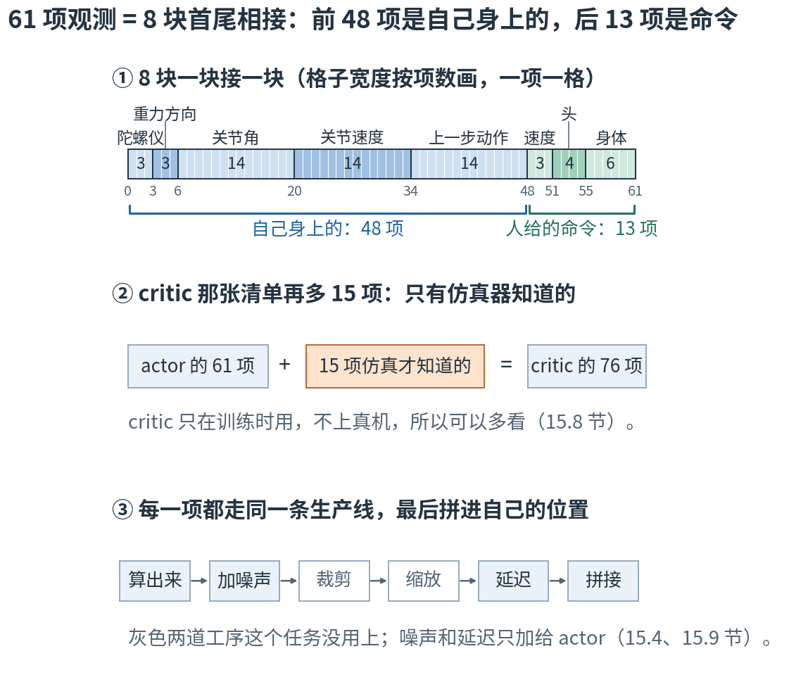
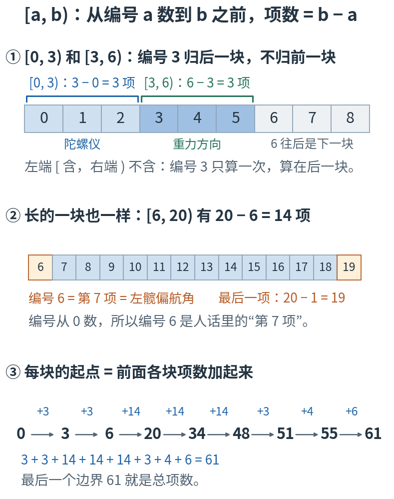
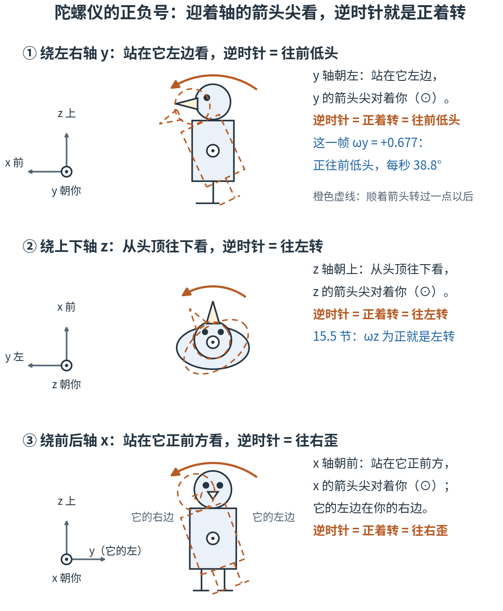
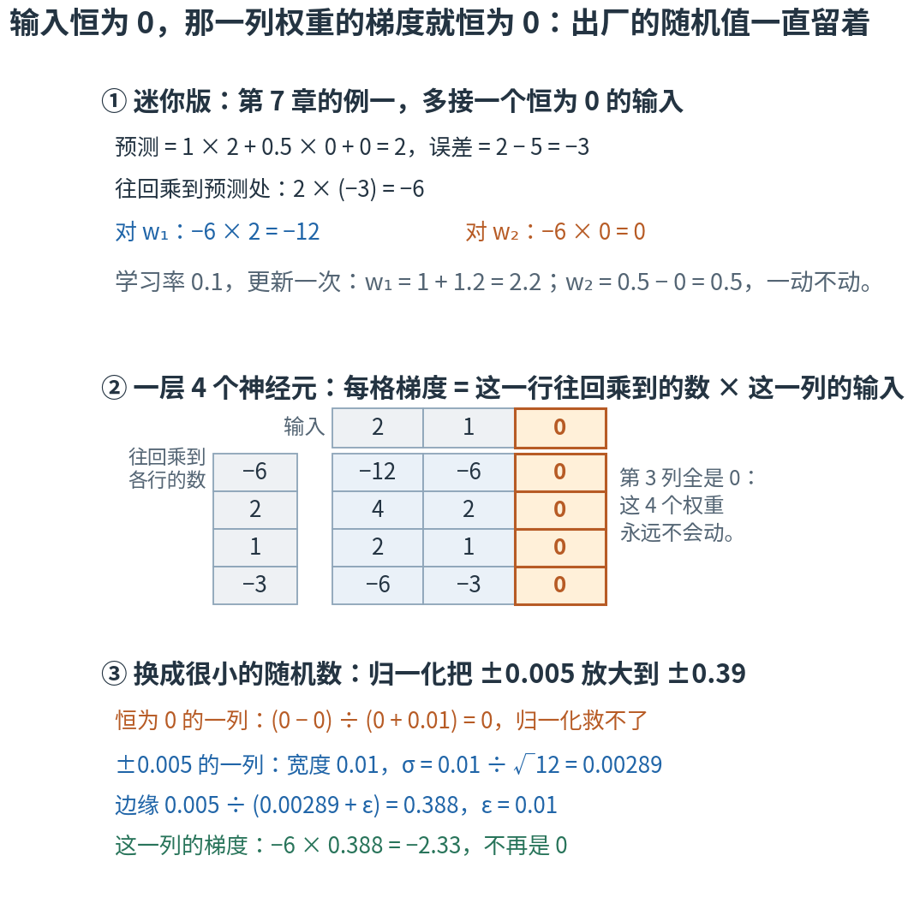
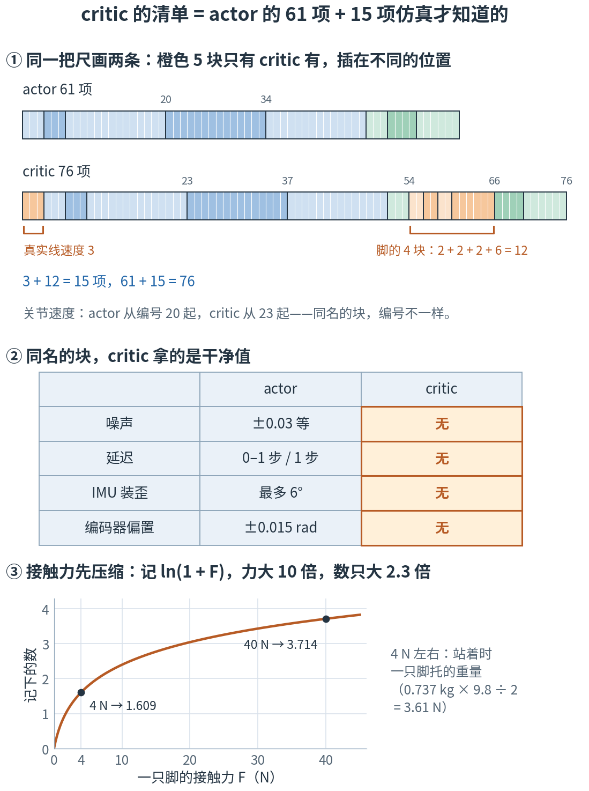

# 第 15 章 · 61 维观测逐位拆解：一张 61 项的清单，8 块首尾相接

> **上一部我们有了什么**：从走廊小游戏到 PPO（项目训练机器人用的算法，第 13 章）的全部算法。策略（actor）每 0.02 秒看一张 61 项的清单、吐出 14 个动作；
> critic（只在训练时用的第二张网络）看 76 项，给处境打分。算法只管把这些数当输入，并不关心它们是什么意思。
>
> **这一章要补什么**：第 4 部不再引入新算法，只把前面的每个概念对到 Microduck 的具体数字上。这一章先拆"策略看到什么"：
> 61 个数每一个是什么物理量、什么单位、加了多少噪声、晚了几步；critic 为什么能多看 15 个数；为什么有 6 个数几乎永远接近 0，却不能删。
>
> **本章新词**：半开区间、本体感受、命令块、热切换、零填充、死权重、特权观测。
> **需要的前提**：第 2 章的清单、箭头的长度、投影重力和切片（2.1、2.3、2.4、2.7 节），第 4 章的均匀分布、标准差和 ln（4.2、4.4、4.8 节），
> 第 6 章的一层网络和 critic（6.2、6.7 节），第 7 章的反向传播（7.2 节），第 8 章的归一化和烘焙（8.2、8.3、8.6 节），第 9 章的状态与观测（9.3 节）。
> 用到前面的概念时，正文都会先用一两句话提醒它是什么。**不要求**会三角函数：用到的 sin、cos 和"已知 cos 值反查角度"（arccos）都直接给了数，
> 还给了浏览器控制台的按法；想补弧度，[附录 D.2](../appendix/D-三角函数从0补课.md) 几分钟就够。标"进阶"的折叠块可以第二遍再读。

---

## 15.0 先看地图：一张 61 项的清单，8 块首尾相接

**策略每一步看到的 61 个数，是 8 块首尾相接拼成的：前 5 块共 48 项，是机器人自己身上就知道的（4 块是传感器测的，1 块是它自己上一步发出的动作）；
后 3 块共 13 项，是人给它的命令。每一项的位置、单位都是定死的；训练时还故意让读数差一点、晚一点。critic 那一份再多 15 项，只有仿真器才知道。**

第 2 章 2.1 节说过，61 维观测就是"每次要填 61 个数字的记录单"。现在把这张单子拿到手里看。它很像医院的体检表：
前面几栏是仪器测的（体温、心率、血压），最后一栏是医生写的医嘱（"每天走半小时"）。每一栏在表上的位置是印死的：
护士永远把体温写在第一格，医生永远去第一格找体温。仪器有误差，化验单总是晚一点才送到。
哪怕这家医院不测血压，那一格也得留着——表的格式一变，别处的医生就读不懂了。
实习期间，还有一位带教老师在旁边给实习医生的每个决定打分；老师手里是加长版，多几栏化验室才出得来的结果。实习医生将来独立出诊，老师不跟着去，手里只有那张基本表。

这一章就是逐栏读这张表。



**读图顺序：** 从 ① 到 ③ 竖着读。① 是全章的骨架：8 块按项数画成一条，一项一格，格子数得清；上面的字是块名，格子里的数是这一块有几项，
下面的小数字是每块的起点，最后的 61 是总项数。前 48 项（蓝）是机器人自己身上的，后 13 项（绿）是人给的命令。② critic 在这 61 项之外再多看 15 项。③ 每一项交出去之前，都走同一条生产线。
块名和数字现在不用记，15.1–15.9 节会一块一块讲。

| 概念 | 它在回答什么问题 | 体检表里对应什么 | 在哪一节 |
|---|---|---|---|
| 半开区间 [a, b) | 某一块占编号几到几？一共几项？ | 第几格到第几格 | 15.1 |
| 本体感受 | 前 48 项：机器人自己身上知道什么？ | 仪器测的那几栏 | 15.2–15.3 |
| 噪声与延迟 | 训练时为什么故意让读数差一点、晚一点？ | 仪器有误差，化验单晚一点到 | 15.4 |
| 命令块 | 后 13 项：人要它做什么？ | 医嘱栏 | 15.5 |
| 热切换 | 为什么好几个策略必须读同一张表？ | 别处的医生也读得懂 | 15.6 |
| 零填充、死权重 | 用不上的格子为什么不删？为什么又不能真的填 0？ | 不测血压也得留着那格 | 15.7 |
| 特权观测 | critic 多看的 15 项是什么？ | 带教老师手里的化验结果 | 15.8 |
| 生产线 | 一项数从测出来到交出去，经过哪几道工序？ | 测量、誊写、送达 | 15.9 |

表里的名字先不背，到了各节再给。本章最容易混的四处，先贴上标签：

- **编号和"第几项"**：代码从 0 数，人话从 1 数。编号 6 就是第 7 项（第 2 章 2.1 节："数学从 1 数起，代码从 0 数起"）。说整张清单里的位置，本章一律用编号；说一块**里面**的第几项，照人话从 1 数："陀螺仪的第 2 项"是编号 1；关节角那一块从编号 6 起，它的"第 4 个"是 6 + 3 = 9。
- **本章的 8 块和第 8 章 8.2 节的 6 块**：是同样的 61 项。第 8 章和部署演练脚本（📍 里的 `scripts/infer_policy.py`）把 3 块命令并成一块 13 项，所以数成 6 块；训练配置里命令是分开的 3 块，所以是 8 块。
- **观测噪声和动作噪声**：本章的噪声加在**读数**上，模拟传感器不准；第 4 章 4.7 节的噪声加在**动作**上，为了探索。两样东西，互不相干。
- **"零填充"填的不是零**：名字里有"零"，训练时喂的却是很小的随机数。15.7 节解释为什么真填 0 反而坏事。

现在觉得这些区别有点抽象很正常，读到对应小节就清楚了。

第一次读，按顺序看正文、图和手算；标"进阶"的折叠块可以先跳过。本章有两个实验：GPU 实验真建环境、打印一帧真实的观测；
CPU 实验不建环境，从配置里把每个常数读出来核对，并画出本章的图。两个都是复核工具，不是阅读门槛。

## 15.1 读表的三把钥匙：[a, b) 数项数，rad 量角度，一步是 0.02 秒

后面每一节都要读"某一块占编号几到几、单位是什么、晚几步"。先把三件工具备齐。

### 第一把：[a, b) 读作"从 a 到 b 之前"

第 2 章 2.7 节说过，切片 `:2` 是"从开头取到编号 2 **之前**"，取到的是编号 0 和 1。本章的表都按这个规矩写区间：

- 陀螺仪占 [0, 3)：编号 0、1、2，一共 3 − 0 = **3** 项。
- 重力方向紧接着占 [3, 6)：编号 3、4、5，一共 6 − 3 = **3** 项。
- 关节角占 [6, 20)：编号 6 到 19，一共 20 − 6 = **14** 项；最后一项的编号是 20 − 1 = 19，不是 20。

前端里你天天用的就是这个规矩：`arr.slice(6, 20)` 取的是编号 6 到 19，一共 14 个；`for (let i = 6; i < 20; i++)` 也是 6 跑到 19，写的是 `<` 不是 `<=`。

为什么项数是 b − a，不用再加 1？先拿最小的数：[3, 6) 是 3、4、5，一共 3 项，正好 6 − 3。道理是从 0 数起：编号 0 到 5 是 6 个，编号 0 到 2 是 3 个，
扣掉前面那 3 个，剩下的 3、4、5 就是 6 − 3 = 3 个。换成"两头都含"的写法就麻烦了：编号 6 到 19 两头都算，项数是 19 − 6 + 1 = 14——那个"+ 1"最容易忘，
少数一项、多数一项的错就是这么来的。

所以两条规矩就够用：**项数 = 右端 − 左端**；**上一块的右端，就是下一块的左端**。编号 3 不归陀螺仪、归重力方向——左端算、右端不算，
所以每个编号恰好只归一块，块和块之间既没有缝，也不重叠。

这种"左端含、右端不含"的区间叫**半开区间**（half-open interval），写成 [a, b)：方括号表示含，圆括号表示不含。
数学里把"含端点"叫"闭"（门关着，端点关在里面），"不含端点"叫"开"，所以 [a, b) 也读"左闭右开"。

| 符号 | 怎么读 | 就是 |
|---|---|---|
| $[a, b)$ | "a 到 b，左闭右开" | 编号 a、a + 1、……、b − 1，一共 b − a 项 |
| `x[a:b]` | "x 从 a 切到 b" | 代码里的同一件事（第 2 章 2.7 节）；JS 写作 `x.slice(a, b)` |



**这样读图：** ① 编号 3 被蓝、绿两个括号夹在中间：它是蓝块的右端（不含），又是绿块的左端（含），只算一次。
② 长块也一样：20 − 6 = 14，最后一项是 19。编号 6 是人话里的第 7 项——第 2 章 2.1 节说"第 7 位永远是左髋偏航角"，指的就是这一格。
③ 把 8 块的项数依次加起来，每一步的累计就是下一块的起点；加到最后是 61。

CPU 实验第 1 节不建环境，从配置（训练用的那份设置文件，代码里叫 env cfg，第 8 章 8.2 节见过这个名字）和机器人模型推出这 8 块，边界依次是 0, 3, 6, 20, 34, 48, 51, 55, 61。
GPU 实验真建了 4 个环境——第 9 章 9.2 节的"环境"，是除了做决定的策略以外的一切；这里就是 4 只仿真机器人，各在各的小世界里。
GPU 实验第 1 节确认 actor 61 项、critic 76 项、一步 0.02 s；GPU 实验第 2 节读出的表，和 CPU 推出的逐行对上：

```
           观测块  维数  索引区间
-----------------  ----  --------
     base_ang_vel     3     [0:3)
projected_gravity     3     [3:6)
        joint_pos    14    [6:20)
        joint_vel    14   [20:34)
          actions    14   [34:48)
          command     3   [48:51)
     head_command     4   [51:55)
     body_command     6   [55:61)
```

**怎么读这段输出**：左列是代码里每一块的名字，中间是项数（输出里叫"维数"），右列是区间——`[0:3)` 就是本节的 [0, 3)。
每一行的右端 = 左端 + 项数：第三行 6 + 14 = 20，所以是 `[6:20)`。从上往下，每行的右端 = 下一行的左端，最后一行停在 61。
前 5 行加起来 3 + 3 + 14 + 14 + 14 = 48，后 3 行加起来 3 + 4 + 6 = 13。每块叫什么、是什么，15.2–15.5 节一块一块讲。

### 第二把：rad 是转到了哪，rad/s 是转得多快

项目里的角度都用弧度（rad）。先提醒它是什么：弧度是另一把量角度的尺子——拿圆的半径当尺子，去量圆周上走过的那段弧，走过 1 个半径那么长，就是转了 1 rad；
走半圈是 π 个半径（π 是圆周率 3.1416），所以 π rad = 180°（[附录 D.2](../appendix/D-三角函数从0补课.md)）。

换算只记这一句。两边同时除以 π，就是 1 rad = 180° ÷ π = 180 ÷ 3.1416 ≈ 57.3°（≈ 读"约等于"：精确值是 57.2958…）。
所以**弧度换成度，乘 57.3**：0.1 rad ≈ 0.1 × 57.3 = 5.73°。反过来，度换成弧度就除以 57.3。

rad/s 是"每秒转多少弧度"，说的是**快慢**，不是转到了哪。和车速一样：时速 60 公里开半小时，开了 60 × 0.5 = 30 公里——速度乘时间，才是走过的量。
一个关节以 0.5 rad/s 的速度转 0.02 s，只转过 0.5 × 0.02 = 0.01 rad，约 0.01 × 57.3 = 0.573°，大约 0.57°。

> ⚠️ **rad 和 rad/s 只差"每秒"两个字，意思差得远。** 关节角那一块的单位是 rad，关节速度那一块是 rad/s。两块紧挨着，数的大小也差不多：
> 关节角读到 0.5，是已经比站姿多转了 0.5 × 57.3 ≈ 29°（关节角为什么记"比站姿多转多少"，15.3 节讲）；关节速度读到 0.5，是这一步只转了约 0.57°。读表先看单位。

### 第三把：一步 = 0.02 秒

"一步"指策略做一次决定：看一张 61 项的清单，吐出 14 个动作。一步 = **0.02 s**，所以一秒是 1 ÷ 0.02 = 50 步（第 14 章 14.1 节：仿真器每 0.005 s 算一次物理，`decimation = 4` 让 4 次合成一步，0.005 × 4 = 0.02）。
本章说"延迟 1 步"，就是晚 0.02 s。1 秒 = 1000 毫秒，0.02 × 1000 = 20，也就是晚 20 毫秒。

CPU 实验第 1 节把这三把钥匙里的数（57.3°、5.73°、0.01 rad、0.02 s）都从配置和公式里重算了一遍。

> **停一下，自测**：速度命令占 [48, 51)，头部命令紧接着占 4 项。头部命令的区间怎么写？最后一项的编号是几？另外，0.3 rad 大约是多少度？
> <details><summary>答案</summary>
>
> 左端接着上一块的右端 51，右端是 51 + 4 = 55：[51, 55)，最后一项编号 55 − 1 = 54。0.3 rad ≈ 0.3 × 57.3 = 17.19°，约 17°。
>
> </details>

## 15.2 前 48 项（一）：身体歪没歪、转多快——陀螺仪 3 项，重力方向 3 项

前 5 块、48 项有一个共同点：全是机器人**自己身上就知道的**——就像你闭着眼也知道自己的胳膊弯没弯、身子歪没歪。
其中 4 块是身上的传感器测的；第 5 块"上一步的动作"是它自己刚发出去的指令，15.3 节细说。
这类"不用看外面、自己感觉自己"的信息叫**本体感受**（proprioception）。它不包括"离墙多远""前面的地平不平"这种要看外面才知道的事。

打头的两块来自躯干里的 **IMU**（惯性测量单元：一块小芯片，里面有测转速的陀螺仪，和用来估计重力方向的加速度计）。
陀螺仪测的"转速"，是身体绕某根轴每秒转多少弧度，单位就是 15.1 节的 rad/s：

| 编号 | 块（代码名） | 是什么 | 单位 |
|---|---|---|---|
| 0–2 | 陀螺仪 `base_ang_vel` | 躯干绕自己的前后（x）、左右（y）、上下（z）三根轴，各转多快 | rad/s |
| 3–5 | 重力方向 `projected_gravity` | 第 2 章 2.4 节的投影重力：从机器人自己看，"下"在哪一边 | 无单位（理想时长度为 1） |

**重力方向这一块，先回到第 2 章 2.4 节的手机。** 手机平放在桌上，重力传感器读到"重力朝下"；把手机竖起来，它读到"重力朝手机的底边"——所以手机知道该横屏还是竖屏。
重力本身一点没变，变的是手机自己的姿势。机器人的这 3 项是同一件事：拿钉在躯干上的三根轴（x 朝前、y 朝左、z 朝上）去量"下"这个方向，看它在每根轴上各分到多少。
站得笔直时是 (0, 0, −1)："下"全落在上下轴上，z 朝上，往下就是负的；往前倾 30° 时是 (0.50, 0, −0.87)，有一部分落到了前后轴上（2.4 节那张图）。
"下"画成一根长度为 1 的箭头（第 2 章 2.3 节的单位向量），每一项只是"这根箭头在这根轴上占多少"，是个比例，所以没有单位。

陀螺仪和重力方向用的都是这套钉在躯干上、跟着身体转的轴。训练和真机必须用同一套轴：同样是 3 个数，要是按房间的轴填进去，形状不变，意思全错——
按房间的轴量，"下"永远是 (0, 0, −1)，机器人歪成什么样，这 3 个数都一动不动，等于没装。

### 陀螺仪的三项：绕三根轴转，正负号用右手定则读

陀螺仪的 3 项常写成 ωx、ωy、ωz（ω 读"欧米伽"，物理里常用它表示转得多快；右下角的小字母说绕哪根轴）。三根轴，三种转法：

| 陀螺仪的哪一项 | 绕哪根轴转 | 看起来像 | 这种转法叫 | 读数为正是 |
|---|---|---|---|---|
| 第 1 项 ωx（编号 0） | 前后轴 x | 身子往左、往右侧歪，像把头歪向肩膀 | 横滚（roll） | 往右歪 |
| 第 2 项 ωy（编号 1） | 左右轴 y | 往前低头、往后仰，像点头 | 俯仰（pitch） | 往前低头 |
| 第 3 项 ωz（编号 2） | 上下轴 z | 原地转身，像摇头说"不" | 偏航（yaw） | 往左转 |

横滚、俯仰、偏航这三个叫法，15.3 节的关节名里还会见到（髋偏航、髋横滚、髋俯仰……）：意思一样，只是转的换成了一个关节。

最后一列的正负号从哪来？按**右手定则**：右手握拳、竖起大拇指，让大拇指指向这根轴的正方向，四根手指弯的方向就是"正着转"。
不想比划手，还有一个等价的说法：**站到轴的箭头尖那一头，迎着它看过去（箭头尖对着你的眼睛），逆时针转就是正着转。** 三根轴各看一次：

- **y 轴朝左**：站在机器人左边看它，你看到它的侧面，它的脸朝你的左手边。逆时针，头顶就往你的左手边、也就是往它的前方转——往前低头。
- **z 轴朝上**：从它头顶往下看，它的脸朝你视野的上方，它的左边就在你的左边。逆时针，脸就往你的左边、也就是它的左边转——往左转。
- **x 轴朝前**：站在它正前方看它的脸，它的左手在你的右手边。逆时针，头顶往你的左手边倒，那是它的右边——往右歪。



**这样读图：** 每一幅都是"迎着一根轴的箭头尖看"：圆圈里一个点（⊙）就是正对着你的那根轴，另外两根轴画在纸面上，箭头指向正方向。
绕着 ⊙ 的橙色弧形箭头都是逆时针，也就是正着转；虚线是机器人顺着它转过一个小角度以后的样子。① 从左边看，它的脸朝左：往前低头。
② 从头顶往下看：往左转。③ 从正前方看，它的左边在你的右边：往右歪。

GPU 实验第 3 节让 4 只机器人做了 30 步随机小动作，然后打印第 0 号机器人的一帧。每行三样：块名、区间、这一块的几个数（打印到小数点后 3 位）。前两块是：

```
  base_ang_vel       [ 0: 3)  [-0.032  0.677 -0.163]
  projected_gravity  [ 3: 6)  [ 0.243  0.012 -0.971]
```

逐项翻译：

1. **歪了多少**：用第 2 章 2.4 节的一条关系：站直时"下"全在 z 轴上，g_z = −1；身体倾斜 θ 度（θ 读"西塔"，这里代表倾斜的角度），g_z 就变成 −cos θ（前倾 30° 时 −cos 30° = −0.87）。
   两边变号，cos θ = −g_z。这一帧 −g_z = −(−0.971) = 0.971，要问的就是"哪个角度的 cos 是 0.971"——已知 cos 值反查角度，用 arccos（[附录 D.6](../appendix/D-三角函数从0补课.md)）：
   倾角 = arccos(0.971) ≈ 13.8°，约 14°。浏览器控制台里按 `Math.acos(0.971)` 得 0.2414，这是弧度；乘 57.3（15.1 节），0.2414 × 57.3 ≈ 13.8°。`Math.acos(0.971) * 180 / Math.PI` 一步就是度数。
2. **往哪边歪**：第 1 项 0.243 为正，第 2 项 0.012 几乎为 0。第 2 章 2.4 节的约定是：往前倾时第 1 项 g_x 为正（前倾 30° 时是 0.50），往左歪时第 2 项 g_y 为正。
   所以这是**往前倾**，几乎不往两边歪。
3. **转得多快、往哪边转**：陀螺仪三项按大小比（不看正负号，只看离 0 多远：0.032、0.677、0.163），第 2 项 ωy 最大，是绕左右轴转，也就是上面表里"点头"的那种转法：
   0.677 rad/s ≈ 0.677 × 57.3 ≈ 每秒 38.8°。一步 0.02 s 里只转 0.677 × 0.02 = 0.01354 rad ≈ 0.78°。
   它是正的。按右手定则，绕 y 轴正着转就是往前低头，所以 +0.677 说的是：这一刻它正往前栽，前倾还在加大。
4. **长度不是 1**：箭头的长度用第 2 章 2.3 节的算法——每一项平方、加起来、再开平方根（√）：
   0.243² + 0.012² + 0.971² = 0.059049 + 0.000144 + 0.942841 = 1.002034，√1.002034 ≈ 1.001。
   重力方向理想时是长度恰好为 1 的单位向量，可 actor 看到的每一项都加过一点噪声（15.4 节），长度就不再恰好是 1。

它为什么歪？这只机器人身上没有训练好的策略，只是在随机抖；GPU 实验用的是演示模式（建环境时打开的 `play=True` 开关），还会每 0.5–1 秒推它一把。歪 14° 不奇怪，离摔倒还远：
倾角超过 70° 才算摔倒，这一回合（一局：从开局到摔倒或时间到，第 9 章 9.5 节）就此结束。换成 g_z 说：站直时是 −1，越歪越往 0 走；
70° 时是 −cos 70° = −0.342，比它更靠近 0（比如 −0.2）就算倒了（第 2 章 2.4 节）。
严格说，13.8° 是 actor **读到**的倾角：读数带着噪声，还有下面马上要讲的"装歪"，真实的倾角可能差几度。

**IMU 故意"装歪"。** 真机的 IMU 焊在板子上，不可能装得绝对正。所以每只机器人在训练一开始随机抽一根转轴、转一个 0 到 6° 之间的角度，整个训练都不变；
陀螺仪和重力方向两块用同一个旋转。站得笔直的机器人，也可能读到自己歪了好几度。按第 2 章 2.4 节，前倾 θ 时 g_x = sin θ、g_z = −cos θ；
要是这 6° 正好朝前，它会读到 (0.105, 0, −0.9945)：sin 6° = 0.105，cos 6° = 0.9945（控制台按 `Math.sin(6 * Math.PI / 180)` 得 0.1045）。
转轴朝别的方向时，歪出来的那一点会分到前后、左右两项上；落在这两根轴上的部分（水平分量）最多就是这 0.105。
这是第 17 章（域随机化）的一种：训练时故意把机器人的条件随机改一改，让策略不挑条件——第 4 章 4.2 节每只机器人开机时抽的电池电压，就是同一类做法。名字先不背。
它练的是"IMU 装得不太正也能走"。可它抵消不了一个**固定方向**的偏差：转轴是随机抽的，往前歪和往后歪一样常见，策略学会的只是"读数可能差几度，别太当真"。
项目的真机板子却有约 5° 的固定前后偏差，每一刻都朝同一个方向：站得笔直，读数也说"前倾 5°"，策略分不出这是真前倾还是板子歪，只能当真。
所以这 5° 是在运行时先校准掉的（运行时把读数反着转回这 5°），不靠训练。

CPU 实验第 2 节从这一帧和配置里，把 1.001、13.8°、38.8°/s、0.78°、70° 和 6° 的两个分量都重算了一遍，还用三个小旋转核对了右手定则读出的三个正负号，并画出上面那张三视图。

> **停一下，自测**：另一只机器人读到重力方向 (0, −0.5, −0.866)。它歪了多少度？往哪边歪？
> <details><summary>答案</summary>
>
> g_z = −0.866，所以 −g_z = 0.866，倾角 = arccos(0.866) = 30°（[附录 D.3](../appendix/D-三角函数从0补课.md) 的表：cos 30° ≈ 0.866）。第 1 项是 0：不往前也不往后。
> 第 2 项 −0.5：按第 2 章 2.4 节"y 轴朝左"的约定，往左歪时 g_y ≈ +0.5；这里是负的，所以是**往右**歪了 30°。
>
> </details>

## 15.3 前 48 项（二）：14 个关节的角度、速度，和上一步的动作

接下来三块各 14 项，一项对应一个舵机，顺序是固定的。舵机是装在每个关节上的小电机：告诉它转到哪个角度，它就自己转过去，还能报告现在转到了哪（全书开头说的 14 个舵机）。

| 关节组 | 关节（按顺序） | 关节角的编号 | 关节速度的编号 | 上一步动作的编号 |
|---|---|---|---|---|
| 左腿 | 髋偏航、髋横滚、髋俯仰、膝、踝 | 6–10 | 20–24 | 34–38 |
| 颈和头 | 颈俯仰、头俯仰、头偏航、头横滚 | 11–14 | 25–28 | 39–42 |
| 右腿 | 髋偏航、髋横滚、髋俯仰、膝、踝 | 15–19 | 29–33 | 43–47 |

表里的编号这样来：左腿 5 个关节，关节角从编号 6 起，排到 6 + 5 − 1 = 10；颈和头 4 个接着排 11 到 14；右腿 5 个排 15 到 19。
三块里关节的顺序一模一样，所以关节速度的编号 = 关节角的编号 + 14（20 − 6 = 14），动作的编号 = 关节角的编号 + 28（34 − 6 = 28）。
同一个关节在三块里排在同一个位置：左膝是每块的第 4 个，编号分别是 6 + 3 = 9、20 + 3 = 23、34 + 3 = 37。

关节名里的偏航、横滚、俯仰，就是 15.2 节那三种转法，只是转的换成了一个关节：髋（大腿根）偏航是大腿绕竖直方向拧，脚尖往里、往外转；
髋横滚是大腿往外侧抬；髋俯仰是大腿前后摆，也就是迈步。颈俯仰、头俯仰是点头，头偏航是摇头，头横滚是把头歪向肩膀。

**关节角 [6, 20)：减掉站姿之后的差。** 每个关节先读舵机里的**编码器**（测转角的传感器），再减去这个关节在标准站姿 HOME 时的角度（第 8 章 8.2 节）。
手算一次，用教学构造的数（接近颈俯仰关节真实的 HOME 0.3491 rad，0.3491 × 57.3 ≈ 20°）：HOME 是 0.35 rad，编码器读到 0.40 rad，
填进清单的是 0.40 − 0.35 = **0.05 rad**，0.05 × 57.3 ≈ 2.9°。它说的是"比站姿多转了约 2.9°"，不是"关节转到了 2.9°"。

为什么不直接填编码器读到的 0.40，偏要减掉站姿？两个理由。第一，**和动作说同一种话**：下面会讲，策略吐出的动作也是"比站姿多转多少"（目标角 = HOME + 动作）。
关节角也按站姿记，两个数就是同一把尺子上的刻度：动作说 +0.10、关节角是 +0.05，一减就知道还差 0.05。
第二，**站着就是 0**：站着不动时，这 14 项全在 0 附近——最常见的姿势，在输入里是一个干净的零点；看到 0.05，就知道是"比站着多转了一点"，不用去查这个关节的 HOME 是多少。

**关节速度 [20, 34)：每个关节转多快**，单位 rad/s。它的正负号和关节角各管各的：关节角 +0.05、速度 −0.2 rad/s，
意思是"比站姿多转了一点，正往回转"：照这个速度，0.02 s 后关节角是 0.05 + (−0.2) × 0.02 = 0.05 − 0.004 = 0.046，离站姿又近了一点。
两个符号相反并不矛盾，不能因此就以为传感器坏了。

**上一步动作 [34, 48)：策略自己上一步吐出的 14 个数。** 每个数的意思是"目标角比站姿多转多少"（单位 rad，目标角 = HOME + 动作；
接着上面的例子，HOME 0.35、动作 +0.10，目标角就是 0.35 + 0.10 = 0.45 rad）。
它不是传感器读数，是策略自己记下的。为什么要喂回去？舵机追目标要时间。假设上一步的动作是 +0.10，现在关节角还只有 +0.05：
两个数都在，网络才分得清"已经到了"和"还差 0.05，正在追"；只看关节角，这两种情况一模一样。
第 9 章 9.3 节的折叠（马尔可夫性质）说，知道"现在"就足以预测下一步——前提是"现在"记得够全；把上一步的动作喂回去，就是让这一帧记得更全的一个办法。
第 16 章（奖励）里让动作平滑的那一项，罚的也正是相邻两步动作的差。

那一帧的三块：

```
  joint_pos          [ 6:20)  [ 0.004  0.012 -0.043  0.162 -0.086 -0.026  0.035 -0.02   0.022 -0.004 -0.001  0.045 -0.123  0.075]
  joint_vel          [20:34)  [-0.171  0.101 -0.01   0.069 -0.714 -0.351  0.084 -0.217 -0.014 -0.273 -0.267  0.667  0.152 -0.01 ]
  actions            [34:48)  [ 0.108  0.067 -0.022 -0.031 -0.007 -0.007  0.094 -0.014  0.007 -0.006 -0.047 -0.04  -0.037 -0.005]
```

每行 14 个数，按上面表里的关节顺序排：第 1 个是左髋偏航，第 4 个是左膝，……第 14 个是右踝。读几个数：

- 关节角离 0 最远（不看正负号）的是第 4 个数 0.162（编号 6 + 3 = 9，左膝）：左膝比站姿多转了 0.162 rad，0.162 × 57.3 ≈ 9.3°。
- 关节速度离 0 最远的是第 5 个数 −0.714（编号 20 + 4 = 24，左踝）。
- 动作全在 ±0.11 以内（± 读"正负"，就是在 −0.11 到 0.11 之间，第 8 章见过）：GPU 实验喂的是随机小动作，不是训练好的策略。
- 同一张清单里，左髋偏航的关节角只有 0.004，重力方向第 3 项是 −0.971，大小差 0.971 ÷ 0.004 ≈ 243 倍。0.004 是这一帧碰巧小（关节角平常能到 ±0.5 rad），但各列**平常的大小**本来就差得远：第 8 章 8.2 节的表里，关节速度 ±8 是身体位置命令 ±0.005 的 1600 倍。
  这才是第 8 章要给每一列各配一把尺子的原因（8.3 节的归一化：每一列减去自己的平均、再除以自己的标准差，换算后各列都在 ±1 上下）。

**没有前进速度。** 本体感受里没有"我相对地面走多快"：机器人身上没有 GPS，也没有能直接测对地速度的传感器。
项目的环境是在 mjlab 上搭的（mjlab 是一个机器人训练框架：仿真、观测、奖励这些通用的部分都在里面，还自带一份现成的走路任务"模板"，项目就在模板上改）。
模板里本来有这一块：身体线速度 `base_lin_vel`，躯干平着移动有多快，单位 m/s（米每秒），和陀螺仪的"转多快"相对。项目把它从 actor 的清单里**删掉**了，策略只能从关节速度和陀螺仪里**推断**自己走得多快。
这就是第 9 章 9.3 节（状态与观测）说的"状态里有、观测里没有"。模板里的地形扫描 `height_scan` 也删了：机器人身上没有扫地形的传感器。

**编码器偏置：一把歪尺子，两头一起歪。** 真机的编码器装配时有零点误差：同一个角度，这只读得偏大一点，那只偏小一点。
（这里的"偏置"说的是读数整体歪了一点，和第 6 章网络里的偏置 b 同名，不是一回事。）
训练一开始，每只机器人给每个关节抽一个固定的偏差，在 ±0.015 rad 之间（0.015 × 57.3 ≈ 0.86°，也就是约 ±0.86°），整个训练不变。
actor 看到的关节角带着这个偏差；动作换算成目标角时，mjlab 也减掉同一个偏差——真机上，编码器读数和舵机目标用的是同一把歪尺子，仿真也得一样歪。
拿数走一遍（第 17 章（动作执行器）用的是同一组数，在那里细算）：HOME 0.35、动作 +0.10，这只舵机的读数总比真实大 0.01。
真机上，舵机的芯片照着自己的读数，把读数推到 0.35 + 0.10 = 0.45，这时真实角度是 0.45 − 0.01 = 0.44；
仿真里没有歪尺子，mjlab 就直接把目标定成 0.35 + 0.10 − 0.01 = 0.44。两边停在同一个真实角度上。
critic 看到的关节角不带偏差（15.8 节）。

CPU 实验第 3 节从机器人模型里读出 14 个关节的顺序和 HOME，核对了上面的编号表（+14、+28）、0.05 rad ≈ 2.9°、0.046、目标角 0.45、左膝 9.3°、243 倍和 1600 倍、±0.86° 和偏置那笔 0.44 的账。

> **停一下，自测**：某关节 HOME = 0.35 rad，编码器读到 0.30 rad，上一步的动作是 +0.10。清单里关节角那一项填多少？这个关节离它的目标还差多少？
> <details><summary>答案</summary>
>
> 关节角填 0.30 − 0.35 = −0.05 rad。目标是比站姿多 0.10，现在比站姿少 0.05，还差 0.10 − (−0.05) = 0.15 rad，正在追。
>
> </details>

## 15.4 噪声和延迟：每一项都"差一点、晚一点"

真机的传感器没有一个是准的，也没有一个是即时的：陀螺仪的读数带着抖，舵机报上来的速度是一小段时间的平均，从测量到策略拿到还要排队。
如果仿真里给策略的全是完美、即时的数，它就会依赖这种完美——上了真机，读数一抖，它就不会走了。所以训练时故意把 actor 的读数弄得"差一点、晚一点"。
下表中间一列是噪声："±0.03 rad/s"的意思是，每一步、每一项，从 −0.03 到 0.03 之间均匀地抽一个数，加到读数上；右边一列是延迟，"1 步"就是晚一步（0.02 秒）才交给策略：

| 块 | 噪声（每项、每步重新抽） | 延迟 |
|---|---|---|
| 陀螺仪 | ±0.03 rad/s | 0 或 1 步（每 64 步重抽一次） |
| 重力方向 | ±0.01 | 0 或 1 步（同上） |
| 关节角 | ±0.001 rad | 无 |
| 关节速度 | ±0.25 rad/s | 固定 1 步 |
| 上一步动作、3 块命令 | 无 | 无 |

**噪声**：每一步、每一项，从第 4 章 4.2 节的均匀分布里抽一个数，加到读数上。先提醒一下 4.2 节：均匀分布就是"一段区间里处处机会均等"，
U(a, b) 表示从 a 到 b 之间随便取一个数，你最熟的 `Math.random()` 就是 U(0, 1)。表里写 ±0.25，就是从 U(−0.25, 0.25) 里抽。
写成前端代码，和 4.2 节抽电池电压是同一招——先抽一个 0 到 1 之间的数，再拉宽、平移：

```js
const noise = -0.25 + (0.25 - (-0.25)) * Math.random();   // 就是 -0.25 + 0.5 * Math.random()：落在 −0.25 到 0.25 之间
const seen = 0.40 + noise;                                 // actor 读到的 = 真实值 + 这一步抽到的噪声
```

mjlab 里也正是这么算的：一个 0 到 1 之间的随机数，乘（上限 − 下限），再加下限。

拿关节速度算一下：真实值 0.40 rad/s，actor 读到的可能是 0.40 − 0.25 = 0.15 到 0.40 + 0.25 = 0.65 之间的任何数。±0.25 听着大，放到第 8 章 8.2 节估的典型幅度 ±8 rad/s 上，
只占 0.25 ÷ 8 ≈ 0.031，约 3%。关节角的噪声 ±0.001 rad，0.001 × 57.3 才约 0.057°：编码器本来就准，它真正的不准是上一节那个固定的偏置（±0.015 rad，是噪声的 0.015 ÷ 0.001 = 15 倍）。

噪声和偏置都是"读数不准"，脾气却正相反：

- **噪声每一步重抽**：这一步偏大，下一步可能偏小，长期平均是 0（第 4 章 4.3 节：均匀分布的期望在区间的正中间，U(−0.25, 0.25) 的正中间就是 0）。它像手抖。
- **偏置整个训练不变**：每一步都朝同一个方向偏，平均下来还是它自己。它像一把刻度印歪了的尺子。

**延迟**：关节速度**固定晚 1 步**。这是照着真舵机定的：舵机里的固件（装在舵机芯片里的小程序）取最近一小段位置读数的平均来算速度。
平均说的是刚过去的那一小段，就像一段路的平均车速说的是刚才那一段、不是这一刻——所以策略读到的速度，天然就晚一个控制周期（一步，0.02 s）左右。
陀螺仪和重力方向是 **0 或 1 步**：每只机器人自己抽，0 和 1 各占一半，每 64 步（64 × 0.02 = 1.28 s）重抽一次。
关节角是编码器这一刻的读数，配置里没给它延迟。上一步动作和命令本来就在策略手里，不加噪声，也没有延迟。

延迟怎么做出来？排一个队：每一步把新读数放到队尾，交出去的是往回数第 1 个。前端的写法：

```js
const history = [];
function delayed(value, lag = 1) {
  history.push(value);                                   // 这一步的新读数排到队尾
  const i = Math.max(0, history.length - 1 - lag);       // 往回数 lag 个；队里还不够，就拿最早那个
  return history[i];                                     // 交给策略的是这一个
}
```

手算一次。某关节连续 5 步的真实速度是 0.10、0.30、0.50、0.70、0.90（教学构造的数），晚 1 步：

| 第几步 | 这一步的真实值 | 队里排着的（从早到晚） | 往回数 1 个，交出去的 |
|---|---|---|---|
| 0 | 0.10 | 0.10 | 0.10（队里只有一个，只能先交它） |
| 1 | 0.30 | 0.10、0.30 | 0.10 |
| 2 | 0.50 | 0.10、0.30、0.50 | 0.30 |
| 3 | 0.70 | 0.10、0.30、0.50、0.70 | 0.50 |
| 4 | 0.90 | 0.10、0.30、0.50、0.70、0.90 | 0.70 |

从第 1 步起，每次交出去的都是上一步的真实值：最后一列整体比第二列晚了一行。
CPU 实验第 4 节用这段队列和 mjlab 自己的延迟缓冲（mjlab 里专门管排队的那段代码，叫 `DelayBuffer`）各算一遍，两串数一样；
噪声和延迟的设置也从配置里读出来核对了，还数了一数 0 步、1 步各占几成；GPU 实验第 5 节从建好的环境里读出的是同一张表。

> **停一下，自测**：某关节这一步的真实速度是 0.40 rad/s，上一步是 0.20 rad/s。actor 这一步读到的关节速度，可能落在什么范围？
> <details><summary>答案</summary>
>
> 关节速度固定晚 1 步，交出来的是上一步的 0.20，带着上一步抽的噪声（噪声在排队之前就加上了，15.9 节）：0.20 − 0.25 = −0.05 到 0.20 + 0.25 = 0.45 之间。
> 它甚至可能是负的。策略得学会不被一两步的读数带偏。
>
> </details>

## 15.5 后 13 项：命令块——走多快、头朝哪、身体怎么摆

后 3 块不是测出来的，是人告诉机器人"现在该做什么"。这 13 项合起来叫**命令块**（command block）。
真机上，命令由人用遥控器给（第 19 章（导出与部署））；训练时旁边没有人，命令是按下表的范围随机抽的。

下表最后一列的"±0.4"，意思是每次从 −0.4 到 0.4 之间均匀地抽一个数（15.4 节说过的那种抽法）。单位里 m 是米，m/s 是米每秒。
头和身体的命令都是"目标偏移"：头部的 4 项是那 4 个关节比站姿多转多少（和 15.3 节的动作一样，相对 HOME）；身体的 6 项是躯干比标准站姿时挪了多少、转了多少。

| 编号 | 块（代码名） | 每一项是什么 | 单位 | 训练时的抽样范围 |
|---|---|---|---|---|
| 48–50 | 速度命令 `command` | 前后速度 vx、左右速度 vy、转向速度 ωz | m/s、m/s、rad/s | ±0.4、±0.3、±1.0，整个训练不变 |
| 51–54 | 头部命令 `head_command` | 颈俯仰、头俯仰、头偏航、头横滚 4 个关节的目标偏移（相对 HOME） | rad | 起步 ±0.05、±0.05、±0.07、±0.015；训练中途按计划逐步放宽（这叫课程，第 18 章讲），最后 ±1.10、±1.10、±1.40、±0.31 |
| 55–60 | 身体命令 `body_command` | 躯干姿态的目标偏移：x、y、z 三个位置，横滚、俯仰、偏航三个角度 | m、rad | 位置 ±0.005、角度 ±0.05，**永远这么小** |

方向照第 2 章 2.4 节那套轴。v 是速度，右下角的 x、y 说沿哪根轴；ωz 就是 15.2 节陀螺仪表里那个"绕上下轴转多快"。
vx 为正是往前，vy 为正是往左，ωz 为正是从上往下看逆时针转，也就是左转——正是 15.2 节右手定则在 z 轴上的结论。

换成人话：速度命令前后最快 0.4 m/s，一秒走 40 厘米；左右最快 0.3 m/s，一秒 30 厘米；转向最快 1.0 rad/s，一秒约 1.0 × 57.3 ≈ 57°。
头部命令最后放宽到 ±1.10 rad（1.10 × 57.3 ≈ 63°，颈、头俯仰）、±1.40 rad（1.40 × 57.3 ≈ 80°，头偏航）、
±0.31 rad（0.31 × 57.3 ≈ 18°，头横滚，机械上本来就转不了多少）——每个关节按自己够得着的范围定，不是统一的一个数。
身体命令的 ±0.005 m 只有 5 毫米（1 米 = 1000 毫米，0.005 × 1000 = 5），±0.05 rad 约 0.05 × 57.3 ≈ 2.9°。

**命令怎么变**：每只机器人的速度命令每 3–8 秒重抽一次，头和身体的每 2–5 秒重抽一次，两次之间保持不变。
另外总有一部分机器人拿到**恰好全零**的速度命令，意思是站着别动：配置里的比例起步是 2%，课程里慢慢涨到 25%——训练时同时跑 4096 只，按这个比例，起步约 4096 × 0.02 ≈ 82 只，最后 4096 × 0.25 = 1024 只。
严格说还要打个折：每次重抽速度命令，还有 15% 的机会被改成"原地转圈"的命令，抽中站着的也不例外。所以真正在练站着的是这两个数的 85%（1 − 0.15 = 0.85），约 70 只和 870 只（第 18 章 18.4 节细讲）。
为什么要专门安排？第 4 章 4.2 节说过：连续的量"恰好等于某个值"是一条没有宽度的线，面积是 0；光靠均匀地抽，几乎永远抽不到恰好全零，
而"站着别动"偏偏是真机上最常见的命令。头部命令的范围怎么随训练放宽，第 18 章（课程学习）细讲。

那一帧的命令块：

```
  command            [48:51)  [0.231 0.267 0.613]
  head_command       [51:55)  [ 0.046 -0.042 -0.038 -0.005]
  body_command       [55:61)  [-0.004  0.005 -0.    -0.029 -0.039  0.   ]
```

翻译：要它前进 0.231 m/s、同时往左 0.267 m/s、左转 0.613 rad/s ≈ 0.613 × 57.3 ≈ 每秒 35°。
头部命令 4 项按大小逐项对：0.046、0.042、0.038、0.005，分别没超过起步范围 0.05、0.05、0.07、0.015——GPU 实验建的是刚开局的环境，课程还没往前走。
身体命令前 3 项是位置（米）：−0.004、0.005、−0.000，都在 5 毫米以内；后 3 项是角度（rad）：−0.029、−0.039、0.000，都在 0.05 rad 以内。`-0.` 是一个很小的负数，按 3 位小数打印成了 0。
这只机器人并没有照着命令走：它身上没有训练好的策略，只有随机小动作。命令只是被抽出来，填进了清单。


**这样读图：** 左边是块名和区间；右边第一行是原始数（或其中最显眼的一个），第二行是翻成的人话。
①（蓝字）五块是 15.2–15.3 节翻过的，②（绿字）三块是本节刚翻的。整张图读下来是一句话：一只往前歪了约 14°、还在往前栽的机器人，被要求一边前进、往左，一边左转。

CPU 实验第 5 节从配置里读出所有命令范围、重抽间隔和全零命令的比例，算了 57°、63°、80°、18°、82 只和 1024 只（打折以后约 70 只、870 只），并核对这一帧都落在范围里。

## 15.6 同一张清单，几个策略轮流读：热切换

Microduck 不止一个策略：走路一个，站着一个，还有坐下再站起、踢球、前滚翻……每个都是单独导出的一个 ONNX 文件
（第 8 章 8.6 节：把网络连同归一化器存成一个文件，真机上的程序不装 PyTorch 也能照着算）。
真机上按一下按钮，运行时（真机上跑策略的那个程序）就换一个文件，读同一张清单、出同一种格式的 14 个动作，机器人不用停下来。这叫**热切换**（hot-swap）。
"热"是"开着机、不停下就换"的意思，和前端开发里的热更新（页面不刷新，改过的模块就换上了）是同一个"热"。

热切换的前提是：**所有策略都用同一张 61 项的清单**。仓库根目录下的 AGENTS.md（写给开发者的规矩文件）把"61 项的布局"列为不能破坏的规矩，原因就在这里。

"同一张清单"不只是"都是 61 个数"。拿速度命令举例，约定是 [vx, vy, ωz]。一个策略要求 [0.2, 0, 0.5]：前进 0.2 m/s，同时以 0.5 rad/s 左转。
要是哪段代码把第 1、3 项填反了，网络读到的是 [0.5, 0, 0.2]：前进 0.5 m/s（比训练时的上限 0.4 还快），转向只有 0.2 rad/s。
形状照样是 3 项，任何"长度对不对"的检查都会通过（部署演练脚本启动时就有这样一道长度检查，见 📍），任务却完全变了。

> ⚠️ **形状对了，不等于意思对了。** 热切换要求这些全都一致：块的顺序、每块里各项的顺序、单位、坐标系（三根轴怎么定：x 朝前、y 朝左、z 朝上）、HOME、关节顺序、每个命令的含义。
> 举两个项目里真实存在的坑。其一，有的机器人模型带着不装舵机的关节（名字都以 `passive_` 开头，比如轮子），它们在关节列表里**插在中间**，
> "关节列表的前 14 个就是 14 个舵机"并不成立，得按名字把舵机关节挑出来。
> 其二，"坐下再站起"那个策略把"坐 / 站"的开关写在速度命令的第 1 项（1 是坐下，0 是站起），运行时必须按它的约定填；全填 0，它的意思是"站着"。

部署那头怎么拼，📍 会看一眼仓库里的部署演练脚本：拼的顺序和训练的 8 块一致（3 块命令在那里是一个 13 项的数组）；导出的 ONNX 文件里还记着这 8 块的名字和顺序，第 19 章（导出与部署）会用到。

CPU 实验第 6 节核对了对调之后的 0.5 超出训练范围，以及下面自测里的长度 0.073。

> **停一下，自测**：头部命令恰好有 4 项。有人说："4 个数，那就是表示头朝向的四元数吧？"（四元数是另一种用 4 个数表示旋转的写法，表示旋转时，4 个数的长度必须是 1。）
> 用那一帧的 (0.046, −0.042, −0.038, −0.005) 验证一下。
> <details><summary>答案</summary>
>
> 不对。这 4 项是颈俯仰、头俯仰、头偏航、头横滚 4 个关节各自的目标偏移。按 15.2 节量长度的办法：四个平方 0.002116 + 0.001764 + 0.001444 + 0.000025 = 0.005349，
> 开根号 √0.005349 ≈ 0.073，远不是 1。
> 读一串数，必须连同它的布局约定一起读，不能凭"有几个数"猜意思。
>
> </details>

## 15.7 用不上的格子：零填充，而且不能真的填零

身体命令那 6 项，在走路任务里其实没用：奖励里对应的那一项权重是 0（第 16 章）。奖励是好几项打分按各自的权重加起来的；权重 0，这一项乘出来永远是 0，等于不计分。
走路时也不需要谁告诉它躯干往哪歪几毫米。可"摔倒后站起来"那个任务要用它：告诉机器人躯干该摆成什么姿势。

要是走路任务把这 6 项删了，它的清单就只剩 61 − 6 = 55 项，和站立策略的 61 项对不上：它的网络第一层是一张 512 行、55 列的价格表（第 6 章 6.2 节），
运行时递过来 61 项，根本乘不了——每一行和清单做点积，两边得一样长（第 2 章 2.5 节）。删的要是中间的一块就更糟：后面的块整体往前挪，编号全串了（"改一改"第 1 条就是这个实验）。
两个 ONNX 就不能热切换了。所以仓库的规矩是：**用不上的块也原样占着位置，不删**。这叫**零填充**（zero-padding），名字来自"没用的位置填 0"。

可走路任务并没有真的填 0，而是在一个很小的范围里随机抽（身体命令就是 ±0.005 m、±0.05 rad）。为什么？

### 迷你版：第 7 章的例一，多接一个恒为 0 的输入

先回忆第 7 章 7.2 节的例一：一条直线 ŷ = w·x + b 猜一个数（· 是乘号，ŷ 是预测），损失是误差的平方。x = 2、真值 y = 5、w = 1、偏置 b = 0：预测 1 × 2 + 0 = 2，误差 2 − 5 = −3。
反向传播从损失往回乘，每过一台机器乘一次它的本地汇率（这台机器的输入动一点、输出动几倍）：平方机器是 2 × 误差 = 2 × (−3) = −6，减法机器是 1，所以往回乘到预测处是 −6；
乘加机器对 w 的本地汇率是 x = 2，对 w 的梯度就是 −6 × 2 = −12。

现在给它多接一个输入，永远是 0（就像一个填了 0 的命令格子），配一个权重 0.5（网络刚建好时随手填的初值）。
为了分清两个，原来的输入和权重改叫 x₁、w₁，新接的叫 x₂、w₂（右下角的小数字只是编号），预测变成 ŷ = w₁·x₁ + w₂·x₂ + b：

- 预测 = 1 × 2 + 0.5 × 0 + 0 = 2，误差还是 −3，往回乘到预测处还是 −6。
- 对 w₁：乘加机器对 w₁ 的本地汇率是 x₁ = 2，梯度 −6 × 2 = −12，和第 7 章一样。
- 对 w₂：本地汇率是 x₂ = 0，梯度 −6 × 0 = **0**。

为什么对 w₂ 的本地汇率偏偏是 x₂？第 7 章 7.2 节有一句话：**乘法机器有两个输入，问谁，本地汇率就是另一个**。w₂·x₂ 这一块，问 w₂，得到的就是 x₂。拧一下核对：

- w₁ 从 1 拧到 1.01：预测 = 1.01 × 2 + 0.5 × 0 + 0 = 2.02，多了 0.02，是拧的 0.01 的 2 倍——本地汇率 2，正是 x₁。
- w₂ 从 0.5 拧到 0.51：预测 = 1 × 2 + 0.51 × 0 + 0 = 2，一点没变，变化率 0 ÷ 0.01 = 0——本地汇率 0，正是 x₂。

道理就是小学乘法：一个乘数是 0，另一个乘数拧到多大，乘积都是 0。w₂ 怎么拧，预测都不动，损失也就不动，梯度当然是 0。

学习率取 0.1，更新一次（第 3 章 3.4 节：旋钮减去"学习率 × 梯度"）：w₁ = 1 − 0.1 × (−12) = 1 − (−1.2) = 1 + 1.2 = 2.2；w₂ = 0.5 − 0.1 × 0 = 0.5，**没动**。
再更新一千次也一样：往回乘到预测处的那个数会跟着 w₁ 变，可它乘上 x₂ = 0，结果永远是 0。w₂ 拿到的梯度一直是 0，永远停在出厂时的 0.5。

真正的麻烦在后面：换了任务、或者课程把范围放宽了，x₂ 第一次变成 0.3，这个权重给出 0.5 × 0.3 = 0.15——一个从来没学过、随手填的贡献。
出厂时要是随手填成了 −0.5，贡献就是 −0.5 × 0.3 = −0.15，方向都反了。网络对这个输入的反应，等于是随机的。

这种因为输入恒为 0、永远拿不到梯度、一直停在初值上的权重，叫**死权重**（dead weights）。仓库的 AGENTS.md 说得很直白：

> A command input that is never non-zero has dead weights forever.
>
> （一个从来没有非零过的命令输入，它连着的权重永远是死的。）



**这样读图：** ① 就是上面的手算。② 把它推到一层 4 个神经元（第 6 章的 4 家店）、3 个输入：最上面一行是 3 个输入，第 3 个恒为 0；
左边一列是"往回乘到这一行的数"，也就是损失对这家店算出的总价的倍数（教学构造的数）；中间 4 × 3 的格子是 12 个权重各自的梯度，每一格 = 这一行的数 × 这一列的输入。
第 3 列的输入是 0，这一列 4 格全是 0。真网络的第一层有 512 行，那一列的 512 个权重都一样一动不动。
③ 是换成小随机数的情况，下面马上算；③ 里的 σ 是这一列的标准差，ε 就是第 8 章 8.3 节分母上那个防止除以 0 的 0.01。

为什么每一格都是"这一行的数 × 这一列的输入"？第 k 家店（第 k 个神经元）的总价，是它那一行价格和 3 个输入逐项相乘再相加，再加运费（第 6 章 6.1 节）。
第 j 列的权重，只出现在"它 × 第 j 项输入"这一个乘积里：问它，本地汇率就是第 j 项输入——和迷你版里的 w₂ 一模一样。再乘上往回乘到这家店的数，就是这一格。
拿第 2 行核对：往回乘到第 2 家店的数是 2，三格依次是 2 × 2 = 4、2 × 1 = 2、2 × 0 = 0。

### 小范围随机：让这一列活着

规矩的后半句是：**用不上的格子也要喂一点非零的数**，从训练一开始就喂。身体命令的位置在 ±0.005 m 里抽，看着小得可怜——
可别忘了，网络看到的不是原始读数，是第 8 章 8.3 节归一化之后的数。先提醒那一章做了什么：每一列换一把自己的尺子——
先减去这一列的平均，再除以这一列的标准差（第 4 章 4.4 节：一个平常的读数离平均有多远）。换算公式搬过来：

**归一化后的数 = (读数 − 这一列的平均) ÷ (这一列的标准差 + ε)**，ε 是一个固定的小数 0.01，只为防止除以 0。

- 恒为 0 的一列：每个读数都是 0，平均就是 0；每个读数离平均都差 0，平方、平均、开根号还是 0，所以标准差也是 0。归一化后是 (0 − 0) ÷ (0 + 0.01) = 0。归一化救不了它。
- ±0.005 的一列：从 −0.005 到 0.005，宽度是 0.005 − (−0.005) = 0.01；平均在正中间，是 0（第 4 章 4.3 节：均匀分布的期望在区间正中间）。
  标准差先拿数算：第 4 章 4.4 节说均匀分布的方差 = 宽度² ÷ 12，0.01² = 0.0001，0.0001 ÷ 12 ≈ 0.00000833；标准差是方差开根号，√0.00000833 ≈ 0.00289（控制台按 `Math.sqrt(0.0001 / 12)`）。
  也可以一步算：开根号时，相除的两个数可以各开各的（第 4 章 4.6 节讲过相乘的情形 √(4 × 9) = 2 × 3，相除也一样：√(36 ÷ 4) = √9 = 3 = 6 ÷ 2），
  而 √(宽度²) 就是宽度，所以标准差 = 宽度 ÷ √12 = 0.01 ÷ 3.464 ≈ 0.00289（√12 ≈ 3.464，因为 3.464 × 3.464 ≈ 12）。
  这一列最大的读数是边缘的 0.005，归一化后是 (0.005 − 0) ÷ (0.00289 + 0.01) = 0.005 ÷ 0.01289 = **0.388**。浏览器控制台里按 `0.005 / (0.01 / Math.sqrt(12) + 0.01)` 可以核对。

> ⚠️ **这里有两个 0.01，是两样东西。** 一个是这一列的宽度（0.005 − (−0.005)），一个是分母里的 ε。数值碰巧相等：范围改小，宽度跟着变小，ε 不变——"改一改"第 2 条改的就是范围。

原始读数只有几毫米，进网络时能到 ±0.39，已经不是 0。不过比别的列小一些：要是没有 ε 在分母里压着，均匀散开的一列，边缘总是换算成 1.73 左右
（宽度是边缘的 2 倍，标准差 = 宽度 ÷ 3.464 = 边缘 × 2 ÷ 3.464，所以边缘 ÷ 标准差 = 3.464 ÷ 2 ≈ 1.73，和范围多大无关）。
比如关节速度那样散在 ±8 的列，标准差 = 16 ÷ 3.464 ≈ 4.62，边缘 8 ÷ (4.62 + 0.01) = 8 ÷ 4.63 ≈ 1.73，ε 在那里几乎不起作用（第 8 章 8.3 节）。
把迷你版里的 x₂ 从 0 换成 0.388，w₂ 的梯度就是 −6 × 0.388 = −2.33，不再是 0。

有两件事要分清：

- 零填充是**接口上的规矩**：位置必须占着，谁也不许删，不然后面的块全部错位。
- 小范围采样是**学习上的讲究**：让那一列一直有梯度，权重不死。它只保证"有机会学"，不保证"学会了"——走路任务里身体命令的奖励权重是 0，网络很可能学成"不理这 6 项"。
  真要让某个命令起作用，还得有对应的奖励（第 16 章）。

所以头部命令起步时也不是 0，而是 ±0.05 这样的小范围：课程后面要把它放宽到 ±1.10，到那时，这些输入连着的权重早就是活的了（第 18 章）。

也有任务真的填了 0：坐下再站起那个策略的身体 6 格、前滚翻那个策略的头部和身体 10 格，配置里用的是 `zero_command_padding`，一个恒为 0 的观测项。
这不矛盾。死权重怕的是"输入以后会变成非零"（上面那个 0.3）；这些格子在那些任务里永远用不上，部署时运行时也只往里送 0——输入一直是 0，那一列的权重再"死"，乘出来也一直是 0，碍不着事。
走路任务的头部命令就不一样：课程要把它一步步放宽，输入迟早不是 0，所以从第一步起就得喂小随机数，让那一列活着。

<details>
<summary>进阶：一般的式子——恒为 0 的第 j 列，512 个权重的梯度全是 0（现在可跳过）</summary>

把正文那句"每一格 = 这一行的数 × 这一列的输入"写成式子。第一层第 k 个神经元先算总价 $z_k = \sum_j W_{kj}\,x_j + b_k$：
Σ 就是第 2 章 2.2 节那个"for 循环累加"，j 把输入从头到尾走一遍；这就是第 2 章 2.6 节那张价格表的第 k 行。3 个输入时把它写开：

$$z_k = W_{k1}x_1 + W_{k2}x_2 + W_{k3}x_3 + b_k$$

（$W_{k1}x_1$ 中间省了乘号。）对其中一个权重 $W_{kj}$ 求偏导（第 3 章 3.2 节：别的旋钮都按住不动，只拧这一个，看结果变多快）：
写开的式子里只有 $W_{kj}x_j$ 这一块含它，别的块都不跟着变；这一块是乘法机器，问 $W_{kj}$，本地汇率就是另一个乘数 $x_j$。
用图 ② 第 1 行核对（输入是 2、1、0）：$W_{11}$ 多拧 0.01，$z_1$ 多 0.01 × 2 = 0.02，汇率 2；$W_{13}$ 多拧 0.01，$z_1$ 多 0.01 × 0 = 0，汇率 0。
再乘上从损失往回乘到 $z_k$ 的数（第 7 章 7.2 节：一路上的倍数连乘）：

$$\frac{\partial L}{\partial W_{kj}} = \frac{\partial L}{\partial z_k}\cdot x_j$$

（· 是乘号。）第 1 行往回乘到 $z_1$ 的数是 −6，三个梯度依次是 −6 × 2 = −12、−6 × 1 = −6、−6 × 0 = 0，正是图 ② 的第 1 行。

| 符号 | 怎么读 | 就是 |
|---|---|---|
| $W_{kj}$ | "W k j" | 第一层第 k 行、第 j 列的权重：第 k 个神经元给第 j 项输入标的"价格"。前一个下标说哪一行，后一个说哪一列 |
| $x_j$ | "x j" | 第 j 项输入（归一化之后的） |
| $\dfrac{\partial L}{\partial z_k}$ | "L 对 z k 的偏导" | 往回乘到第 k 个神经元的数（图 ② 左边那一列） |
| $\dfrac{\partial L}{\partial W_{kj}}$ | "L 对 W k j 的偏导" | 这一个权重的梯度（图 ② 中间的一格） |

如果进网络的第 j 列恒为 0，那么对每一个 k，这个乘积都是 0：第 j 列的 512 个权重一起冻住。整张梯度表就是"左边一列 × 上面一行"，图 ② 那张 4 × 3 的表是它的迷你版。

项目用的 Adam（第 7 章 7.5 节）也救不了它。Adam 记两本账：m 是梯度的滑动平均，v 是梯度平方的滑动平均，这一步 = 学习率 × m ÷ (√v + ε)。梯度一直是 0 时，
m = 0.9 × 0 + 0.1 × 0 = 0，v = 0.999 × 0 + 0.001 × 0² = 0，起步修正除完还是 0，这一步 = 学习率 × 0 ÷ (0 + ε) = 0
（这里的 ε 是 Adam 自己防止除以 0 的一个极小的数，不是归一化的那个 0.01）。每次更新走的都是 0。实验真用 torch 的 Adam 跑了 1000 步：w₂ 一直是 0.5。

</details>

CPU 实验第 7 节用 torch 的自动求导（第 7 章 7.2 节的 autograd：沿着计算图自动往回乘）把 −12、0 和 4 × 3 的梯度表算了一遍，拧 0.01 核对了两个本地汇率，
用 Adam 跑了 1000 步看 w₂ 一动不动，从配置里读出身体姿态那一项奖励的权重确实是 0，再用项目的归一化器实测 ±0.005 那一列归一化后的边缘，和手算的 0.388 对上。

> **停一下，自测**：有人提议："头部命令一开局就按最终范围 ±1.10 抽，何必从 ±0.05 起步？"另一个人说："那就干脆先填 0，等课程到了再放开。"两个提议各有什么问题？
> <details><summary>答案</summary>
>
> 第一个是课程的问题：走路还没学会，就要求头转 ±63°，一上来就被一个很难的目标压着——为什么要从容易的开始，第 18 章（课程学习）讲。
> 第二个就是本节的死权重：先填 0，这几项输入连着的权重一直拿不到梯度，停在初值；等课程放开，网络对它们的反应是随机的。
> ±0.05 的小范围两头都顾到了：足够容易，又让这些权重从一开始就在学。
>
> </details>

## 15.8 critic 那张清单多 15 项：特权观测

第 6 章 6.7 节说过，critic（只在训练时用的第二张网络：不决定动作，只给"现在这个处境"打分，估计从这里往后大概还能拿多少奖励）看 76 项，比 actor 多 15 项。
多出来的 5 块，每一块都是真机上测不到、或者测不准的：

| 块（代码名） | 项数 | 是什么 | 为什么真机拿不到 |
|---|---|---|---|
| 身体线速度 `base_lin_vel` | 3 | 躯干真实的前后、左右、上下速度 | 没有 GPS，也没有能测对地速度的传感器（15.3 节） |
| 脚离地高度 `foot_height` | 2 | 每只脚离地面多高（仿真里从脚往下发一条射线，看它走多远碰到地面，像激光测距） | 脚底没有测距的传感器 |
| 腾空时间 `foot_air_time` | 2 | 每只脚已经离地多久 | 得先知道脚着没着地 |
| 着地没 `foot_contact` | 2 | 每只脚现在碰没碰到地 | 脚底没有触地开关 |
| 接触力 `foot_contact_forces` | 6 | 每只脚受到的地面的力，三个方向各一项 | 脚底没有测力的传感器 |

3 + 2 + 2 + 2 + 6 = 15，61 + 15 = 76。这种只有仿真器才知道、只给训练用的观测，叫**特权观测**（privileged observation）：
只有它有资格看，真机上谁也拿不到，就像 15.0 节那位带教老师手里多出来的化验单。
为什么能给 critic 看？critic 只在训练时给处境打分，从来不上真机（第 6 章 6.7 节）；它看得越全，"这个处境有多好"就越容易估。
两张网络看的东西不一样，这种做法叫非对称 actor-critic，第 10 章 10.5 节讲过道理：多看不自动保证估得更准、训练更快，
它的作用都要通过优势（这个动作比平均好多少，第 10 章 10.4 节）间接传给 actor。

**同名的块，critic 拿的是干净值。** 另外 8 块虽然和 actor 同名，但 critic 这一组的开关 `enable_corruption`（corruption 是"弄脏"：给读数加噪声的总开关）是关着的：不加噪声；
也没有延迟、没有 IMU 装歪的旋转、没有编码器偏置。critic 不需要学会容忍噪声，只需要估得准。

**接触力先压缩，再交出去。** 脚撞地的一瞬间，力可能是站着时的好几倍。直接交给网络，偶尔一个特别大的数，就会把这一列的统计带偏：
第 8 章的归一化器按这一列平常的平均和起伏来换算，几个特别大的数会把"起伏"撑大，平常那些数换算后就全挤在 0 附近，网络反而看不清它们的变化。
所以这一块记的不是力 F 本身，而是 ln(1 + |F|)，再带上原来的正负号。先提醒 ln（第 4 章 4.8 节）：ln x 问的是"e（≈ 2.718）的几次方等于 x"。
x 越大，ln x 涨得越慢：x 从 1 走到 2.718，ln 涨了 1；从 2.718 走到 7.389，ln 才又涨了 1。大数被压扁，这正是"压缩"要的效果。
|F| 是 F 的绝对值（去掉负号后的大小，第 4 章 4.4 节），因为 ln 只接受正数。加 1 也是为了这件事：F = 0 时 ln 0 根本算不出来（e 的多少次方都不是 0）；
加了 1，最小也是 ln 1 = 0，F = 0 时记下的正好也是 0。

机器人模型重 0.737 kg，两只脚站着各托一半：0.737 × 9.8 ÷ 2 = 3.61 N（N 读"牛"，力的单位；重量 = 质量 × 9.8，初中物理。托住一个 100 克的苹果大约要 0.1 × 9.8 = 0.98 N），
就按 4 N 算：ln(1 + 4) = ln 5 = 1.609。力大 10 倍到 40 N，记下的是 ln(1 + 40) = ln 41 = 3.714，只大 3.714 ÷ 1.609 ≈ 2.3 倍。
反方向的 −4 N 记成 −1.609：先按大小 4 算出 1.609，再把负号带回去。
前端写法是 `Math.sign(F) * Math.log1p(Math.abs(F))`（`Math.sign(F)` 取 F 的正负号，给 1、−1 或 0；`log1p(x)` 就是 ln(1 + x)）。这一块 6 项，每一项各压各的。

GPU 实验第 4 节读出的 critic 清单——总表，不用背：

```
      critic 观测块  维数             
-------------------  ----  -----------
       base_lin_vel     3  ★ 仅 critic
       base_ang_vel     3             
  projected_gravity     3             
          joint_pos    14             
          joint_vel    14             
            actions    14             
            command     3             
        foot_height     2  ★ 仅 critic
      foot_air_time     2  ★ 仅 critic
       foot_contact     2  ★ 仅 critic
foot_contact_forces     6  ★ 仅 critic
       head_command     4             
       body_command     6             
```

**怎么读这段输出**：带 ★ 的 5 块只有 critic 有，其余 8 块和 actor 同名。先数项数，从上往下加：3 + 3 + 3 + 14 + 14 + 14 + 3 + 2 + 2 + 2 + 6 + 4 + 6 = 76。
再看位置：★ 块没有整齐地接在 actor 那 61 项后面，而是插在中间——
身体线速度打头，4 块脚的信息夹在速度命令和头部命令之间。
为什么这么排？mjlab 的模板里，critic 的清单 = actor 的清单（打头就是线速度）+ 地形扫描 + 脚的 4 块；项目从 actor 那份删了线速度、从两份都删了地形扫描，最后在两份末尾各追加头部、身体命令。顺序是这样一步步留下来的，不是谁特意排的。

> ⚠️ **同一个量，在两张清单里的编号不一样。** 关节速度在 actor 里是 [20, 34)，在 critic 里是 [23, 37)：前面多了身体线速度那 3 项（3 + 3 + 3 + 14 = 23）。
> 拿 actor 的编号去 critic 的清单里找东西，会错开 3 格。



**这样读图：** ① 两条用的是同一把尺，一项一格：critic 那条更长，橙色 5 块是它独有的，打头 3 项，中间 12 项。灰色的小数字是几个块的起点。
② 同名的 8 块，critic 那一列样样是"无"。③ 接触力压缩的曲线：横轴是一只脚受的力 F（牛），纵轴是记下的数 ln(1 + F)；越往右越平，力大 10 倍，记下的数只多一点。

CPU 实验第 8 节从配置推出 critic 的 13 块，和 GPU 实验第 4 节的表逐行对上，并核对了 mjlab 模板里 critic 清单的来历、"干净值"的每一条、ln 的那两步涨幅、0.98 N，以及 1.609、3.714 和 2.3 倍。

> **停一下，自测**：critic 清单里，身体命令是哪个区间？（提示：它是最后一块，6 项。）critic 的头部命令又从编号几开始？
> <details><summary>答案</summary>
>
> 最后一块的右端就是总项数 76：[76 − 6, 76) = [70, 76)。头部命令 4 项紧挨在它前面：[66, 70)，从编号 66 开始。
>
> </details>

## 15.9 一项观测的生产线：算出来、加噪声、裁剪、缩放、延迟、拼接

最后把前面几节串起来：一项观测从"算出来"到"进了网络"，中间过了哪几道工序？mjlab 对每一块都按同一个固定顺序加工，像一条**生产线**：

1. **算出来**：从仿真里读出这个量（关节速度、投影重力……）。
2. **加噪声**：15.4 节的均匀噪声（只有 actor 加）。
3. **裁剪**：把数夹在一个范围里，超出的按到边上（本任务没用）。比如夹到 [−1, 1]（两边都是方括号：照 15.1 节的规矩，−1 和 1 本身都算在内）：1.7 变成 1，−3 变成 −1，0.4 不动；前端写法是 `Math.min(Math.max(x, -1), 1)`。
4. **缩放**：乘一个倍数，换个单位（本任务没用）。比如乘 0.1：12 变成 1.2。
5. **延迟**：排队，晚几步交出（15.4 节，只有 actor 有）。
6. **拼接**：8 块按顺序首尾相接，拼成 61 项（15.1 节）。

mjlab 的源码注释里，延迟之后还有一道"保留最近几步的历史"，本任务同样没用，这里就不列了。

拿左膝的关节速度走一遍。真实值 0.40 rad/s；这一步抽到的噪声假设是 +0.12（教学构造的数，在 ±0.25 以内），加完是 0.52；不裁剪，不缩放；
进队列排着，下一步才交出去；拼接时放进关节速度块的第 4 格，编号 20 + 3 = 23。
critic 的同一项没有噪声、也不排队，这一步拿到的就是 0.40，放在它自己清单的编号 23 + 3 = 26。


**这样读图：** ① actor 的一项走完 6 道工序，灰框是这个任务没用上的两道。② critic 的同一项只走首尾两道。
③ 拼好的 61 项先交给第 8 章的归一化器，再进网络；蓝色虚线框是导出的 ONNX 文件，归一化器和网络装在一起（第 8 章 8.6 节）。

所以真机上的程序只管按顺序喂**原始读数**：不用自己加噪声（真传感器自带），不用自己排队制造延迟（真读数天然就晚），也不用自己做归一化（ONNX 里已经有了）。
仿真里加噪声、加延迟，是为了让策略在训练时就见过真机的样子。

### 为什么偏偏是这个顺序

可以把这条线想成一个真传感器的信号，从测到交出去走过的一路：先测出一个数，测的那一刻就带着误差；再把它限在量程里、换成要交出去的单位；
然后在路上排队，晚一点才到；最后和别的读数拼成一张单子。相邻两道工序为什么是这个先后，都能拿数说清：

- **噪声在裁剪之前**：裁剪是守门的，保证交出去的数不出范围。要是先裁剪、后加噪声，噪声会把数又推出去。设范围是 [−1, 1]、读数 1.0、噪声 +0.2：
  先加噪声，1.0 + 0.2 = 1.2，再裁剪成 1.0，守住了；反过来，先裁剪，1.0 还是 1.0，再加噪声成了 1.2，出界了。
- **裁剪在缩放之前**：裁剪的范围是按这个量自己的单位写的。假设给关节速度设了 ±10 rad/s 的范围，再乘 0.1 缩放：读数 12 先裁成 10，再乘 0.1 得 1.0；
  要是先缩放，12 × 0.1 = 1.2，再拿 ±10 去夹它，根本夹不着——范围就白写了。
- **延迟在这几道之后**：排队的是已经加工好的读数，晚到的那一个，带着的是它被测出来那一刻的噪声。拿左膝走两步：第 0 步真实 0.40、抽到噪声 +0.12，队里排进 0.52；
  第 1 步真实 0.45、抽到噪声 −0.05，队里排进 0.45 − 0.05 = 0.40。第 1 步交出去的是往回数 1 个的 0.52——第 0 步的值，连同第 0 步的噪声。
  要是顺序反过来，先排队、交出去时再加噪声，第 1 步交出去的就是 0.40 + (−0.05) = 0.35：旧值配了一份新噪声。
  真舵机报来的速度，是它上一刻算好、连误差一起发出来的，路上不会再"重新抖一次"，所以前一种才像真机。15.4 节那道自测就是这么算的。
- **拼接放最后**：每一块的噪声大小、延迟步数都不一样，得各自加工完，最后才按固定顺序首尾相接，拼成 61 项（15.1 节）。

CPU 实验第 9 节核对了 mjlab 源码里写明的工序顺序、actor 的 8 块都没设裁剪和缩放、23 和 26 这两个编号，并用 mjlab 的延迟缓冲把上面两种顺序各走了两步，得到 0.52 和 0.35。

## 📍 映射到项目

> 只需看一眼。语法看不懂没关系。

**这段配置做什么**：训练用的这张清单不是从零写的。`src/mjlab_microduck/tasks/microduck_velocity_env_cfg.py` 的 `make_microduck_velocity_env_cfg()`
先拿 mjlab 的模板，然后删掉 actor 的线速度和两组的地形扫描、把 critic 的线速度重写一遍留着、给 actor 加噪声和延迟、换上"装歪的 IMU"、打开编码器偏置，最后在两组末尾各追加两块命令。
下面是其中的关键几行，中间省略了很多：

```python
del cfg.observations["actor"].terms["base_lin_vel"]                          # actor 看不到身体线速度（15.3 节）
del cfg.observations["actor"].terms["height_scan"]                           # 两组都删掉地形扫描：身上没这种传感器
del cfg.observations["critic"].terms["height_scan"]
cfg.observations["critic"].terms["base_lin_vel"] = ObservationTermCfg(       # critic 的线速度模板里本来就有，这里重写一遍留着：特权观测（15.8 节）
...
cfg.observations["actor"].terms["base_ang_vel"].delay_max_lag = 1            # 陀螺仪最多晚 1 步（15.4 节；重力方向同样设置）
...
cfg.observations["actor"].terms["base_ang_vel"].noise = Unoise(n_min=-0.03, n_max=0.03)   # 陀螺仪噪声 ±0.03（15.4 节）
...
cfg.observations["actor"].terms["joint_vel"].noise = Unoise(n_min=-0.25, n_max=0.25)      # 关节速度噪声 ±0.25
...
    av.func = microduck_mdp.base_ang_vel_imu_misaligned                      # 陀螺仪换成"装歪最多 6°"的版本（15.2 节）
...
cfg.observations["actor"].terms["joint_vel"].delay_min_lag = 1               # 关节速度最少晚 1 步
cfg.observations["actor"].terms["joint_vel"].delay_max_lag = 1               # 最多也晚 1 步：固定 1 步（15.4 节）
...
    cfg.observations["actor"].terms["joint_pos"].params["biased"] = True      # actor 的关节角带编码器偏置（15.3 节）
    cfg.observations["critic"].terms["joint_pos"].params["biased"] = False    # critic 的不带（15.8 节）
...
for group in ("actor", "critic"):                                            # 两组末尾都追加两块命令（15.5 节）
    cfg.observations[group].terms["head_command"] = ObservationTermCfg(      # 头部命令 4 项
    ...
    cfg.observations[group].terms["body_command"] = ObservationTermCfg(      # 身体命令 6 项
```

**部署那头怎么拼**：真机上跑的程序在另一个仓库里；本仓库的 CPU 部署演练脚本 `scripts/infer_policy.py`，在电脑上用 MuJoCo 照着它的做法跑 ONNX，上真机之前先在这里排练。它的 `get_observations()`（第 2 章 📍 看过它那 6 行 `append`）按同样的顺序拼：
陀螺仪、重力方向、关节角、关节速度、上一步动作、命令。3 块命令在这里是一个数组：

```python
        self.command = np.zeros(13 if self.new_cmd_obs else 3, dtype=np.float32)   # 开 --new-cmd-obs 是 13 项（15.5 节）；不开是旧策略的 3 项
...
        Total: 51D                                                           # get_observations() 的说明文字还停在旧布局：3+3+14+14+14+3 = 51
...
        obs.append(self.command)                                             # 命令拼在最后：3+3+14+14+14+13 = 61
        return np.concatenate(obs).astype(np.float32)                        # 拼好直接交出去
...
    expected_obs_size = 3 + 3 + policy.n_joints + policy.n_joints + policy.n_joints + cmd_dim   # 启动时算应有的项数：14 个关节、13 项命令时是 61
...
    if test_obs.size != expected_obs_size:                                   # 和实际拼出的长度比：对不上只打印 WARNING，不中断
```

三件事要知道。第一，启动时那道检查只核对**长度**：对不上也只是打印一条 WARNING，程序照样往下跑，它不是 assert；
而且长度对了，顺序和含义对不对它管不了（15.6 节）——顺序靠两边的代码写成一样来保证。
第二，说明文字写的 51D 是命令还只有 3 项时的旧布局，开了 `--new-cmd-obs` 才是 61。
第三，导出 ONNX 时，mjlab 的 `rl/exporter_utils.py` 在 `get_base_metadata()` 里把 actor 这 8 块的名字按顺序存成 `observation_names`，第 19 章（导出与部署）拿它核对。

正文还用到几处别的源码，这里只列出来：mjlab 的 `managers/observation_manager.py`（生产线的工序顺序，以及 critic 这一组建环境时清掉噪声设置）、`tasks/velocity/velocity_env_cfg.py`（模板里 actor、critic 两份清单原来的顺序）、
`envs/mdp/actions/actions.py`（目标角减掉编码器偏置）、`tasks/velocity/mdp/observations.py` 的 `foot_contact_forces()`（ln(1 + |F|) 压缩），
项目的 `src/mjlab_microduck/tasks/mdp.py` 的 `_imu_misalignment_quat()`（每只机器人一个固定的随机旋转，最多 6°）。

CPU 实验第 10 节核对：上面引用的配置行和源码行，在你机器上的源码里还原样存在，顺序一致。

## 🧪 动手实验

```bash
uv run python docs/learn-zh/labs/ch15_obs_layout.py      # CPU，几秒钟
uv run python docs/learn-zh/labs/ch15_print_obs.py       # 🖥️ 需要 CUDA GPU
```

CPU 实验 `labs/ch15_obs_layout.py`（第 K 节对应正文 15.K 节）：

1. 三把钥匙：从配置和机器人模型推出 8 块和边界 0, 3, …, 61，和 GPU 实验的表逐行对上；编号 6 = 左髋偏航角；项数 b − a 与"两头都含"的 19 − 6 + 1；
   180 ÷ π ≈ 57.3°、5.73°、0.01 rad ≈ 0.57°、29°、0.02 s、50 步、20 毫秒；画 `ch15_overview.png` 和 `ch15_half_open.png`。
2. 姿态：投影重力站直 (0, 0, −1)、前倾 30° (0.50, 0, −0.87)，按房间的轴量永远不变；那一帧重力方向的长度 1.001（三个平方 1.002034）、倾角 13.8°（0.2414 rad）、
   0.677 rad/s ≈ 38.8°/s、一步 0.01354 rad ≈ 0.78°；三个小旋转核对右手定则的三个正负号；70° 的摔倒阈值；IMU 装歪 6° 的两个分量；画 `ch15_gyro_axes.png`。
3. 关节：14 个关节的顺序、HOME 和三块里的编号（+14、+28）；0.40 − 0.35 = 0.05 rad ≈ 2.9°、0.046、目标角 0.45、左膝 9.3°、243 倍与第 8 章的 1600 倍、
   编码器偏置 ±0.86° 和 0.44 那笔账；actor 里没有 `base_lin_vel`。
4. 噪声和延迟：从配置读出噪声和延迟表；`-0.25 + 0.5 * Math.random()` 的两头、3%、15 倍、噪声的平均是 0；0 步和 1 步各占一半；晚 1 步的队列和 mjlab 的延迟缓冲逐步对照。
5. 命令块：三块命令的范围、重抽间隔、全零命令的比例（82 只、1024 只，被原地转圈拿走 15% 以后约 70 只、870 只）、头部命令课程的起步和终值、57°、63°、80°、18°；画 `ch15_one_frame.png`。
6. 热切换：[0.2, 0, 0.5] 对调成 [0.5, 0, 0.2]；头部命令那 4 个数的平方和 0.005349、长度 0.073。
7. 零填充与死权重：身体姿态奖励的权重是 0；autograd 算出 −12 和 0、拧 0.01 核对两个本地汇率、4 × 3 的梯度表；Adam 跑 1000 步 w₂ 不动；
   √(0.0001 ÷ 12) = 0.00289、项目的归一化器实测 ±0.005 → 0.388、±8 的列是 1.73；画 `ch15_dead_weight.png`。
8. 特权观测：critic 的 13 块和区间、多出的 15 项、mjlab 模板里 critic 清单的来历、干净值的每一条、ln(1 + F) 压缩、0.98 N 和 2.3 倍；画 `ch15_actor_critic.png`。
9. 生产线：mjlab 写明的工序顺序；左膝速度在 actor、critic 里的编号 23、26；裁剪、缩放谁先谁后的两个反例；噪声先于延迟时交出 0.52、反过来是 0.35；画 `ch15_pipeline.png`。
10. 映射到项目：核对 📍 里引用的配置行和源码行还在不在。

GPU 实验 `labs/ch15_print_obs.py`（🖥️ 要 CUDA GPU；本章引用的是它的一次存档输出。随机动作没有固定种子，你跑出来的那一帧数字会不一样，布局和表格不变）：

1. 建 4 个环境，确认 actor 61 项、critic 76 项、一步 0.02 s。
2. actor 的 8 块：名字、项数、区间（15.1 节那张表）。
3. 走 30 步随机小动作，打印第 0 号机器人的一帧（15.2、15.3、15.5 节引用的数）。
4. critic 的 13 块，★ 标出只有 critic 有的 5 块（15.8 节）。
5. 从建好的环境里读出每块的噪声和延迟（15.4 节）。

**改一改**（每条都先写下你的预测，再运行 CPU 实验。要改的三行在脚本里都标着 `# TWEAK-1` / `TWEAK-2` / `TWEAK-3`。
改了参数以后，锁正文数字的检查会从 ✓ 变成 ✗，脚本照常跑完，最后提示有几项没对上——这是预期的；有 ✗ 时新画的图不会覆盖教材里的图。试完记得改回去再跑一遍）：

- 把第 1 节的 `DROP_BLOCK` 从 `None` 改成 `"joint_vel"`，假装有人把关节速度那一块删了。先预测：总项数变成多少？编号 20 在训练时是关节速度的第一项，删块之后它归哪一块？编号 48 呢？
  再运行，看那张"训练时 / 删块之后"的对照表。
- 把第 7 节的 `SMALL_RANGE` 从 0.005 改成 0.0005，范围缩小 10 倍。先用 15.7 节的办法预测：归一化之后的边缘也会缩小 10 倍吗？（提示：标准差跟着小 10 倍，可分母里还有一个 0.01。）
  再运行，看打印出来的理论值和实测值。
- 把第 4 节的 `LAG_STEPS` 从 1 改成 3，也就是晚 60 毫秒。先预测：真实值 0.10、0.30、0.50、0.70、0.90，交出去的 5 个数依次是什么？再运行对照。

## 本章小结

- 61 项观测是 8 块首尾相接。用**半开区间** [a, b) 读：项数 = b − a（不用再加 1，就像 JS 的 `slice(a, b)`），上一块的右端就是下一块的左端；边界是 0, 3, 6, 20, 34, 48, 51, 55, 61。
  编号从 0 数，编号 6 是第 7 项（左髋偏航角）。单位要看清：rad 是转到了哪（乘 57.3 换成度），rad/s 是转得多快；一步是 0.02 s。
- 前 48 项是**本体感受**：陀螺仪 3（rad/s）、重力方向 3、关节角 − HOME 14（rad）、关节速度 14（rad/s）、上一步动作 14（rad）。
  陀螺仪三项是绕前后、左右、上下三根轴的转速，三种转法叫横滚、俯仰、偏航；正负号按右手定则读（迎着轴的箭头尖看，逆时针为正）。
  重力方向就是第 2 章手机的重力感应：用身上的三根轴量"下"。关节角减掉站姿，是为了和动作用同一个零点。
  没有前进速度，真机测不到。那一帧：往前歪了约 14°，还在以每秒 38.8° 往前低头。
- actor 的读数故意"差一点、晚一点"：噪声 ±0.03 / ±0.01 / ±0.001 / ±0.25（每步从这个范围里均匀地抽，平均是 0），关节速度固定晚 1 步（20 毫秒），陀螺仪和重力方向 0 或 1 步；
  外加 IMU 装歪最多 6°、编码器偏置 ±0.015 rad（这两样整个训练不变，像歪尺子，不像手抖）。
- 后 13 项是**命令块**：速度 3 项（±0.4 m/s、±0.3 m/s、±1.0 rad/s）、头 4 项（起步 ±0.05 左右，课程放宽到 ±1.10 / ±1.10 / ±1.40 / ±0.31 rad）、
  身体 6 项（±0.005 m、±0.05 rad，永远这么小）。
- 几个策略读同一张清单，真机上才能**热切换**。形状对了不等于意思对了：顺序、单位、坐标系、HOME、命令的含义都得一致。
- **零填充**：用不上的块也占着位置。而且不能真填 0：乘法机器问谁，本地汇率就是另一个，所以一个权重的梯度 = 往回乘到它那家店的数 × 它连着的输入；
  输入恒为 0，那一列权重永远拿不到梯度，成了**死权重**（Adam 也救不了）。喂 ±0.005 的小随机数，归一化后能到 ±0.39，这一列才活着。
- critic 多 15 项**特权观测**：真实线速度 3 项，加上脚的 4 块 12 项，61 + 15 = 76。同名的块 critic 拿干净值；它们插在中间，同一个量在两张清单里编号不同。
  接触力先压成 ln(1 + |F|)：力大 10 倍，记下的数只大 2.3 倍。
- 一项观测的生产线：算出来 → 加噪声 → 裁剪 → 缩放 → 延迟 → 拼接，再交给归一化器和网络。顺序照着真传感器走：裁剪在噪声之后才守得住范围，
  在缩放之前才能按原单位写范围；噪声在延迟之前，晚到的读数带着它被测那一刻的噪声。真机只喂原始读数。

**下一章**：策略每一步看完这 61 项、吐出 14 个动作，然后拿到一个分数。那个分数其实是 16 条规则的加权和：每一条的公式、权重，
以及仓库 `AGENTS.md` 里那些"血泪教训"在数学上到底说了什么——[第 16 章 · 奖励逐项拆解](16-奖励逐项拆解.md)。
