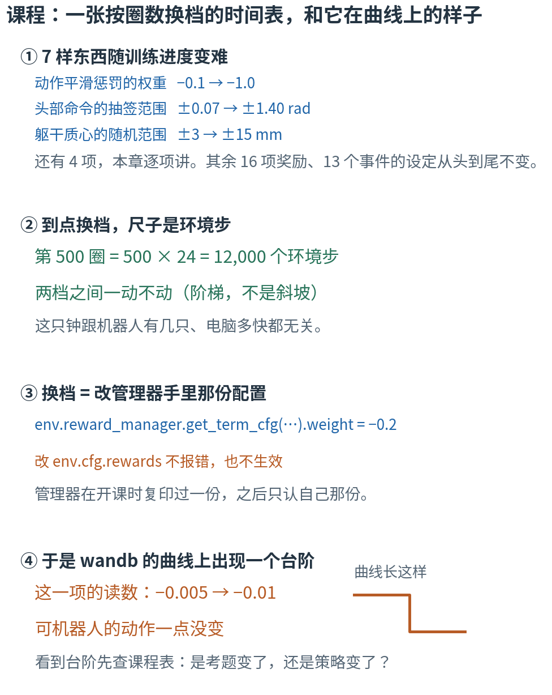
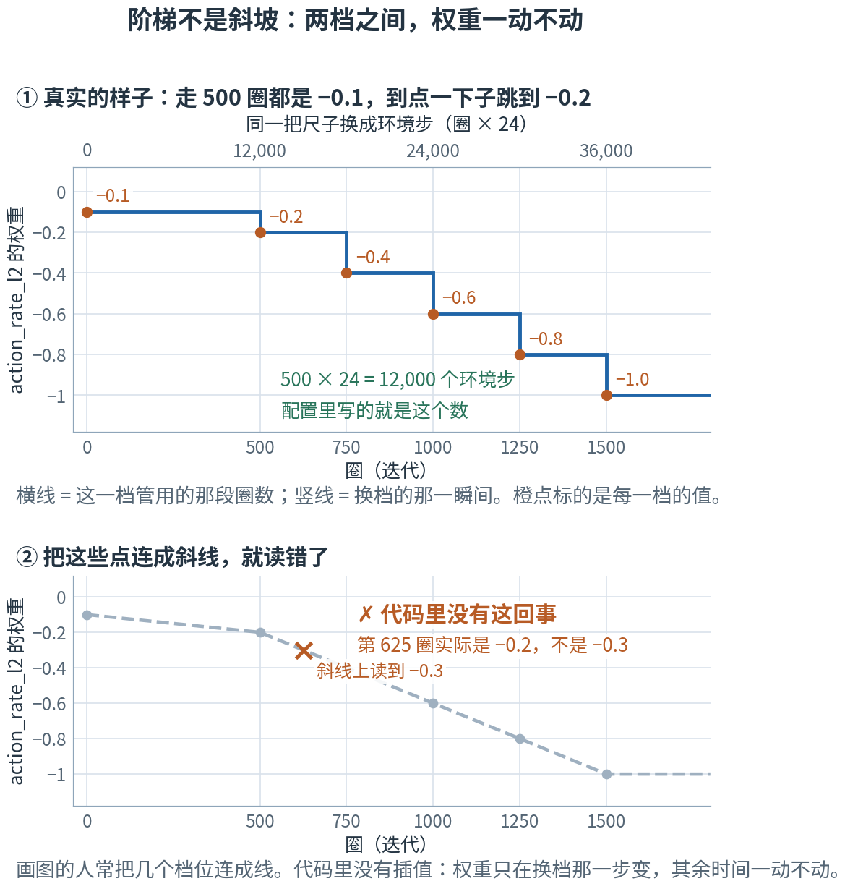
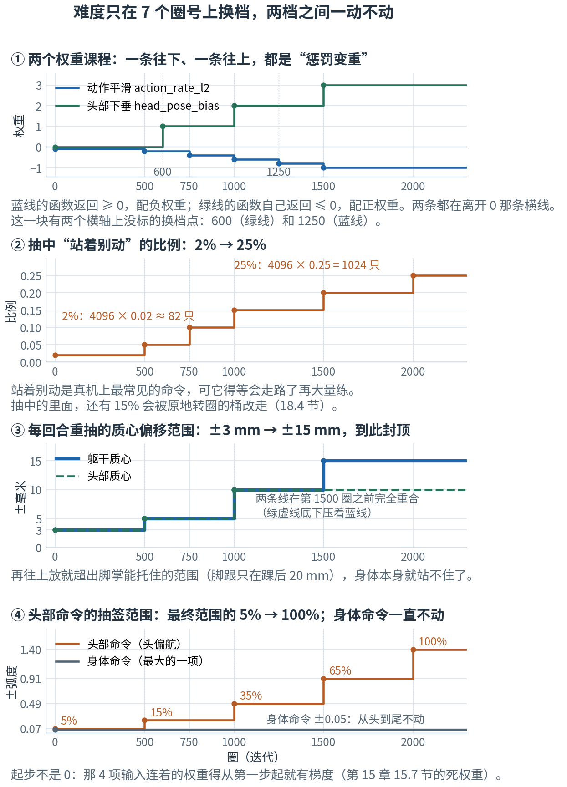
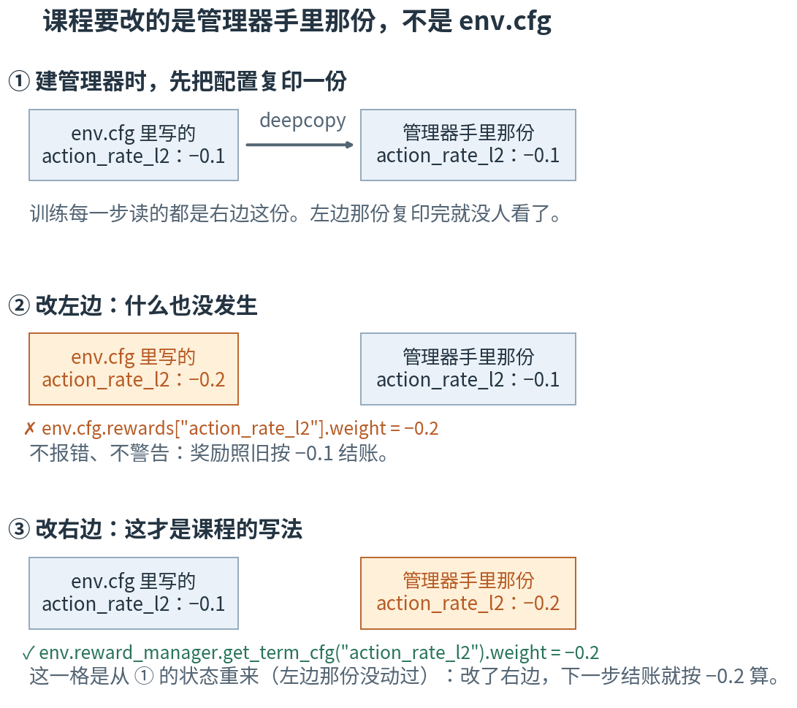
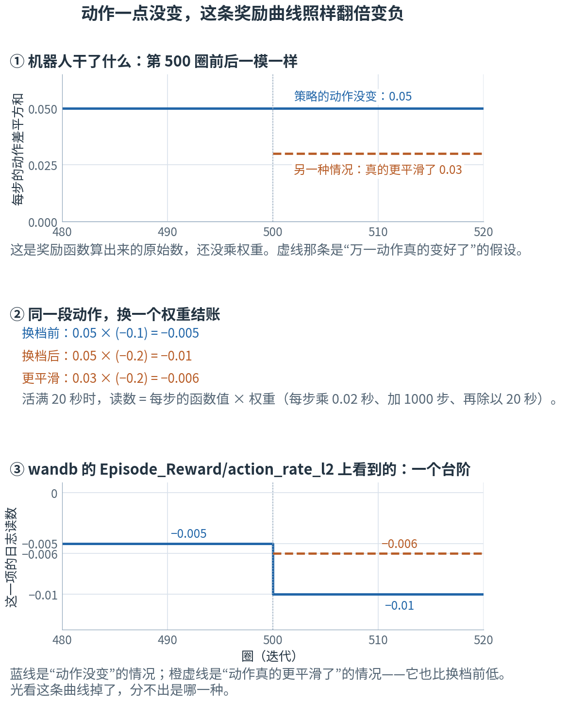

# 第 18 章 · 课程学习与读懂 wandb：先易后难的时间表，和它在曲线上留下的台阶

> **上一章我们有了什么**：一个数怎么变成一股力（BAM 舵机），以及 4096 只机器人各有一套自己的身体（域随机化）。
> 那一章的总表里，躯干质心那一行写着"±3 mm 起步，按课程放宽到 ±15 mm"，头部质心那一行也是"±3 mm 起步，放宽到 ±10 mm"
> （± 读"正负"：±3 mm 就是从 −3 mm 到 +3 mm 之间）——"课程"是什么，当时说先不背。
>
> **这一章要补什么**：走路任务里，有 7 样东西不是从头到尾一个样的，它们**随训练进度一档一档变难**：
> 两个奖励权重、一个"站着别动"的环境比例、两个质心随机范围、两个命令范围。这张时间表就是**课程**。
> 它同时是读训练曲线时最容易误判的地方：wandb（项目用来看训练曲线的那个网页工具，第 4 章 4.9 节提过一句，18.7 节细说）
> 上那条"为什么在第 500 圈突然掉下去"的曲线，十有八九是它干的。
>
> **本章新词**：课程学习、阶梯函数、逆向课程。
> **需要的前提**：第 4 章的期望（4.3 节）和"动作 = 均值 + σ × 噪声"（4.7 节）；第 14 章的四只钟（14.1 节）、一块日志怎么读（14.4 节）、`Episode_Reward` 的单位（14.5 节）、惩罚项的符号约定（14.6 节）、
> 课程那几行读数（14.7 节）、健康与生病的曲线（14.8 节）；第 15 章的命令块（15.5 节）和死权重（15.7 节）；第 16 章的奖励项和它们的权重（16.3、16.4、16.8、16.9 节）；第 17 章的域随机化（17.7、17.8 节）。
> 每用到一样，正文都会先用一两句话提醒它是什么。
> **不要求**跑过训练，也**不要求**有 GPU：本章的实验只读配置文件，在你的笔记本上就能跑完。

---

## 18.0 先看地图：一张按圈数换档的时间表

**训练不是从头到尾一个难度。7 样东西写在一张时间表上，到了规定的圈数就换下一档，两档之间一动不动；
换档改的是管理器手里那份配置；于是 wandb 的曲线上会出现一级台阶——而台阶不一定意味着策略变差了。**

先想象一门游泳课。第一周只在浅水区，后面几周水越来越深（**范围**在变）；教练头几节课根本不管你姿势好不好看，
等你能游起来了，才开始抠动作，而且越抠越严（**扣分的轻重**在变）。课表是提前排好的，写着"第三周下深水"，
不看你今天游得怎么样——这正是本章这种课程的样子：**按进度换档，不按表现换档**。
还有一件事：课表复印了两份，一份贴在墙上，一份在教练手里。真正决定今天练什么的，是教练手里那份。
（程序里的"教练"叫管理器：环境里分管奖励、随机化、命令……的几个程序对象，18.5 节细说。）



**读图顺序：** 从 ① 到 ④ 竖着读。① 是"有哪些东西在变"（18.1、18.3、18.4 节逐项讲）；② 是"什么时候变"（18.2、18.6 节）；
③ 是"怎么变的"（18.5 节）；④ 是"变完以后你在曲线上看到什么"（18.7、18.8 节）。图里的数字现在不用算，后面每一个都会手算一遍。

| 概念 | 它在回答什么问题 | 游泳课里对应什么 | 在哪一节 |
|---|---|---|---|
| 课程学习 | 为什么不一上来就按最终难度训练？ | 第一周不下深水 | 18.1 |
| 尺子：环境步 = 迭代 × 24 | 课表上的"第 500 圈"，代码里写成什么？ | 课表按第几周排 | 18.2 |
| 阶梯函数 | 两档之间，值是怎么变的？ | 这一周内，深度不变 | 18.2 |
| 权重课程（2 项） | 哪些惩罚是后来才加重的？ | 姿势扣分越来越严 | 18.3 |
| 范围课程（5 项） | 哪些"考题范围"是后来才放宽的？ | 水越来越深 | 18.4 |
| 活的管理器 | 课程改的到底是哪一份配置？ | 教练手里那份，不是墙上那份 | 18.5 |
| 换档时机 | 第 500 圈那一刻，到底换没换？ | 周一上午第一节课算不算第三周 | 18.6 |
| wandb 与 `Curriculum/*` | 训练跑起来以后，从哪儿看现在在第几档？ | 看课表进度 | 18.7 |
| 反事实账表 | 曲线掉了，是游得差了，还是评分变严了？ | 同一个动作，换个打分标准 | 18.8 |
| 逆向课程 | "容易"除了"范围小"，还能怎么造？ | 先从离岸边一米的地方游 | 18.9 |

表里的名字先不背，到了各节再给。本章最容易混的四处，先贴上标签：

- **四只钟**（第 14 章 14.1 节：环境步、迭代、仿真时间、墙上时间）。本章主要用前两只：环境步是每只机器人做一次决定（0.02 秒一步）；
  迭代本章叫"圈"，一圈 = 每只机器人走 24 个环境步、再把策略拧一轮。两只钟成固定比例：一圈 = 24 个环境步。
  课程表的横轴永远是**环境步**。4096 只机器人是一起走的（第 14 章 14.1 节的广播操：人再多，做了 6 节就是 6 节），所以它跟机器人有几只、你的电脑多快都无关。
- **两种"权重"**。第 2、6 章的权重是网络里的旋钮；第 16 章（奖励逐项拆解）的权重是奖励项前面的系数。
  本章的课程改的是**后者**——奖励项的系数，一个旋钮也没动。（18.4 节会提到"死权重"，那个"权重"是前者：网络里的旋钮。）
- **阶梯不是斜坡**。图上把几个档位连成线，很容易读成"权重在慢慢变"。代码里没有插值：权重只在换档那一步跳一下（18.2 节）。
- **读数掉了 ≠ 行为变差**。课程一换档，同一个动作的计分口径就变了；曲线掉下去，可能什么都没发生（18.8 节）。

第一次读，按顺序看正文、图和手算。标着"进阶"的折叠块可以先跳过；代码是复核工具，不是阅读门槛。

## 18.1 为什么要先易后难：一上来全开，"什么都不做"就赢了

小孩先学站，再学走，最后才管姿势好不好看。训练也一样，而且理由更硬：**难度全开的时候，"什么都不做"常常是得分最高的选择。**
这句话听着反常。下面用两笔账把它算出来：一笔是项目里真出过的事故，一笔是你能从头算到尾的。

### 第一笔账：一次真实的事故

先说清"每步多少分"用的是哪把尺子。本节的分，都是**每一步的"函数值 × 权重"**（还没乘 0.02 秒）——机器人活满 20 秒时，它正好就是日志里这一项的读数（第 14 章 14.5 节；为什么正好相等，18.8 节一步一步算给你看）。

走路时机器人要抬脚。迈步那一项叫 `air_time`：每只脚每次腾空 0.125–0.3 秒就记 1 分，两只脚，权重 3（第 16 章 16.3 节），所以每步最多 3 × 2 = 6 分。
2026 年 8 月有一次训练，一个正在走路的策略在这一项上每步拿到约 **1.01 分**——离满分 6 还远，步态还很生涩。

那次训练想顺手把头端正一点：把头部跟踪那一项的宽容度收得很窄（第 16 章 16.8 节），头每一瞬间都得对准，才拿得到分。
可 Microduck 的头有 280 g，占全身的 38%，**只要迈步就一定会晃**。量出来：这一改，让走路的策略每步少拿 **0.77 分**——等于交了 0.77 分的税，而且这笔税躲不掉。

这几个数你没法自己算，也不用算：它们是那次训练**实测**出来、记在配置文件注释里的（本章实验的最后一节只核对那几行注释还在不在）。把它们排成两条路的账：

| 每步的账（函数值 × 权重） | 一直走 | 站着不动 |
|---|---|---|
| 迈步 `air_time` | +1.01 | +0.02 |
| 头部跟踪收窄以后交的税 | −0.77 | 约 0 |
| 这两项合计 | +0.24 | +0.02 |

逐行看。第一行是实测：走路时 1.01，策略停下来以后掉到 0.02（站着几乎不腾空）。
第二行的 −0.77 是实测；站着那一格是推出来的：头不晃，"每一瞬间都对准"站着就做得到，几乎不用交税。
第三行是前两行相加：1.01 + (−0.77) = 0.24；0.02 + 0 = 0.02。

税吃掉了迈步收入的 0.77 ÷ 1.01 ≈ 0.76，也就是 76%（配置注释的原话正是"76% of the whole air_time reward"）。
光看这两项，走路还比站着多 0.24 − 0.02 = 0.22 分。可走路另有几笔站着几乎不用付的钱：腿要摆，动作就得一步一步变，动作平滑那一项就要扣钱（下一笔账专门算这一项）；脚有几项惩罚；身子会晃。
注释没有记这几笔各是多少，只记下了结局："Standing still scored higher, so it stood still."——站着不动的总分更高，于是它就站着不动了。
到第 300 圈，`air_time` 从 1.01 掉到 0.02，抬脚高度从 15 mm 掉到 2 mm（这两组数也在同一段注释里）。

### 第二笔账：每个数都能自己算

第一笔账里有一格是推出来的，还有几笔开销没记。换一项每个数都能自己算的：**动作平滑**那一项 `action_rate_l2`。
它扣的是"这一步的动作和上一步差多少"：14 个关节，每个关节"这一步 − 上一步"的差先平方，再全部加起来（第 16 章 16.4 节）。
项目让它的权重从 −0.1 起步，到第 1500 圈才收紧到 −1.0。假如一开训就用 −1.0 呢？

先回忆策略怎么出动作：**动作 = 均值 + σ × 噪声**（第 4 章 4.7 节）。均值是网络算出来的"我认为该做的动作"；噪声每一步重抽，是"顺便试试旁边的动作"；σ 管试多远，开训时是 1.0。
所以就算网络让均值一动不动，相邻两步的动作也会因为噪声而不一样。

用最简单的噪声来算：每个关节的噪声要么 +1、要么 −1，各占一半。它的标准差正好是 1，和 σ = 1 一样宽（第 4 章 4.4 节的算法：平均是 0，偏差都是 ±1，平方都是 1，平均 1，开根号还是 1）。相邻两步一共四种组合，机会均等。
下表前两列是上一步、这一步抽到的噪声，第三列是两者之差，第四列是差的平方：

| 上一步的噪声 | 这一步的噪声 | 这一步 − 上一步 | 差的平方 |
|---|---|---|---|
| +1 | +1 | 0 | 0 |
| +1 | −1 | −2 | 4 |
| −1 | +1 | +2 | 4 |
| −1 | −1 | 0 | 0 |

拿第二行手算：(−1) − (+1) = −2，平方 (−2) × (−2) = 4（负负得正）。四种平均：(0 + 4 + 4 + 0) ÷ 4 = **2**。
一个关节每步平均 2，14 个关节加起来是 14 × 2 = **28**。
（换成真正的钟形噪声，平均也是 2。把上一步的噪声变个号，"这一步 − 上一步"就成了两个互不相干的噪声相加；第 4 章 4.5 节的进阶折叠用两枚硬币推过：这时方差相加，1 + 1 = 2。实验第 1 节抽了 10 万对，算出 1.995。）
这还只是"均值不动"的情形；真要走路，腿要摆，均值也得一步一步变，这一项只会比 28 更大。

再乘上权重，和"最多能挣多少"放在一起比。六项任务奖励（跑得够不够快、转得够不够快、身子正不正、腿别乱动、迈步、头朝哪）每一项都拿满分，
每步一共 2 + 2 + 2 + 1 + 6 + 2 = **15**（第 16 章 16.9 节：每一项是"权重 × 打分的最大值"，迈步是 3 × 2 = 6）：

| 动作平滑的权重 | 光噪声就要扣（每步） | 六项奖励全拿满（每步） | 拿满了还剩 |
|---|---|---|---|
| −0.1（项目的起步） | 28 × 0.1 = 2.8 | 15 | 15 − 2.8 = 12.2 |
| −1.0（最后一档） | 28 × 1.0 = 28 | 15 | 15 − 28 = −13 |

按最后一档开训，**就算机器人每一项都做到满分，每步也要倒贴 13 分**——何况开训时它离满分还差得远。
这笔税只看相邻两步差多少，躲开它的办法只有一个：让相邻两步一样。也就是把噪声收小（不再随便试别的动作），动作也不再变（不再动）——**什么都不做**。
第 14 章 14.8 节说的"σ 塌到 0 附近、过早收敛"，就是这样被逼出来的。按 −0.1 起步，2.8 还不到满分 15 的五分之一（2.8 ÷ 15 ≈ 0.19），策略付得起，可以接着试。

<details>
<summary>进阶：存档里真能看到这个 28 吗（现在可跳过）</summary>

能，而且对得上。第 14 章 14.6 节那次冒烟训练只跑了开头 5 圈，σ 还是 1.0。它的存档里，`action_rate_l2` 读 −0.1028；权重是 −0.1，回合平均活 35.21 步（14.4 节）。
第 14 章 14.5 节的算法是：读数 = 函数值 × 权重 × 0.02 × 活的步数 ÷ 20。要倒推函数值，就把乘上去的那几样除回去：

1. 两边同时乘 20："÷ 20"就抵消了。左边：−0.1028 × 20 = −2.056。
2. 两边同时除以"权重 × 0.02 × 活的步数" = (−0.1) × 0.02 × 35.21 = −0.07042。左边：−2.056 ÷ (−0.07042) ≈ 29.2（负数除以负数得正数）。

每步约 29，比纯噪声的 28 多一点——网络算的均值本身也在变，多出来的就是它。（这是估算：35.21 是最近 100 个回合的平均，和这一项统计的回合不完全是同一批。）

</details>

那次事故里的策略，也是这样"放弃"的：同一段注释还记着，它的熵从 10.9 掉到了 1.9。熵小了，就是抽动作时的随机少了（第 4 章 4.9 节）——不再尝试。

这就是第一个理由：**技能还没长出来的时候，任何"尝试税"都会让"不尝试"赢。**

第二个理由是反过来的：**目标太难，"做对了一点点"的经验太少，策略不知道该往哪边改。**
起身任务吃过这个亏（18.9 节细说）：一开训就让四种起点（已经站着、坐着、趴着、仰面躺着）各占四分之一，最难的"仰面躺着"那一种，策略最后干脆躺着不动。
第 17 章 17.8 节那个质心的例子更极端：范围一路放宽到 ±30 mm，质心已经落到脚掌外面，那个身体本来就站不住，怎么练都练不会。
走路任务的头部命令也是按这个思路排的：最终范围 ±1.40 rad（1 rad ≈ 57.3°，第 15 章 15.1 节；1.40 × 57.3 ≈ 80°），起步只给 ±0.07 rad（18.4 节）。

对策：**从容易的设置开始，等策略学会了再逐步加难。** 这叫**课程学习**（curriculum learning）——就是 18.0 节那门游泳课。
项目的做法是一张写死的时间表：在预定的训练进度上，把某个参数换成下一档。走路任务里一共 7 项——实验第 1 节从配置里原样读出来：

```
               课程项                       改什么            起步        最后一档  共几档  第一次换档（圈）
---------------------  ---------------------------  --------------  --------------  ------  ----------------
   action_rate_weight           动作平滑惩罚的权重            −0.1            −1.0       6               500
head_pose_bias_weight           头部下垂惩罚的权重             0.0             3.0       4               600
        standing_envs         抽中“站着别动”的比例            0.02            0.25       6               500
            com_range  躯干质心随机偏移的范围（m）           0.003           0.015       4               500
       head_com_range  头部质心随机偏移的范围（m）           0.003            0.01       3               500
      head_pose_range       4 个头部命令的抽签范围  最大 ±0.07 rad   最大 ±1.4 rad       5               500
      body_pose_range       6 个身体命令的抽签范围  最大 ±0.05 rad  最大 ±0.05 rad       1            不换档
```

**怎么读这张表**：每一行是一项课程。第一列是它在配置里的名字，第二列说它改的是什么；"起步"是第 0 档的值，"最后一档"是最后那一档的值，"共几档"数的是一共有几级台阶。
最后一列是第二档从第几圈起：配置里写的门槛是环境步，除以 24 就是圈数。比如第一行第二档的门槛是 12,000 步，12,000 ÷ 24 = 500（这把尺子 18.2 节细说）。
质心那两行的单位是米：1 米 = 1000 毫米，所以 0.003 m = 0.003 × 1000 = 3 mm。命令那两行写的"最大 ±0.07 rad"，是几个关节的范围里最大的那个上限（18.4 节逐个列出来）。

这张表不用背，18.3 和 18.4 节会一项一项讲。现在只看三件事：

1. **两类**：前两行改的是**奖励的权重**（惩罚变重），后五行改的是**抽签的范围**（考题变难）。
2. **起步都更容易**，最后一档才是真正想要的难度。
3. **最后一行是个例外**：只有一档，永远不换——它就是第 15 章 15.7 节说的那个零填充的槽：用不上，可位置得占着，不参与考试。

课程只碰这 7 样东西，其余的设定从第一圈到最后一圈一个样：16 项奖励里另外 14 项的权重，13 个事件里另外 11 个的范围
（"事件"是 mjlab 里到点就执行一次的随机化：开机一次、每回合一次、每隔几秒一次，就是第 17 章 17.7 节那张表里"什么时候抽"那一列），
还有速度命令的范围——从第一圈到最后一圈都是前后 ±0.4 m/s、左右 ±0.3 m/s、转 ±1.0 rad/s（rad/s：每秒转多少弧度）。
mjlab 模板自带的"速度范围逐渐放宽"那个课程被**删掉**了（配置注释说它"跑在机器人的能力前面"，第 1000 圈以后奖励和回合长度一起往下掉）。
能用课程解决的问题，并不是越多越好。

> **停一下，自测**：开训一段时间后，σ 从 1.0 收到了 0.5。噪声改成 +0.5、−0.5 各一半。
> ① 一个关节相邻两步之差的平方，平均是多少？14 个关节呢？② 这时把动作平滑的权重开到 −1.0，光噪声每步扣多少？按 −0.1 呢？
> <details><summary>答案</summary>
>
> ① 四种组合的差是 0、−1、+1、0（比如 (−0.5) − (+0.5) = −1），平方是 0、1、1、0，平均 (0 + 1 + 1 + 0) ÷ 4 = 0.5；14 个关节是 14 × 0.5 = 7。
> ② 按 −1.0 扣 7 × 1.0 = 7，按 −0.1 扣 0.7。σ 减半，这一项从 28 变成 7，只剩四分之一：差的平方跟着 σ 的平方走，0.5 × 0.5 = 0.25。
> 这就是为什么权重可以随着训练一档一档加重——σ 收窄以后，同样的权重扣得少多了（18.3 节接着说）。
>
> </details>

## 18.2 尺子和阶梯：迭代 × 24 = 环境步，两档之间一动不动

课表上写"第 500 圈起加难"，代码里得写成一个数。用哪只钟？

第 14 章 14.1 节那四只钟里，课程用的是**环境步**：每只机器人做了几次决定。理由有两层。
一是它最"干净"：4096 只机器人是一起走的，所以这只钟不因为机器人多了就走得快；换台更快的电脑，它也不变。
二是课程函数"住"在环境里：环境自己只数步数（这个计数器叫 `common_step_counter`，18.6 节再见），并不知道训练程序那边转到了第几圈。课程要看钟，只能看手边这一只。

环境步和圈数是固定比例：**一圈 = 每只机器人走 24 个环境步**（训练配置 `MicroduckRlCfg` 里的 `num_steps_per_env = 24`，字面意思是"每个环境每圈走几步"）。所以：

$$\text{环境步} = \text{圈数} \times 24$$

手算几个，都是课表上真出现的数：

- 第 500 圈 = 500 × 24 = **12,000** 个环境步。
- 第 600 圈 = 600 × 24 = **14,400**。
- 第 2000 圈 = 2000 × 24 = **48,000**。

"第 500 圈 = 12,000 步"说的是第 500 圈**开始**的时候：圈从 0 数，那时第 0 到第 499 圈这 500 圈已经走完，500 × 24 = 12,000 步。细到"到底哪一步换档"，18.6 节再较真。

反过来也一样（第 14 章 14.1 节：知道环境步，÷ 24 就是圈数）。配置里写的门槛是环境步，比如某一档的门槛是 18,000 步，18,000 ÷ 24 = 750，就是第 750 圈起。
18.3、18.4 节那几张表里"= 第几圈"那一列，都是这样除出来的。实验第 2 节把换算表打了出来，还从第 0 圈到第 2000 圈逐点查了一遍权重。

> ⚠️ **门槛是写死的步数，不会跟着"一圈几步"走。** 配置里的门槛有两种写法：两个权重课程写成 `500 * NUM_STEPS_PER_ENV`（`NUM_STEPS_PER_ENV` 是配置文件开头的另一个常数，也是 24）；另外四项直接写 `500 * 24`。
> 眼下几处的 24 一样，算出来都是 12,000 步、第 500 圈。可"一圈几步"那个 24（上面的 `num_steps_per_env`）和这两种写法都没有用代码连起来：
> 要是有人只把一圈改成 48 步，门槛还是 12,000 步，第一次换档就挪到了 12,000 ÷ 48 = **第 250 圈**。18.6 节的自测会接着算。

两档之间发生什么？**什么也不发生。** 权重在第 500 圈变成 −0.2，然后一直是 −0.2，直到第 750 圈才变成 −0.4。
这种"到点跳一下、其余时间不动"的函数叫**阶梯函数**（step function）。
（英文名里的 step 是"台阶"，和"环境步"的 step 撞了词；配置里每一档都有个键叫 `"step"`，那个说的才是环境步。）

为什么一档一档地跳，不画一条斜线慢慢变？有三个原因：

1. **工具就是这么写的。** 项目改权重用的 `reward_weight` 只认"第几步起换成几"这样一张清单（AGENTS.md 的原话："a step function, not an interpolation"——是阶梯函数，不做插值）。
   想要接近斜坡，就自己多切几档：动作平滑那一项就切成了 6 档。
2. **一档之内，考题不变。** 策略有一段时间对着同一套考题练，练稳了再换下一档（AGENTS.md 的说法是：每一档都要和策略已经学会的东西对齐）。
3. **换档的时刻清清楚楚。** 曲线上出了台阶，能对着课程表查出是哪一圈、哪一项干的（18.8 节）；斜坡没有这样一个"时刻"可查。

查一档的写法就是一串 `if`（这正是源码的写法，章末 📍 里就是它的 Python 版）：

```js
let w = stages[0].weight;                       // 先取第 0 档
for (const s of stages) {
  if (step > s.step) w = s.weight;              // 凡是"已经过了"的档都覆盖一次
}                                               // 最后一个满足的档生效 → 所以档位必须按 step 从小到大写
```

逐档跑一遍，看它怎么查出正确的那一档。拿第 625 圈开始的时候，也就是第 625 × 24 = 15,000 步。
下表一行是一档，按清单的顺序从上往下查：第二列是这一档的门槛，第三列是 `if` 里那个比较，第四列是查完这一档后 `w` 的值：

| 档 | 门槛（环境步） | 15,000 > 门槛？ | 查完这一档，w 是 |
|---|---|---|---|
| 第 0 档 | 0 | 是 | −0.1 |
| 第 1 档 | 12,000 | 是 | −0.2 |
| 第 2 档 | 18,000 | 否 | −0.2（不动） |
| 第 3 档 | 24,000 | 否 | −0.2（不动） |
| 第 4 档 | 30,000 | 否 | −0.2（不动） |
| 第 5 档 | 36,000 | 否 | −0.2（不动） |

最后留下 **−0.2**：凡是已经过了的档都覆盖一次，最后一个过了的那档说了算。
要是有人把清单倒过来写（第 5 档在最上面），照样从上往下查，最后一个"过了"的就成了第 0 档，结果是 −0.1——错了一档。
所以档位必须按门槛从小到大写；实验第 1 节核对了 7 项都是这样写的，第 2 节把正着、倒着两种查法都跑了一遍。



**这样读图：** ① 先看横轴：下面一行是圈数，上面一行是同一把尺子换成环境步（乘 24），500 圈正对着 12,000 步。
再看蓝线：每一段**横线**是这一档管用的那段圈数，**竖线**是换档的一瞬间；橙点标着每一档的值。
② 是常见的读错法：把橙点连成斜线，就会以为权重在两档之间慢慢滑过去。斜线上那个 −0.3 是这么来的：625 是 500 和 750 的正中间，斜线在正中间的高度就是两头的平均，(−0.2 + (−0.4)) ÷ 2 = −0.3。
代码里没有插值——第 625 圈查出来是 −0.2（上面那张表）。

> **停一下，自测**：第 1300 圈时，动作平滑惩罚的权重是多少？折成环境步是第几步？
> <details><summary>答案</summary>
>
> 第 1250 圈那一档已经生效、第 1500 圈那一档还没到，所以是 **−0.8**。环境步 = 1300 × 24 = **31,200**。
>
> </details>

## 18.3 两个权重课程：一个越来越负，一个越来越正

**第一个：`action_rate_l2`（动作平滑惩罚）。** 它按"这一步的动作和上一步差多少"扣分：14 个关节，各自"这一步 − 上一步"的差平方，再加起来（18.1 节的第二笔账算的就是它）。
迷你版，只看两个关节：这一步比上一步分别变了 0.1 和 −0.2，函数值就是 0.1² + (−0.2)² = 0.01 + 0.04 = **0.05**
（第 14 章 14.6 节、第 16 章 16.4 节用的是同一个例子，18.8 节还要用它）。

它从很轻开始，等步态出现了再逐步加重——实验第 3 节从配置里读出的阶梯：

```
  action_rate_weight（改的是奖励项 action_rate_l2 的权重）
环境步  = 第几圈  权重
------  --------  ----
     0         0  −0.1
 12000       500  −0.2
 18000       750  −0.4
 24000      1000  −0.6
 30000      1250  −0.8
 36000      1500  −1.0
```

**怎么读这张表**：第一列是配置里写的门槛（环境步），第二列是它除以 24 得到的圈数，比如 18,000 ÷ 24 = 750；第三列是从这一圈起用的权重。
六档，越来越负：先从 −0.1 翻倍到 −0.2，之后每档再往负的方向走 0.2，第 1500 圈到顶。最后一档是起步的 (−1.0) ÷ (−0.1) = 10 倍。

为什么这样排？18.1 节的第二笔账：开训时 σ = 1，光噪声就让这一项每步约 28，按 −0.1 扣 2.8，按 −1.0 就要扣 28——比六项奖励全拿满的 15 还多。
训练健康的话，σ 会随着步态成形慢慢收窄（第 14 章 14.8 节）；σ 减半，这一项就只剩四分之一（18.1 节自测：28 → 7）。到那时，同样的 −1.0 就付得起了。
所以权重跟着训练进度一档一档往上加。

**第二个：`head_pose_bias`（头部下垂惩罚）。** 它算的是头的角度误差在 1 秒里的平均值——只罚"一直偏着"，不罚"走起来晃"。
提醒一下为什么（第 16 章 16.8 节）：走路时头来回摆，误差 +0.2、−0.2 交替出现，一平均就是 0，罚不到；头一直低着，误差一直是 −0.2，平均还是 −0.2，罚得到。
这里的"1 秒平均"是第 7 章 7.4 节的滑动平均：每一步，旧的平均留 98%，新的这一步占 2%。

它的课程更极端：**前 600 圈权重就是 0，等于这一项根本不存在**（mjlab 根本不去算权重为 0 的项，第 14 章 14.6 节）。

```
  head_pose_bias_weight（改的是奖励项 head_pose_bias 的权重）
环境步  = 第几圈  权重
------  --------  ----
     0         0   0.0
 14400       600   1.0
 24000      1000   2.0
 36000      1500   3.0
```

读法同上：14,400 ÷ 24 = 600，第 600 圈起权重从 0 跳到 1.0，第 1000 圈 2.0，第 1500 圈 3.0。

配置里的注释写得很直白：*"a posture-precision term is a distraction before a gait exists."*——步态出现之前，姿态精度是干扰。

到了权重 3.0 那一档，这一项有多重？算一笔就知道。假设头部那 4 个关节都一直偏着 15°（配置注释记的实测值就是这个量级）：

- 换成弧度：15 ÷ 57.3 = **0.2618** rad（第 15 章 15.1 节：1 rad ≈ 57.3°）。
- 函数值：一直偏着（偏了好几秒），1 秒平均就几乎等于这个偏差（第 16 章 16.8 节：误差不变时，这本账会一直往它靠）；4 个关节都偏 0.2618，4 个取平均还是 0.2618；这个函数自带负号，返回 −0.2618。
- 乘权重：(−0.2618) × 3 = **−0.79**，每步扣 0.79 分（"每步"的尺子和 18.1 节一样：函数值 × 权重）。

再算一个偏得少的：2° = 0.0349 rad，(−0.0349) × 3 = **−0.10**，每步只扣 0.10 分。
**同一条惩罚，偏 15° 扣的是偏 2° 的 7.5 倍**（15 ÷ 2 = 7.5）。为什么正好是角度之比？因为这一项是"偏多少 × 权重"，用的是绝对值，不是平方：角度大几倍，扣的分就大几倍。
要是平方，就成了 7.5 × 7.5 = 56.25 倍。（拿印出来的 0.79 ÷ 0.10 去算，会得 7.9 而不是 7.5——两个数各自舍入过；不舍入的 0.7854 ÷ 0.1047 = 7.5。）

把两件事合起来：偏得越多，扣得越多；来回晃，1 秒一平均就抵消了，几乎不扣。所以它逼的是"把头端正"，不是"别动头"。

你可能会问：每步 0.79，和 18.1 节那笔让机器人停步的 0.77 差不多重，为什么这次不会重演？差在**逃不逃得掉**。
那 0.77 罚的是每一瞬间的误差，只要迈步头就晃，走路就躲不开；这 0.79 罚的只是一直偏着的那部分，把脖子的命令抬高一点、抵消重力往下拽的那一截，就一分不用交
（配置注释的原话："At the optimum this costs a walking policy nothing"——做到最好时，它对一个走路的策略一分钱不收）。而且它第 600 圈才打开，那时步态已经有了。

> ⚠️ **两个权重课程，一个往负走，一个往正走，却都是"惩罚变重"。**
> 第 14 章 14.6 节的符号约定：mjlab 自带的代价函数返回 ≥ 0 的数（≥ 读"大于或等于"），必须配**负**权重（`action_rate_l2`：−0.1 → −1.0）；
> 而 microduck 自己写的那一批 `*_penalty` 函数**自己就返回 ≤ 0**（≤ 读"小于或等于"），必须配**正**权重（`head_pose_bias`：0 → 3.0）。
> 两种写法乘出来都是 ≤ 0 的扣分：0.05 × (−0.1) = −0.005；(−0.2618) × 3 = −0.79。看课程表时不要只看"权重变大还是变小"，要看**它离 0 越来越远**。

> **停一下，自测**：某次训练跑到第 400 圈，`Episode_Reward/head_pose_bias` 从头到尾读 0。能不能断定"机器人的头一点没下垂"？
> <details><summary>答案</summary>
>
> 不能。第 600 圈之前这一项的权重是 0，而日志记的是**加权**以后的值（第 14 章 14.5 节）：乘 0 以后，不管头垂了多少都读 0。
> 这个读数在告诉你"这一项现在不参与打分"，没有告诉你头的任何事。想知道头垂没垂，得看 `head_pose_tracking` 那一项，或者直接看视频。
>
> </details>

## 18.4 五个范围课程：考题范围从多小放宽到多大

剩下五项改的不是打分，是**出题**：每次抽签的范围。（"站着别动"那一项严格说是个比例，不是范围；但它改的也是出题这一侧——抽到什么样的命令。）

**站着别动的比例。** 速度命令是每隔一段时间重抽一次的：每只机器人每 3–8 秒抽一次（第 15 章 15.5 节）。每次抽签都有一定的机会抽中**全零命令**：不许走，站着别动。
第 4 章 4.2 节说过，均匀地抽几乎永远抽不到恰好全零，所以这个情况必须单独安排——而它恰恰是真机上最常见的一条命令。

```
  standing_envs（抽中“站着别动”的比例；4096 只机器人里平均有几只）
环境步  = 第几圈  比例  4096 只里约几只
------  --------  ----  ---------------
     0         0  0.02               82
 12000       500  0.05              205
 18000       750   0.1              410
 24000      1000  0.15              614
 36000      1500   0.2              819
 48000      2000  0.25             1024
```

**怎么读这张表**：前两列和 18.3 节一样（门槛的环境步、÷ 24 得到的圈数）；第三列是这一档"抽中站着"的机会；第四列是 4096 只里平均有几只抽中。
第四列是期望（第 4 章 4.3 节：按概率加权的平均）：每只机器人各自有 2% 的机会，4096 只平均就有 4096 × 0.02 = 81.92 ≈ 82 只；
第二行 4096 × 0.05 = 204.8 ≈ 205 只；最后一行 4096 × 0.25 = 1024 只。

严格说，抽中站着的还会被拿走一部分：每次重抽速度命令，还有 15% 的机会被改成"原地转圈"的命令（18.9 节那个桶），抽中站着的也不例外。
所以真正拿到全零命令的，是表里比例的 85%（1 − 0.15 = 0.85）：起步时 0.02 × 0.85 = 0.017，4096 × 0.017 ≈ 70 只；
最后一档 0.25 × 0.85 = 0.2125，4096 × 0.2125 ≈ 870 只。课程改的、wandb 上画的，都是表里那个没打折的比例。

起步只有 2%，是因为"站着别动"和"按命令走"是两件不同的本事，一开始把四分之一的经验花在站着上，走路就学得慢；
但也不能是 0——那样"站住"这件事永远没练过，而它是部署时最常按到的那个按钮。

**两个质心范围。** 质心是整块东西重量的"平衡点"；每回合把它随机挪一点，就是换一具重心略有不同的身体（第 17 章 17.7 节：质心每回合抽一次）。
第 17 章 17.7 节那张域随机化总表里，躯干质心、头部质心那两行写着"±3 mm 起步，放宽到……"，就是这两项。
躯干质心四档，分别从第 0、500、1000、1500 圈起：**±3 → ±5 → ±10 → ±15 mm**（配置里按米写：0.003、0.005、0.01、0.015，乘 1000 就是毫米）。
头部质心少一档：前三档一样，到 ±10 mm（第 1000 圈起）就封顶。
注意课程改的是**抽签的范围**，不是这一回合抽到的那个值：每回合照样重抽一次，只是签筒变大了。

±15 mm 这个上限是踩出来的：之前一路放宽到 ±30 mm，可脚跟只在踝关节后面 20 mm，质心往后挪 30 mm 已经落在脚掌托不住的地方了
（第 17 章 17.8 节讲过这段）。配置注释里还记着一句：策略变差的时间点，和那条旧课程的 0.015 → 0.02 → 0.03 这三次放宽（单位是米，就是 15 → 20 → 30 mm）一一对上。
**课程放得太宽，和放得太快，是两种不同的错。**

**头部命令范围。** 4 个头部关节，每个关节自己一条范围（机械上能转多少，每个关节不一样），一共五档：

```
  head_pose_range（4 个头部命令的抽签范围，弧度；颈俯仰和头俯仰每一档都相同）
  圈  颈俯仰 = 头俯仰  头偏航  头横滚  头偏航占最终的
----  ---------------  ------  ------  --------------
   0            ±0.05   ±0.07  ±0.015              5%
 500            ±0.17   ±0.21  ±0.047             15%
1000            ±0.39   ±0.49   ±0.11             35%
1500            ±0.72   ±0.91    ±0.2             65%
2000             ±1.1    ±1.4   ±0.31            100%
```

**怎么读这张表**：每一行是一档，第一列是从第几圈起；中间三列是这一档每个关节的抽签范围，单位 rad（颈俯仰和头俯仰每一档都一样，并成了一列）。
最后一列是自己算的：头偏航这一档的范围 ÷ 它最后一档的 1.40。比如第 500 圈那一行，0.21 ÷ 1.40 = 0.15，也就是 15%。
头偏航那一列正好整齐：1.40 × 0.05 = **0.07**，1.40 × 0.35 = **0.49**。别的关节也是照 5%、15%、35%、65%、100% 排的，只是四舍五入到两位小数以后没那么整齐，比如颈俯仰第 500 圈 0.17 ÷ 1.10 ≈ 0.155。
最后一档 ±1.10、±1.10、±1.40、±0.31 rad，就是第 15 章 15.5 节那张命令表里写的上限（第 8 章 8.2 节也提过）。

起步的 5% 有多小？±0.07 rad ≈ ±4°（0.07 × 57.3 ≈ 4.0），几乎就是"头别乱动"。**为什么不干脆填 0？** 因为第 15 章 15.7 节的死权重。
提醒一下：网络第一层里连着某个输入的权重，梯度 = 往回乘到的那个数 × 这个输入；输入是 0，梯度就是 0（第 15 章 15.7 节的迷你版：−6 × 0 = 0）。
那 4 项观测要是从第一步起就恒等于 0，它们连着的权重永远拿不到梯度，会一直停在初值；等第 2000 圈把范围放开，网络对这 4 个输入的反应是随机的。
给一点非零的小范围，两头都顾到了：足够容易，又让这些权重从一开始就在学。

**身体命令范围**只有一档：±0.005 m（前后、左右、上下，也就是 ±5 mm）和 ±0.05 rad（三个转角，0.05 × 57.3 ≈ 2.9°），从第一圈到最后一圈不变。
走路任务用不上它，但位置得占着，而且不能真填零——还是同一条死权重的规矩。
（上面这几张表和刚才那几组毫米数，都是实验第 4 节从配置里读出来打印的。）



**这样读图：** 四块面板共用一条横轴（圈数）。每块里的竖虚线是**这一项自己的换档点**；
七项合起来一共只有 7 个圈号：500、600、750、1000、1250、1500、2000
（其中 600 和 1250 只有 ① 里用到，横轴上没标刻度，图里单独写了出来）。**整个训练里，难度就只在这 7 个时刻动过。**
① 纵轴是权重：两条权重一条往下、一条往上，都是在离开 0 那条横线（18.3 节的 ⚠️）。
② 纵轴是抽中站着的比例，两个标注就是上面表里的 4096 × 0.02 ≈ 82 只和 4096 × 0.25 = 1024 只（没打 85 折的那个数）。
③ 纵轴是毫米。两条线**在第 1500 圈之前完全重合**（都是 ±3 → ±5 → ±10 mm，所以绿虚线底下还压着一条蓝线），到第 1500 圈只有躯干那条再涨一级。
④ 纵轴是弧度，画的是头偏航那一列，橙字标着它占最终范围的百分之几；底下那条灰线是身体命令，从头到尾不动。
每块面板里都是横线加竖线，没有一根斜线——18.2 节那件事，在每一项上都成立。

> **停一下，自测**：训练跑到第 1200 圈。头偏航的命令范围是多少？躯干质心的随机范围是多少？
> <details><summary>答案</summary>
>
> 头偏航：第 1000 圈那一档生效、第 1500 圈还没到，所以是 **±0.49 rad**（0.49 × 57.3 ≈ 28，约 ±28°）。
> 躯干质心：同样是第 1000 圈那一档，**±10 mm**。两项都还差一级才到顶。
>
> </details>

## 18.5 课程是怎么"生效"的：改管理器手里那份

课程函数每次被调用，就干一件事：把某个参数改成当前这一档的值。（谁来调用？环境里专管课程的那个管理器，在有机器人重置的时候调用，18.6 节细说。）
听起来简单，但这里有一个能让整门课程**悄悄失效**的坑。

先说"管理器"是什么。mjlab 把一个环境拆成好几个**管理器**，每个管一摊事：奖励管理器每一步给 16 项奖励结账；事件管理器负责各种随机化（18.1 节说的"事件"）；
命令管理器负责抽命令；终止管理器判断回合该不该结束（摔倒、超时）；课程管理器负责调用课程函数……它们都是程序里的对象。
建环境的时候，每个管理器拿到自己那一摊的配置，之后训练的每一步，都照着自己手里那份办事。

回到游泳课那个比喻：课表复印了两份，一份贴在墙上，一份在教练手里。你在墙上那份改了"今天下深水"，教练不会知道——他只看自己手里那份。

mjlab 里的情形一模一样。你写的那份配置叫 `env.cfg`，它就是墙上那份。建环境时，奖励管理器和事件管理器（还有终止、观测等几个）各自**深拷贝**了一份
（`deepcopy`：连里面套着的对象也复印一遍，得到一份完全独立的副本），之后训练每一步读的都是管理器自己那份。

用前端的话说，这是"副本"和"引用"的区别。下面几行对照着看。`structuredClone` 是浏览器自带的深复印函数，作用和 Python 的 `deepcopy` 一样：

```js
const wall = { weight: -0.1 };          // 墙上那份：你写的 env.cfg
const copy = structuredClone(wall);     // 复印一份：内容一样，但从此是两个对象，各过各的
const same = wall;                      // 不复印：只是给同一个对象多起一个名字（引用）
wall.weight = -0.2;                     // 改墙上那份
copy.weight;                            // 还是 -0.1 —— 复印件不跟着变（奖励、事件管理器手里的就是这种）
same.weight;                            // -0.2 —— 本来就是同一个对象（命令管理器手里的就是这种，下面说）
```

写成 Python，就是下面这两行的区别（第一行那种写法你在别处也可能见到：它不会报错，但什么也不做）：

```python
env.cfg.rewards["action_rate_l2"].weight = -0.2                       # ✗ 改了墙上那份，训练照旧按 −0.1 结账
env.reward_manager.get_term_cfg("action_rate_l2").weight = -0.2       # ✓ 改到管理器手里那份，下一步就生效
```

`get_term_cfg(名字)` 的意思是"按名字，取出管理器手里那一项的配置"——取到的是那份本身，不是又一份复印件，所以改它就改到了训练用的那份。



**这样读图：** ① 两个方框：左边是你写的 `env.cfg`，右边是管理器开课时复印的那份，箭头上写着复印的方法。
② 改左边：左框变橙（改成了 −0.2），右框纹丝不动，而训练读的是右框——**什么也没发生**。
③ 改右边：右框变橙，下一步结账就按 −0.2 算。三张图里的数字和实验第 5 节打印的完全一致。

实验第 5 节用十几行纯 Python 把这件事演了一遍：复印、改左边、再改右边，每一步都核对两份的值；还演了"不复印、只多起一个名字"的情形。

为什么要复印？好处是互不干扰：谁改了自己手里那份，都碰不到别人。共用一个对象有多危险，这个项目自己踩过一次：
mjlab 模板造出来的几份任务配置，里面有些对象是共用的；起身任务、捡东西任务会把速度命令的范围就地改成 0——要是走路任务也共用那一个对象，它的速度命令也跟着成了 0。
所以走路任务的配置里专门自己 deepcopy 了一份（那段注释写着"deepcopy to avoid shared-state corruption"：复印一份，免得共用的东西被别人改坏）。
坏处就是本节这个坑：建好以后再去改原件，没有用。

**命令管理器是例外**：课程会碰到的三个管理器（奖励、事件、命令）里，只有它没有复印——源码里就是 `self.cfg = cfg`，相当于上面 JS 里 `const same = wall` 那一行。
所以 `env.cfg.commands[...]` 和它手里那份是同一个对象，改了照样生效。
可"哪个管理器复印过"不值得记——四个课程函数一律走管理器，就不会错。

<details>
<summary>进阶：为什么非得是"深"拷贝（现在可跳过）</summary>

JS 里还有一种"浅"复印：`{ ...cfg }`（展开写法），只复印最外面一层，里面套着的对象还是共用的。
`env.cfg` 正是一层套一层的：最外层是整个配置，里面有一本 `rewards`，`rewards` 里每一项又是一个对象，权重在那个对象里面。

```js
const cfg = { rewards: { action_rate_l2: { weight: -0.1 } } };
const shallow = { ...cfg };                    // 浅复印：只复印最外层
cfg.rewards.action_rate_l2.weight = -0.2;      // 改原件里面那一层
shallow.rewards.action_rate_l2.weight;         // -0.2 —— 里面那层还是同一个对象，跟着变了
```

要是管理器只做浅复印，改 `env.cfg.rewards[...].weight` 就会改到管理器那份，本节这个坑反而不存在了。
正因为 mjlab 做的是深拷贝（每一层都复印），两份才彻底分开。实验第 5 节也演了浅复印的情形。

</details>

> ⚠️ **写 `env.cfg.rewards` / `env.cfg.events` 是一次静默的无操作**：不报错、不警告，程序照常跑，只是什么也没改。
> 这条规矩咬过的不只是课程：评估脚本里"强制给机器人设一个初始状态"，改的是 `env.cfg.events[...]`，结果每次跑出来的还是原来的随机初始状态。
> 凡是训练中途要改配置的地方，都要通过管理器：`env.reward_manager.get_term_cfg(名字)`、`env.event_manager.get_term_cfg(名字)`、
> `env.command_manager.get_term(名字).cfg`（命令管理器先按名字取出那一项命令，再拿它的配置）。源码里为此留了一行注释：*"EventManager.__init__ does deepcopy(cfg), so mutating env.cfg.events is a no-op."*

## 18.6 换档的那一瞬间：一圈 24 步，门槛卡在第一步之前

"第 500 圈起加难"听着精确，但一圈有 24 步，到底是这一圈的第一步换，还是最后一步换？

先把圈和步对齐。环境里那个计数器 `common_step_counter`，每走一步就加 1，而且是在这一步结账之前加：第一步结账时它已经读 1。所以环境步从 1 开始数。
第 0 圈走的是第 1–24 步，第 1 圈是第 25–48 步……一般地，第 k 圈走的是第 k × 24 + 1 到第 (k + 1) × 24 步。
代入 k = 500：500 × 24 + 1 = 12,001，501 × 24 = 12,024——第 500 圈是第 **12,001–12,024** 步。

而门槛写的是 500 × 24 = 12,000。源码里的判断是 `common_step_counter > stage["step"]`——**大于**，不是大于等于（`>` 读"大于"，`>=` 读"大于或等于"，和 JS 里一样）。
代进去：12,000 > 12,000 不成立，12,000 那一步还不算；12,001 > 12,000 成立，12,001 才算——而 12,001 正是第 500 圈的第一步。**"第 500 圈起"名副其实。**

走路这 7 项课程由 4 个课程函数驱动：`reward_weight` 管两个权重，`com_range_curriculum` 管两个质心范围，`pose_command_range_curriculum` 管头部、身体两个命令范围，
`standing_envs_curriculum` 管站立比例（2 + 2 + 2 + 1 = 7）。其中改命令范围的那个用的是 `>=`：12,000 >= 12,000 成立，所以它在第 12,000 步就换了。
实验第 6 节把换档前后这三圈逐步查了一遍：

```
 圈  这一圈的环境步  权重（首步）  权重（末步）  头部范围（首步）  头部范围（末步）
---  --------------  ------------  ------------  ----------------  ----------------
499     11977–12000          −0.1          −0.1              0.07              0.21
500     12001–12024          −0.2          −0.2              0.21              0.21
501     12025–12048          −0.2          −0.2              0.21              0.21
```

**怎么读这张表**：每一行是一圈。第二列是这一圈的计数器从几走到几（照上面的式子，第 499 圈是 499 × 24 + 1 = 11,977 到 500 × 24 = 12,000）。
后四列是课程函数在这一圈的第一步、最后一步查出来的值：权重是动作平滑那一项（用 `>`）；头部范围是 4 个头部范围里最大的那个上限，也就是头偏航（单位 rad，用 `>=`）。

表上有两处零头，都只差 1 步。
其一：`>=` 早一步，所以第 499 圈的最后一步（第 12,000 步）上，头部范围**已经**放宽到 ±0.21 rad，而权重**还是** −0.1。
其二：课程是在一步的**末尾**才算的。一步之内的次序是：

1. 先把这一步的物理算完，计数器加 1；
2. 按当前的权重，给这一步的奖励结账；
3. 最后，有机器人要重置的话，才轮到课程（下面"第一"条）。

拿第 12,001 步走一遍：计数器变成 12,001；这一步的奖励按还没换的 −0.1 结账；然后课程查到 12,001 > 12,000，把权重换成 −0.2——从第 12,002 步起，才按 −0.2 结账。
所以表里第 500 圈"权重（首步）"那个 −0.2，是这一步**结束时**查出来的值。一圈 24 步，这 1 步对训练没有任何影响，只在你盯着某一圈的读数较真时才看得出来。

还有两件更值得记住的事。

**第一，课程只在"有机器人重置"的时候才重算一次。** mjlab 把这行调用放在重置流程里（`_reset_idx`），不是每步都算。
4096 只机器人各有各的回合，几乎每一步都有几只摔倒或超时：就算一只都不摔，回合最长 1000 步，各只的回合秒表在开训时又被随机拨开了（第 14 章 14.1 节），
平均每步也有 4096 ÷ 1000 ≈ 4 只到点重置。所以实际上每步都会算到——但**环境少的时候不一定**：只有 1 只机器人、又一直不摔，就得等它的回合到点（最长 20 秒）才重算一次。
另外，课程函数虽然收到"这次重置的是哪几只"，却根本不看：它改的是全局那一份配置，一改就是所有机器人一起换。

**第二，接着练不会把课程打回第 0 档。** 第 14 章 14.9 节说过，检查点里存了环境步那只钟（`common_step_counter`）；
`--agent.resume` 会把它读回来，所以从第 3000 圈接着练，课程照样停在最后一档。

> ⚠️ **回放（`uv run play`）时，开头那一个回合的考题是第 0 档。** 回放会新建一个环境，建好时先整体重置一次——那时钟还是 0，课程就按第 0 档设好了：
> 头部命令范围 ±0.07 rad（约 ±4°），"站着别动"的比例 2%。接着才读检查点，把环境步那只钟也读回来（和接着练是同一个读法）。
> 可课程只在有机器人重置时才重算（上面"第一"条），所以要等第一次有机器人重置（摔倒，或者活满 20 秒到点），考题才跳到检查点所在的那一档。
> 刚打开回放时机器人的头几乎不动，那不是策略退化了，是**考题还停在第一周**——等一个回合再看。
> （起身任务另外留了一个环境变量 `STANDUP_PLAY_FACE_UP`，回放时直接指定"仰面躺着"占几成，不走课程。）

> **停一下，自测**：有人只把训练配置里"一圈几步"（`num_steps_per_env`）从 24 改成 48，课程表一个字没动。
> ① 第一次换档落在第几圈？这一圈里每只机器人的经验是多了还是少了？② 要是他顺手把配置文件开头的 `NUM_STEPS_PER_ENV` 也改成了 48 呢？
> <details><summary>答案</summary>
>
> ① 门槛是写死的 12,000 步，不跟着变；一圈 48 步，12,000 ÷ 48 = 250，第一次换档提前到**第 250 圈**。每圈每只机器人走 48 步，经验是原来的两倍。
> ② 两个权重课程写的是 `500 * NUM_STEPS_PER_ENV`，门槛变成 500 × 48 = 24,000 步，24,000 ÷ 48 = 500，还在第 500 圈；另外四项写死了 `500 * 24`，还是 12,000 步、第 250 圈。
> 课表就错位了：一部分在第 500 圈换，一部分在第 250 圈换。要让整张课表跟着挪，门槛和"一圈几步"得用同一个常数（18.2 节的 ⚠️）。本章实验的"改一改"第 1 条让你亲手试 ①。
>
> </details>

## 18.7 wandb：把课程表和曲线对着看

训练跑几千圈，终端里滚过去几千块日志，没法用眼睛比。wandb（Weights & Biases 的缩写）就是第 4 章 4.9 节和第 14 章 14.4 节提过的那个网页工具：
训练时每圈把日志里的数发上去，在网页上画成曲线，还能把几次训练叠在一张图里比。
项目的 project 名是 `mjlab_microduck`，`uv run train` 默认就往那儿发。
第 14 章那次冒烟训练加了 `--agent.logger tensorboard`，数写进本地的事件文件，不用登录——两条路记的是同一组数，只是存放的地方不同。

课程在 wandb 上有自己的七条曲线，叫 `Curriculum/<课程项的名字>`（尖括号的意思是"换成具体的名字"，比如 `Curriculum/com_range`；第 14 章 14.7 节见过它们）。
它们的值不是别的，正是**课程函数每次返回的那个数**：改权重的返回当前权重，改范围的返回当前范围里最大的那个上限，改站立比例的返回当前比例。
实验第 7 节把七条曲线的头尾都算了出来：

```
                  wandb 上的曲线  第 0 圈的读数  第 2000 圈以后的读数
--------------------------------  -------------  --------------------
   Curriculum/action_rate_weight           −0.1                    −1
Curriculum/head_pose_bias_weight              0                     3
        Curriculum/standing_envs           0.02                  0.25
            Curriculum/com_range          0.003                 0.015
       Curriculum/head_com_range          0.003                  0.01
      Curriculum/head_pose_range           0.07                   1.4
      Curriculum/body_pose_range           0.05                  0.05
```

**怎么读这张表**：第一列是 wandb 上的曲线名；第二列是开训时（第 0 档）的读数；第三列是最后一档全部到位以后（第 2000 圈以后）的读数。
读数不带单位，单位跟着那一项走：两个权重没有单位；`standing_envs` 是比例；两个质心范围是米，0.015 就是 0.015 × 1000 = 15 mm；两个命令范围是 rad。

左边那一列和第 14 章 14.7 节存档里的读数一模一样——那次冒烟训练只跑了 5 圈，一档都没来得及换。
`Curriculum/head_pose_range` 读 0.07，是因为它报的是 4 个关节里最大的那个上限（头偏航的 ±0.07）；
`Curriculum/body_pose_range` 从头到尾 0.05，那一项本来就只有一档。

**看曲线的顺序**（第 14 章 14.8 节那张表的课程版）：

1. 先看 `Curriculum/*`：现在在第几档，上一次换档是哪一圈。
2. 再看 `Train/mean_reward` 和 `Train/mean_episode_length`（终端日志里的 Mean reward、Mean episode length 在 wandb 上的名字，第 14 章 14.4 节）在**这一档之内**的趋势——跨着换档点比较，比的是两套不同的考题。
3. 最后看主任务项（`Episode_Reward/track_linear_velocity` 之类）是不是真的在涨——总分在涨，可能只是别的小项在涨（第 14 章 14.8 节）。

对着课程表，很多"怪事"就有解释了。下表左边是你在曲线上看到的，右边是最常见的原因：

| 现象 | 通常的原因 |
|---|---|
| `Episode_Reward/head_pose_bias` 前 600 圈一直是 0 | 权重是 0，读数是加权值（第 14 章 14.5 节） |
| `Episode_Reward/action_rate_l2` 在 500、750、1000… 处一级级变负 | 权重换档，不是动作变差（18.8 节） |
| `Train/mean_reward` 在某个换档点掉一下、之后慢慢回来 | 难度加了一档。小掉正常 |
| 掉下去**不回来** | 这一档太难或者来得太早：把它往后挪 |
| 掉的同时回合长度也掉 | 新档位让它摔了——质心那次就是这样 |
| 命令范围涨了，跟踪误差却没涨 | 好事：范围变大，同样的本事误差本该变大；没变大，说明真学会了 |

<details>
<summary>进阶：换档前后的读数，为什么不是一下子跳过去（现在可跳过）</summary>

两件事，一件是"一圈之内取平均"闹的，一件是"回合结束才记账"闹的。

**`Curriculum/*` 可能有一圈落在两档之间。** 这些数是每一步记一笔（有机器人重置时更新），一圈 24 步取平均之后再发给 wandb 的。
换档正好发生在某一圈中间时，这一圈的平均值就落在两档之间。比如命令范围那两项用 `>=`，在第 499 圈的最后一步就换了：
这一圈前 23 步记 0.07、最后 1 步记 0.21，平均 (23 × 0.07 + 0.21) ÷ 24 = 1.82 ÷ 24 ≈ 0.0758。曲线上就有一个不上不下的点。
它不是插值，只是"这一圈里前后记的不是同一个数"。下一圈就干净了。

**`Episode_Reward/*` 的台阶，要走大约一个回合。** 这些数是回合结束时才记账的，记的是这个回合从头到尾的总账（第 14 章 14.5 节）。
换档那一刻还在半路上的回合，前半段按旧权重记，后半段按新权重记。一个活满 20 秒的回合有 1000 步，1000 ÷ 24 ≈ 42 圈；
所以换档以后，读数要花大约 42 圈，等换档前就开始的那些回合都结束了，才完全落到新的那一档。
放在几千圈的横轴上，这 42 圈就是一级台阶；放大了看，是一小段斜坡——那是回合在摊账，不是权重在插值。

</details>

## 18.8 曲线突然掉了：先做一张反事实账表

这是本章最该记住的一件事。

先看一个场景（数是教学构造的，下面会一个个算出来）：第 500 圈，`Episode_Reward/action_rate_l2` 从 −0.005 掉到 −0.01，扣的分正好翻倍。策略退化了吗？

先算清楚这个读数是怎么来的。第 14 章 14.5 节的算法：**每步的函数值 × 权重 × 0.02 秒，整回合加起来，再除以 20 秒**。
机器人活满 20 秒（1000 步）时，这一长串刚好约掉。一步一步看（f 是每步的函数值，w 是权重）：每步记 f × w × 0.02；1000 步加起来是 f × w × 0.02 × 1000；再除以 20，就是

$$f × w × 0.02 × 1000 ÷ 20 = f × w × (0.02 × 1000 ÷ 20) = f × w × (20 ÷ 20) = f × w × 1$$

（一串乘除，先算哪几个都一样，所以可以先把 0.02、1000、20 这三个纯数字凑在一起算：0.02 × 1000 = 20，20 ÷ 20 = 1。）所以活满 20 秒时，**读数 = 每步的函数值 × 权重**。

现在做一张**反事实账表**。"反事实"就是"和实际不一样的假设"：实际上换档前后，权重和动作可能都变了；我们故意只让一样东西变，算出读数"本该"是多少，再拿去和真实读数比。
第一个问题是："假如动作一点没变，光换权重，读数会变成多少？"

假设这一项的函数值每步都是 0.05——就是 18.3 节那个两个关节的例子：这一步比上一步变了 0.1 和 −0.2，0.1² + (−0.2)² = 0.05。
这是为了好算选的数（18.1 节说过，开训时真实的数大得多，约 28），换成哪个数，账的算法都一样。注意这个 0.05 是"动作差平方和"，和 18.4 节那个 ±0.05 rad 的命令范围没有任何关系。

```
                  情况  每步的动作差平方和  权重  每步记的一笔  日志读数
----------------------  ------------------  ----  ------------  --------
   换档前（第 499 圈）                0.05  −0.1       −0.0001    −0.005
  换档后，动作一模一样                0.05  −0.2       −0.0002     −0.01
换档后，动作其实更平滑                0.03  −0.2      −0.00012    −0.006
```

这张表是实验第 8 节打印的。五列依次是：哪种情况；函数值 f（每步的动作差平方和）；这一档的权重 w；每步记的一笔 f × w × 0.02；
活满 20 秒时的日志读数（每步一笔 × 1000 步 ÷ 20 秒，也就是 f × w）。一行一行手算：

- 第一行：0.05 × (−0.1) × 0.02 = −0.0001（每步记的一笔）；−0.0001 × 1000 步 = −0.1；−0.1 ÷ 20 秒 = **−0.005**。
- 第二行：**动作一个字都没改**，只是权重从 −0.1 变成 −0.2，读数就成了 0.05 × (−0.2) = **−0.01**。扣的分翻倍，曲线掉下去一级，可机器人什么都没做错。
- 第三行更扎心：动作真的变平滑了（0.05 → 0.03，降了 (0.05 − 0.03) ÷ 0.05 = 0.4，也就是四成），读数是 0.03 × (−0.2) = **−0.006**——**还是比换档前的 −0.005 低**（−0.006 比 −0.005 更负）。

要让这条曲线在换档后原地不动，读数得还是 −0.005，也就是 f × (−0.2) = −0.005。两边同时除以 −0.2：f = −0.005 ÷ (−0.2) = 0.025。
动作差平方和得从 0.05 降到 0.025，正好减半——权重翻了倍，原始值就得减半。达不到这个幅度，曲线就一定往下走。



**这样读图：** ① 是机器人真正干的事（奖励函数算出来的原始数，还没乘权重）：第 500 圈前后完全一样，一条平线。
② 是三笔账，数字和上面那张表同源。③ 是你在 wandb 上看到的那条曲线：第 500 圈一级台阶。
把 ① 和 ③ 对着看——**①没变，③却掉了**。橙色虚线是"动作真的更平滑了"的情况，它在 ③ 里也在换档前的下面。光看 ③ 这一条曲线，分不出是哪一种。
（③ 把台阶画成了一条竖线，是示意：真实曲线要花大约一个回合——活满时约 42 圈——才滑完，见 18.7 节的进阶折叠；放在几千圈的横轴上看，就是一级台阶。）

> ⚠️ **加权读数掉下去，不等于行为变差。** 每次看到某个 `Episode_Reward/*` 出现台阶，第一件事是查课程表：
> 这一圈是不是正好换档？是的话，先按上面的办法把读数**除以权重**还原成原始值再比较：−0.01 ÷ (−0.2) = 0.05，和换档前 −0.005 ÷ (−0.1) = 0.05 一样，动作没变。
> 这一招假设回合长度差不多：读数还跟活了多久有关（第 14 章 14.5 节）。比如换档后动作不变、机器人却只活了 10 秒（500 步），读数是 0.05 × (−0.2) × 0.02 × 500 ÷ 20 = −0.005，看着和换档前一模一样——所以还要同时看回合长度。
> 同理，读数变好也可能只是权重变轻了——虽然这张课程表里没有变轻的项。

要区分的情况有三种，越往下证据越硬：

1. **原始行为没变，只是计分口径变了**：把读数除以当前权重还原一下就看出来。
2. **考题变难了**：命令范围或质心范围刚放宽一档，误差自然变大，但回合长度没掉、完成度还行。
3. **真的退化了**：在**同一组固定的评估条件**下跑，也更容易摔。

第 3 条需要一把不随课程变的尺子：留一组固定的命令和固定的初始状态，每隔几百圈拿检查点跑一遍。
道理和第 5 章 5.6 节的验证集一样——那份数据不参与拧旋钮，只用来横向比较。固定评估**不能替代**训练分布，它只是让前后两个检查点有一把共同的尺。
项目里没有现成的脚本干这件事，得自己写一个。`uv run play` 不算：它的命令照样每隔几秒随机重抽，每次看到的考题都不一样，没法拿来比两个检查点；而且开头那个回合还停在第 0 档（18.6 节那条 ⚠️）。

最后一条规矩，来自项目的 `AGENTS.md`：

> 当一个指标**恰好在课程阶段边界处**下跌，说明节奏错了——拉长这一阶段，或者把它往后挪，**永远不要提前**。

为什么是往后挪？掉在边界上，说明那一档来的时候策略还没准备好；提前只会让它更没准备好。
配上第 14 章 14.8 节那句"先量，再下结论"：训练"失败"了，先拿检查点在仿真里跑一遍、看视频、分情况统计，再去动奖励。

> **停一下，自测**：换档前 `Episode_Reward/action_rate_l2` 读 −0.005（权重 −0.1），换档后读 −0.0075（权重 −0.2）。
> 假设机器人两次都活满了 20 秒，动作到底是更平滑了还是更糙了？
> <details><summary>答案</summary>
>
> 把读数除以权重还原：换档前 −0.005 ÷ (−0.1) = 0.05；换档后 −0.0075 ÷ (−0.2) = **0.0375**。
> 原始的动作差平方和从 0.05 降到 0.0375，**更平滑了**——尽管这条曲线看上去又往下掉了一截（扣的分多了一半：0.0075 ÷ 0.005 = 1.5 倍）。
>
> </details>

## 18.9 自己设一门课程："容易"指什么，什么时候算练完

**"容易"不等于"把奖励都设成 0"。** 那样每个动作得分都一样（全是 0），没有哪一个"比平均好"；而策略梯度只会把比平均好的动作往上推（第 11 章（策略梯度）），全都一样，就推不动任何旋钮。
项目里的"容易"是这三种，前两种前面见过了，第三种就是本节后面的逆向课程：

- **更窄的抽签范围**，但非零：头部命令 ±0.07 rad 起步（18.4 节）。
- **更轻的惩罚**：动作平滑 −0.1 起步，姿态精度干脆先关掉（18.3 节）。
- **更靠近终点的起点**：起身任务一开始，多数回合从"已经站着""坐着"开练（下面细说）。

**"加难"也不总是放宽范围。** 有时候要改的是"某种情况占多大比例"。
原地转身就是个例子：速度命令三个分量各自独立地均匀抽，"几乎不平移、但转得快"这种组合出现的机会很低。手算一个（第 4 章 4.2 节：落在某一段的机会 = 这一段的宽度 ÷ 总宽度）：

- 前后速度落在 ±0.05 m/s 以内：−0.4 到 0.4 一共宽 0.8，中间这一段宽 0.1，机会 0.1 ÷ 0.8 = 0.125；
- 左右速度落在 ±0.05 m/s 以内：0.1 ÷ 0.6 ≈ 0.167；
- 转速超过 0.4 rad/s（往哪边转都算）：−1 到 1 一共宽 2，两头各有 0.6 宽，机会 1.2 ÷ 2 = 0.6。

三件事各抽各的，同时发生的机会要相乘（第 4 章 4.8 节：互相独立的可能性相乘）：0.125 × 0.167 × 0.6 ≈ 0.0125，1% 出头（配置注释按它自己的门槛估的是约 2%）。
这件本事于是几乎练不到。项目的做法是开一个**显式的桶**——专门划出来的一份采样名额：每次重抽速度命令，都有 15% 的机会直接给一条原地转的命令（前后、左右都是 0，转速在 0.4 到 1.0 rad/s 之间）。
注意它不是课程——这 15% 从第一圈到最后一圈都不变，只是把采样的概率改了。（18.4 节说过，抽中"站着别动"的也会被它拿走 15%。）

**还有一种加难是从终点往回退。** 起身任务（教机器人从地上爬起来）里有一项课程，改的不是难度参数，而是**回合从什么状态开始**。
它是吃过亏才这样排的。配置注释记着：早先一开训就让四种起点各占 25%，结果策略只顾着练占多数的容易情况（本来就站着的、从坐着起身的），难的没练成——
趴着的只起来一半，仰面躺着的"冻成了什么都不做"。现在的课程是这样排的：

```
  圈  已经站着  坐着  趴着  仰面躺着
----  --------  ----  ----  --------
   0       0.4   0.4   0.2         0
 600      0.25   0.3  0.35       0.1
1500       0.2  0.25   0.3      0.25
2500      0.15   0.2   0.3      0.35
```

**怎么读这张表**：每一行是一档，第一列是从第几圈起（门槛 ÷ 24，起身任务一圈也是 24 步）；后四列是一个回合从这四种姿势开始的概率，每一行加起来是 1，比如第二行 0.25 + 0.3 + 0.35 + 0.1 = 1。

一开始 80%（0.4 + 0.4 = 0.8）的回合从"已经站着"或"坐着"开始——离终点只差最后一小段，策略很容易碰到"再撑一下就成功了"的经验；
最难的"仰面躺着"一开始一个都没有，到最后才涨到 35%。这种"先练最后一段，再逐步把起点往前挪"的安排叫**逆向课程**（reverse curriculum）。
它治的是一种很典型的病：**开头学会了，最后一米永远学不会**——因为策略几乎走不到那里，那一段就拿不到经验。
（起身任务一共有 14 项课程，走路只有 7 项——那是另一个任务，这里只借它举个例子。这张表和 14 这个数都是实验第 9 节从它的配置里读出来的。）

**什么时候算练完？** 先说一个不能用的判据：损失不再下降。第 5 章 5.3 节那种训练里，损失一路降到平就差不多算学完了；
PPO 不是这样——数据每一圈都换，损失的目标跟着策略动，它本来就不会一路往下走（第 14 章 14.4 节：日志里的几个损失，每圈都拿新采的数据重新算）。

能用的有这么几条，按顺序看：

1. **课程跑完了没有。** 最后一档在第 2000 圈：2000 × 24 = 48,000 个环境步；48,000 × 0.02 = 960 秒；960 ÷ 60 = 16 分钟——每只机器人在仿真里只活了 16 分钟。
   **课程跑完只意味着"考题到齐了"**，策略还得在最终难度上再练很久：一次步态训练的常见预算是 4000–6000 圈（AGENTS.md），
   也就是说课程只占前三分之一到一半（2000 ÷ 6000 = 1/3，2000 ÷ 4000 = 1/2）。
2. **曲线健康**（第 14 章 14.8 节）：平均奖励还在涨、回合长度接近 1000 步、主任务项真的在涨、每个惩罚项 ≤ 0、动作标准差在慢慢降而不是塌到 0。
3. **固定评估**：同一组命令下，新检查点比旧的强。
4. **看视频，最后看真机。** 仿真里的数字全绿，视频里照样可能在同手同脚地抖。

说"它能走了"之前，先说清楚看到的是什么：走十次摔几次、往哪个方向容易摔、哪些命令跟不上。

## 📍 映射到项目

> 只需看一眼。语法看不懂没关系。

**这段配置做什么**：定义两个权重课程里的一个。每一项课程都是一个 `CurriculumTermCfg`：`func` 指定用哪个课程函数，
`params` 里装着这一项的阶梯。它在 `src/mjlab_microduck/tasks/microduck_velocity_env_cfg.py` 的 `make_microduck_velocity_env_cfg()` 里：

```python
cfg.curriculum["action_rate_weight"] = CurriculumTermCfg(      # 7 项课程之一（18.1 节那张表的第一行）
    func=microduck_mdp.reward_weight,                          # 用哪个课程函数：改奖励权重的那个
    params={
        "reward_name": "action_rate_l2",                       # 改哪一项奖励的权重（18.3 节）
        "weight_stages": [                                     # 阶梯：按环境步从小到大写，顺序不能乱
            {"step": 0, "weight": -0.1},                       # 第 0 圈起：−0.1
            {"step": 500 * NUM_STEPS_PER_ENV, "weight": -0.2}, # NUM_STEPS_PER_ENV 是文件开头的常数 24：500 × 24 = 12,000 步起 −0.2（18.2 节）
            ...                                                # （中间省略 750、1000、1250 三档）
            {"step": 1500 * NUM_STEPS_PER_ENV, "weight": -1.0},# 第 1500 圈起：−1.0，到顶
        ],
    },
)
del cfg.curriculum["command_vel"]                              # 删掉模板自带的速度命令课程（18.1 节）
```

**这段代码做什么**：查出当前该用哪一档，改到管理器手里那份配置上，再把这一档的值报给日志。
它在 `src/mjlab_microduck/tasks/mdp.py` 的 `reward_weight()` 里，正是 18.2 节那段 JS 的 Python 版：

```python
term_cfg = env.reward_manager.get_term_cfg(reward_name)   # 18.5 节：管理器手里那份，不是 env.cfg
for stage in weight_stages:                               # 从第 0 档开始，逐档检查
    if env.common_step_counter > stage["step"]:           # 环境步超过这一档的起点（18.6 节：> 不是 >=）
        term_cfg.weight = stage["weight"]                 # 覆盖一次；最后一个满足的档生效
return torch.tensor([term_cfg.weight])                    # 这个返回值就是 wandb 上的 Curriculum/action_rate_weight（18.7 节）
```

另外三个课程函数是同一个模子：`com_range_curriculum` 改事件管理器里的质心范围，
`pose_command_range_curriculum` 改命令管理器里的范围（它用的是 `>=`），`standing_envs_curriculum` 改速度命令"抽中站着"的比例。
正文还用到这些文件里的事实（实验第 10 节逐行核对）：同一个配置文件里，另外四项课程的门槛写死成 `500 * 24`、训练配置 `MicroduckRlCfg` 的 `num_steps_per_env=24`、
命令那一段的 `deepcopy`（18.2、18.5 节）；`mdp.py` 里原地转的桶把抽中的机器人改成"不站着"（18.4 节）；
`mjlab/managers/event_manager.py` 和 `reward_manager.py`（初始化时 `deepcopy(cfg)`）、`command_manager.py`（没有 `deepcopy`，就是 18.5 节那个例外）；
`mjlab/managers/curriculum_manager.py`（调用课程函数、把返回值记成 `Curriculum/<名字>`）；
`mjlab/envs/manager_based_rl_env.py`（环境步计数器每步加 1；先结账、再在重置流程里调用课程）；
`mjlab/rl/runner.py`（存检查点时保存这个计数器，读检查点时把它读回来——接着练和回放都走这一步）；
`mjlab/rl/vecenv_wrapper.py`（环境包一层时先整体重置一次）和 `mjlab/scripts/play.py`（回放：新建环境、包一层、再读检查点，18.6 节）。

## 🧪 动手实验

```bash
uv run python docs/learn-zh/labs/ch18_curriculum_timeline.py
```

只构造配置对象，不建仿真、不训练，纯 CPU（头一次 import 要十几秒）。

1. 走路任务的 7 项课程：每项的起步、最后一档、第一次换档在第几圈；18.1 节的两笔账（实测账表的加减和 76%，±1 噪声的四格表与 14 × 2 = 28，
   10 万对钟形噪声的 1.995，28 乘两种权重、对照从配置里算出的满分 15，存档倒推的 29.2，自测里 σ = 0.5 的 7）；
   核对速度命令范围是固定的、模板自带的两个课程被删掉了、另外 14 项奖励和 11 个事件不在课程里。
2. 尺子与阶梯函数：迭代 × 24 的换算表（也反过来 ÷ 24），两种门槛写法和"一圈 48 步就落到第 250 圈"，第 625 圈的逐档追踪（正着查、倒着查），第 0 到 2000 圈逐点查权重；
   画 `ch18_step_not_ramp.png`（阶梯与"斜坡"的对比）。
3. 两个权重课程的阶梯表；0.05 的迷你版、最后一档是起步的 10 倍；权重 3.0 下偏 15° / 2° 每步各扣多少分，7.5 倍和平方时的 56.25 倍。
4. 五个范围课程的阶梯表：站立比例（含 4096 只里的只数，以及被原地转圈拿走 15% 以后的约 70 只、870 只）、两个质心范围、头部命令的四列与百分比、身体命令的唯一一档；
   画 `ch18_curriculum_timeline.png`。
5. 改哪一份配置：用十几行纯 Python 演一遍 `deepcopy` 之后"改左边没用、改右边才行"，再演"不复印、只多起一个名字"和浅复印；画 `ch18_live_cfg.png`。
6. 换档到底在哪一步：第 499、500、501 圈的环境步区间，`>` 和 `>=` 差的那一步；4 个课程函数怎么分 7 项，每步约 4 只到点重置，自测里的第 250 圈和"课表错位"。
7. wandb 上 `Curriculum/*` 七条曲线的头尾读数，和第 14 章 14.7 节的存档对照；进阶折叠里的 0.0758 和 42 圈。
8. 反事实账表：三种情况的每步一笔与日志读数，"约掉"的那一步，降了四成，读数不变要降到 0.025，只活 10 秒的反例；
   画 `ch18_weight_step_drop.png` 和 18.0 节的总览图 `ch18_overview.png`。
9. 课程跑完占训练预算的多少；原地转身只占 1% 出头的手算；起身任务那张逆向课程的表。
10. 映射到项目：核对 📍 里引用的配置、课程函数和 mjlab 的那几行还在不在（含写死的 24、原地转的桶、回放时读回计数器）。

**改一改**（每条都先写下你的预测，再运行。要改的三行在脚本里标着 `# TWEAK-1` / `TWEAK-2` / `TWEAK-3`。
改动之后，锁正文数字的检查会从 ✓ 变成 ✗，脚本照常跑完，最后提示"N 项没对上"——这是预期的，它们锁的是正文里的数；有 ✗ 时新画的图不会覆盖教材里的图。
试完记得改回去再跑一遍）：

- 第 2 节的 `STEPS_PER_ITER` 从 24 改成 48（假装有人只把一圈的步数翻了一倍，课程表一个字没动）。先预测：第一次换档会落在第几圈？第 3、4 节那几张表里的"第几圈"会怎么变？
- 第 8 节的 `RAW_SMOOTHER` 从 0.03 改成 0.02（假设换档后动作平滑了六成）。先预测：这一行的日志读数会比换档前的 −0.005 高还是低？曲线是掉下去还是涨上来？
- 第 6 节的 `QUERY_ITER` 从 500 改成 501。先预测：表里三行的环境步区间各是多少？"这一圈的第一步就换档"这句话还成立吗？

本章的 500 × 24 = 12,000 这个手算，也可用 `python3 docs/learn-zh/labs/worked_examples.py` 独立复核。

## 本章小结

- **课程学习** = 先易后难的时间表。两个理由：技能还没长出来时，任何"尝试税"都会让"不尝试"赢——0.77 分的姿态税吃掉了 1.01 分抬脚奖励的 76%；
  开训时光噪声就让动作平滑项每步约 14 × 2 = 28，按最终权重 −1.0 要扣 28，比六项奖励全拿满的 15 还多。目标太难，则"做对了一点点"的经验太少（起身任务的仰面躺着）。
- 走路任务 7 项：动作平滑权重 −0.1 → −1.0（第 1500 圈）、头部下垂权重第 600 圈才打开、站立比例 2% → 25%、
  躯干质心 ±3 → ±15 mm、头部质心 ±3 → ±10 mm、头部命令范围最终值的 5% → 100%、身体命令永远一档。
- 尺子是**环境步 = 圈数 × 24**（第 500 圈 = 12,000 步）；形状是**阶梯函数**——两档之间一动不动，图上把档位连成斜线就读错了。
  门槛是写死的步数："一圈几步"改了，换档的圈数就跟着挪（一圈 48 步时，12,000 步是第 250 圈）。
- 两个权重课程一个往负走、一个往正走，都是"惩罚变重"：函数返回 ≥ 0 的配负权重，自己返回 ≤ 0 的配正权重。
- 课程必须改**管理器手里那份**（`get_term_cfg`）。写 `env.cfg.rewards` / `env.cfg.events` 不报错也不生效，是一次静默的无操作——
  就像 `structuredClone` 之后改原对象，复印件不跟着变（课程会碰到的三个管理器里只有命令管理器没复印，但统一走管理器就不用记）。
- 换档卡在第 500 圈的第一步（`>`）；命令范围那两项用 `>=`，早一步。课程只在有机器人重置时重算：回放时开头那一个回合还是第 0 档，第一次有机器人重置后才跳到检查点那一档。
- 读 wandb：先看 `Curriculum/*` 在第几档，再看这一档**之内**的趋势。看到某项读数出现台阶，先做**反事实账表**：
  同一个动作换个权重，读数本来就会变（0.05 × (−0.1) = −0.005 变成 0.05 × (−0.2) = −0.01）。加权读数掉下去，不等于行为变差。
- 指标恰好在阶段边界往下掉，是**节奏**错了：拉长阶段或往后挪，永远不要提前。
- **逆向课程**：让一部分回合从"快做完"的状态开始，专治"开头学会了、最后一米永远学不会"。
- 课程跑完（第 2000 圈）只说明考题到齐了；一次步态训练的预算是 4000–6000 圈，之后还要看固定评估、看视频、看真机。

**下一章**：训练终于结束了。可 wandb 上的曲线再好看，机器人也还在电脑里。
最后一步是把 197,774 个旋钮和 61 对归一化统计装进一个文件、送上真机，每 0.02 秒跑一次——[第 19 章 · 导出与部署](19-导出与部署.md)。
